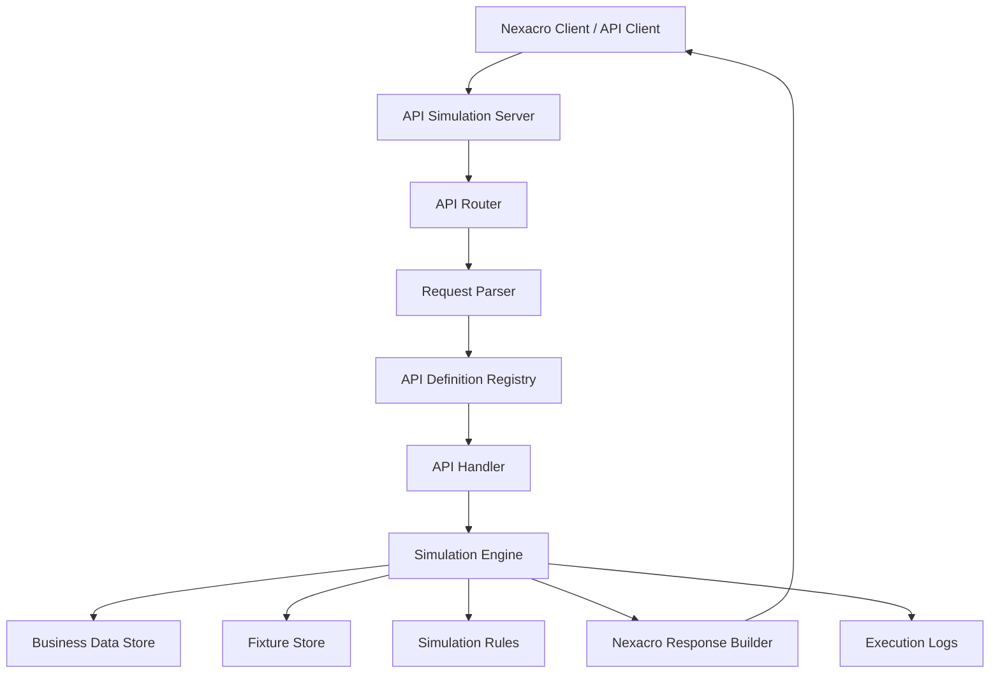
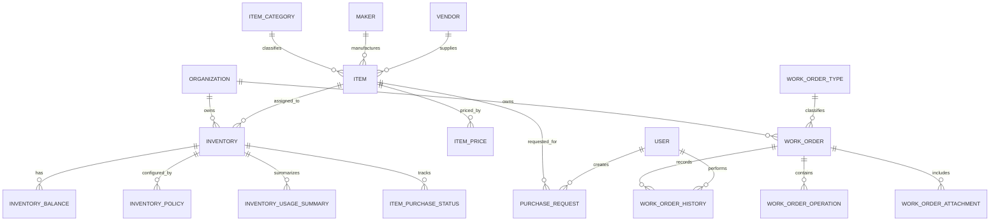
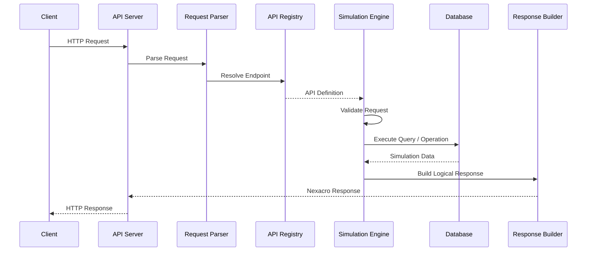

# API Simulation System
## System Requirements and Technical Specification

**Document Version:** 0.1.0  
**Status:** Initial Draft  
**Project Type:** Configuration-Driven API Simulation Platform  
**Primary Compatibility Target:** Nexacro-based EMS APIs  
**Document Language:** English

---

## 1. Introduction

### 1.1 Purpose

This document defines the requirements and technical direction for an API Simulation System.

The system will simulate existing backend APIs without requiring access to the original production backend. It will provide compatible API endpoints, accept requests, process input parameters and datasets, execute configurable simulation logic, and return responses that follow the original API structure.

The initial implementation will focus on APIs captured from the Nexacro-based EMS application.

The system must be designed for incremental expansion. New APIs, datasets, business domains, simulation rules, and test scenarios should be added primarily through configuration and data changes rather than modifications to the core engine.

### 1.2 Objectives

The system has the following objectives:

1. Reproduce the request and response behavior of captured APIs.
2. Support Nexacro-style request and response structures.
3. Maintain reusable and consistent business data.
4. Simulate API operations using database queries and business rules.
5. Support multiple datasets in a single request and response.
6. Support configurable API definitions and simulation scenarios.
7. Provide deterministic responses for testing and development.
8. Allow new APIs and business domains to be added incrementally.
9. Provide request history, execution logs, and debugging capabilities.
10. Operate independently from the original EMS backend.

### 1.3 Design Principles

| Principle | Description |
|---|---|
| Configuration-driven | API behavior should be defined through configuration wherever practical. |
| Protocol compatibility | Preserve the observed Nexacro request and response structure. |
| Data consistency | Different APIs should operate on shared business data. |
| Extensibility | New endpoints and domains should not require redesigning the core engine. |
| Separation of concerns | API definitions, business logic, simulation rules, and data storage must remain separate. |
| Reproducibility | The same request and simulation state should produce predictable results. |
| Traceability | Every API execution should be traceable through execution logs. |

---

## 2. Source Analysis and Assumptions

### 2.1 Source Material

The initial API definitions are derived from captured HTTP request and response records.

The captured data includes:

- HTTP methods and endpoint URLs.
- Request parameters.
- Request datasets.
- Dataset column definitions.
- Dataset row samples.
- Response parameters.
- Response datasets.
- HTTP response status codes.

The captured records demonstrate that the application uses POST requests for many operations, including search and data retrieval.

The response structure commonly contains `params` and `datasets`, with fields such as `errorCode` and `errorMsg`.

### 2.2 Identified API Domains

The following business domains have been identified from API names, dataset names, and sample response fields.

| Domain | Description | Examples |
|---|---|---|
| Spare Parts | Spare-part master data and related operations | Item search, stock status |
| Inventory | Inventory quantities and stock information | On-hand, allocated, available quantity |
| Stock Management | Target stock and stock optimization | Target stock search |
| Purchasing | Purchase requests and purchase-order information | Item purchase status |
| Work Orders | Work-order information and operations | Work-order search, detail, history |
| Common Data | Shared codes and dropdown data | Common-code retrieval |
| Configuration | UI-related configuration data | Grid format retrieval |
| Application Logs | Application and screen execution tracking | Start log, end log |

This classification is an initial logical grouping. It does not claim to represent the complete internal module structure of the original EMS system.

### 2.3 Observed API Examples

The following endpoints are present in the captured traces:

| API | Observed Request Dataset(s) | Observed Response Dataset(s) |
|---|---|---|
| `RetStockStatusList.lgdn` | `ds_search`, `ds_ItemInfo` | `ds_result` |
| `retrieveItemPoStatusList.lgdn` | `ds_Search` | `ds_Rtn` |
| `retrieveItemInfoDetail.lgdn` | `ds_Input` | `ds_Item`, `ds_Inv`, `ds_Summary` |
| `retrieveItem` | `ds_Search` | `ds_List` |
| `TargetStockSearchList.lgdn` | `ds_search`, `ds_ItemInfo` | `ds_StockInfomation` |
| `retrieveGridFormat` | `ds_search` | `ds_list` |
| `retComCodeList.lgdn` | Multiple input datasets | Multiple output datasets |
| `retrieveWipEntity` | `ds_input` | `ds_output` |
| `WoMasterRetInit` | `ds_info`, `ds_wo` | Multiple datasets |
| `WO230WoSaveInit` | Multiple business datasets | Multiple datasets |
| `statusHistory` | `ds_info`, `ds_input` | `ds_list` |
| `insertStartLog` | Request parameters | Response parameters |
| `updateEndLog` | Request parameters | Response parameters |

The exact column definitions and sample values must be maintained in the API catalog and fixture records.

### 2.4 Important Limitations

The captured traces are API execution records, not a complete database schema or database dump.

Therefore:

- Physical table names are not confirmed.
- Primary keys and foreign keys are not confirmed.
- Original SQL statements are not available from the traces.
- Some business relationships are inferred from API fields.
- Business validation and calculation rules require further investigation.

The proposed database model in this document is a simulation-oriented logical model, not a reconstruction of the original EMS physical database.

---

## 3. System Scope

### 3.1 Initial Scope

The first version will provide:

- HTTP API server.
- Nexacro request parser.
- Nexacro response builder.
- API endpoint registry.
- API definition management.
- Dataset definition management.
- Sample response and fixture storage.
- Basic database-backed simulation.
- Basic request filtering.
- Execution logging.
- Error response handling.

### 3.2 Future Scope

The architecture should allow future implementation of:

- Advanced business logic.
- Multi-step API workflows.
- Configurable scenario execution.
- Stateful simulation.
- Data mutation and transaction simulation.
- API version management.
- Mock user and organization management.
- API management interface.
- Import and export of API definitions.
- Automated compatibility testing.
- Request recording and replay.
- Multiple simulation environments.

### 3.3 Out of Scope for the Initial Version

The initial version does not need to:

- Connect to the original production database.
- Reproduce the original backend implementation.
- Reconstruct all original SQL statements.
- Implement every business rule immediately.
- Reproduce the entire Nexacro frontend.
- Provide a complete replacement for the EMS application.

---

## 4. System Architecture

### 4.1 High-Level Architecture



### 4.2 Core Components

| Component | Responsibility |
|---|---|
| API Server | Receives HTTP requests and returns HTTP responses. |
| API Router | Resolves incoming requests to registered API definitions. |
| Request Parser | Parses parameters and Nexacro datasets. |
| API Definition Registry | Stores and resolves endpoint configurations. |
| Dataset Engine | Validates and manipulates dataset structures. |
| Simulation Engine | Executes the configured simulation behavior. |
| API Handler | Connects an API definition to its execution logic. |
| Query Engine | Retrieves and filters business data. |
| Business Data Store | Stores shared simulation data. |
| Fixture Store | Stores predefined request and response examples. |
| Scenario Engine | Executes configurable simulation scenarios. |
| Response Builder | Constructs compatible Nexacro responses. |
| Execution Logger | Records request, execution, and response information. |

### 4.3 Architectural Requirements

- The core engine must not depend on individual API endpoint implementations.
- API definitions must be independently manageable.
- Dataset processing must be reusable across APIs.
- Business data must be shared between related endpoints.
- The response builder must support multiple response datasets.
- Simulation behavior must be replaceable or extendable without changing the HTTP server.
- The system must support adding new domains without changing existing domain implementations.

---

## 5. API Protocol Specification

### 5.1 HTTP Communication

The API server must support HTTP-based communication.

The initial compatibility target is the observed Nexacro API pattern.

| Property | Initial Requirement |
|---|---|
| Protocol | HTTP / HTTPS |
| HTTP Method | POST |
| Content Type | Configurable; must support the captured request format |
| Endpoint | Configurable API path |
| Request Body | Parameters and datasets |
| Response Body | Parameters and datasets |
| HTTP Status | Compatible with configured API behavior |

Although POST is the initial observed method, the architecture should allow additional HTTP methods in the future.

### 5.2 Request Structure

The logical request structure is:

```json
{
  "params": {
    "_ems_userId": "658359",
    "_ems_organizationId": "28753",
    "_ems_language": "EN"
  },
  "datasets": {
    "ds_search": {
      "cols": [
        "organizationId",
        "userId",
        "itemDescription"
      ],
      "count": 1,
      "rows": [
        ["28753", "658359", "Motor"]
      ]
    }
  }
}
```

This is a normalized illustration of the captured request structure. The actual HTTP serialization must be confirmed against the original client transport format.

### 5.3 Dataset Structure

A dataset consists of:

| Field | Type | Description |
|---|---|---|
| `cols` | Array of strings | Ordered column names |
| `count` | Integer | Number of rows |
| `rows` | Array of arrays | Dataset records |

Example:

```json
{
  "cols": ["item", "itemDesc", "inventoryItemId"],
  "count": 2,
  "rows": [
    ["ITEM001", "Motor", "10001"],
    ["ITEM002", "Bearing", "10002"]
  ]
}
```

The Dataset Engine must preserve column order because each row is represented as an ordered array.

The engine must also support:

- Empty datasets.
- Multiple rows.
- Multiple datasets.
- Empty values.
- Null values where supported by the source format.
- Dataset names that differ between APIs.
- Dataset schemas that contain different columns.

### 5.4 Response Structure

The logical response structure is:

```json
{
  "params": {
    "errorCode": "1",
    "errorMsg": ""
  },
  "datasets": {
    "ds_result": {
      "cols": [
        "itemName",
        "organizationId",
        "inventoryItemId",
        "itemDescription"
      ],
      "count": 1,
      "rows": [
        ["ITEM001", "28753", "10001", "Motor"]
      ]
    }
  }
}
```

The response builder must preserve:

- Response parameter names.
- Dataset names.
- Dataset column order.
- Dataset row order.
- Empty datasets.
- Multiple datasets in a single response.

The observed traces commonly use `errorCode: "1"` and an empty `errorMsg` for successful responses. The precise meaning of other error codes must be established from additional examples rather than assumed.

### 5.5 Common Parameters

The captured APIs include parameters such as:

| Parameter | Description |
|---|---|
| `_ems_userId` | User identifier |
| `_ems_organizationId` | Organization identifier |
| `_ems_language` | Language code |
| `statementName` | Statement or query identifier used by common-code retrieval |
| `comboCnt` | Number of requested combo datasets in an observed request |

These parameters should be configurable per API. They must not be hard-coded as mandatory for every endpoint.

---

## 6. API Definition Management

### 6.1 General Requirement

Each API must be registered through an API definition.

The API definition describes how the system identifies, parses, executes, and responds to an API request.

### 6.2 API Definition Structure

The proposed logical configuration is:

```json
{
  "id": "spare_parts.stock_status.search",
  "name": "Search Stock Status",
  "version": "1.0.0",
  "enabled": true,
  "endpoint": {
    "method": "POST",
    "path": "/emsspareparts/sp101/sp110Nav/RetStockStatusList.lgdn"
  },
  "request": {
    "params": [
      "_ems_userId",
      "_ems_organizationId",
      "_ems_language"
    ],
    "datasets": [
      {
        "name": "ds_search",
        "schema": "spare_parts.stock_status.search_filter"
      },
      {
        "name": "ds_ItemInfo",
        "schema": "spare_parts.item_selection"
      }
    ]
  },
  "execution": {
    "type": "handler",
    "handler": "inventory.search_stock_status"
  },
  "response": {
    "datasets": [
      {
        "name": "ds_result",
        "schema": "spare_parts.stock_status.result"
      }
    ]
  }
}
```

This is an illustrative configuration based on the observed endpoint and dataset names. It is not an exact configuration extracted from the original system.

### 6.3 Required API Definition Properties

| Property | Description |
|---|---|
| `id` | Unique API identifier |
| `name` | Human-readable API name |
| `version` | API definition version |
| `enabled` | Whether the endpoint is active |
| `endpoint` | HTTP method and path |
| `request` | Request parameter and dataset definitions |
| `execution` | Simulation execution strategy |
| `response` | Response dataset definitions |

### 6.4 Execution Types

The system should support multiple execution strategies.

| Type | Description |
|---|---|
| `fixture` | Returns a predefined response. |
| `query` | Retrieves data from the simulation database. |
| `handler` | Executes a registered business handler. |
| `scenario` | Executes a configurable scenario. |
| `composite` | Combines multiple execution operations. |

The initial implementation should prioritize `fixture`, `query`, and `handler`.

---

## 7. Dataset Definition Management

### 7.1 Purpose

Dataset definitions describe the structure of Nexacro datasets independently of individual API implementations.

A dataset definition should be reusable across multiple API endpoints.

### 7.2 Proposed Dataset Schema

```json
{
  "id": "spare_parts.stock_status.result",
  "name": "Stock Status Result",
  "version": "1.0.0",
  "columns": [
    {
      "name": "itemName",
      "type": "string"
    },
    {
      "name": "organizationId",
      "type": "string"
    },
    {
      "name": "inventoryItemId",
      "type": "string"
    },
    {
      "name": "itemDescription",
      "type": "string"
    },
    {
      "name": "onhandQuantity",
      "type": "number"
    },
    {
      "name": "availableQuantity",
      "type": "number"
    }
  ]
}
```

The example contains representative fields only. The complete column definitions must be extracted from the captured traces.

### 7.3 Dataset Requirements

- Dataset definitions must be reusable.
- Column order must be preserved.
- Column types must be configurable.
- Unknown columns must be handled according to the configured compatibility policy.
- The system must support optional and nullable columns.
- Dataset definitions must be versioned.
- API definitions must reference dataset definitions rather than duplicate schemas unnecessarily.

---

## 8. Business Data Model

### 8.1 Design Approach

The simulation database should represent shared business entities rather than storing independent response snapshots for every API.

For example, item information returned by a stock-status API should be consistent with item information returned by an item-detail API.

The database model should be organized by business domain.

### 8.2 Proposed Business Domains and Entities

The following entities are initial design proposals inferred from the API traces.

#### 8.2.1 Master Data

| Entity | Description |
|---|---|
| Organization | Organization or business unit |
| User | Application user |
| Item | Spare-part or inventory item |
| ItemCategory | Item classification |
| Maker | Manufacturer |
| Vendor | Supplier |
| UnitOfMeasure | Measurement unit |
| CatalogGroup | Item catalog grouping |

#### 8.2.2 Inventory

| Entity | Description |
|---|---|
| Inventory | Inventory item assigned to an organization |
| InventoryBalance | Inventory quantity information |
| InventoryPolicy | Stock policy and target quantities |
| InventoryUsageSummary | Usage and consumption summary |
| InventoryStatus | Inventory status and availability information |

#### 8.2.3 Purchasing

| Entity | Description |
|---|---|
| ItemPurchaseStatus | Purchasing status associated with an item |
| ItemPrice | Item pricing information |
| PurchaseRequest | Purchase request information |
| Buyer | Purchasing contact or responsible person |

#### 8.2.4 Work Orders

| Entity | Description |
|---|---|
| WorkOrder | Work-order master information |
| WorkOrderType | Work-order classification |
| WorkOrderStatus | Work-order status |
| WorkOrderHistory | Work-order status and activity history |
| WorkOrderOperation | Work-order operation details |
| WorkOrderAttachment | Work-order attachment metadata |

#### 8.2.5 Shared and System Data

| Entity | Description |
|---|---|
| CommonCode | Shared application code |
| GridFormat | UI grid configuration |
| ApiExecutionLog | API execution history |

### 8.3 Proposed Relationships

The following relationships are logical proposals and must be validated against additional API traces and business behavior.



### 8.4 Data Modeling Rules

1. Shared business entities should have a single logical source of truth.
2. Organization-specific data must retain its organization context.
3. Item identifiers must be preserved from the source API.
4. Original identifiers should not be replaced with generated identifiers without a clear mapping.
5. Relationships must be introduced only when supported by evidence or explicitly defined as simulation assumptions.
6. API response fields should be mapped to business entities through explicit mappings.
7. The database must support multiple organizations and users.

The actual primary keys, foreign keys, uniqueness constraints, and physical data types remain subject to further analysis.

---

## 9. Simulation Engine

### 9.1 Purpose

The Simulation Engine is responsible for executing API behavior.

It receives a parsed request and an API definition, performs the configured operation, and produces a logical response for the Response Builder.

### 9.2 Execution Flow



### 9.3 Simulation Behavior

The engine should support:

- Request parameter validation.
- Dataset validation.
- Dataset-to-query parameter mapping.
- Filtering.
- Sorting.
- Pagination where applicable.
- Multiple output datasets.
- Static response fixtures.
- Configurable business handlers.
- Configurable error responses.

### 9.4 Query Mapping

API definitions should be able to map request values to query parameters.

Example:

```json
{
  "execution": {
    "type": "query",
    "query": "inventory.search_stock_status",
    "parameters": {
      "organizationId": "$params._ems_organizationId",
      "itemDescription": "$datasets.ds_search[0].itemDescription"
    }
  }
}
```

The expression syntax shown here is illustrative. A formal mapping and expression specification must be defined before implementation.

### 9.5 Multiple Dataset Responses

A single API may return multiple datasets.

For example, `retrieveItemInfoDetail.lgdn` has been observed with the response datasets:

- `ds_Item`
- `ds_Inv`
- `ds_Summary`

The Simulation Engine must support this structure directly. It must not assume that one API returns only one dataset.

---

## 10. Fixture and Scenario Management

### 10.1 Fixtures

Fixtures are predefined request and response examples.

They are useful for initial compatibility testing and for APIs whose business behavior has not yet been implemented.

A fixture should contain:

- Fixture identifier.
- API identifier.
- Optional request matching criteria.
- Response parameters.
- Response datasets.
- Priority.
- Enabled status.

### 10.2 Scenarios

Scenarios define how an API behaves under specific conditions.

Examples include:

- Successful search.
- Empty search result.
- Item not found.
- Invalid request dataset.
- Multiple matching records.
- Business validation failure.
- Simulated server error.

### 10.3 Scenario Configuration Example

```json
{
  "id": "inventory.stock_status.empty_result",
  "apiId": "spare_parts.stock_status.search",
  "enabled": true,
  "match": {
    "params": {
      "_ems_organizationId": "28753"
    },
    "datasets": {
      "ds_search": {
        "itemDescription": "NO_MATCHING_ITEM"
      }
    }
  },
  "response": {
    "params": {
      "errorCode": "1",
      "errorMsg": ""
    },
    "datasets": {
      "ds_result": {
        "cols": [
          "itemName",
          "organizationId",
          "inventoryItemId",
          "itemDescription"
        ],
        "count": 0,
        "rows": []
      }
    }
  }
}
```

This is an illustrative simulation scenario, not an observed production response.

### 10.4 Scenario Requirements

- Multiple scenarios may exist for one API.
- Scenario matching must be deterministic.
- Scenario priority must be configurable.
- Scenarios must be enabled or disabled independently.
- Scenario definitions must be versioned.
- The system should support both fixture-based and database-backed execution.

---

## 11. Proposed Database Structure

The database should separate business data from simulation configuration.

### 11.1 Business Data Tables

Initial proposed tables:

```text
organizations
users

items
item_categories
makers
vendors
units_of_measure
catalog_groups

inventories
inventory_balances
inventory_policies
inventory_usage_summaries
inventory_statuses

item_purchase_statuses
item_prices
purchase_requests

work_orders
work_order_types
work_order_statuses
work_order_histories
work_order_operations
work_order_attachments

common_codes
grid_formats
```

### 11.2 Simulation Configuration Tables

```text
api_definitions
api_dataset_mappings
dataset_definitions
dataset_columns

api_fixtures
api_scenarios
api_behavior_rules

api_execution_logs
```

### 11.3 Table Responsibilities

| Table | Responsibility |
|---|---|
| `api_definitions` | Stores endpoint definitions and execution configuration. |
| `dataset_definitions` | Stores reusable dataset schemas. |
| `dataset_columns` | Stores ordered dataset column metadata. |
| `api_dataset_mappings` | Maps API datasets to logical dataset definitions. |
| `api_fixtures` | Stores predefined API responses. |
| `api_scenarios` | Stores scenario matching and response configuration. |
| `api_behavior_rules` | Stores configurable simulation rules. |
| `api_execution_logs` | Stores API execution history. |

This is an initial logical table inventory. Exact columns, constraints, indexes, and physical types will be defined in a separate database specification after the API catalog and entity relationships are validated.

---

## 12. Execution Logging and Monitoring

### 12.1 Requirements

The system must record API execution information for debugging and compatibility analysis.

Each execution record should include:

- Execution ID.
- API definition ID.
- HTTP method.
- Request path.
- Request timestamp.
- Response timestamp.
- HTTP status.
- Execution duration.
- Execution result.
- Error information.
- Scenario or fixture used, if applicable.

### 12.2 Logging Policy

The system should support configurable logging levels:

- Metadata only.
- Request and response metadata.
- Full request and response payload.

Sensitive information should be masked or excluded according to configuration.

### 12.3 Application Log Compatibility

The captured application also includes APIs such as:

- `insertStartLog`
- `updateEndLog`

These should be treated as separate compatibility endpoints. They should not be confused with the internal execution logging mechanism of the simulation server.

---

## 13. API Management

The system should eventually provide a management interface for maintaining simulation definitions.

### 13.1 API Management Features

- Create and update API definitions.
- Enable and disable endpoints.
- Manage endpoint paths and HTTP methods.
- View request and response schemas.
- Manage dataset definitions.
- Manage fixtures.
- Manage simulation scenarios.
- Test APIs manually.
- Inspect execution logs.
- Import and export configuration.

### 13.2 Configuration Management

Configuration should be independently versioned.

Changing an API definition must not unintentionally modify business data.

The system should support restoring a previous configuration version.

---

## 14. Non-Functional Requirements

| Category | Requirement |
|---|---|
| Extensibility | New APIs and domains can be added without redesigning the core engine. |
| Maintainability | API definitions, datasets, and business logic are separated. |
| Compatibility | Response structures preserve observed Nexacro dataset semantics. |
| Performance | Support efficient filtering and retrieval for test datasets. |
| Reliability | Invalid requests must produce controlled responses. |
| Observability | API executions must be traceable. |
| Data Integrity | Shared business data must remain consistent across APIs. |
| Testability | API definitions and scenarios must be independently testable. |
| Portability | The simulation system must run independently of the original EMS backend. |
| Security | Administrative operations and sensitive logs must be protected. |

Specific performance targets, concurrency limits, and deployment requirements will be defined in a later version.

---

## 15. Implementation Roadmap

The implementation should proceed incrementally.

### Phase 1 — API Compatibility Foundation

- Build the HTTP server.
- Implement endpoint registration.
- Implement request parsing.
- Implement Nexacro dataset handling.
- Implement response generation.
- Register a small set of captured APIs.
- Add fixture-based responses.
- Add execution logging.

**Deliverable:** A working API simulator capable of reproducing selected captured requests and responses.

### Phase 2 — API Catalog and Dataset Management

- Extract all unique endpoints from the YAML traces.
- Identify request parameters.
- Identify request and response datasets.
- Extract dataset columns and sample records.
- Deduplicate reusable dataset definitions.
- Create an API catalog.
- Create dataset configuration management.

**Deliverable:** A structured catalog of the captured APIs and their dataset schemas.

### Phase 3 — Master Data and Inventory Simulation

- Implement organization data.
- Implement user data.
- Implement item master data.
- Implement inventory data.
- Implement stock balance queries.
- Implement stock-status APIs.
- Implement item-detail APIs.

**Deliverable:** Database-backed simulation for the initial Spare Parts and Inventory domains.

### Phase 4 — Purchasing and Work Order Simulation

- Implement purchasing-related entities.
- Implement purchase status queries.
- Implement work-order entities.
- Implement work-order search and detail.
- Implement work-order history.
- Implement common-code retrieval.

**Deliverable:** Expanded simulation across the Purchasing and Work Order domains.

### Phase 5 — Scenario Engine

- Implement scenario matching.
- Implement configurable behavior rules.
- Implement success and error scenarios.
- Implement stateful operations where required.
- Implement deterministic scenario execution.

**Deliverable:** A configurable simulation environment for different test cases.

### Phase 6 — Management Interface

- API definition management.
- Dataset management.
- Fixture management.
- Scenario management.
- Execution history.
- Manual API testing.

**Deliverable:** A manageable API Simulation Platform.

---

## 16. Initial Acceptance Criteria

The initial version is considered functional when:

1. The server can receive requests using registered endpoint paths.
2. The server can parse request parameters and datasets.
3. Dataset column order and row values are preserved.
4. The server can return multiple datasets in one response.
5. The server can return predefined fixtures.
6. Unknown endpoints are handled consistently.
7. Invalid requests produce controlled errors.
8. API executions are recorded.
9. API definitions can be added without modifying the HTTP server.
10. At least one captured inventory API can be reproduced using the original request and expected response structure.

Compatibility testing must compare the simulator output with the captured response structure, including parameter names, dataset names, column order, row counts, and values where deterministic.

---

## 17. Open Questions and Future Analysis

The following items require additional investigation.

| Topic | Required Investigation |
|---|---|
| Complete API inventory | Extract and deduplicate every endpoint in the source file. |
| Request format | Confirm the exact HTTP serialization used by the Nexacro client. |
| Dataset types | Identify data types, nullable values, and default values. |
| Database structure | Identify actual entities, keys, and relationships where evidence is available. |
| Business rules | Determine filtering, calculation, and validation behavior. |
| Error handling | Collect examples of unsuccessful responses and error codes. |
| Stateful APIs | Identify APIs that create or update business data. |
| Authentication | Determine whether authentication needs to be simulated. |
| Organization context | Determine how organization-specific data is selected. |
| Language support | Identify how response values change according to `_ems_language`. |
| Pagination | Determine whether APIs use pagination or return complete datasets. |
| Transactions | Determine whether multiple operations require transaction-like behavior. |

These topics should be resolved progressively as more API traces and business information become available.

---

## 18. Extensibility Strategy

The system must be designed as a reusable API simulation platform rather than a collection of hard-coded mock endpoints.

Future extensions should follow these rules:

1. New endpoints should be registered through API definitions.
2. New dataset structures should be registered through dataset definitions.
3. New business domains should be introduced as independent modules.
4. New execution strategies should be implemented as extensions of the Simulation Engine.
5. Business data should be reused across related APIs.
6. Fixtures should remain independent of business database records.
7. Scenario definitions should remain independent of endpoint implementation.
8. Existing API behavior should remain stable unless explicitly versioned or changed.

The architecture should support gradual migration from static fixtures to database-backed simulation and then to more complete business behavior.

---

## 19. Conclusion

The API Simulation System will provide a configurable environment for reproducing and testing APIs captured from the Nexacro-based EMS application.

The initial focus is protocol compatibility, endpoint registration, dataset processing, fixture-based responses, and a structured API catalog.

The next stage will introduce shared business data and database-backed simulation, beginning with Spare Parts and Inventory before expanding into Purchasing, Work Orders, Common Data, and additional domains.

The core architecture must remain independent of individual API implementations so that future APIs, datasets, business rules, and simulation scenarios can be added incrementally.

**This document defines the initial system direction. Detailed API specifications, complete database schemas, and business behavior definitions will be maintained as separate documents and added progressively.**