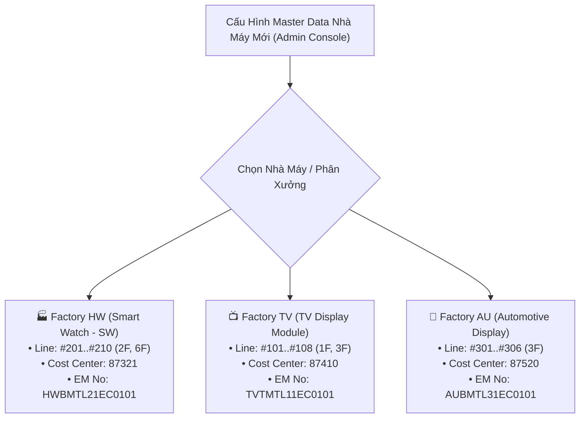

# 01. Cơ Cấu Tổ Chức, Nhà Xưởng & Phân Định Pháp Nhân
> *Chuẩn hóa thực tế: Factory HW = Smart Watch (SW), Cấu trúc Team => Part => Kỹ Sư (Không có trường công đoạn, Kỹ sư ngang hàng), Cost Management (Reviewer & Assistant là 1 người), và Phê duyệt trên EMS*

---

## 1. Cơ Cấu Tổ Chức Nhà Máy & Phân Cấp Nội Bộ (Team => Part => Kỹ Sư)

Hệ thống phục vụ trực tiếp cho hoạt động quản lý phụ tùng tại **Factory HW** (Display Module Plant 1 - Org ID: 28753), trong đó **Factory HW chính là toàn bộ ngành sản xuất Smart Watch (SW)**:

$$\mathbf{Factory\ HW} = \mathbf{Ng\grave{a}nh\ Smart\ Watch\ (SW)}$$

*(Công ty có thể có các nhà máy khác phụ trách các ngành hàng khác như TV, Màn hình ô tô Auto Display...)*.

```
Tập Đoàn / Công Ty (Nhiều Pháp Nhân & Nhiều Nhà Máy)
 └── Factory HW = Smart Watch (SW) (Display Module Plant 1 - Org: 28753)
       │
       ├── Cost Management Team (Bộ Phận Quản Lý Chi Phí)
       │     ├── Nhân sự: Reviewer & Assistant LÀ 1 NGƯỜI DUY NHẤT (Quản lý chi phí, không phải lãnh đạo)
       │     ├── Thời điểm: Thẩm định chi phí và kiểm thảo giải trình tồn kho ĐẦU MỖI THÁNG (Offline)
       │     └── Vai trò: Kiểm soát hạn mức ngân sách SG, yêu cầu thêm thông tin giải trình qua LEC, duyệt chính thức trên EMS
       │
       ├── Team Requestor (Ví dụ: PO Module Technology Team 2 - Mã BP: 87321)
       │     │
       │     ├── Nhóm LEC Trong Team (Multi-LEC: Pham Duc Long - 658359 cùng các đồng sự)
       │     │     ├── Bản chất: Kỹ sư quản trị thiết bị thuộc ngay trong Team
       │     │     ├── Nhiệm vụ: Gom đơn cùng trạng thái, quản lý mã EM No 14 ký tự, mở Interlock
       │     │     ├── Cầu nối thông tin: Tiếp nhận yêu cầu bổ sung từ Reviewer -> gửi Kỹ sư -> gửi lại Reviewer
       │     │     ├── Kiểm soát tiến độ: Cập nhật thủ công tiến độ nhập hàng, theo dõi RFQ Purchase
       │     │     └── Nhập budget thủ công hàng tháng (TUYỆT ĐỐI KHÔNG CỘNG DỒN SỐ DƯ)
       │     │
       │     └── Part (Phân ban / Bộ phận trong Team - ví dụ: CP/SG Part 1)
       │           │
       │           └── Các Kỹ Sư Hiện Trường (NGANG HÀNG NHAU - KHÔNG PHÂN CHIA CÔNG ĐOẠN)
       │                 ├── Không có trường công đoạn (loại bỏ POL, TAB, DIP... và không có Process Leader)
       │                 ├── Làm việc trực tiếp với TÊN Machine, Line, Assembly thân thiện
       │                 ├── Chuẩn bị dữ liệu (Upload folder bản vẽ/catalog) để LEC đăng ký QCode
       │                 └── Nộp Task giải trình tồn kho chưa dùng phục vụ kiểm thảo đầu tháng
       │
       └── Bộ Phận Mua Hàng Ngoài (Purchase Dept)
             └── Đơn vị thương mại chuyên trách: Đàm phán giá độc lập với nhà cung cấp ngoài (ServeOne, SMC, Trumpf...)
```

---

## 2. Vị Trí & Vai Trò Của Nhóm LEC Trong Team (Hỗ Trợ Nhiều Nhân Sự LEC)

- **Team có thể tạo và phân quyền cho Nhiều LEC (Multi-LEC)**:
  - LEC không phải là một phòng ban xa lạ bên ngoài, mà trực thuộc ngay trong Team (ví dụ: `PO Module Technology Team 2`).
  - Hệ thống cho phép cấu hình **nhiều nhân sự LEC cùng phụ trách trong Team** (ví dụ: Pham Duc Long - User ID: 658359 cùng các đồng sự LEC khác).
  - Phân công linh hoạt: Có thể phân chia theo Part (LEC phụ trách CP/SG Part 1, LEC phụ trách CP/SG Part 2), hoặc cùng chia sẻ danh sách xử lý chung để san sẻ khối lượng công việc, không phụ thuộc vào một cá nhân duy nhất.
- **Trách nhiệm cốt lõi của nhóm LEC**:
  - Gom và kiểm tra các hạng mục đăng ký từ các kỹ sư trong Team.
  - Chuẩn hóa thông số kỹ thuật, quản lý dải mã tạm `TMP-HW-xxxx`.
  - Phối hợp với bộ phận `Purchase` theo dõi trạng thái báo giá RFQ.
  - Điều phối quy trình Interlock tuần tự (Ưu tiên xuất dùng tồn kho của Team bạn trong xưởng, Transfer liên pháp nhân, Mở khóa mua thường).
  - Xuất báo cáo giải trình tồn kho và chi phí ra **file Excel form cố định** để họp thẩm định đầu tháng với Cost Management.
  - **Cầu nối 3 bên**: Tiếp nhận yêu cầu bổ sung thông tin từ Reviewer Cost Management $\rightarrow$ nhập hệ thống gửi Kỹ sư $\rightarrow$ nhận phản hồi Kỹ sư $\rightarrow$ gửi lại Reviewer.
  - Cập nhật thủ công tiến độ nhập hàng khi phụ tùng về xưởng.

---

## 3. Phân Cấp Thiết Bị Kỹ Thuật (EBOM Core Hierarchy)

Cấu trúc định danh máy móc thiết bị gắn chặt với phân cấp tổ chức mà **không cần trường công đoạn**:

$$\mathbf{Machine\ (M\acute{a}y)} \longrightarrow \mathbf{Unit\ (C\text{ụ}m\ m\acute{a}y)} \longrightarrow \mathbf{Line\ (D\hat{a}y\ chuy\text{ề}n)}$$

*   **Vị trí sản xuất Smart Watch tại Factory HW**:
    - **Tòa nhà (Building)**: H1, H2, H3.
    - **Tầng (Floor)**: 2F, 6F... (Quy tắc tự động: `Left(Line, 1) = Floor`).
    - **Dây chuyền (Line)**: `#201 ~ #210` (Tầng 2F), `#601, #604` (Tầng 6F).
    - **Model sản phẩm Smart Watch**: D111, D222, D333.
*   **Machine & Unit**: Mỗi máy trên line (ví dụ máy gắn chip `DB-01`) chia thành các cụm cơ cấu chức năng (`Bonding Head Unit`, `Feeder Unit`), nơi lắp đặt các linh kiện phụ tùng cụ thể.

---

## 4. Bản Chất Các Nhánh Giao Dịch Tồn Kho & Điều Chuyển

Hệ thống phân biệt rõ ràng các phạm vi giao dịch:
1.  **Nội bộ nhà máy (Intra-Plant / Cross-Team Transfer)**:
    - Khi có cảnh báo `agingInterlockFlag == 'Y'`, đây có thể là **tồn kho nhàn rỗi của Team khác trong cùng nhà máy HW**.
    - **Quy tắc vàng**: **Cần xuất sử dụng tồn kho này trước khi mua mới!** Không yêu cầu Kỹ sư phải giải trình vì đây là tồn của Team bạn, mà ưu tiên làm thủ tục điều chuyển nội bộ xưởng.
2.  **Liên pháp nhân (Different Legal Entities)**:
    - Các giao dịch qua API `/emsspareparts/sp40/sp401Nav/retPartsTransferReqList.lgdn` và `retOtherSitePoRevReqList.lgdn` là với **các pháp nhân độc lập trong tập đoàn** (LGD Hàn Quốc, LGD Nam Kinh, LGD Quảng Châu...).
    - Gồm 2 phương thức rõ ràng:
        - **Phương án 1: Chuyển giao tồn kho (Inventory Transfer)**: Lấy linh kiện tồn kho nhàn rỗi từ pháp nhân bạn chuyển về xưởng.
        - **Phương án 2: Mua với giá thấp nhất từ pháp nhân khác**: Tận dụng hợp đồng/đơn giá ưu đãi của pháp nhân liên kết nếu giá mua qua bên đó thấp hơn.
    - **Nguyên tắc vận hành**: Nếu bị khóa: chuyển trạng thái **Chờ pháp nhân khác xác nhận (Pending External Entity Confirmation)** với SLA 48h. Cả 2 phương án đều **BẮT BUỘC DIỄN RA SAU KHI THẨM ĐỊNH ĐẦU THÁNG PHÊ DUYỆT TRÊN EMS**.

---

## 5. Kiến Trúc Cấu Hình Đa Nhà Máy / Đa Phân Hệ (Multi-Plant / Multi-Team Scalability)

Toàn bộ hệ thống được thiết kế theo mô hình **Tham Số Hóa Master Data (Parametric Hierarchy Model)**, cho phép **áp dụng tức thì cho các Team khác hoặc Nhà máy khác** trong tập đoàn (Factory TV, Automotive Display, IT Monitor...) mà không cần lập trình lại:



### Các tham số cấu hình động độc lập theo từng Team / Nhà máy:
- **`plant_code` & `plant_name`**: Mã và tên nhà máy (`HW`, `TV`, `AU`).
- **`budget_profile`**: Hạn mức ngân sách tháng độc lập, mã Cost Center và GL Account riêng.
- **`lec_roster`**: Danh sách tài khoản Multi-LEC phụ trách phân xưởng đó.
- **`ebom_schema`**: Quy tắc phân rã cây máy theo chủng loại sản phẩm.
