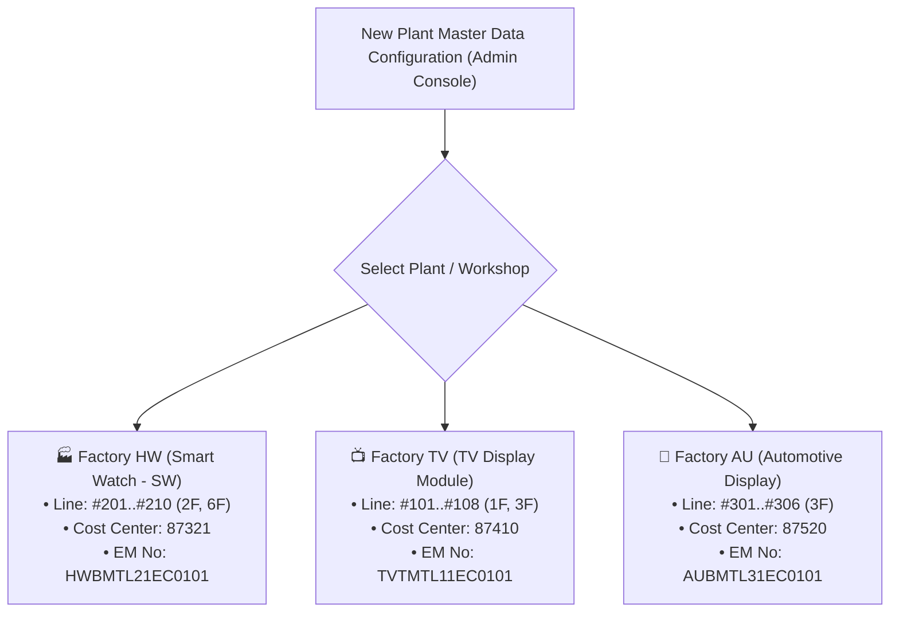

# 01. Organizational Structure, Plant Hierarchy & Legal Entity Delineation
> *Operational Reality Standardization: Factory HW = Smart Watch (SW), Structure: Team => Part => Engineers (No process/stage field, Peer Engineers), Cost Management (Reviewer & Assistant is 1 single person), and Approval executed on EMS*

---

## 1. Plant Organizational Structure & Internal Hierarchy (Team => Part => Engineers)

The system directly serves spare parts management operations at **Factory HW** (Display Module Plant 1 - Org ID: 28753), where **Factory HW represents the entire Smart Watch (SW) production division**:

$$\mathbf{Factory\ HW} = \mathbf{Smart\ Watch\ (SW)\ Division}$$

*(The company may have other manufacturing plants handling different product categories such as TV, Automotive Display, etc.)*.

```
Corporation / Company (Multiple Legal Entities & Multiple Plants)
 └── Factory HW = Smart Watch (SW) (Display Module Plant 1 - Org: 28753)
       │
       ├── Cost Management Team
       │     ├── Personnel: Reviewer & Assistant IS 1 SINGLE PERSON (Cost manager, not executive leadership)
       │     ├── Timing: Beginning-of-Month cost review/audit and idle inventory justification review (Offline)
       │     └── Role: Control SG budget quota, request clarification via LEC, execute official approval on EMS
       │
       ├── Requestor Team (e.g., PO Module Technology Team 2 - Dept Code: 87321)
       │     │
       │     ├── LEC Group Within Team (Multi-LEC: Pham Duc Long - 658359 and peers)
       │     │     ├── Nature: Equipment management engineers embedded directly within the Team
       │     │     ├── Tasks: Aggregate requisitions with identical status, manage 14-character EM No, release Interlock
       │     │     ├── Communication bridge: Receive clarification requests from Reviewer -> forward to Engineers -> return to Reviewer
       │     │     ├── Progress tracking: Manually update receiving progress, monitor Purchase RFQs
       │     │     └── Monthly manual budget entry (STRICTLY NO BUDGET ROLLOVER)
       │     │
       │     └── Part (Section / Subdivision within Team - e.g., CP/SG Part 1)
       │           │
       │           └── Field Engineers (PEER ENGINEERS - NO PROCESS/STAGE DIVISION)
       │                 ├── No process field (eliminated POL, TAB, DIP... and no Process Leader)
       │                 ├── Work directly with user-friendly Machine, Line, and Assembly names
       │                 ├── Data preparation (Upload drawing/catalog folder) for LEC to register QCode
       │                 └── Submit idle inventory justification tasks for beginning-of-month review
       │
       └── External Purchasing Department (Purchase Dept)
             └── Specialized commercial procurement unit: Negotiates pricing independently with external vendors (ServeOne, SMC, Trumpf...)
```

---

## 2. Position & Role of the LEC Group Within the Team (Multi-LEC Support)

- **Team can configure and authorize Multi-LEC**:
  - The LEC is not an external unfamiliar department, but is embedded directly within the Team (e.g., `PO Module Technology Team 2`).
  - The system supports configuring **multiple LEC personnel in charge within the Team** (e.g., Pham Duc Long - User ID: 658359 along with other LEC colleagues).
  - Flexible assignment: Can be divided by Part (LEC in charge of CP/SG Part 1, LEC in charge of CP/SG Part 2), or share a common work queue to distribute workload without single-person dependency.
- **Core responsibilities of the LEC group**:
  - Aggregate and review registered items from engineers within the Team.
  - Standardize technical specifications, manage temporary code range `TMP-HW-xxxx`.
  - Coordinate with the `Purchase` department to monitor RFQ quotation status.
  - Coordinate sequential Interlock workflow (Prioritize borrowing/using peer team idle stock within the plant, Cross-legal-entity transfer, Unlock standard purchase).
  - Export inventory justification and cost reports to **fixed-format Excel templates** for beginning-of-month audit meetings with Cost Management.
  - **3-Party Bridge**: Receive clarification requests from Cost Management Reviewer $\rightarrow$ input into system to send to Engineer $\rightarrow$ receive Engineer response $\rightarrow$ return to Reviewer.
  - Manually update receiving/inbound progress when spare parts arrive at the plant.

---

## 3. Technical Equipment Hierarchy (EBOM Core Hierarchy)

The machine equipment identification structure is tightly coupled with organizational hierarchy **without requiring a process field**:

$$\mathbf{Machine} \longrightarrow \mathbf{Unit\ (Assembly)} \longrightarrow \mathbf{Line}$$

*   **Smart Watch production location at Factory HW**:
    - **Building**: H1, H2, H3.
    - **Floor**: 2F, 6F... (Automated rule: `Left(Line, 1) = Floor`).
    - **Line**: `#201 ~ #210` (Floor 2F), `#601, #604` (Floor 6F).
    - **Smart Watch product model**: D111, D222, D333.
*   **Machine & Unit**: Each machine on the line (e.g., chip mounting machine `DB-01`) is divided into functional mechanism units (`Bonding Head Unit`, `Feeder Unit`), where specific spare parts are installed.

---

## 4. Nature of Inventory Transaction Branches & Transfers

The system clearly distinguishes transaction scopes:
1.  **Intra-Plant / Cross-Team Transfer**:
    - When warning `agingInterlockFlag == 'Y'` occurs, this may be **idle stock belonging to another Team in the same HW plant**.
    - **Golden Rule**: **Must issue and use this stock before purchasing new!** Engineers are not required to provide aging justifications since this is a peer team's stock; instead, prioritize intra-plant inter-team transfer procedures.
2.  **Cross-Legal-Entity (Different Legal Entities)**:
    - Transactions via API `/emsspareparts/sp40/sp401Nav/retPartsTransferReqList.lgdn` and `retOtherSitePoRevReqList.lgdn` are with **independent legal entities within the corporation** (LGD Korea, LGD Nanjing, LGD Guangzhou, etc.).
    - Includes 2 distinct methods:
        - **Option 1: Inventory Transfer**: Transfer idle spare parts from peer legal entity to the plant.
        - **Option 2: Lowest Price Purchase from Peer Entity**: Leverage preferential contracts/unit pricing of affiliated entities if purchasing through them is cheaper.
    - **Operational principle**: If locked: transition status to **Pending External Entity Confirmation** with 48h SLA. Both options **MUST TAKE PLACE AFTER BEGINNING-OF-MONTH AUDIT APPROVAL ON EMS**.

---

## 5. Multi-Plant / Multi-Team Scalability Configuration Architecture

The entire system is designed according to a **Parametric Hierarchy Model**, allowing **instant rollout to other Teams or Plants** within the corporation (Factory TV, Automotive Display, IT Monitor...) without rewriting code:



### Dynamic configuration parameters independent per Team / Plant:
- **`plant_code` & `plant_name`**: Plant code and name (`HW`, `TV`, `AU`).
- **`budget_profile`**: Independent monthly budget limit, dedicated Cost Center and GL Account.
- **`lec_roster`**: List of Multi-LEC accounts managing that plant/workshop.
- **`ebom_schema`**: Equipment tree breakdown rules by product family.
