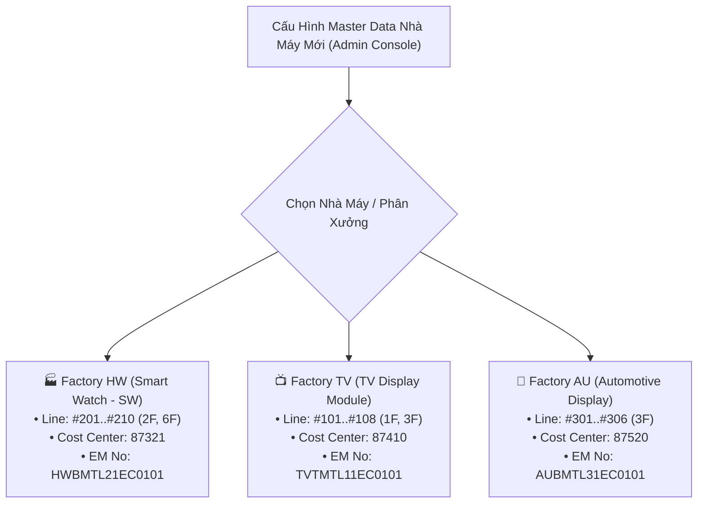

# 01. Cơ Cấu Tổ Chức, Nhà Xưởng & Phân Định Pháp Nhân
> *Cập nhật chuẩn hóa: Factory HW = Smart Watch (SW), phân cấp Team => Part => Process, và vị trí của LEC trong Team*

---

## 1. Cơ Cấu Tổ Chức Nhà Máy & Phân Cấp Nội Bộ (Team => Part => Process)

Hệ thống phục vụ trực tiếp cho hoạt động quản lý phụ tùng tại **Factory HW** (Display Module Plant 1 - Org ID: 28753), trong đó **Factory HW chính là toàn bộ ngành sản xuất Smart Watch (SW)**:

$$\mathbf{Factory\ HW} = \mathbf{Ng\grave{a}nh\ Smart\ Watch\ (SW)}$$

*(Công ty có thể có các nhà máy khác phụ trách các ngành hàng khác như TV, Màn hình ô tô Auto Display...)*.

```
Tập Đoàn / Công Ty (Nhiều Pháp Nhân & Nhiều Nhà Máy)
 └── Factory HW = Smart Watch (SW) (Display Module Plant 1 - Org: 28753)
       │
       ├── Team Management (Ban Lãnh Đạo / Quản Lý Nhà Máy)
       │     ├── Reviewer (Quản lý cấp cao duyệt PRV, Budget)
       │     ├── Assistant (Trợ lý điều phối, theo dõi tiến độ)
       │     └── Cơ chế: Tạm thời CHƯA đưa vào hệ thống, thẩm định OFFLINE hàng tháng
       │
       ├── Team (Ví dụ: PO Module Technology Team 2 - Mã BP: 87321)
       │     │
       │     ├── LEC (Quản Lý Spare Parts Trong Team)
       │     │     ├── Bản chất: Là 1 người hoặc 1 nhóm người chuyên trách TRONG TEAM
       │     │     ├── Đại diện phụ trách: Pham Duc Long (User ID: 658359)
       │     │     └── Vai trò: Xử lý các hạng mục từ kỹ sư, gửi request báo giá sang Purchase,
       │     │                  thẩm định kỹ thuật, mở Interlock, chốt đơn mua tháng và lên PO
       │     │
       │     └── Part (Phân ban / Bộ phận trong Team - ví dụ: CP/SG Part 1)
       │           │
       │           └── Process (Các công đoạn sản xuất trong Part):
       │                 ├── POL (Polarizer - Dán phim phân cực)
       │                 ├── TAB (Tape Automated Bonding - Ép vi mạch màng dẻo)
       │                 ├── DIP (Dual In-line Package / Hàn nhúng chân cắm)
       │                 ├── LT  (Laser Trimming / Low Temperature Process)
       │                 ├── DB  (Die Bonding - Gắn chip bán dẫn)
       │                 └── BD  (Wire/Ball Bonding - Đấu nối dây vi mạch)
       │                 │
       │                 ├── Process Leaders: Quản lý kỹ thuật và giám sát mua sắm của công đoạn
       │                 └── Engineer Process: Kỹ sư trực tiếp vận hành máy (NGƯỜI TẠO HẠNG MỤC MUA)
       │
       └── Bộ Phận Mua Hàng Ngoài (Purchase Dept)
             └── Đơn vị thương mại chuyên trách: Đàm phán giá với nhà cung cấp ngoài (ServeOne, SMC, Trumpf...)
```

---

## 2. Vị Trí & Vai Trò Của Nhóm LEC Trong Team (Hỗ Trợ Nhiều Nhân Sự LEC)

- **Team có thể tạo và phân quyền cho Nhiều LEC (Multi-LEC)**:
  - LEC không phải là một phòng ban xa lạ bên ngoài, mà trực thuộc ngay trong Team (ví dụ: `PO Module Technology Team 2`).
  - Hệ thống cho phép cấu hình **nhiều nhân sự LEC cùng phụ trách trong Team** (ví dụ: Pham Duc Long - User ID: 658359 cùng các đồng sự LEC khác).
  - Phân công linh hoạt: Có thể phân chia theo Part (LEC phụ trách CP/SG Part 1, LEC phụ trách CP/SG Part 2), theo công đoạn (POL, TAB, DIP, LT, DB, BD), hoặc cùng chia sẻ danh sách xử lý chung để san sẻ khối lượng công việc, không phụ thuộc vào một cá nhân duy nhất.
- **Trách nhiệm cốt lõi của nhóm LEC**:
  - Gom và kiểm tra các hạng mục đăng ký từ các `Engineer Process` trong Team.
  - Chuẩn hóa thông số kỹ thuật, quản lý dải mã tạm `TMP-HW-xxxx`.
  - Phối hợp với bộ phận `Purchase` đàm phán giá.
  - Điều phối quy trình Interlock tuần tự (Transfer, Mua qua pháp nhân khác, Mở khóa mua thường).
  - Xuất báo cáo giải trình tồn kho và kiểm thảo định kỳ hàng tháng ra **file Excel form cố định** để họp thẩm định với Team Management.
  - Thao tác tạo đơn trên hệ thống EMS, sau đó quay lại nhập mã PRV/PO để hệ thống đồng bộ trạng thái.

---

## 3. Phân Cấp Thiết Bị Kỹ Thuật (EBOM Core Hierarchy)

Cấu trúc định danh máy móc thiết bị gắn chặt với phân cấp tổ chức:

$$\mathbf{Process\ (C\hat{o}ng\ \text{đ}o\text{ạ}n)} \longrightarrow \mathbf{Machine\ (M\acute{a}y)} \longrightarrow \mathbf{Unit\ (C\text{ụ}m\ m\acute{a}y)} \longrightarrow \mathbf{Line\ (D\hat{a}y\ chuy\text{ề}n)}$$

*   **Vị trí sản xuất Smart Watch tại Factory HW**:
    - **Tòa nhà (Building)**: H1, H2, H3.
    - **Tầng (Floor)**: 2F, 6F... (Quy tắc tự động: `Left(Line, 1) = Floor`).
    - **Dây chuyền (Line)**: `#201 ~ #210` (Tầng 2F), `#601, #604` (Tầng 6F).
    - **Model sản phẩm Smart Watch**: D111, D222, D333.
*   **Machine & Unit**: Mỗi máy trên line (ví dụ máy gắn chip `DB-01`) chia thành các cụm cơ cấu chức năng (`Bonding Head Unit`, `Feeder Unit`), nơi lắp đặt các linh kiện phụ tùng cụ thể.

---

## 4. Bản Chất Hai Nhánh Giao Dịch Liên Pháp Nhân (Inter-Entity Transactions)

Hệ thống phân biệt rõ ràng các phạm vi giao dịch:
1.  **Nội bộ nhà máy (Intra-Plant / Same Entity)**: Điều chuyển phụ tùng giữa các kho H1, H2, H3 trong cùng một nhà máy.
2.  **Liên pháp nhân (Different Legal Entities)**:
    *   Các giao dịch qua API `/emsspareparts/sp40/sp401Nav/retPartsTransferReqList.lgdn` và `retOtherSitePoRevReqList.lgdn` là với **các pháp nhân độc lập trong tập đoàn** (LGD Hàn Quốc, LGD Nam Kinh, LGD Quảng Châu...).
    *   Gồm 2 phương thức rõ ràng:
        - **Phương án 1: Chuyển giao tồn kho (Inventory Transfer)**: Lấy linh kiện tồn kho nhàn rỗi từ pháp nhân bạn chuyển về xưởng.
        - **Phương án 2: Mua với giá thấp nhất từ pháp nhân khác**: Pháp nhân bạn có hợp đồng giá rẻ hơn $\rightarrow$ mua ủy thác qua pháp nhân đó.
    *   **Nguyên tắc vận hành**: Nếu bị khóa: chuyển trạng thái **Chờ pháp nhân khác xác nhận (Pending External Entity Confirmation)** với SLA 48h. Cả 2 phương án đều **BẮT BUỘC DIỄN RA SAU KHI THẨM ĐỊNH NGÀY 25 PHÊ DUYỆT**.

---

## 5. Kiến Trúc Cấu Hình Đa Nhà Máy / Đa Phân Hệ (Multi-Plant / Multi-Team Scalability)

Toàn bộ hệ thống được thiết kế theo mô hình **Tham Số Hóa Master Data (Parametric Hierarchy Model)**, cho phép **áp dụng tức thì cho các Team khác hoặc Nhà máy khác** trong tập đoàn (Factory TV, Automotive Display, IT Monitor...) mà không cần lập trình lại:



### Các tham số cấu hình động độc lập theo từng Team / Nhà máy:
- **`plant_code` & `plant_name`**: Mã và tên nhà máy (`HW`, `TV`, `AU`).
- **`process_list`**: Danh mục công đoạn đặc thù của nhà máy đó (ví dụ TV có thêm công đoạn `BLU - Backlight Unit`, `OPEN_CELL`).
- **`budget_profile`**: Hạn mức ngân sách tháng độc lập, mã Cost Center và GL Account riêng.
- **`lec_roster`**: Danh sách tài khoản Multi-LEC phụ trách phân xưởng đó.
- **`ebom_schema`**: Quy tắc phân rã cây máy theo chủng loại sản phẩm.

