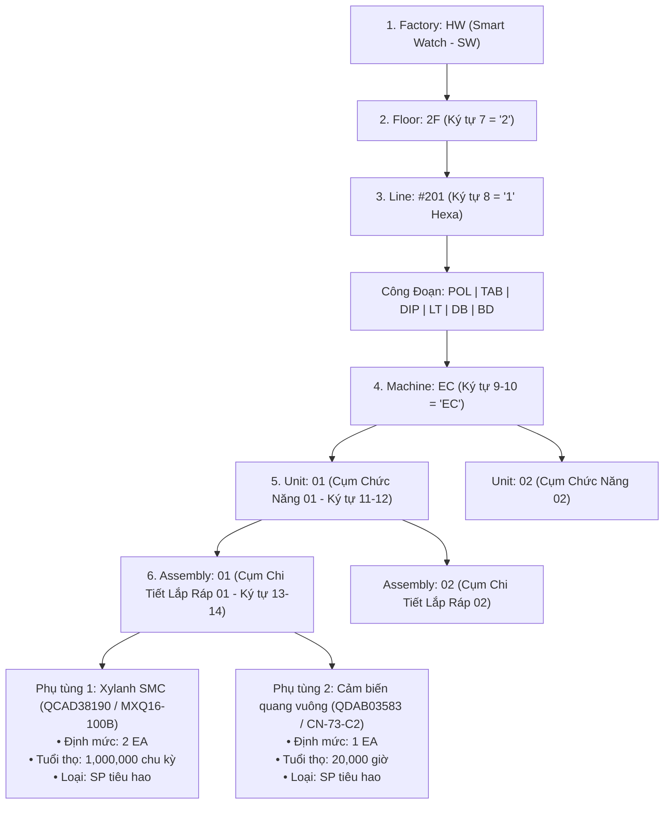

# 02. Cấu Trúc Cây Thiết Bị EBOM & Giải Mã Số Quản Lý Thiết Bị (EM No)
> *Chuẩn hóa cấu trúc 14 ký tự EM No: HWBMTL21EC0101 và cây phân cấp Machine > Unit > Assembly*

---

## 1. Công Thức Giải Mã Số Quản Lý Thiết Bị 14 Ký Tự (EM No Decoder)

Trong toàn bộ hệ thống quản lý sản xuất và bảo trì của nhà máy, mỗi vị trí lắp đặt linh kiện được định danh chính xác bằng **Số Quản Lý Thiết Bị (EM No - Equipment Management Number)** gồm 14 ký tự chuẩn hóa:

$$\mathbf{EM\ No:\ } \underbrace{\text{HW}}_{\text{Ký tự 1-2}} \underbrace{\text{BMTL}}_{\text{3-6}} \underbrace{\text{2}}_{\text{7}} \underbrace{\text{1}}_{\text{8}} \underbrace{\text{EC}}_{\text{9-10}} \underbrace{\text{01}}_{\text{11-12}} \underbrace{\text{01}}_{\text{13-14}}$$

```
┌────┬────┬────┬────┬────┬────┬────┬────┬────┬────┬────┬────┬────┬────┐
│ 1  │ 2  │ 3  │ 4  │ 5  │ 6  │ 7  │ 8  │ 9  │ 10 │ 11 │ 12 │ 13 │ 14 │
├────┴────┼────┴────┴────┴────┼────┼────┼────┴────┼────┴────┼────┴────┤
│   H    W│   B    M    T    L│  2 │  1 │   E    C│   0    1│   0    1│
├─────────┼───────────────────┼────┼────┼─────────┼─────────┼─────────┤
│ Factory │ Phân Hệ Kỹ Thuật  │Tầng│Line│ Machine │  Unit   │Assembly │
│  (HW)   │(Module Tech Line) │Floor(Hex)│  (Máy)  │ (Cụm)   │(Cụm Lắp)│
└─────────┴───────────────────┴────┴────┴─────────┴─────────┴─────────┘
```

### Bảng tra cứu ý nghĩa từng phân đoạn trong EM No:

| Vị trí ký tự | Giá trị mẫu | Tên phân đoạn | Quy tắc giải mã nghiệp vụ |
| :---: | :---: | :--- | :--- |
| **1 $\rightarrow$ 2** | `HW` | **Factory (Nhà máy)** | `HW`: Nhà máy Display Module Plant 1 (Ngành sản phẩm **Smart Watch - SW**). |
| **3 $\rightarrow$ 6** | `BMTL` | **System / Line Group** | Phân hệ kỹ thuật dây chuyền (Building / Module Technology Line). |
| **7** | `2` | **Floor (Tầng)** | Tầng đặt máy: `2` = Tầng 2F, `6` = Tầng 6F. |
| **8** | `1` | **Line (Dây chuyền)** | **Định dạng Thập Lục Phân (Hexadecimal)**:<br>• `1` $\rightarrow$ `9`: Line 1 đến Line 9.<br>• `A` $\rightarrow$ `F`: Line 10 đến Line 15.<br>*Ví dụ: Tầng 2, Line 1 $\rightarrow$ Line #201; Tầng 2, Line A $\rightarrow$ Line #210.* |
| **9 $\rightarrow$ 10** | `EC` | **Machine (Cỗ máy)** | Mã định danh loại máy trên dây chuyền (ví dụ: `EC`, `DB`, `BP`, `PL`...). |
| **11 $\rightarrow$ 12** | `01` | **Unit (Cụm máy chức năng)** | Mã cụm cơ cấu chức năng (ví dụ: `01` = Cụm cấp liệu Feeder Unit, `02` = Cụm đầu gắp Bonding Head). |
| **13 $\rightarrow$ 14** | `01` | **Assembly (Cụm chi tiết lắp ráp)** | Mã cụm cụ thể chi tiết lắp ráp (ví dụ: `01` = Cụm xilanh trượt, `02` = Cụm gia nhiệt). |

---

## 2. Cây Phân Cấp EBOM Toàn Diện (6 Cấp Kỹ Thuật)

Nhờ việc giải mã EM No, hệ thống thiết lập cây phả hệ kỹ thuật hoàn chỉnh từ Nhà máy xuống tận chi tiết phụ tùng thay thế:

$$\mathbf{Factory\ (HW)} \rightarrow \mathbf{Floor\ (2F)} \rightarrow \mathbf{Line\ (\#201)} \rightarrow \mathbf{Machine\ (EC)} \rightarrow \mathbf{Unit\ (01)} \rightarrow \mathbf{Assembly\ (01)} \rightarrow \mathbf{Spare\ Part}$$



---

## 3. Tương Tác 2 Chiều Của Bộ Giải Mã EM No (Smart EM No Resolver)

Trên tất cả các giao diện người dùng (Requestor, Leader, LEC, Kho vật tư), hệ thống tích hợp **Thành phần Bộ Giải Mã EM No Thông Minh (Smart EM No Resolver Component)**:

1.  **Nhập mã EM No $\rightarrow$ Tự động bung cây phân cấp**:
    *   Kỹ sư chỉ cần quét mã Barcode/QR hoặc gõ `HWBMTL21EC0101`:
    *   Hệ thống lập tức tự động chọn:
        - *Factory*: `HW (Smart Watch)`
        - *Tầng*: `2F`
        - *Dây chuyền*: `Line #201`
        - *Máy*: `Machine EC`
        - *Cụm Unit*: `Unit 01`
        - *Cụm Assembly*: `Assembly 01`
    *   Đồng thời hiển thị ngay danh sách các phụ tùng thuộc Assembly 01 đó.

2.  **Chọn trên Cây EBOM $\rightarrow$ Tự động sinh mã EM No chuẩn**:
    *   Nếu kỹ sư click chuột chọn trên cây trực quan từ Factory $\rightarrow$ Floor 2F $\rightarrow$ Line 1 $\rightarrow$ Machine EC $\rightarrow$ Unit 01 $\rightarrow$ Assembly 01:
    *   Hệ thống tự động nối chuỗi và điền mã `HWBMTL21EC0101` vào trường `emNo` của phiếu yêu cầu mua sắm và Work Order.
