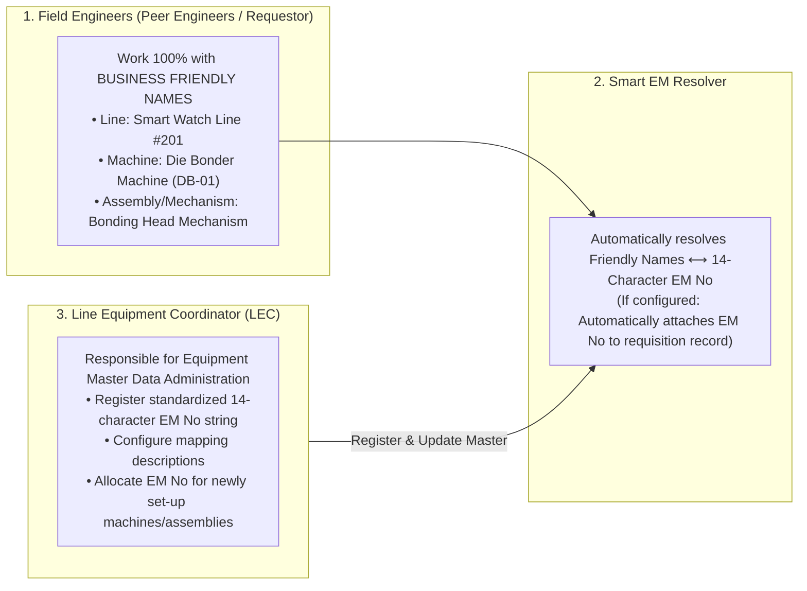
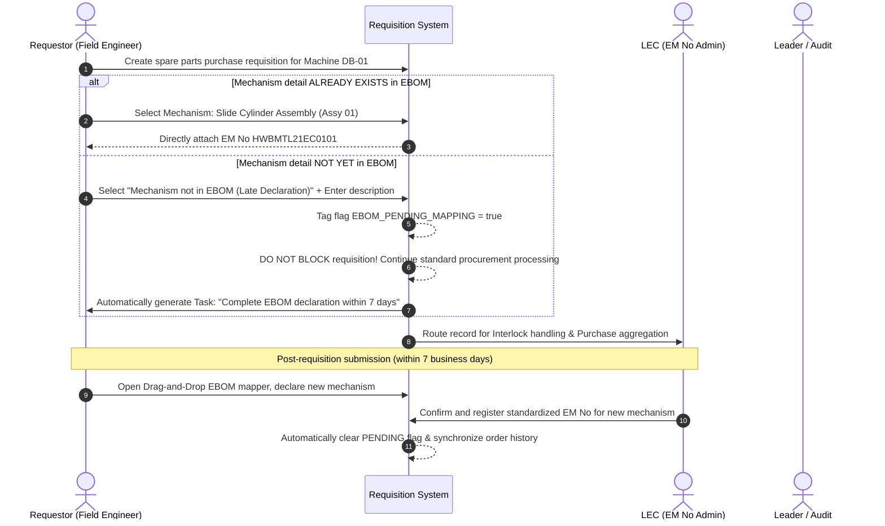

# 02. EBOM Equipment Tree Structure & Equipment Management Number (EM No) Decoding
> *Standardization of 14-Character EM No Structure: HWBMTL21EC0101, Separation of Business Friendly Names vs EM No, Drag-and-Drop EBOM Slot Mapper & Late Declaration Mechanism*

---

## 1. Separation of Responsibilities: Business Friendly Names vs Technical EM No Code

In shop-floor manufacturing reality, forcing Field Engineers (Peer Engineers — no stage/process division) to memorize or type 14-character technical codes (`HWBMTL21EC0101`) creates friction and introduces errors. The system enforces a clear separation of operational boundaries:



- **Requestor Engineers**: Work exclusively with familiar operational hierarchy levels: **Plant Name $\rightarrow$ Line Name $\rightarrow$ Machine Name $\rightarrow$ Assembly / Mechanism Detail**.
- **LEC (Line Equipment Coordinator)**: Manages Master Data configurations. The LEC registers standardized 14-character `EM No` strings in the system along with official bilingual English/Vietnamese descriptions. When a Requestor selects a machine on the UI, the system automatically assigns the corresponding `emNo` behind the scenes to procurement records and Work Orders.

---

## 2. 14-Character Equipment Management Number Formula (EM No Decoder)

Every standardized component installation position across the corporation is identified by a 14-character **Equipment Management Number (EM No)**:

$$\mathbf{EM\ No:\ } \underbrace{\text{HW}}_{\text{Chars 1-2}} \underbrace{\text{BMTL}}_{\text{3-6}} \underbrace{\text{2}}_{\text{7}} \underbrace{\text{1}}_{\text{8}} \underbrace{\text{EC}}_{\text{9-10}} \underbrace{\text{01}}_{\text{11-12}} \underbrace{\text{01}}_{\text{13-14}}$$

```
┌────┬────┬────┬────┬────┬────┬────┬────┬────┬────┬────┬────┬────┬────┐
│ 1  │ 2  │ 3  │ 4  │ 5  │ 6  │ 7  │ 8  │ 9  │ 10 │ 11 │ 12 │ 13 │ 14 │
├────┴────┼────┴────┴────┴────┼────┼────┼────┴────┼────┴────┼────┴────┤
│   H    W│   B    M    T    L│  2 │  1 │   E    C│   0    1│   0    1│
├─────────┼───────────────────┼────┼────┼─────────┼─────────┼─────────┤
│ Factory │ Technical Subsys  │Flr │Line│ Machine │  Unit   │Assembly │
│  (HW)   │(Module Tech Line) │(2F)│(Hex│ (Equip) │(Assembly│(Mech Dtl│
└─────────┴───────────────────┴────┴────┴─────────┴─────────┴─────────┘
```

### EM No Segment Reference Table:

| Character Index | Sample Value | Segment Name | Business Decoding Rules | Adaptability to Other Plants / Teams |
| :---: | :---: | :--- | :--- | :--- |
| **1 $\rightarrow$ 2** | `HW` | **Factory (Plant)** | `HW`: Smart Watch Plant 1.<br>Fully parameterized for other plants. | `TV`: Factory TV Display.<br>`AU`: Automotive Display Plant.<br>`MO`: IT Monitor Plant. |
| **3 $\rightarrow$ 6** | `BMTL` | **System / Line Group** | Technical line subsystem (`BMTL` = Building / Module Tech Line). | `TMTL`: TV Module Tech Line.<br>`AMTL`: Auto Module Line. |
| **7** | `2` | **Floor** | Equipment installation floor: `2` = Floor 2F, `6` = Floor 6F. | Numeric floor format from `1` to `9`. |
| **8** | `1` | **Line** | **Hexadecimal Format**:<br>• `1` $\rightarrow$ `9`: Line 1 through Line 9.<br>• `A` $\rightarrow$ `F`: Line 10 through Line 15. | Line #201 to Line #215 across all workshops. |
| **9 $\rightarrow$ 10** | `EC` | **Machine** | Machine model identifier on line (e.g., `EC`, `DB`, `BP`, `PL`...). | Flexible machine code table mapped per product family. |
| **11 $\rightarrow$ 12** | `01` | **Unit (Assembly)** | Functional assembly code (e.g., `01` = Feeder Unit, `02` = Bonding Head). | Standardized per mechanical schematic of each equipment model. |
| **13 $\rightarrow$ 14** | `01` | **Assembly (Mech Detail)**| Specific mechanism assembly detail (e.g., `01` = Slide cylinder mechanism, `02` = Heating block). | Linked directly to replaceable spare parts. |

---

## 3. Mechanism Detail Matching & Late Declaration Policy

### 3.1. Mandatory Matching with Mechanism Detail
In industrial spare parts maintenance and procurement, **every spare part newly purchased or issued from warehouse MUST be mapped to a specific Mechanism Detail / Assembly Slot of the machine**.
- **Objectives**:
  - Accurately identify which machine component the purchased spare part replaces when an equipment failure occurs.
  - Enable MTBF (Mean Time Between Failures) reliability analytics for each mechanical/electrical mechanism.
  - Prevent unchecked, arbitrary procurement without clear usage justification.

### 3.2. Late Declaration Workflow
In shop-floor manufacturing operations, when unexpected equipment breakdowns require emergency spare part procurement or during new product line setup where the mechanism **has not yet been declared in the EBOM tree**:
- **The system DOES NOT BLOCK the Requisition / Procurement workflow**:
  - Requestor selects Machine Name $\rightarrow$ Under Mechanism Detail selects: `[+] Mechanism not in EBOM (Late Declaration)`.
  - Requestor inputs a brief note describing the mechanism (e.g., *"Auxiliary night-shift scrap ejector mechanism added"*).
  - The system automatically tags the record with flag **`EBOM_PENDING_MAPPING = true`**.
- **Post-Procurement EBOM Enrollment**:
  - The system automatically generates a **Pending EBOM Completion Task** in the `My Tasks` inbox of the Requestor and Leader.
  - After submitting the purchase request, within the defined SLA grace period (Standard: 7 business days), the Engineer and LEC must open the EBOM interface to officially register this mechanism into the equipment tree.
  - Once the mechanism is added to EBOM, the system automatically clears the `EBOM_PENDING_MAPPING` flag and synchronizes equipment history for the order.



---

## 4. Visual Drag-and-Drop EBOM Slot Mapper

To minimize the complexity of maintaining multi-tier equipment trees, the system provides a **Drag-and-Drop Visual EBOM Slot Mapper**:

```
┌──────────────────────────────────────────────────────────────────────────────────────────────────────────────────────────────────┐
│  VISUAL DRAG-AND-DROP EBOM SLOT MAPPER                                                 [💾 Save Config]   [➕ Add New Mechanism]   │
├───────────────────────────────────┬──────────────────────────────────────────────────┬───────────────────────────────────────────┤
│ 🌳 EQUIPMENT TREE (FRIENDLY NAME) │ 🧩 SLOT SCHEMATIC CANVAS                         │ 📦 SPARE PARTS TRAY (WAITING ASSIGNMENT)  │
├───────────────────────────────────┼──────────────────────────────────────────────────┼───────────────────────────────────────────┤
│ ▼ Factory HW (Smart Watch)        │  ACTIVE MACHINE: DB-01 (Die Bonder #201)         │ [🔍 Search QCode / Part Name...]          │
│   ▼ Line #201 (Smart Watch Line 1)│  Base EM No: HWBMTL21EC0000                      │                                           │
│     ▼ Machine DB-01 (Die Bonder)  │ ┌──────────────────────────────────────────────┐ │ ▧ QDAB03583 - Square Photoelectric Sensor │
│       ├─► 01. Feeder Unit         │ │ [ Mechanism 01: Feeder Assembly Unit ]       │ │   (Maker: Panasonic / Model: CN-73-C2)    │
│       │   ├─ Mech 01: Slide Rail  │ │   • Slot 01: [ QDAB03583 - Photo Sensor ]    │ │   [DRAG & DROP TO CANVAS SLOT ➔]        │
│       │   └─ Mech 02: Clamping    │ │   • Slot 02: [ ➕ Drop spare part here... ]   │ │                                           │
│       └─► 02. Bonding Head Unit   │ └──────────────────────────────────────────────┘ │ ▧ QCAD38190 - SMC Dual Rod Cyl 16-100B    │
│           ├─ Mech 01: Grip Cyl    │ ┌──────────────────────────────────────────────┐ │   (Maker: SMC / Model: MXQ16-100B)        │
│           └─ Mech 02: Heating Blk │ │ [ Mechanism 02: Bonding Head Assembly Unit ] │ │   [DRAG & DROP TO CANVAS SLOT ➔]        │
│     ► Machine EC-01 (Cleaner 01)  │ │   • Slot 01: [ QCAD38190 - SMC Dual Cyl ]    │ │                                           │
│     ► Machine PL-01 (Polarizer)   │ │   • Slot 02: [ QDAD12236 - CPX Power Board ] │ │ ▧ QDAD12236 - Trumpf CPX Power Board V4 │
│   ► Line #202 (Smart Watch Line 2)│ │   • Slot 03: [ ➕ Drop spare part here... ]   │ │   (Maker: Trumpf / Model: 2912146)         │
└───────────────────────────────────┴──────────────────────────────────────────────────┴───────────────────────────────────────────┘
```

### Key Visual Capabilities:
1.  **Drag-and-Drop Parts into Mechanisms**: Engineers or LECs simply drag spare part cards from the Spare Parts Tray on the right and drop them directly into Mechanism Slots in the center canvas.
2.  **Automatic BOM Relationship Persistence**: Upon dropping a part into a slot, the system automatically stores the tuple relationship `(em_no, q_code, mechanism_id, std_qty)`.
3.  **Quick Creation of Missing Mechanisms**: Click `[➕ Add New Mechanism]` directly on the workspace to register newly emerging shop-floor mechanism slots without reloading the page.

---

## 5. Multi-Plant Scalability & Easy Rollout to Other Teams / Plants

The data architecture of the EBOM Equipment Tree module is engineered around a **Parametric Multi-Tenant Architecture**, enabling immediate adoption across other Teams or Plants in the enterprise (Factory TV, Automotive Display, IT Monitor...):

```json
{
  "plant_configuration": {
    "factory_code": "TV",
    "factory_name": "TV Large-Size Display Module Plant",
    "line_prefix": "TMTL",
    "floor_options": ["1F", "2F", "3F"],
    "em_no_pattern": "^TV[A-Z]{4}[1-9][0-9A-F][A-Z0-9]{6}$",
    "friendly_naming_schema": {
      "level_1": "Factory Name",
      "level_2": "Floor / Workshop",
      "level_3": "TV Production Line",
      "level_4": "Heavy Machinery Name",
      "level_5": "Functional Unit",
      "level_6": "Mechanism Detail Slot"
    },
    "late_declaration_grace_period_days": 7
  }
}
```

- **When rolling out to TV Plant or Automotive Display**:
  - Zero application source code modifications required.
  - System Administrators simply provision a new Plant Profile via the Admin Console.
  - The system automatically initializes the corresponding EM No decoder, equipment catalog, and mechanism slot schemas for the new manufacturing facility.
