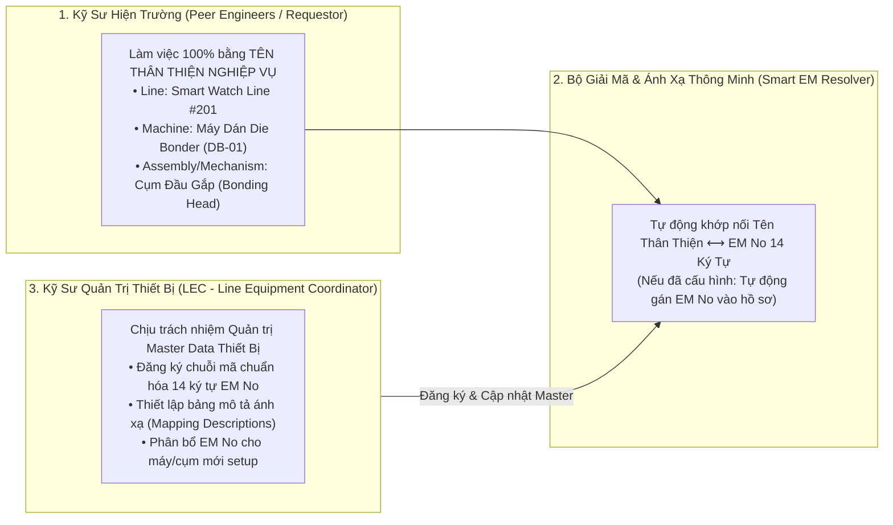
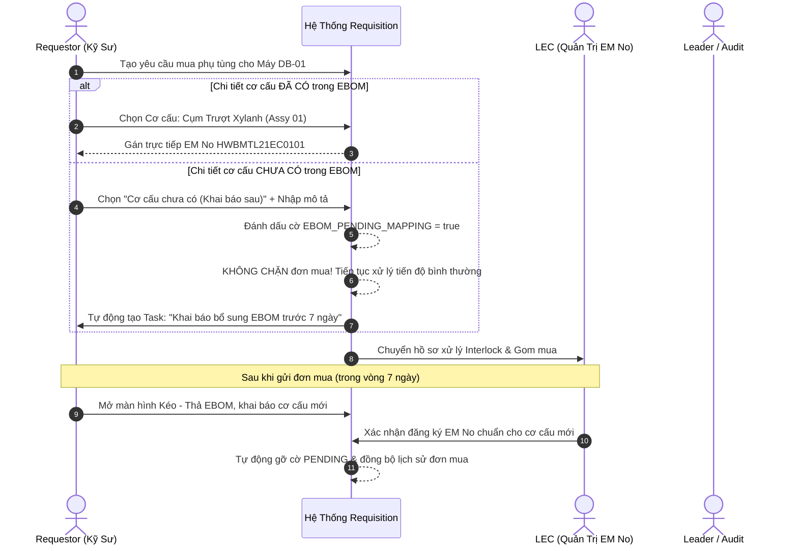

# 02. Cấu Trúc Cây Thiết Bị EBOM & Giải Mã Số Quản Lý Thiết Bị (EM No)
> *Chuẩn hóa cấu trúc 14 ký tự EM No: HWBMTL21EC0101, Tách bạch Tên Thân Thiện vs EM No, Drag-and-Drop EBOM Slot Mapper & Khai Báo Chi Tiết Cơ Cấu Khai Báo Sau*

---

## 1. Phân Tách Trách Nhiệm: Tên Thân Thiện Nghiệp Vụ vs Mã Kỹ Thuật EM No

Trong thực tế sản xuất tại nhà xưởng, việc bắt buộc Kỹ sư Hiện Trường (Peer Engineers — không phân chia công đoạn) phải nhớ hoặc gõ chính xác chuỗi mã 14 ký tự kỹ thuật (`HWBMTL21EC0101`) gây cản trở và dễ nhầm lẫn. Hệ thống áp dụng nguyên tắc phân tách ranh giới rõ ràng:



- **Kỹ sư Requestor**: Chỉ thao tác với danh mục cấp bậc quen thuộc: **Tên Nhà Máy $\rightarrow$ Tên Dây Chuyền (Line Name) $\rightarrow$ Tên Máy (Machine Name) $\rightarrow$ Tên Cụm Cơ Cấu (Assembly / Mechanism Detail)**.
- **LEC (Line Equipment Coordinator)**: Là người quản lý cấu hình Master Data. LEC đăng ký mã chuẩn 14 ký tự `EM No` lên hệ thống, kèm theo các trường mô tả tiếng Việt/Anh chuẩn mực. Khi Requestor chọn máy trên giao diện, hệ thống tự động ngầm gán `emNo` tương ứng vào hồ sơ mua sắm và Work Order.

---

## 2. Công Thức Giải Mã Số Quản Lý Thiết Bị 14 Ký Tự (EM No Decoder)

Mỗi vị trí lắp đặt linh kiện chuẩn hóa trong tập đoàn được định danh bằng **Số Quản Lý Thiết Bị (EM No - Equipment Management Number)** gồm 14 ký tự:

$$\mathbf{EM\ No:\ } \underbrace{\text{HW}}_{\text{Ký tự 1-2}} \underbrace{\text{BMTL}}_{\text{3-6}} \underbrace{\text{2}}_{\text{7}} \underbrace{\text{1}}_{\text{8}} \underbrace{\text{EC}}_{\text{9-10}} \underbrace{\text{01}}_{\text{11-12}} \underbrace{\text{01}}_{\text{13-14}}$$

```
┌────┬────┬────┬────┬────┬────┬────┬────┬────┬────┬────┬────┬────┬────┐
│ 1  │ 2  │ 3  │ 4  │ 5  │ 6  │ 7  │ 8  │ 9  │ 10 │ 11 │ 12 │ 13 │ 14 │
├────┴────┼────┴────┴────┴────┼────┼────┼────┴────┼────┴────┼────┴────┤
│   H    W│   B    M    T    L│  2 │  1 │   E    C│   0    1│   0    1│
├─────────┼───────────────────┼────┼────┼─────────┼─────────┼─────────┤
│ Factory │ Phân Hệ Kỹ Thuật  │Tầng│Line│ Machine │  Unit   │Assembly │
│  (HW)   │(Module Tech Line) │Floor(Hex)│  (Máy)  │ (Cụm)   │(Cụm Lắp)│
└─────────┴───────────────────┴────┴────┴─────────┴─────────┴─────────┘
```

### Bảng tra cứu ý nghĩa từng phân đoạn trong EM No:

| Vị trí ký tự | Giá trị mẫu | Tên phân đoạn | Quy tắc giải mã nghiệp vụ | Dễ dàng áp dụng cho Nhà máy / Team khác |
| :---: | :---: | :--- | :--- | :--- |
| **1 $\rightarrow$ 2** | `HW` | **Factory (Nhà máy)** | `HW`: Smart Watch Plant 1.<br>Tham số hóa linh hoạt cho nhà máy khác. | `TV`: Factory TV Display.<br>`AU`: Automotive Display Plant.<br>`MO`: IT Monitor Plant. |
| **3 $\rightarrow$ 6** | `BMTL` | **System / Line Group** | Phân hệ kỹ thuật dây chuyền (`BMTL` = Building / Module Tech Line). | `TMTL`: TV Module Tech Line.<br>`AMTL`: Auto Module Line. |
| **7** | `2` | **Floor (Tầng)** | Tầng đặt máy: `2` = Tầng 2F, `6` = Tầng 6F. | Định dạng số tầng từ `1` đến `9`. |
| **8** | `1` | **Line (Dây chuyền)** | **Định dạng Hexadecimal**:<br>• `1` $\rightarrow$ `9`: Line 1 đến Line 9.<br>• `A` $\rightarrow$ `F`: Line 10 đến Line 15. | Line #201 đến Line #215 của mọi phân xưởng. |
| **9 $\rightarrow$ 10** | `EC` | **Machine (Cỗ máy)** | Mã định danh loại máy trên dây chuyền (ví dụ: `EC`, `DB`, `BP`, `PL`...). | Bảng mã máy linh hoạt theo từng chủng loại sản phẩm. |
| **11 $\rightarrow$ 12** | `01` | **Unit (Cụm chức năng)** | Mã cụm cơ cấu chức năng (ví dụ: `01` = Cụm cấp liệu Feeder Unit, `02` = Bonding Head). | Chuẩn hóa theo sơ đồ cơ khí của từng loại máy. |
| **13 $\rightarrow$ 14** | `01` | **Assembly (Chi tiết cơ cấu)**| Mã cụm cơ cấu lắp ráp cụ thể (ví dụ: `01` = Cụm xilanh trượt, `02` = Cụm gia nhiệt). | Gắn trực tiếp với phụ tùng spare part thay thế. |

---

## 3. Matching Chi Tiết Cơ Cấu & Cơ Chế Khai Báo Sau (Late Declaration Policy)

### 3.1. Nguyên tắc Matching Bắt Buộc Với Chi Tiết Cơ Cấu
Trong bảo trì và mua sắm phụ tùng công nghiệp, **mỗi phụ tùng mua mới hoặc xuất kho BẮT BUỘC phải được gắn với một Chi Tiết Cơ Cấu (Mechanism Detail / Assembly Slot) cụ thể của cỗ máy**.
- **Mục đích**:
  - Xác định chính xác phụ tùng mua về dùng để thay thế cho bộ phận nào khi máy xảy ra hư hại.
  - Phục vụ phân tích độ tin cậy MTBF (Mean Time Between Failures) của từng cơ cấu cơ khí / điện tử.
  - Ngăn ngừa tình trạng mua sắm tràn lan không rõ mục đích sử dụng.

### 3.2. Cơ Chế Khai Báo Sau (Late Declaration Workflow)
Trong điều kiện vận hành sản xuất thực tế, khi máy gặp sự cố cần mua phụ tùng thay thế gấp hoặc setup model mới nhưng cơ cấu đó **chưa kịp khai báo trong cây EBOM**:
- **Hệ thống KHÔNG CHẶN luồng tạo Requisition / Mua hàng**:
  - Requestor chọn Tên Máy $\rightarrow$ Tại mục Chi Tiết Cơ Cấu chọn: `[+] Cơ cấu chưa có trong EBOM (Khai báo sau)`.
  - Requestor nhập ghi chú ngắn mô tả cơ cấu (ví dụ: *"Cơ cấu gạt phôi phụ ca đêm chế thêm"*).
  - Hệ thống tự động cấp cờ **`EBOM_PENDING_MAPPING = true`**.
- **Cơ chế Khai Báo Bổ Sung Sau (Post-Procurement EBOM Enrollment)**:
  - Hệ thống tự động sinh một **Task chờ hoàn thiện EBOM** trong mục `Công Việc Của Tôi` trên giao diện của Requestor và Leader.
  - Sau khi gửi yêu cầu mua, trong thời hạn SLA (Quy định: 7 ngày làm việc), Kỹ sư và LEC phải mở màn hình EBOM để bổ sung chính thức cơ cấu này vào cây thiết bị.
  - Khi cơ cấu được thêm vào EBOM, hệ thống tự động giải phóng cờ `EBOM_PENDING_MAPPING` và cập nhật lịch sử mã thiết bị cho đơn hàng.



---

## 4. Màn Hình Kéo - Thả EBOM Trực Quan (Drag-and-Drop EBOM Slot Mapper)

Để giảm thiểu tối đa độ phức tạp của việc bảo trì cây thiết bị nhiều tầng bậc, hệ thống phát triển giao diện **Drag-and-Drop Visual EBOM Slot Mapper**:

```
┌──────────────────────────────────────────────────────────────────────────────────────────────────────────────────────────────────┐
│  BÀN THIẾT KẾ CÂY THIẾT BỊ EBOM TRỰC QUAN (DRAG-AND-DROP EBOM SLOT MAPPER)             [💾 Lưu Cấu Hình]  [➕ Thêm Cơ Cấu Mới]    │
├───────────────────────────────────┬──────────────────────────────────────────────────┬───────────────────────────────────────────┤
│ 🌳 CÂY THIẾT BỊ (THEO TÊN THÂN THIỆN)│ 🧩 SƠ ĐỒ CƠ CẤU MÁY (SLOT SCHEMATIC CANVAS)       │ 📦 KHO PHỤ TÙNG CHỜ GẮN (SPARE PARTS TRAY)│
├───────────────────────────────────┼──────────────────────────────────────────────────┼───────────────────────────────────────────┤
│ ▼ Factory HW (Smart Watch)        │  MÁY ĐANG CHỌN: DB-01 (Die Bonder #201)          │ [🔍 Tìm kiếm QCode / Tên phụ tùng...]    │
│   ▼ Line #201 (Smart Watch Line 1)│  Mã EM No Gốc: HWBMTL21EC0000                    │                                           │
│     ▼ Máy DB-01 (Die Bonder 01)   │ ┌──────────────────────────────────────────────┐ │ ▧ QDAB03583 - Cảm biến quang vuông    │
│       ├─► 01. Feeder Unit (Cấp liệu)│ │ [ Cơ Cấu 01: Cụm Cấp Liệu Feeder ]           │ │   (Maker: Panasonic / Model: CN-73-C2)  │
│       │   ├─ Mech 01: Ray trượt phôi│ │   • Slot 01: [ QDAB03583 - Cảm biến quang ]  │ │   [KÉO THẢ VÀO SLOT TRÊN CANVAS ➔]      │
│       │   └─ Mech 02: Kẹp phôi      │ │   • Slot 02: [ ➕ Thả linh kiện vào đây... ] │ │                                           │
│       └─► 02. Bonding Head (Đầu gắp)│ └──────────────────────────────────────────────┘ │ ▧ QCAD38190 - Xylanh đôi SMC 16-100B    │
│           ├─ Mech 01: Xylanh gắp    │ ┌──────────────────────────────────────────────┐ │   (Maker: SMC / Model: MXQ16-100B)      │
│           └─ Mech 02: Đầu gia nhiệt │ │ [ Cơ Cấu 02: Cụm Đầu Gắp Bonding Head ]      │ │   [KÉO THẢ VÀO SLOT TRÊN CANVAS ➔]      │
│     ► Máy EC-01 (Cleaner 01)      │ │   • Slot 01: [ QCAD38190 - Xylanh đôi SMC ]    │ │                                           │
│     ► Máy PL-01 (Polarizer Attach)│ │   • Slot 02: [ QDAD12236 - Board nguồn CPX ]   │ │ ▧ QDAD12236 - Board nguồn CPX V4 Trumpf │
│   ► Line #202 (Smart Watch Line 2)│ │   • Slot 03: [ ➕ Thả linh kiện vào đây... ] │ │   (Maker: Trumpf / Model: 2912146)       │
└───────────────────────────────────┴──────────────────────────────────────────────────┴───────────────────────────────────────────┘
```

### Các tính năng trực quan vượt trội:
1.  **Kéo - Thả Phụ Tùng Vào Cơ Cấu**: Kỹ sư hoặc LEC chỉ cần nắm kéo thẻ phụ tùng từ Khay linh kiện bên phải thả trực tiếp vào ô Slot của Cơ cấu ở giữa.
2.  **Tự động cập nhật quan hệ BOM**: Khi thả linh kiện vào Slot, hệ thống tự động lưu cặp quan hệ `(em_no, q_code, mechanism_id, std_qty)`.
3.  **Hỗ trợ Tạo Nhanh Cơ Cấu Chưa Có**: Bấm nút `[➕ Thêm Cơ Cấu Mới]` ngay trên giao diện để bổ sung chi tiết cơ cấu phát sinh ngoài hiện trường mà không cần reload trang.

---

## 5. Khả Năng Mở Rộng & Áp Dụng Dễ Dàng Cho Team Khác / Nhà Máy Khác (Multi-Plant Scalability)

Toàn bộ kiến trúc dữ liệu của module Cây Thiết Bị EBOM được thiết kế hướng **Tham Số Hóa Toàn Diện (Parametric Multi-Tenant Architecture)**, cho phép áp dụng ngay lập tức cho các Team khác hoặc Nhà máy khác trong tập đoàn (Factory TV, Automotive Display, IT Monitor...):

```json
{
  "plant_configuration": {
    "factory_code": "TV",
    "factory_name": "Nhà Máy Module TV Siêu Lớn (TV Module Plant)",
    "line_prefix": "TMTL",
    "floor_options": ["1F", "2F", "3F"],
    "em_no_pattern": "^TV[A-Z]{4}[1-9][0-9A-F][A-Z0-9]{6}$",
    "friendly_naming_schema": {
      "level_1": "Factory Name",
      "level_2": "Floor / Workshop",
      "level_3": "TV Production Line",
      "level_4": "Heavy Machinery Name",
      "level_5": "Functional Unit",
      "level_6": "Mechanism Detail Slot"
    },
    "late_declaration_grace_period_days": 7
  }
}
```

- **Khi chuyển sang Nhà máy TV hoặc Auto Display**:
  - Không cần sửa một dòng mã nguồn nào.
  - Quản trị viên Admin chỉ cần tạo một Plant Profile mới trên cổng cài đặt.
  - Hệ thống tự động kích hoạt bộ giải mã EM No, danh mục máy, sơ đồ slot cơ cấu tương ứng cho phân xưởng mới.

