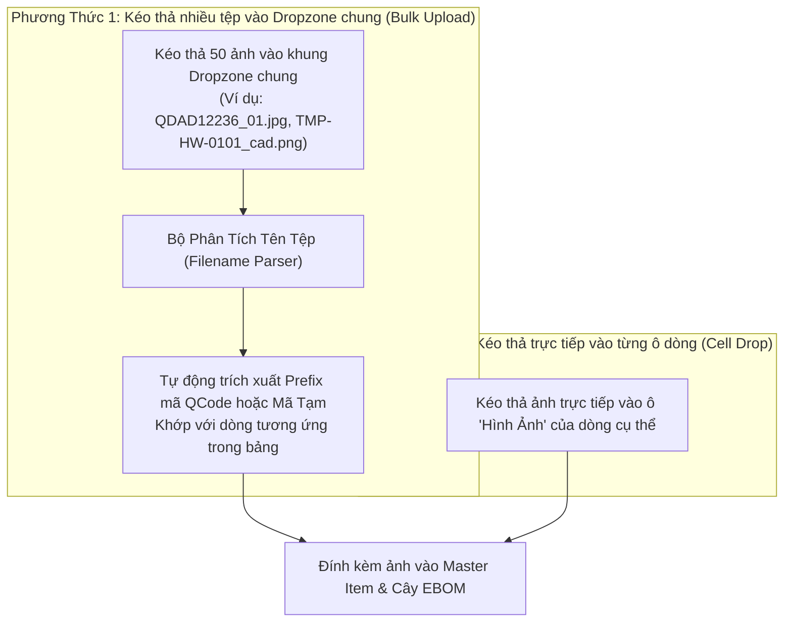

# 03. Đăng Ký Hàng Loạt QCode, Nhập Thuộc Tính Lưới & Upload Hình Ảnh

## 1. Nhu Cầu Nghiệp Vụ Đăng Ký Hàng Loạt

Trong các đợt Setup dây chuyền mới (ví dụ mở rộng Line #205 đến #210 cho dòng Smart Watch D222), số lượng phụ tùng cần đăng ký mới lên đến hàng trăm mã. Nếu thao tác tạo từng mã đơn lẻ trên EMS cũ sẽ mất nhiều tuần.

Hệ thống cung cấp module **Đăng Ký Hàng Loạt QCode (Batch QCode Onboarding)**:
- Nhập toàn bộ thuộc tính kỹ thuật trên bảng lưới (Interactive Spreadsheet Grid).
- Hỗ trợ copy-paste hàng trăm dòng từ Excel vào trình duyệt.
- Tự động cấp mã tạm thời `TMP-HW-xxxx` cho các dòng chưa có QCode EMS.
- Upload hình ảnh, tài liệu kỹ thuật và bản vẽ CAD hàng loạt với cơ chế tự động khớp nối (Auto-matching).

---

## 2. Bảng Thuộc Tính Nhập Liệu Hàng Loạt (Batch Attributes Schema)

Giao diện dạng lưới hiển thị các cột thuộc tính tương ứng với cấu trúc Master Item và EBOM:

```
┌────┬──────────────┬──────────────┬──────────────────────────────┬──────────┬──────────┬──────┬─────┬────────┬─────┬───────┬─────────┬─────────┬─────────┬──────────┐
│ STT│ Mã Tạm       │ QCode EMS    │ Tên Phụ Tùng                 │ Maker    │ Model    │ Phân │ ĐVT │ Target │ MOQ │ Pack  │ Process │ Machine │ Unit    │ Hình Ảnh │
│    │ (Auto/Opt)   │ (Nếu có)     │                              │          │          │ Loại │     │ Stock  │     │ Size  │         │         │         │ (Thumnail│
├────┼──────────────┼──────────────┼──────────────────────────────┼──────────┼──────────┼──────┼─────┼────────┼─────┼───────┼─────────┼─────────┼─────────┼──────────┤
│ 1  │ TMP-HW-0101  │              │ Board Nguồn CPX V4 Controls  │ TRUMPF   │ 2912146  │ SPR  │ EA  │ 2      │ 1   │ 1     │ DB      │ DB-01   │ HEAD-01 │ 🖼️ 2 file│
│ 2  │ TMP-HW-0102  │ QDAB03583    │ Cảm biến quang vuông         │ PANASONIC│ CN-73-C2 │ SP   │ EA  │ 15     │ 4   │ 2     │ DB      │ DB-01   │ FEED-01 │ 🖼️ 1 file│
│ 3  │ TMP-HW-0103  │ QCAD38190    │ Xylanh dẫn hướng đôi 16-100B │ SMC      │ MXQ16-100│ SP   │ EA  │ 8      │ 2   │ 1     │ TAB     │ TAB-02  │ CUT-01  │ 🖼️ 3 file│
└────┴──────────────┴──────────────┴──────────────────────────────┴──────────┴──────────┴──────┴─────┴────────┴─────┴───────┴─────────┴─────────┴─────────┴──────────┘
```

### Các tính năng thông minh trên lưới nhập liệu:
1.  **Paste từ Excel**: Kỹ sư copy từ Excel, bấm `Ctrl+V` vào lưới, hệ thống tự động nhận diện đúng cột và nhảy dòng.
2.  **Kiểm tra tính hợp lệ tức thì (Live Cell Validation)**:
    *   Ô hợp lệ hiển thị viền xanh lá nhạt.
    *   Ô lỗi (ví dụ: gõ chữ vào cột MOQ, hoặc chọn sai mã Process) viền đỏ kèm tooltip hướng dẫn sửa.
3.  **Tự động gán mã tạm `TMP-HW-xxxx`**: Với bất kỳ dòng nào để trống ô QCode EMS, hệ thống tự động cấp phát mã tạm theo định dạng `TMP-HW-[Năm]-[Số thứ tự]` để Kỹ sư và LEC có thể làm việc ngay.

---

## 3. Cơ Chế Tải Lên Hình Ảnh Hàng Loạt (Bulk Media Upload)

Hệ thống hỗ trợ 2 phương thức tải ảnh linh hoạt:



### Quy ước đặt tên tệp để tự động khớp nối (Auto-matching Rule):
Hệ thống sử dụng bộ Regex để quét tên file tải lên:
*   `[QCode hoặc Mã Tạm]_[Số thứ tự / Loại].ext`
*   *Ví dụ*:
    *   `QDAD12236_front.jpg` $\rightarrow$ Tự động gán làm ảnh đại diện mặt trước của linh kiện `QDAD12236`.
    *   `TMP-HW-0101_spec.pdf` $\rightarrow$ Tự động gán làm tài liệu thông số kỹ thuật của mã tạm `TMP-HW-0101`.
    *   `QCAD38190_cad.dwg` $\rightarrow$ Tự động liên kết bản vẽ CAD kỹ thuật.

### Xử lý tối ưu hóa hình ảnh tự động:
- Tự động nén ảnh chất lượng cao thành chuẩn WebP để tải nhanh trên giao diện web di động và máy tính bảng nhà xưởng.
- Tạo thumbnail $150 \times 150\text{px}$ để xem nhanh trực tiếp khi hover chuột vào ô trên bảng.

