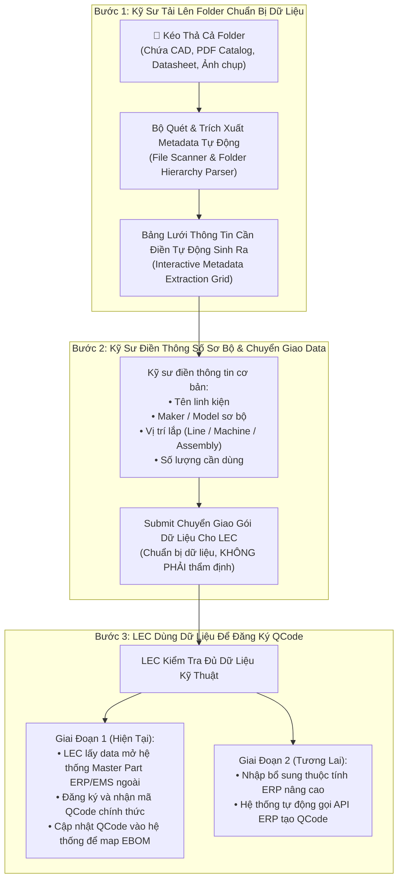

# 03. Chuẩn Bị Dữ Liệu Đăng Ký QCode Bằng Upload Thư Mục Kỹ Thuật (Data Preparation)
> *Quy trình Kỹ sư Chuẩn Bị Dữ Liệu: Upload Toàn Bộ Folder (Bản vẽ CAD, Catalog, Datasheet) -> Tự Động Sinh Bảng Nhập Liệu -> Chuyển Giao Dữ Liệu Cho LEC Đăng Ký QCode Ngoài ERP/EMS (Không Phải Là Bước Thẩm Định)*

---

## 1. Nhu Cầu Nghiệp Vụ: Chuẩn Bị Dữ Liệu Đăng Ký QCode (Data Preparation, Not Approval)

Khi setup dây chuyền mới hoặc bổ sung phụ tùng thay thế chưa có mã, Kỹ sư hiện trường nhận được một gói hồ sơ kỹ thuật dạng thư mục chứa hàng chục tệp: bản vẽ gia công cơ khí CAD (`.dwg`, `.dxf`, `.step`), catalog thông số nhà sản xuất (`.pdf`), bảng thông số kỹ thuật (datasheet) và ảnh chụp mẫu linh kiện thực tế.

> ⚠️ **BẢN CHẤT NGHIỆP VỤ**:  
> Việc Kỹ sư kéo thả thư mục và bấm **Submit** ở bước này thuần túy là **CHUẨN BỊ DỮ LIỆU ĐẦY ĐỦ ĐỂ LEC ĐI ĐĂNG KÝ QCODE TRÊN HỆ THỐNG ERP/EMS**, **HOÀN TOÀN KHÔNG PHẢI LÀ BƯỚC THẨM ĐỊNH PHÊ DUYỆT**.



---

## 2. Cơ Chế Upload Cả Folder & Tự Động Sinh Bảng Lưới Nhập Liệu

### 2.1. Công Nghệ Kéo Thả Thư Mục (Folder Drag-and-Drop)
- Giao diện hỗ trợ chuẩn HTML5 `webkitdirectory` và Drag-and-Drop thư mục. Kỹ sư có thể:
  - Bấm nút `[📁 Chọn Cả Thư Mục]` từ máy tính.
  - Hoặc nắm kéo cả folder từ Windows File Explorer thả thẳng vào Dropzone.
- Hệ thống hỗ trợ đọc đệ quy các thư mục con:
  ```
  📁 ThuMuc_Setup_DieBonder_DB01/
  ├── 📄 Catalog_SMC_MXQ_Series.pdf
  ├── 📄 Datasheet_Panasonic_CN73.pdf
  ├── 📐 DWG_BanVe_CumKep_DB01_V2.dwg
  ├── 📐 STEP_CumGatPhoi.step
  ├── 🖼️ AnhThucTe_CamBien_01.jpg
  └── 🖼️ AnhThucTe_Xylanh_02.png
  ```

### 2.2. Bảng Lưới Thông Tin Cần Điền Tự Động Sinh Ra (Auto-Generated Grid)
Hệ thống tự động gom các tệp liên quan vào các dòng phụ tùng dự kiến và hiển thị bảng lưới:

```
┌──────────────────────────────────────────────────────────────────────────────────────────────────────────────────────────────────┐
│  BẢNG CHUẨN BỊ DỮ LIỆU ĐĂNG KÝ QCODE TỪ THƯ MỤC UPLOAD                    [📁 Đổi Thư Mục]   [🚀 GỬI DATA CHO LEC ĐĂNG KÝ QCODE] │
├────┬─────────────┬─────────────────────┬──────────────┬─────────────┬───────────┬─────────────┬─────────────────┬────────────────┤
│ STT│ Mã Tạm Hệ   │ Tên Phụ Tùng        │ Maker        │ Model       │ Vị Trí    │ Số Lượng Dùn│ Tài Liệu Đã Map │ Tình Trạng     │
│    │ Thống Cấp   │ (Kỹ sư điền)        │ (Kỹ sư điền) │ (Nếu biết)  │ (Machine) │ (ĐVT: EA)   │ (CAD/Doc/Ảnh)   │ Dữ Liệu        │
├────┼─────────────┼─────────────────────┼──────────────┼─────────────┼───────────┼─────────────┼─────────────────┼────────────────┤
│ 1  │ TMP-2611-001│ Xylanh dẫn hướng đôi│ SMC          │ MXQ16-100B  │ DB-01     │ 2           │ 📄 Catalog_SMC  │ 🟢 Đủ file     │
│    │             │                     │              │             │           │             │ 🖼️ Anh_02.png   │                │
├────┼─────────────┼─────────────────────┼──────────────┼─────────────┼───────────┼─────────────┼─────────────────┼────────────────┤
│ 2  │ TMP-2611-002│ Cảm biến quang vuông│ PANASONIC    │ CN-73-C2    │ DB-01     │ 4           │ 📄 Datasheet_Pan│ 🟢 Đủ file     │
│    │             │                     │              │             │           │             │ 🖼️ Anh_01.jpg   │                │
├────┼─────────────┼─────────────────────┼──────────────┼─────────────┼───────────┼─────────────┼─────────────────┼────────────────┤
│ 3  │ TMP-2611-003│ Cụm tay gắp gá kẹp  │ NỘI BỘ GIA CÔ│ MECH-GAT-V2 │ DB-01     │ 1           │ 📐 BanVe_V2.dwg │ 🟡 Chờ file CAD │
│    │             │ (Gia công theo CAD) │              │             │           │             │ 📐 Step_GatPhoi │                │
└────┴─────────────┴─────────────────────┴──────────────┴─────────────┴───────────┴─────────────┴─────────────────┴────────────────┘
```

- Kỹ sư chỉ cần điền các cột tối thiểu: Tên phụ tùng, Nhà sản xuất (Maker), Model (nếu có), Tên máy/Vị trí lắp, Số lượng cần dùng.
- Sau khi điền xong, bấm nút **`[🚀 GỬI DATA CHO LEC ĐĂNG KÝ QCODE]`**.

---

## 3. Quy Trình LEC Sử Dụng Dữ Liệu Để Đăng Ký Mã 2 Giai Đoạn

### 3.1. Giai Đoạn 1: LEC Đăng Ký Ngoài Trên ERP/EMS & Cập Nhật Lại Hệ Thống (Hiện Tại)
1. **Tiếp nhận gói dữ liệu**: LEC mở tab `Chuẩn Bị QCode` trên Bàn làm việc LEC, xem các tài liệu đính kèm (bản vẽ CAD, catalog PDF).
2. **Đăng ký ngoài hệ thống**:
   - LEC truy cập hệ thống Master Part của Tập đoàn hoặc màn hình đăng ký vật tư EMS cũ.
   - Nhập thông số kỹ thuật, nhóm vật tư, tài khoản kế toán và phát hành mã QCode chính thức (ví dụ: `QCAD38190`, `QDAB03583`).
3. **Cập nhật mã QCode lên hệ thống**:
   - LEC quay lại Bàn làm việc trên hệ thống mới, gõ mã `QCode chính thức` vào dòng mã tạm `TMP-xxxx`.
   - Hệ thống tự động chuyển trạng thái dòng thành `QCODE_ACTIVATED`, đồng bộ vào Cây thiết bị EBOM và bắn thông báo cho Kỹ sư.

### 3.2. Giai Đoạn 2: Tự Động Hóa Đăng Ký Qua API ERP (Lộ Trình Tương Lai)
- Khi có cổng API ghi mở, hệ thống tự động đẩy gói dữ liệu JSON/XML sang API ERP để sinh mã QCode tự động.

---

## 4. Bảng Trạng Thái Vòng Đời Chuẩn Bị Dữ Liệu QCode

| Mã trạng thái | Tên trạng thái | Trách nhiệm | Ý nghĩa nghiệp vụ |
| :--- | :--- | :---: | :--- |
| `DRAFT_DATA_COLLECTED` | Kỹ sư đang chuẩn bị data | Kỹ sư | Đã tải folder lên, bảng lưới đã sinh ra, kỹ sư đang điền thông số sơ bộ. |
| `DATA_SUBMITTED_TO_LEC`| Đã gửi data cho LEC | Kỹ sư $\rightarrow$ LEC | Kỹ sư đã bàn giao gói dữ liệu cho LEC (không phải gửi thẩm định). |
| `LEC_PREPARING_ERP` | LEC đang kiểm tra data | LEC | LEC kiểm tra độ đầy đủ của CAD/catalog, chuẩn bị nhập lên ERP/EMS ngoài. |
| `ERP_REGISTRATION_WAIT`| Đang chờ cấp mã ngoài | LEC | Đã gửi hồ sơ lên ERP/EMS ngoài, chờ hệ thống cấp mã QCode. |
| `QCODE_ACTIVATED` | Đã có QCode & Kích hoạt | Hệ thống | LEC đã cập nhật mã QCode chính thức, đã map vào EBOM, sẵn sàng mua bán. |
| `NEED_MORE_TECH_INFO` | Cần bổ sung tài liệu | LEC $\rightarrow$ Kỹ sư | Hồ sơ thiếu bản vẽ CAD hoặc catalog không rõ thông số, LEC yêu cầu kỹ sư bổ sung. |
