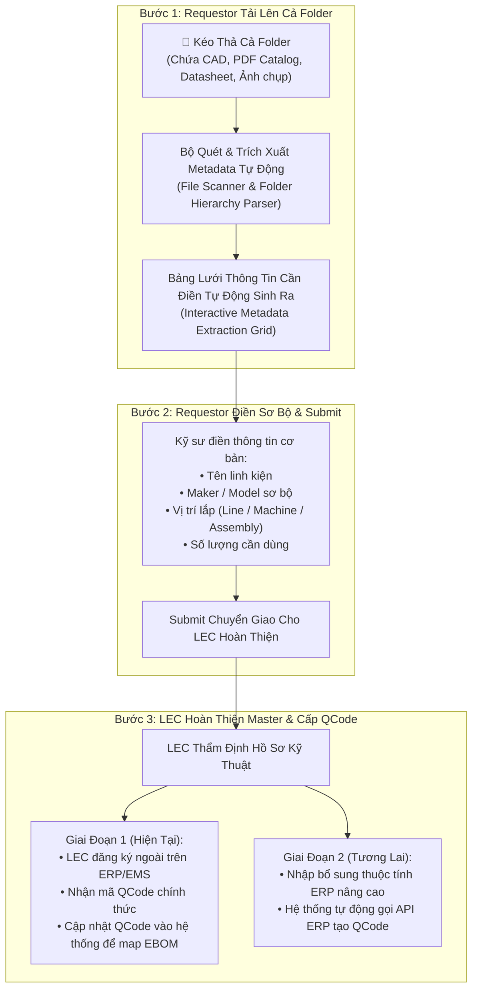

# 03. Đăng Ký QCode Bằng Upload Thư Mục Tài Liệu Kỹ Thuật & Hoàn Thiện Master Data
> *Quy trình Upload Toàn Bộ Folder (Bản vẽ CAD, Catalog, Datasheet) -> Tự Động Sinh Bảng Nhập Liệu -> Phối Hợp Requestor & LEC 2 Giai Đoạn (Thủ công ngoài & Tự động API)*

---

## 1. Nhu Cầu Nghiệp Vụ & Bài Toán Thực Tế Tại Phân Xưởng

Khi Setup dây chuyền mới hoặc bổ sung phụ tùng thay thế mới, Kỹ sư quy trình (`Engineer Process`) thường nhận được một gói hồ sơ kỹ thuật dạng thư mục chứa hàng chục tệp: bản vẽ gia công cơ khí CAD (`.dwg`, `.dxf`, `.step`), catalog thông số nhà sản xuất (`.pdf`), bảng thông số kỹ thuật (datasheet) và ảnh chụp mẫu linh kiện thực tế.

Nếu bắt kỹ sư phải đổi tên từng file theo định dạng regex phức tạp hoặc mở từng form nhập liệu thì rất mất thời gian và dễ sai sót. Hệ thống xây dựng tính năng **Upload Toàn Bộ Folder Đăng Ký QCode (Entire Folder Technical Package Onboarding)**.



---

## 2. Cơ Chế Upload Cả Folder & Tự Động Sinh Bảng Lưới Nhập Liệu

### 2.1. Công Nghệ Kéo Thả Thư Mục (Folder Drag-and-Drop)
- Giao diện hỗ trợ chuẩn HTML5 `webkitdirectory` và Drag-and-Drop thư mục. Kỹ sư có thể:
  - Bấm nút `[📁 Chọn Cả Thư Mục]` từ máy tính.
  - Hoặc nắm kéo cả folder từ Windows File Explorer thả thẳng vào Dropzone.
- Hệ thống hỗ trợ đọc đệ quy các thư mục con:
  ```
  📁 ThuMuc_Setup_DieBonder_DB01/
  ├── 📄 Catalog_SMC_MXQ_Series.pdf
  ├── 📄 Datasheet_Panasonic_CN73.pdf
  ├── 📐 DWG_BanVe_CumKep_DB01_V2.dwg
  ├── 📐 STEP_CumGatPhoi.step
  ├── 🖼️ AnhThucTe_CamBien_01.jpg
  └── 🖼️ AnhThucTe_Xylanh_02.png
  ```

### 2.2. Bảng Lưới Thông Tin Cần Điền Tự Động Sinh Ra (Auto-Generated Grid)
Hệ thống tự động gom các tệp liên quan vào các dòng phụ tùng dự kiến và hiển thị bảng lưới:

```
┌──────────────────────────────────────────────────────────────────────────────────────────────────────────────────────────────────┐
│  BẢNG NHẬP THÔNG TIN PHỤ TÙNG TỪ THƯ MỤC UPLOAD                           [📁 Đổi Thư Mục]   [🚀 SUBMIT CHO LEC HOÀN THIỆN]       │
├────┬─────────────┬─────────────────────┬──────────────┬─────────────┬───────────┬─────────────┬─────────────────┬────────────────┤
│ STT│ Mã Tạm Hệ   │ Tên Phụ Tùng        │ Maker        │ Model       │ Vị Trí    │ Số Lượng Dùn│ Tài Liệu Đã Map │ Trạng Thái     │
│    │ Thống Cấp   │ (Kỹ sư điền)        │ (Kỹ sư điền) │ (Nếu biết)  │ (Machine) │ (ĐVT: EA)   │ (CAD/Doc/Ảnh)   │ Hồ Sơ          │
├────┼─────────────┼─────────────────────┼──────────────┼─────────────┼───────────┼─────────────┼─────────────────┼────────────────┤
│ 1  │ TMP-2611-001│ Xylanh dẫn hướng đôi│ SMC          │ MXQ16-100B  │ DB-01     │ 2           │ 📄 Catalog_SMC  │ 🟢 Đủ file     │
│    │             │                     │              │             │           │             │ 🖼️ Anh_02.png   │                │
├────┼─────────────┼─────────────────────┼──────────────┼─────────────┼───────────┼─────────────┼─────────────────┼────────────────┤
│ 2  │ TMP-2611-002│ Cảm biến quang vuông│ PANASONIC    │ CN-73-C2    │ DB-01     │ 4           │ 📄 Datasheet_Pan│ 🟢 Đủ file     │
│    │             │                     │              │             │           │             │ 🖼️ Anh_01.jpg   │                │
├────┼─────────────┼─────────────────────┼──────────────┼─────────────┼───────────┼─────────────┼─────────────────┼────────────────┤
│ 3  │ TMP-2611-003│ Cụm tay gắp gá kẹp  │ NỘI BỘ GIA CÔ│ MECH-GAT-V2 │ DB-01     │ 1           │ 📐 BanVe_V2.dwg │ 🟡 Chờ duyệt CAD│
│    │             │ (Gia công theo CAD) │              │             │           │             │ 📐 Step_GatPhoi │                │
└────┴─────────────┴─────────────────────┴──────────────┴─────────────┴───────────┴─────────────┴─────────────────┴────────────────┘
```

- Kỹ sư chỉ cần điền các cột tối thiểu: Tên phụ tùng, Nhà sản xuất (Maker), Model (nếu có), Tên máy/Vị trí lắp, Số lượng cần dùng.
- Sau khi điền xong, bấm nút **`[🚀 SUBMIT CHO LEC HOÀN THIỆN]`**.

---

## 3. Quy Trình Phối Hợp Requestor & LEC Theo 2 Giai Đoạn (Two-Phase Lifecycle)

Hệ thống thiết kế theo chiến lược lộ trình chuyển đổi thực tế:

### 3.1. Giai Đoạn 1: Đăng Ký Ngoài Trên ERP/EMS & Cập Nhật Lại Hệ Thống (Hiện Tại)
1. **Tiếp nhận hồ sơ**: LEC mở tab `Đăng Ký QCode` trên Bàn làm việc LEC, xem hồ sơ kỹ thuật đính kèm (mở trực tiếp bản vẽ CAD, datasheet PDF đã được Requestor tải lên).
2. **Đăng ký ngoài hệ thống**:
   - LEC truy cập hệ thống Master Part của Tập đoàn hoặc màn hình đăng ký vật tư EMS cũ.
   - Nhập thông số kỹ thuật, nhóm vật tư, tài khoản kế toán và phát hành mã QCode chính thức (ví dụ: `QCAD38190`, `QDAB03583`).
3. **Cập nhật mã QCode lên hệ thống**:
   - LEC quay lại Bàn làm việc trên hệ thống mới, gõ mã `QCode chính thức` vào dòng mã tạm `TMP-xxxx`.
   - Hệ thống tự động:
     - Chuyển trạng thái dòng thành `QCODE_ACTIVATED`.
     - Đồng bộ QCode vào Cây thiết bị EBOM tại vị trí Machine/Mechanism đã đăng ký.
     - Gửi thông báo tự động (Notification/Email) đến Requestor: *"Hồ sơ QCode cho linh kiện [Tên linh kiện] đã hoàn tất, mã QCode: QCAD38190"*.

### 3.2. Giai Đoạn 2: Tự Động Hóa Đăng Ký Qua API ERP (Lộ Trình Mở Rộng)
Khi cổng giao tiếp API của hệ thống ERP/EMS mở cho phép tích hợp:
1. Giao diện của LEC sẽ hiển thị thêm nút **`[⚡ Đăng Ký Tự Động Lên ERP]`**.
2. Hệ thống yêu cầu LEC cung cấp/xác nhận thêm các trường nghiệp vụ ERP chuyên sâu:
   - Nhóm mua sắm (Purchasing Group).
   - Mã biểu thuế hải quan (HS Code).
   - Loại định giá kho (Valuation Class).
   - Kho lưu trữ mặc định (Default Storage Location).
3. Hệ thống tự động đẩy gói dữ liệu JSON/XML sang API ERP để tạo mã tức thì mà không cần LEC phải mở màn hình ngoài để nhập liệu thủ công.

---

## 4. Bảng Trạng Thái Vòng Đời Của Hồ Sơ Đăng Ký QCode

| Mã trạng thái | Tên trạng thái | Trách nhiệm | Mô tả |
| :--- | :--- | :---: | :--- |
| `DRAFT_FOLDER_UPLOADED` | Mới tải thư mục | Requestor | Đã parse file, bảng lưới đã sinh ra, kỹ sư đang điền thông tin sơ bộ. |
| `SUBMITTED_TO_LEC` | Đã chuyển giao cho LEC | Requestor $\rightarrow$ LEC | Kỹ sư đã submit, đang nằm trong hàng đợi thẩm định kỹ thuật của LEC. |
| `LEC_REVIEWING` | LEC đang xử lý | LEC | LEC đang kiểm tra catalog/bản vẽ, đối chiếu trùng lặp với kho hiện hữu. |
| `ERP_REGISTRATION_PENDING` | Chờ cấp mã ERP ngoài | LEC | LEC đã duyệt kỹ thuật, đang tiến hành đăng ký trên hệ thống ERP/EMS ngoài. |
| `QCODE_COMPLETED` | Đã cập nhật QCode | Hệ thống | LEC đã nhập mã QCode chính thức, đã map vào EBOM, sẵn sàng mua bán. |
| `REJECTED_INSUFFICIENT_DOCS` | Trả lại bổ sung tài liệu | LEC $\rightarrow$ Requestor | Hồ sơ thiếu bản vẽ/catalog không rõ nguồn gốc, yêu cầu kỹ sư bổ sung. |


