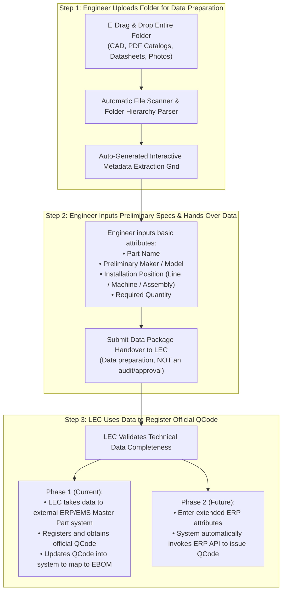

# 03. QCode Registration Data Preparation via Technical Folder Upload (Data Preparation)
> *Engineer Data Preparation Workflow: Upload Entire Folder (CAD Drawings, Catalogs, Datasheets) -> Auto-Generate Input Grid -> Hand Over Data to LEC for External ERP/EMS QCode Registration (Not an Approval/Audit Step)*

---

## 1. Business Need: QCode Registration Data Preparation (Data Preparation, Not Approval)

When commissioning a new production line or introducing uncataloged spare parts, field engineers receive a technical documentation package in folder format containing dozens of files: mechanical CAD machining drawings (`.dwg`, `.dxf`, `.step`), manufacturer catalogs (`.pdf`), technical datasheets, and physical part photographs.

> ⚠️ **OPERATIONAL NATURE**:  
> The engineer's action of dragging and dropping a folder and clicking **Submit** at this stage is strictly **DATA PREPARATION TO ENABLE THE LEC TO REGISTER OFFICIAL QCODES ON THE ERP/EMS SYSTEM**, **AND IS STRICTLY NOT AN AUDIT/APPROVAL STEP**.



---

## 2. Folder Upload Mechanism & Auto-Generated Input Grid

### 2.1. Folder Drag-and-Drop Technology
- The user interface supports the HTML5 `webkitdirectory` standard and folder drag-and-drop. Engineers can:
  - Click `[📁 Select Entire Folder]` from their local PC.
  - Or drag an entire folder directly from Windows File Explorer into the dropzone.
- The system recursively scans subdirectories:
  ```
  📁 DieBonder_DB01_Setup_Folder/
  ├── 📄 Catalog_SMC_MXQ_Series.pdf
  ├── 📄 Datasheet_Panasonic_CN73.pdf
  ├── 📐 DWG_Fixture_Assy_DB01_V2.dwg
  ├── 📐 STEP_ScrapEjector_Mech.step
  ├── 🖼️ Photo_Sensor_Sample_01.jpg
  └── 🖼️ Photo_Cylinder_Sample_02.png
  ```

### 2.2. Auto-Generated Input Grid
The system automatically associates related files into candidate spare part line items and displays an interactive grid:

```
┌──────────────────────────────────────────────────────────────────────────────────────────────────────────────────────────────────┐
│  QCODE REGISTRATION DATA PREPARATION FROM UPLOADED FOLDER                 [📁 Change Folder]  [🚀 SEND DATA TO LEC FOR REGISTRATION]│
├────┬─────────────┬─────────────────────┬──────────────┬─────────────┬───────────┬─────────────┬─────────────────┬────────────────┤
│ No │ System Temp │ Part Name           │ Maker        │ Model       │ Position  │ Required Qty│ Mapped Documents│ Data Status    │
│    │ Code        │ (Engineer inputs)   │ (Eng inputs) │(If known)   │ (Machine) │ (Unit: EA)  │ (CAD/Doc/Photo) │                │
├────┼─────────────┼─────────────────────┼──────────────┼─────────────┼───────────┼─────────────┼─────────────────┼────────────────┤
│ 1  │ TMP-2611-001│ Dual Rod Guide Cyl  │ SMC          │ MXQ16-100B  │ DB-01     │ 2           │ 📄 Catalog_SMC  │ 🟢 Complete    │
│    │             │                     │              │             │           │             │ 🖼️ Photo_02.png │                │
├────┼─────────────┼─────────────────────┼──────────────┼─────────────┼───────────┼─────────────┼─────────────────┼────────────────┤
│ 2  │ TMP-2611-002│ Rectangular Sensor  │ PANASONIC    │ CN-73-C2    │ DB-01     │ 4           │ 📄 Datasheet_Pan│ 🟢 Complete    │
│    │             │                     │              │             │           │             │ 🖼️ Photo_01.jpg │                │
├────┼─────────────┼─────────────────────┼──────────────┼─────────────┼───────────┼─────────────┼─────────────────┼────────────────┤
│ 3  │ TMP-2611-003│ Custom Gripper Claw │ IN-HOUSE MFG │ MECH-GAT-V2 │ DB-01     │ 1           │ 📐 Drawing_V2.dw│ 🟡 Awaiting CAD│
│    │             │ (Machined per CAD)  │              │             │           │             │ 📐 Step_Ejector │                │
└────┴─────────────┴─────────────────────┴──────────────┴─────────────┴───────────┴─────────────┴─────────────────┴────────────────┘
```

- Engineers only need to provide essential fields: Part Name, Manufacturer (Maker), Model (if known), Machine Name / Installation Position, and Required Quantity.
- Once populated, click **`[🚀 SEND DATA TO LEC FOR REGISTRATION]`**.

---

## 3. Two-Phase Workflow for LEC to Register Codes Using Prepared Data

### 3.1. Phase 1: LEC Registers Externally on ERP/EMS & Synchronizes Back (Current)
1. **Receive Data Package**: The LEC accesses the `QCode Preparation` tab on the LEC Workbench to review attached documentation (CAD drawings, PDF catalogs).
2. **External System Registration**:
   - The LEC logs into the corporate Master Part system or legacy EMS material registration interface.
   - Enters technical specifications, material classification group, and GL account, then triggers official QCode issuance (e.g., `QCAD38190`, `QDAB03583`).
3. **Update QCode in New System**:
   - The LEC returns to the Workbench in the new system and inputs the `Official QCode` into the temporary code row (`TMP-xxxx`).
   - The system automatically updates the row status to `QCODE_ACTIVATED`, synchronizes it into the EBOM Equipment Tree, and notifies the Engineer.

### 3.2. Phase 2: Automated Registration via ERP API (Future Roadmap)
- When transactional write APIs are made available, the system will automatically dispatch structured JSON/XML payloads to the ERP API to generate official QCodes automatically.

---

## 4. QCode Data Preparation Lifecycle Status Table

| Status Code | Status Display Name | Responsible Role | Operational Definition |
| :--- | :--- | :---: | :--- |
| `DRAFT_DATA_COLLECTED` | Engineer Preparing Data | Engineer | Folder uploaded, grid generated, engineer currently populating initial parameters. |
| `DATA_SUBMITTED_TO_LEC`| Data Submitted to LEC | Engineer $\rightarrow$ LEC | Engineer handed over data package to LEC (not submitted for approval). |
| `LEC_PREPARING_ERP` | LEC Reviewing Data | LEC | LEC verifying CAD/catalog completeness, preparing entry into external ERP/EMS. |
| `ERP_REGISTRATION_WAIT`| Awaiting External Code | LEC | Submitted to external ERP/EMS, awaiting official QCode issuance. |
| `QCODE_ACTIVATED` | QCode Issued & Active | System | Official QCode registered by LEC, mapped to EBOM, fully active for procurement. |
| `NEED_MORE_TECH_INFO` | Technical Info Required | LEC $\rightarrow$ Engineer | Documentation lacks required CAD drawings or catalog specs; LEC requests clarification. |
