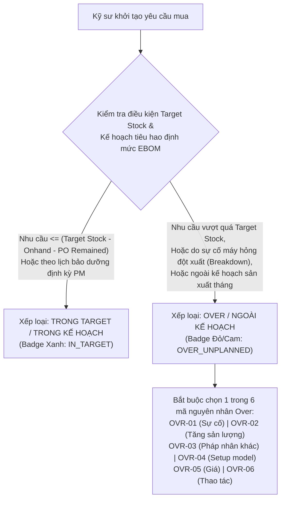

# 01. Bàn Làm Việc Kỹ Sư: Đăng Ký Yêu Cầu & Phân Loại Trong Target vs Over

## 1. Phân Biệt Cốt Lõi: Trong Target vs Over (Ngoài Kế Hoạch)

Theo yêu cầu nghiệp vụ chuẩn hóa:
> **"Over phải là ngoài kế hoạch. Giao diện phải thể hiện rõ danh sách mua nào Over hoặc Trong Target."**

### Tiêu chí nhận diện hiển thị trên giao diện:
| Tiêu chí | Hạng Mục Trong Target (In-Plan) | Hạng Mục Over (Ngoài Kế Hoạch) |
| :--- | :--- | :--- |
| **Huy hiệu giao diện (Badge)** | 🟢 `TRONG TARGET` (Xanh lá cây) | 🔴 `OVER NGOÀI KẾ HOẠCH` (Đỏ/Cam nổi bật) |
| **Bản chất nhu cầu** | Bù mức tồn kho chuẩn (Target Stock) hoặc theo kế hoạch định mức tiêu hao sản lượng | Sự cố khẩn cấp, máy hỏng đột xuất, hoặc phát sinh ngoài dự kiến đầu tháng |
| **Loại lệnh đặt hàng** | `Periodic Replenishment` (Bổ sung định kỳ) | `Ready-to-use (즉사용 - Dùng ngay)` |
| **Yêu cầu giải trình** | Theo công thức chuẩn, không cần giải trình thêm | **Bắt buộc đính kèm mã OVR-01..06**, mô tả vấn đề và Work Order máy hỏng |
| **Thẩm quyền ký duyệt** | LEC kiểm tra nhanh trong hạn mức tháng | Bắt buộc LEC đưa vào **Hồ sơ Thẩm định Offline trình Team Management** |

---

## 2. Các Phương Thức Tạo Đơn Mua Của Kỹ Sư

### 2.1. Đăng ký nhanh qua Cây EBOM (1-Click Selection)
- Kỹ sư mở sơ đồ dây chuyền `#201` $\rightarrow$ Chọn cỗ máy đang vận hành $\rightarrow$ Chọn cụm chi tiết $\rightarrow$ Tích chọn linh kiện.
- Hệ thống tự động điền: Tên linh kiện, Maker, QCode hoặc Mã tạm `TMP-HW-xxxx`, Vị trí máy và các thông số tồn kho.

### 2.2. Đăng ký đơn lẻ cho sự cố khẩn cấp (Emergency Breakdown)
- Kỹ sư chọn loại đơn: `Dùng ngay (즉사용)`.
- Nhập mã lệnh sửa chữa máy: `WO-248926091`.
- Hệ thống tự động gán cờ: **🔴 OVER NGOÀI KẾ HOẠCH (Mã OVR-01)**.
- Form yêu cầu kỹ sư chụp ảnh hiện trường máy hỏng và tải lên hệ thống.

### 2.3. Đăng ký hàng loạt qua lưới (Batch Grid Entry)
- Kỹ sư mở chế độ nhập bảng: Paste hàng loạt 20-50 dòng linh kiện từ file Excel kiểm kê ca.
- Hệ thống tự động phân loại từng dòng là `TRONG TARGET` hay `OVER` ngay khi dán số lượng vào bảng.

