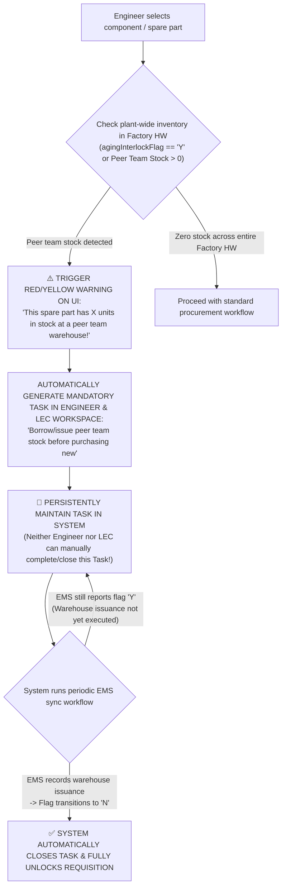

# 01. Requestor Requisition Workbench: Need Creation, Peer Team Stock Warning & Persistent Mandatory Task
> *Peer Team Stock Warning Triggered at Requisition Creation, Persistent Mandatory Task Maintained Until EMS Flag Shifts to 'N', Mandatory Official QCode for Audit & Manual LEC Classification of Target vs Over*

---

## 1. Peer Team Stock Warning Mechanism & Persistent Mandatory Task

According to shop-floor operational rules:
> **"Procedure for borrowing/issuing idle stock from peer teams: A warning alert is displayed to the Requestor immediately upon requisition creation. A mandatory task is persistently maintained until the system reloads EMS information confirming the flag has transitioned to 'N'."**

### Detailed Operational & Display Rules:
1. **Instant Warning Banner**:
   - As soon as the Engineer types a QCode or selects an item from the EBOM tree, if the spare part has idle inventory in another Team, the requisition form immediately surfaces a prominent alert banner:
     > ⚠️ **IDLE STOCK WARNING**: Part code `QDAB03583` currently has **6 EA** in stock at **PO Module Tech Team 1**. Please contact your LEC to borrow/issue this stock prior to proposing a new purchase!
2. **Persistent Mandatory Task**:
   - The system automatically generates a task tagged `TASK-INTER-STOCK-[QCode]`.
   - This task **has no manual "Complete" button**.
   - The sole condition for task resolution is: **When the warehouse issuance / transfer slip is executed in the EMS system, and the recurring sync workflow reads that `agingInterlockFlag` has transitioned to `'N'`**.

---

## 2. Conditions for Beginning-of-Month Audit Inclusion & Target vs Over Classification

### 2.1. Mandatory Official QCode for Audit Eligibility
* **Strict Operational Rule**: **Requisitions eligible for audit MUST POSSESS AN OFFICIAL QCODE**.
* Spare parts carrying only temporary codes `TMP-HW-xxxx` (where engineers have only uploaded CAD/Doc documentation folders) **are strictly barred from the beginning-of-month cost review/audit session**.
* Engineers must submit documentation packages early so that the LEC can finalize official QCode registration on ERP/EMS prior to the audit review cycle.

### 2.2. Manual LEC Classification — Strictly No Automation
* The system **strictly DOES NOT automatically classify** items as `Within Target` or `Over Target`.
* The Engineer's responsibility is solely to:
  - Provide machine operating conditions and describe failure symptoms.
  - Attach the maintenance repair work order (`Work Order: WO-xxxx`).
  - Attach shop-floor photographs of damaged components.
  - Propose a preliminary rationale code (`OVR-01` to `OVR-06`).
* **The LEC manually evaluates and selects the official classification** on the LEC Workbench.

### 2.3. Review Deadlines & Aging Justifications Configured by LEC
* Submission deadlines for **Idle Inventory Justification Tasks** and the cutoff for beginning-of-month cost audit packages **are fully configured by the LEC (Deadlines)** based on the Team's operational schedule, rather than rigid system dates.

---

## 3. Requisition Creation Methods for Engineers

### 3.1. Requisition via EBOM Friendly Names
- Engineer selects: `Line #201` $\rightarrow$ `Die Bonder DB-01` $\rightarrow$ `Bonding Head Unit` $\rightarrow$ checks spare part.
- If the mechanism is not yet in EBOM: Select `[+] Mechanism not in EBOM (Late Declaration)` to avoid blocking procurement.

### 3.2. Requisition for Emergency Machine Breakdown
- Select demand type: `Immediate breakdown replacement`.
- Enter maintenance repair work order (e.g., `WO-248926091`).
- Upload photographs of damaged components and machine alarm logs.

### 3.3. Bulk Grid Entry
- Copy-paste dozens of rows from shift inspection spreadsheets into the grid table.
- Identify rows flagged with peer team stock warnings to prioritize borrowing before purchasing.
