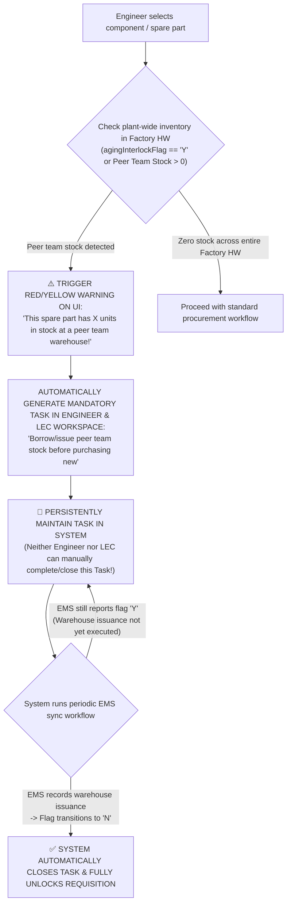

# 01. Requestor Requisition Workbench: Need Creation, Peer Team Stock Warning & Persistent Mandatory Task
> *Peer Team Stock Warning Triggered at Requisition Creation, Persistent Mandatory Task Maintained Until EMS Flag Shifts to 'N', Mandatory Official QCode for Audit & Manual LEC Classification of Target vs Over*

---

## 1. Peer Team Stock Warning Mechanism & Persistent Mandatory Task

According to shop-floor operational rules:
> **"Procedure for borrowing/issuing idle stock from peer teams: A warning alert is displayed to the Requestor immediately upon requisition creation. A mandatory task is persistently maintained until the system reloads EMS information confirming the flag has transitioned to 'N'."**

### Detailed Operational & Display Rules:
1. **Instant Warning Banner**:
   - As soon as the Engineer types a QCode or selects an item from the EBOM tree, if the spare part has idle inventory in another Team, the requisition form immediately surfaces a prominent alert banner:
     > ⚠️ **IDLE STOCK WARNING**: Part code `QDAB03583` currently has **6 EA** in stock at **PO Module Tech Team 1**. Please contact your LEC to borrow/issue this stock prior to proposing a new purchase!
2. **Persistent Mandatory Task**:
   - The system automatically generates a task tagged `TASK-INTER-STOCK-[QCode]`.
   - This task **has no manual "Complete" button**.
   - The sole condition for task resolution is: **When the warehouse issuance / transfer slip is executed in the EMS system, and the recurring sync workflow reads that `agingInterlockFlag` has transitioned to `'N'`**.

---

## 2. Conditions for Beginning-of-Month Audit Inclusion & Target vs Over Classification

### 2.1. Mandatory Official QCode for Audit Eligibility
* **Strict Operational Rule**: **Requisitions eligible for audit MUST POSSESS AN OFFICIAL QCODE**.
* Spare parts carrying only temporary codes `TMP-HW-xxxx` (where engineers have only uploaded CAD/Doc documentation folders) **are strictly barred from the beginning-of-month cost review/audit session**.
* Engineers must submit documentation packages early so that the LEC can finalize official QCode registration on ERP/EMS prior to the audit review cycle.

### 2.2. Manual LEC Classification — Strictly No Automation
* The system **strictly DOES NOT automatically classify** items as `Within Target` or `Over Target`.
* The Engineer's responsibility is solely to:
  - Provide machine operating conditions and describe failure symptoms.
  - Attach the maintenance repair work order (`Work Order: WO-xxxx`).
  - Attach shop-floor photographs of damaged components.
  - Propose a preliminary rationale code (`OVR-01` to `OVR-06`).
* **The LEC manually evaluates and selects the official classification** on the LEC Workbench.

### 2.3. Review Deadlines & Aging Justifications Configured by LEC
* Submission deadlines for **Idle Inventory Justification Tasks** and the cutoff for beginning-of-month cost audit packages **are fully configured by the LEC (Deadlines)** based on the Team's operational schedule, rather than rigid system dates.

---

## 3. Standardized 5-Step Creation & Interlock Workflow for Requestors

Following the authoritative master workflow [`procurement-item-registration-flow.puml`](file:///home/longp/projects/company/ops-workflow/procurement-item-registration-flow.puml), the requisition creation process consists of the following standardized stages:

### Step 1: 4-Tier Equipment Hierarchy Selection & Master Machine Template
- **4-Tier Mandatory Equipment Hierarchy**:
  $$\text{Line (Chuyền)} \longrightarrow \text{Machine (Tên Máy)} \longrightarrow \text{Unit (Khối Chức Năng)} \longrightarrow \text{Assembly (Cụm Cơ Cấu)}$$
- **Automatic Factory Floor Recognition Rule**:
  $$\text{Factory Floor} = \text{Left}(\text{Line Number}, 1)$$
  *(e.g., `Line 101` $\rightarrow$ Floor 1F Cleanroom; `Line 201` $\rightarrow$ Floor 2F Cleanroom; `Line 305` $\rightarrow$ Floor 3F Cleanroom).*
- **Master Machine Template**: Allows copying standard BOM and sub-unit configurations across identical machines running on parallel lines, drastically accelerating setup time.

### Step 2: Item Registration Decision Gateway (Branch 2A vs. Branch 2B)
- **Branch 2A — Existing ERP QCode (Standard Spares)**:
  1. Field engineer searches via Omni-Search typeahead (by QCode, Korean name, English description, Maker, or Model).
  2. System auto-populates 100% of master data: Technical specs, Maker, Model, UOM, Master Contract Price (`UP001`), On-hand Stock, and CAD 2D/3D links.
  3. Requisition state initialized to `DRAFT_ACTIVE`.
- **Branch 2B — New Spare Part / CIP Improvement (No ERP QCode yet)**:
  1. Select Category (Optics, Pneumatics, Sensors, Heating, Motion, Dispensing).
  2. Register new Item Name, preliminary Maker, and detailed technical specifications.
  3. Drag and drop the technical dossier folder (CAD drawings `.dwg`, `.step`, specsheet, vendor catalog `.pdf`).
  4. System issues temporary code: `TMP-HW-xxxx`.
  5. **MANDATORY HARD LOCK GATE**: Sets `costBlocked = true`. Requisition state initialized to `DRAFT_TMP`.
  > [!WARNING]
  > Items bearing `TMP-HW-xxxx` are strictly blocked from external purchase order generation and will be immediately disqualified from the Beginning-of-Month Cost Audit (Days 01–05) until the LEC obtains an official ERP QCode.

### Step 3: Requisition Context, Technical Logic & Operational Impact
- **Request Quantity**: Enter required quantity based on standardized UOM (EA, SET, ROLL).
- **Usage Category Selection (5 Core Types)**:
  1. `Setup`: New line tooling or product model changeover.
  2. `Continuous Improvement (CIP)`: Equipment efficiency and yield enhancement.
  3. `Equipment Breakdown`: Urgent unplanned failure replacement.
  4. `Preventive Maintenance (PM)`: Scheduled cyclical wear replacement.
  5. `Safety Stock Reserve`: Minimum threshold replenishments for critical long-lead items.
- **Detailed Technical Logic & Root Cause**: Detail physical degradation mechanics (e.g., thermal fatigue, frictional wear, electrical coil burnout, pneumatic cylinder leakage).
- **Operational Machine Status & Loss Quantification**:
  - `Line Stop (Emergency)`: Mandatory quantification of lost production units per shift (e.g., $-250\text{ units/shift}$).
  - `Degraded Speed / High Scrap Rate`: Machine operating sub-optimally with elevated defect yield.
- **Urgent Priority Flag**: When toggled, activates 24-48h expedited SLA processing for line-critical emergencies.

### Step 4: Automated 4-Dimension Interlock Scan (<50ms Execution)
Immediately upon submission, the automated engine executes a four-dimensional background scan:
1. **Contract Price Status**:
   - `UP001`: Active master contract price $\rightarrow$ Spend calculated immediately.
   - `UP004`: No active price $\rightarrow$ Automatically routed to Quotation Tracking queue (`RFQ_WAITING`).
2. **Aging Stock Warning**:
   - Flags on-hand stock aging $>30, 60, 90$ days across factory warehouses.
3. **Inter-Entity Stock Availability**:
   - Scans idle inventory across peer group entities (Entity B, Plant 2, Central Hub). If available, blocks immediate external purchase and mandates transfer evaluation.
4. **Cross-Entity Price Disparity**:
   - Benchmarks unit price against historical peer plant purchase orders to prevent overpaying.

### Step 5: Collaborative Dialogue & Technical Evidence with LEC
- Dedicated in-workflow bidirectional communication thread between Requestor and LEC.
- Requestor uploads concrete physical evidence: Photographs of fractured components taken on the line, machine alarm logs, and formal breakdown incident work orders (`WO-xxxx`).
- LEC reviews technical legitimacy and decides whether to approve for batch inclusion or reject with clarification requests.
