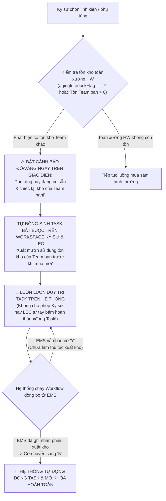

# 01. Bàn Làm Việc Kỹ Sư: Khởi Tạo Nhu Cầu, Cảnh Báo Tồn Kho Team Bạn & Task Bắt Buộc
> *Hiển Thị Cảnh Báo Tồn Kho Team Bạn Ngay Khi Tạo Đơn, Duy Trì Task Bắt Buộc Đến Khi EMS Đổi Sang 'N', Điều Kiện Thẩm Định Bắt Buộc Có QCode & LEC Tự Tay Phân Loại Target/Over*

---

## 1. Cơ Chế Cảnh Báo Tồn Kho Team Bạn & Duy Trì Task Bắt Buộc (Persistent Interlock Task)

Theo quy định thực tế tại xưởng:
> **"Thủ tục mượn/xuất dùng tồn kho của Team khác: Sẽ hiển thị cảnh báo cho Requestor ngay khi tạo. Luôn luôn duy trì task phải làm cho đến khi hệ thống load lại thông tin EMS đã chuyển sang 'N'."**

### Đặc tả quy tắc hiển thị và vận hành:
1. **Cảnh báo tức thời (Instant Warning Banner)**:
   - Ngay khi Kỹ sư gõ mã QCode hoặc chọn từ cây EBOM, nếu linh kiện có tồn kho tại Team khác, form tạo đơn lập tức hiển thị khung cảnh báo nổi bật:
     > ⚠️ **CẢNH BÁO TỒN KHO NHÀN RỖI**: Mã `QDAB03583` hiện đang có tồn **6 EA** tại kho của **PO Module Tech Team 1**. Hãy liên hệ LEC để mượn xuất dùng trước khi đề xuất mua mới!
2. **Task bắt buộc duy trì liên tục (Persistent Mandatory Task)**:
   - Hệ thống tự động tạo 1 Task mang mã `TASK-INTER-STOCK-[QCode]`.
   - Task này **không có nút bấm "Hoàn tất thủ công"**.
   - Điều kiện duy nhất để Task được giải phóng là: **Khi phiếu xuất kho/điều chuyển được thực hiện trên hệ thống EMS, và workflow đồng bộ định kỳ đọc được cờ `agingInterlockFlag` đã chuyển thành `'N'`**.

---

## 2. Điều Kiện Đưa Vào Thẩm Định Đầu Tháng & Phân Loại Target vs Over

### 2.1. Bắt Buộc Phải Có Mã QCode Mới Được Thẩm Định
* **Quy tắc cứng**: **Trường hợp có thể thẩm định BẮT BUỘC PHẢI CÓ MÃ QCODE**.
* Các linh kiện mới chỉ có mã tạm thời `TMP-HW-xxxx` (kỹ sư mới nộp folder CAD/Doc) **không được đưa vào phiên thẩm định chi phí đầu tháng**.
* Kỹ sư phải chuẩn bị đủ hồ sơ tài liệu từ sớm để LEC hoàn tất việc cấp mã QCode trên ERP/EMS trước khi kỳ thẩm định diễn ra.

### 2.2. LEC Tự Tay Phân Loại — Tuyệt Đối Không Tự Động
* Hệ thống **tuyệt đối không tự động gán nhãn** `Trong Target` hay `Over`.
* Kỹ sư chỉ có nhiệm vụ:
  - Cung cấp hiện trạng máy móc, mô tả vấn đề hỏng hóc.
  - Đính kèm mã lệnh bảo trì sửa chữa máy (`Work Order: WO-xxxx`).
  - Đính kèm hình ảnh hiện trường linh kiện cháy hỏng.
  - Đề xuất sơ bộ lý do (`OVR-01` đến `OVR-06`).
* **LEC là người tự tay xem xét và bấm chọn phân loại chính thức** trên Bàn làm việc LEC.

### 2.3. Hạn Thẩm Định & Giải Trình Do LEC Quy Định
* Thời hạn chốt nộp **Task Giải Trình Tồn Kho Chưa Dùng** và chốt hồ sơ thẩm định chi phí đầu tháng **hoàn toàn do LEC quy định hạn (Deadline)** theo lịch làm việc thực tế của Team, không áp đặt ngày cố định.

---

## 3. Các Phương Thức Tạo Yêu Cầu Của Kỹ Sư

### 3.1. Đăng ký theo Cây EBOM Tên Thân Thiện
- Kỹ sư chọn: `Dây chuyền Line #201` $\rightarrow$ `Máy Die Bonder DB-01` $\rightarrow$ `Cụm Đầu Gắp Bonding Head` $\rightarrow$ Tích chọn phụ tùng.
- Nếu cơ cấu chưa có trong EBOM: Chọn `[+] Cơ cấu chưa có trong EBOM (Khai báo sau)` để không bị chặn mua.

### 3.2. Đăng ký cho sự cố máy đột xuất (Emergency Breakdown)
- Chọn loại nhu cầu: `Dùng ngay do sự cố máy (Breakdown)`.
- Nhập mã lệnh sửa máy `Work Order` (ví dụ `WO-248926091`).
- Tải ảnh hiện trường linh kiện hỏng và màn hình log alarm máy.

### 3.3. Đăng ký qua Bảng Nhập Lưới (Grid Entry)
- Copy-paste hàng chục dòng từ Excel kiểm kê ca vào bảng lưới.
- Kiểm tra các dòng bị cảnh báo tồn kho Team bạn để ưu tiên xuất dùng trước.
