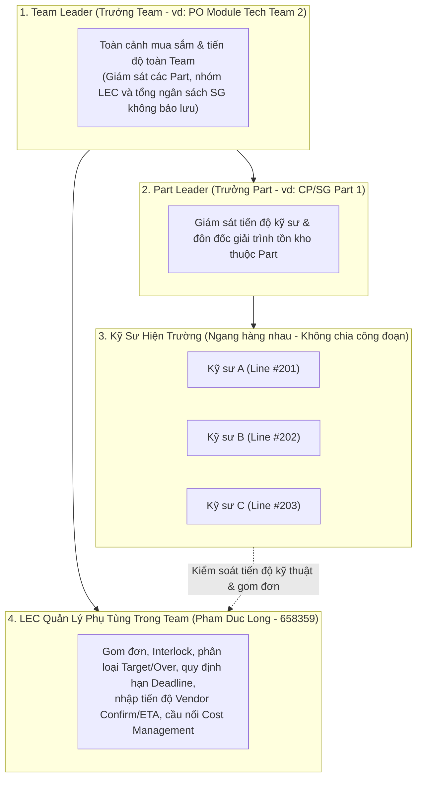

# 02. Bàn Điều Khiển Leader: Giám Sát Tiến Độ Mua Sắm Nội Bộ Team (Team => Part => Kỹ Sư)

> *Tài liệu đặc tả nghiệp vụ Bàn Điều Khiển Leader (Team / Part Leader)*  
> *Nguyên tắc cốt lõi: Không chia công đoạn (kỹ sư ngang hàng trong Part), Bỏ qua quy trình duyệt trên hệ thống (duyệt chính thức trên EMS - hệ thống này CHỈ KIỂM SOÁT TIẾN ĐỘ), giám sát tiến độ giải trình tồn kho và phân bổ chi phí.*

---

## 1. Mục Đích & Phạm Vi Giám Sát Của Leader (Team & Part Scope)

Theo định hướng vận hành thực tế tại nhà máy Smart Watch (Factory HW):
1. **Kỹ sư ngang hàng (Peer Engineers)**: Trong mỗi Part/Team, toàn bộ kỹ sư đều bình đẳng, không phân chia cấp bậc Công đoạn (Process: POL, TAB, DIP...) và không có vai trò "Process Leader".
2. **Không phê duyệt trên hệ thống mới**: Mọi quy trình phê duyệt ký tá ngân sách, PRV, PO chính thức đều thực hiện trên hệ thống **LG Display Nexacro EMS**. Hệ thống nội bộ này **hoàn toàn loại bỏ các nút bấm phê duyệt/duyệt đơn (Endorse / Approve / Reject)**; chức năng duy nhất là **kiểm soát tiến độ toàn diện (Progress Tracking)**.
3. **Phạm vi hiển thị (Visibility Scope)**:
   - **Part Leader**: Theo dõi tiến độ mua sắm và tiến độ giải trình tồn kho của toàn bộ kỹ sư thuộc Part mình phụ trách.
   - **Team Leader**: Giám sát toàn cảnh tiến độ của tất cả các Part trong Team, tiến độ xử lý của LEC, tỷ trọng Target vs Over do LEC phân loại, và tình trạng phân bổ chi phí hàng tháng.

---

## 2. Các Chức Năng Chính Trên Màn Hình Leader

### 2.1. Thẻ Chỉ Số Tiến Độ Thời Gian Thực (Team Real-time KPI Cards)
- **Tổng số hạng mục đang xử lý**: Phân tách rõ theo các mốc tiến độ (Chuẩn bị data QCode $\rightarrow$ Gom đơn $\rightarrow$ Chờ thẩm định đầu tháng $\rightarrow$ Đang RFQ $\rightarrow$ Đã lên EMS $\rightarrow$ Chờ hàng về).
- **Tỷ trọng Trong Target vs Over (Do LEC phân loại)**:
  * Tỷ lệ xanh (Trong Target): Hạng mục phụ tùng thay thế định kỳ nằm trong ngân sách.
  * Tỷ lệ đỏ (Over phát sinh): Cảnh báo hạng mục ngoài kế hoạch cần chuẩn bị tài liệu kỹ thuật để giải trình trong đợt thẩm định đầu tháng với Cost Management.
- **Tiến độ giải trình tồn kho (Task Monitoring)**:
  * Theo dõi số lượng Task giải trình tồn kho chưa sử dụng của các kỹ sư trong Part.
  * Theo dõi các Task cảnh báo tồn kho của Team khác (`agingInterlockFlag`) chưa hoàn tất thủ tục mượn/xuất kho.
- **Tổng ngân sách SG dự toán tháng**: Đối chiếu tiến độ cam kết chi phí với hạn mức tháng của Team (Nguyên tắc nghiêm ngặt: **Không bảo lưu ngân sách - No Rollover** giữa các tháng).

### 2.2. Bảng Theo Dõi Tiến Độ Chi Tiết (Team Procurement Progress Table)
Bảng hiển thị trực quan toàn bộ các yêu cầu mua sắm của các kỹ sư trong Part/Team với các cột dữ liệu:
* **Kỹ sư yêu cầu (Requestor Name & ID)**: Tên kỹ sư tạo đơn trong Part.
* **Định vị máy**: Tên máy thân thiện (vd: *Die Bonder DB-01, Line #201, Tầng 2*).
* **Thông tin phụ tùng**: Tên chi tiết, Mã QCode chính thức (hoặc mã tạm `TMP-HW-xxxx` đang chuẩn bị data), Số lượng yêu cầu.
* **Cờ cảnh báo tồn kho (`agingInterlockFlag`)**:
  - `Y`: Cảnh báo có tồn kho khả dụng (của nội bộ hoặc của **Team khác**). Hiển thị trạng thái kỹ sư đã làm thủ tục mượn/xuất kho hay chưa. Task này được duy trì liên tục cho đến khi EMS cập nhật chuyển sang `'N'`.
* **Phân loại của LEC**: Huy hiệu `[TARGET]` hoặc `[OVER PHÁT SINH]` (do LEC đánh giá thủ công, không tự động).
* **Mốc tiến độ mua sắm (Tracking Funnel)**:
  1. *Đang chuẩn bị data QCode*: Kỹ sư đã nộp folder CAD/Doc/ảnh, LEC đang đăng ký QCode trên ERP/EMS.
  2. *Chờ thẩm định đầu tháng*: Đã có QCode chính thức, LEC đưa vào danh sách thẩm định chi phí với Cost Management.
  3. *Đang RFQ báo giá*: Chuyên viên Purchase đang đàm phán giá với nhà cung cấp.
  4. *Đã tạo PRV / PO trên EMS*: Đang trong quy trình phê duyệt ký tá chính thức trên hệ thống EMS.
  5. *Vendor Confirm ngày nhận*: Nhà cung cấp đã xác nhận ngày giao hàng dự kiến.
  6. *ETA về cảng / nội địa*: Ngày hàng dự kiến về nhà máy HW.
  7. *Hoàn tất nhập kho (EMS Sync)*: Trạng thái hàng về đã được ghi nhận trên hệ thống EMS.

---

## 3. Vai Trò Giám Sát Của Leader Trong Các Hoạt Động Trọng Yếu

### 3.1. Đôn Đốc Kỹ Sư Thực Hiện Task Giải Trình & Mượn Tồn Kho
- Leader không can thiệp duyệt hay chặn đơn trên hệ thống, nhưng có trách nhiệm:
  1. Đôn đốc kỹ sư hoàn thành các Task giải trình tồn kho trước **Deadline do LEC thiết lập**.
  2. Yêu cầu kỹ sư ưu tiên làm thủ tục liên hệ mượn/xuất dùng tồn kho của Team khác trước khi tiếp tục đẩy yêu cầu mua mới.
  3. Rà soát trước các lý do kỹ thuật nếu phụ tùng rơi vào diện `OVER` để hỗ trợ kỹ sư và LEC chuẩn bị nội dung thẩm định với Cost Management vào đầu tháng.

### 3.2. Theo Dõi Kế Hoạch Phân Bổ Chi Phí Hàng Tháng
- Leader theo dõi tiến độ phân bổ chi phí phụ tùng theo từng tháng sử dụng (do LEC phối hợp cùng kỹ sư sắp xếp) nhằm đảm bảo chi phí phát sinh đồng đều, không làm biến động vượt trần ngân sách SG tháng của Team.

### 3.3. Hoàn Toàn Không Duyệt Trên Ứng Dụng Này
- Mọi thao tác phê duyệt chính thức diễn ra trên **LG Display Nexacro EMS**. Bàn điều khiển Leader chỉ là công cụ hỗ trợ trực quan hóa dữ liệu và quản trị vận hành nội bộ theo thời gian thực.
