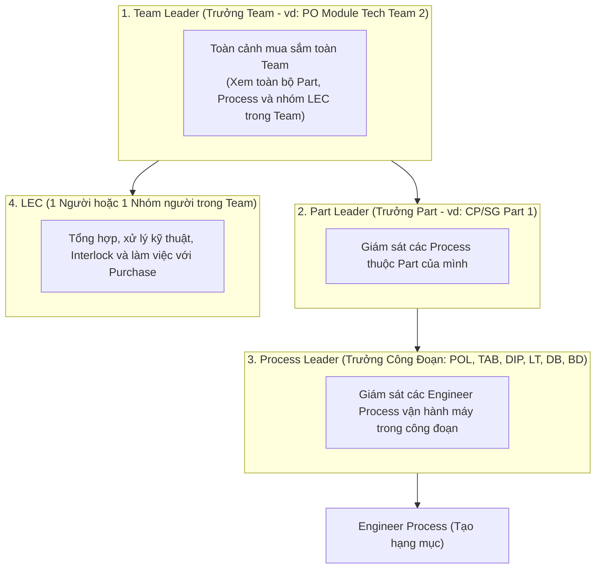

# 02. Bàn Điều Khiển Leader: Giám Sát Mua Sắm Nội Bộ Team (Team => Part => Process)

## 1. Mục Đích & Phạm Vi Phân Quyền Leader (Team Scope Visibility)

Theo định hướng vận hành nhà xưởng:
> **"Các Leader có thể xem và kiểm soát toàn bộ hoạt động mua hàng trong nội bộ team."**

Hệ thống phân quyền theo cấp bậc tổ chức chuẩn hóa:

$$\mathbf{Team\ (Ph\grave{o}ng\ Ban)} \longrightarrow \mathbf{Part\ (Ph\hat{a}n\ Ban)} \longrightarrow \mathbf{Process\ (C\hat{o}ng\ \text{đ}o\text{ạ}n)} \longrightarrow \mathbf{Engineer\ Process\ (K\tilde{y}\ S\u{)}}\$$

### Phạm vi hiển thị theo phân quyền (Scope Constraint):
*   **Process Leader**: Xem toàn bộ đơn hàng của các kỹ sư trong công đoạn của mình (ví dụ Leader DB giám sát các máy DB-01, DB-02 trên các Line #201..#205).
*   **Part Leader**: Xem tổng hợp các công đoạn trực thuộc Part.
*   **Team Leader**: Xem toàn diện toàn bộ Team, kiểm soát tổng chi phí mua so với ngân sách SG tháng ($33\% - 33\% - 34\%$) trước khi LEC xuất hồ sơ trình Management.

---

## 2. Các Chức Năng Chính Trên Bàn Làm Việc Leader

### 2.1. Thống Kê Tổng Quan Đội Ngũ (Team Real-time KPI Card)
- **Tổng số hạng mục đang yêu cầu**: Số phiếu đã tạo trong tháng của toàn team/part/process.
- **Tỷ trọng Trong Target vs Over**:
  * Tỷ lệ xanh (Trong kế hoạch): mục tiêu $> 85\%$.
  * Tỷ lệ đỏ (Over ngoài kế hoạch): cảnh báo nếu phát sinh quá $15\%$.
- **Tổng ngân sách dự toán đã cam kết của Team**: Đối chiếu với hạn mức SG được phân bổ cho công đoạn.

### 2.2. Danh Sách Theo Dõi Chi Tiết (Team Procurement Tracking Table)
Bảng hiển thị toàn bộ các phiếu mua sắm của các kỹ sư trong team với các cột lọc:
*   **Người tạo (Engineer Name & ID)**.
*   **Phân cấp máy**: `Process > Machine > Unit > Line`.
*   **Hạng mục**: Tên linh kiện, QCode / Mã tạm `TMP-HW-xxxx`, Số lượng.
*   **Phân loại Kế hoạch**: Huy hiệu rõ ràng `[TRONG TARGET]` hoặc `[OVER NGOÀI KẾ HOẠCH]`.
*   **Trạng thái xử lý**:
    - *Mới tạo / Chờ Leader xác nhận*.
    - *Đã chuyển LEC (Pham Duc Long) thẩm định*.
    - *Chờ pháp nhân khác xác nhận chuyển giao (Interlock Step 1)*.
    - *Purchase đang làm giá ngoài*.
    - *Đã lên PO*.

### 2.3. Thẩm Tra Nội Bộ Trước Khi Chuyển LEC (Internal Team Endorsement)
Trước khi phiếu mua sắm được chuyển đến LEC trong Team:
1.  Leader kiểm tra tính chính xác của lý do hư hỏng và mã Work Order (`WO-xxxx`).
2.  Leader bấm nút **"Xác Nhận Nội Bộ (Endorse)"**:
    - Hệ thống đóng dấu chứng thực của Leader.
    - Chuyển tiếp phiếu sang cho nhân sự LEC trong Team (Pham Duc Long) để tiến hành xử lý kỹ thuật và Interlock.
3.  Nếu phát hiện kỹ sư đăng ký sai thông số hoặc đặt thừa số lượng: Leader bấm **"Trả lại chỉnh sửa"** kèm lời nhắn trực tiếp trên khung chat.
