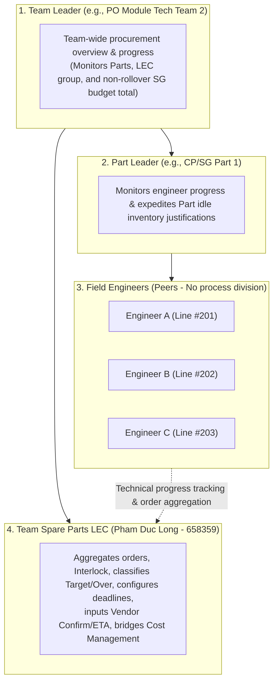

# 02. Leader Team Monitoring Dashboard: Intra-Team Procurement Progress Tracking (Team => Part => Engineers)

> *Business Specification for Leader Dashboard (Team / Part Leader)*  
> *Core Principles: No process/stage division (peer engineers within Part), Bypassed in-app approval workflow (official approval on EMS — this system is STRICTLY FOR PROGRESS TRACKING), monitoring idle inventory justification progress and expense allocation.*

---

## 1. Purpose & Monitoring Scope of Leaders (Team & Part Scope)

According to operational reality at the Smart Watch manufacturing plant (Factory HW):
1. **Peer Engineers**: Within each Part/Team, all engineers operate as peers without hierarchical Process tiers (POL, TAB, DIP...) and without "Process Leader" roles.
2. **No In-App Approval in New System**: All official budget endorsement, PRV, and PO approvals are executed on **LG Display Nexacro EMS**. This internal system **completely omits in-app endorsement / approval / rejection buttons (Endorse / Approve / Reject)**; its exclusive role is **end-to-end progress tracking**.
3. **Visibility Scope**:
   - **Part Leader**: Tracks procurement progress and idle inventory justification progress for all engineers within their assigned Part.
   - **Team Leader**: Oversees panoramic progress across all Parts in the Team, LEC processing throughput, Target vs Over proportion classified by LEC, and monthly expense allocation status.

---

## 2. Key Capabilities on the Leader Dashboard

### 2.1. Real-Time Team Progress KPI Cards
- **Total Pipeline Items**: Broken down by progress milestone (QCode Data Prep $\rightarrow$ Order Aggregation $\rightarrow$ Pending Beginning-of-Month Audit $\rightarrow$ RFQ in Progress $\rightarrow$ Logged on EMS $\rightarrow$ Awaiting Delivery).
- **Target vs Over Breakdown (Classified by LEC)**:
  * Green Ratio (Within Target): Routine replacement items accommodated within budget quota.
  * Red Ratio (Over Budget / Unplanned): Non-routine items requiring technical documentation for beginning-of-month audit with Cost Management.
- **Idle Inventory Justification Monitoring (Task Monitoring)**:
  * Tracks pending idle inventory justification tasks assigned to Part engineers.
  * Tracks peer team idle stock warning tasks (`agingInterlockFlag`) pending warehouse borrowing/issuing procedures.
- **Monthly Committed SG Budget Total**: Compares committed expenditure against the Team's monthly allowance (Strict Rule: **No Budget Rollover** across months).

### 2.2. Detailed Team Procurement Progress Table
A visual grid displaying all requisitions initiated by engineers within the Part/Team with data columns:
* **Requestor Name & ID**: Name of the requisition creator within the Part.
* **Machine Location**: Friendly machine name (e.g., *Die Bonder DB-01, Line #201, Floor 2*).
* **Spare Part Information**: Part name, Official QCode (or temporary code `TMP-HW-xxxx` during data preparation), Requested quantity.
* **Inventory Warning Flag (`agingInterlockFlag`)**:
  - `Y`: Alert indicating available inventory (internal or belonging to a **peer team**). Indicates whether the engineer has executed borrowing/issuing procedures. This task remains active until EMS re-sync confirms the flag has turned to `'N'`.
* **LEC Classification**: Badge `[TARGET]` or `[OVER BUDGET]` (manually evaluated by LEC, strictly non-automated).
* **Procurement Milestones (Tracking Funnel)**:
  1. *QCode Data Preparation*: Engineer uploaded CAD/Doc/photo folder; LEC registering QCode on ERP/EMS.
  2. *Pending Beginning-of-Month Audit*: Official QCode issued; LEC included item in cost audit package with Cost Management.
  3. *RFQ Quoting*: Purchasing specialist actively negotiating pricing with suppliers.
  4. *PRV / PO Created on EMS*: Currently undergoing official review and electronic signatures on EMS.
  5. *Vendor Confirmed Delivery Date*: Supplier confirmed expected shipment/delivery date.
  6. *Port / Domestic ETA*: Anticipated arrival date at Factory HW.
  7. *Goods Receipt Complete (EMS Sync)*: Physical goods receipt confirmed and synced from EMS.

---

## 3. Leader Monitoring Responsibilities in Critical Operations

### 3.1. Expediting Engineer Justification Tasks & Peer Stock Borrowing
- Leaders do not intervene to approve or block orders in the system, but hold operational responsibility to:
  1. Expedite engineers to resolve idle inventory justification tasks before the **Deadline configured by the LEC**.
  2. Instruct engineers to prioritize borrowing and issuing available stock from peer teams before pushing new purchase requisitions.
  3. Pre-review technical justifications if items fall under `OVER` to assist engineers and the LEC in preparing audit materials for the beginning-of-month session with Cost Management.

### 3.2. Tracking Monthly Expense Allocation Plan
- Leaders monitor spare part cost allocation plans across usage months (arranged by the LEC in coordination with engineers) to ensure balanced expenditure without exceeding the monthly Team SG budget ceiling.

### 3.3. Strictly No In-App Approvals
- All official approvals take place on **LG Display Nexacro EMS**. The Leader Dashboard functions strictly as a data visualization and intra-team operational progress tracking instrument.
