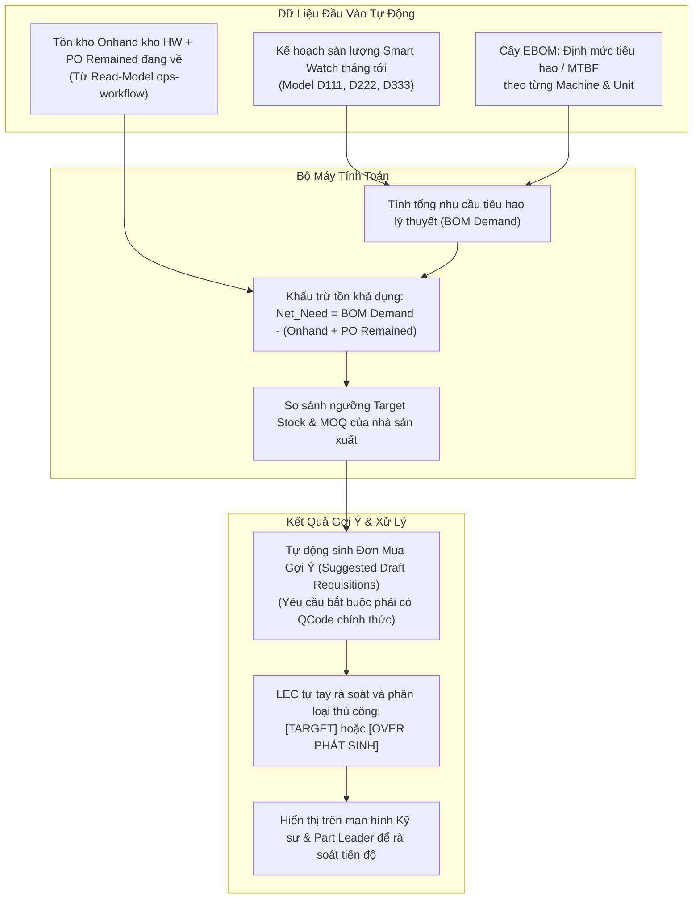

# 03. Động Cơ Sinh Đơn Mua Định Kỳ Tự Động (Auto-Requisition Engine)

> *Tài liệu đặc tả Động Cơ Gợi Ý Nhu Cầu Phụ Tùng Tự Động (Auto-Requisition Engine)*  
> *Nguyên tắc cốt lõi: Phục vụ kỳ thẩm định đầu tháng; Không tự động phân loại Target/Over (LEC tự tay đánh giá phân loại); Kỹ sư ngang hàng trong Part (không phân chia công đoạn); Kiểm soát tiến độ và chuẩn bị dữ liệu.*

---

## 1. Cơ Chế Hoạt Động Định Kỳ

Động cơ sinh đơn tự động chạy định kỳ vào cuối tháng để tính toán lượng phụ tùng tiêu hao cần bù đắp, sẵn sàng dữ liệu cho **đợt thẩm định chi phí vào ĐẦU THÁNG** giữa LEC và Bộ phận Quản Lý Chi Phí (Cost Management):

---

## 2. Công Thức Tính Toán Chi Tiết

$$\text{Nhu Cầu Mua Bổ Sung} = \max\left(0, \left(\sum_{\text{Model}} \frac{\text{Sản Lượng Dự Kiến}}{\text{Định Mức Tuổi Thọ Phụ Tùng}} \times \text{SL Lắp/Máy}\right) + \text{Target Buffer} - (\text{Onhand} + \text{PO Remained})\right)$$

*   Nếu kết quả $> 0$: Làm tròn lên theo **Số lượng đặt tối thiểu (MOQ)** hoặc **Quy cách đóng gói (Pack Size)**.
*   **Điều kiện thẩm định**: Chỉ các hạng mục đã có **Mã QCode chính thức** mới đủ điều kiện đưa vào danh sách thẩm định đầu tháng. Các mã tạm (`TMP-HW-xxxx`) phải hoàn tất tải dữ liệu kỹ thuật để LEC đăng ký QCode trước.
*   **Không tự động phân loại**: Hệ thống chỉ đưa ra số liệu tính toán gợi ý. **LEC là người trực tiếp đánh giá và phân loại thủ công** xem hạng mục đó thuộc diện `TARGET` (trong kế hoạch chi phí) hay `OVER` (vượt kế hoạch cần giải trình).
*   **Kiểm soát tiến độ**: Kỹ sư phụ trách máy xem trước danh sách gợi ý, phản hồi thực tế tình trạng máy móc cho LEC trước thời hạn (Deadline) do LEC thiết lập.
