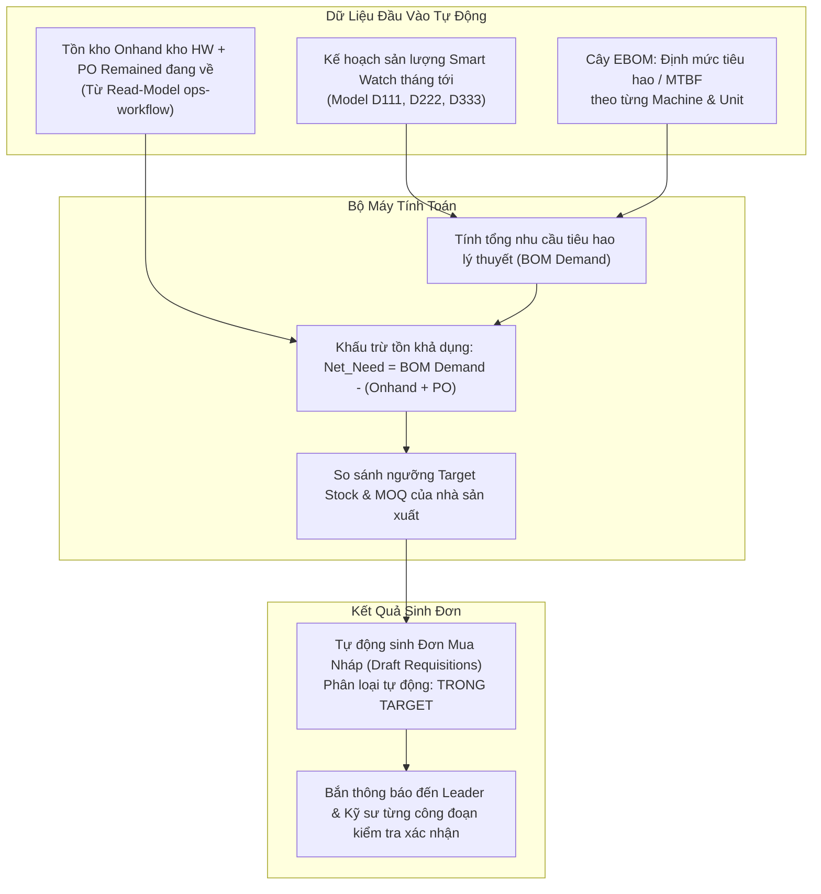

# 03. Động Cơ Sinh Đơn Mua Định Kỳ Tự Động (Auto-Requisition Engine)

## 1. Cơ Chế Hoạt Động Định Kỳ

Động cơ sinh đơn tự động chạy định kỳ vào ngày 25 hàng tháng để tính toán lượng phụ tùng tiêu hao cần bù đắp cho tháng tiếp theo:

---

## 2. Công Thức Tính Toán Chi Tiết

$$\text{Nhu Cầu Mua Bổ Sung} = \max\left(0, \left(\sum_{\text{Model}} \frac{\text{Sản Lượng Dự Kiến}}{\text{Định Mức Tuổi Thọ Phụ Tùng}} \times \text{SL Lắp/Máy}\right) + \text{Target Buffer} - (\text{Onhand} + \text{PO Remained})\right)$$

*   Nếu kết quả $> 0$: Làm tròn lên theo **Số lượng đặt tối thiểu (MOQ)** hoặc **Quy cách đóng gói (Pack Size)**.
*   Toàn bộ các đơn hàng sinh ra từ động cơ này đều được hệ thống tự động gắn nhãn: **🟢 TRONG TARGET (IN_TARGET)** vì nằm hoàn toàn trong kế hoạch sản lượng định mức.
*   Kỹ sư và Leader công đoạn chỉ cần vào giao diện xem trước (Preview), bấm xác nhận hoặc điều chỉnh nhẹ nếu có lịch dừng bảo trì dài ngày.

