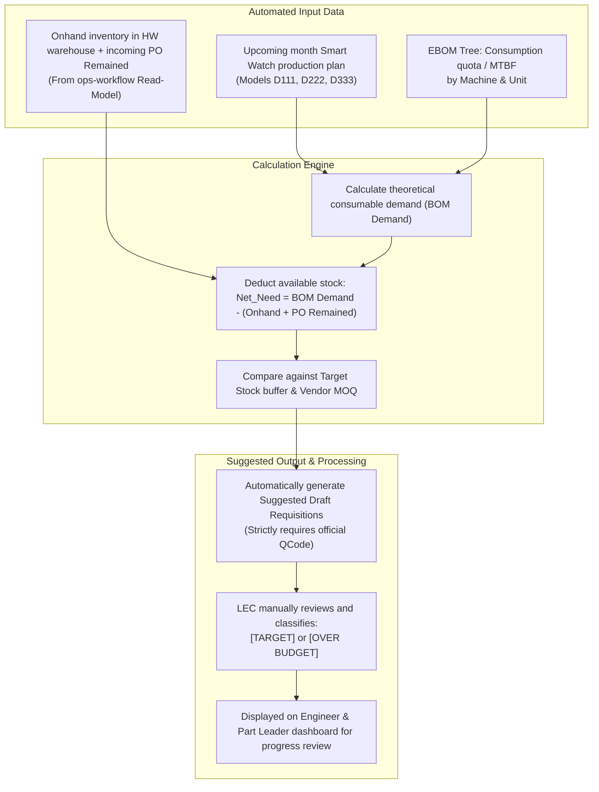

# 03. Periodic Auto-Requisition Engine (Auto-Requisition Engine)

> *Specification for Spare Parts Demand Suggestion Engine (Auto-Requisition Engine)*  
> *Core Principles: Serves Beginning-of-Month audit; Strictly NO automated Target/Over classification (LEC manually evaluates and classifies); Peer engineers within Part (no process/stage division); Progress tracking and data preparation.*

---

## 1. Periodic Execution Mechanism

The auto-requisition engine executes periodically at month-end to calculate consumable spare parts replenishment requirements, preparing data ready for the **BEGINNING-OF-MONTH cost review/audit session** between the LEC and the Cost Management department:

---

## 2. Detailed Mathematical Formula

$$\text{Replenishment Demand} = \max\left(0, \left(\sum_{\text{Model}} \frac{\text{Projected Production Volume}}{\text{Spare Part Life Expectancy Quota}} \times \text{Installed Qty/Machine}\right) + \text{Target Buffer} - (\text{Onhand} + \text{PO Remained})\right)$$

*   If the result is $> 0$: Round up to the nearest **Minimum Order Quantity (MOQ)** or **Packaging Unit (Pack Size)**.
*   **Audit Prerequisite**: Only line items with **Official QCodes** are eligible for inclusion in the beginning-of-month audit package. Temporary codes (`TMP-HW-xxxx`) must complete technical documentation submission so the LEC can register official QCodes first.
*   **Strictly No Automated Classification**: The system solely outputs calculated demand suggestions. **The LEC directly evaluates and manually classifies** each item as either `TARGET` (within expense plan) or `OVER` (exceeding plan, requiring justification).
*   **Progress Tracking**: Machine engineers preview suggested line items and submit feedback regarding physical equipment conditions to the LEC ahead of the deadline configured by the LEC.
