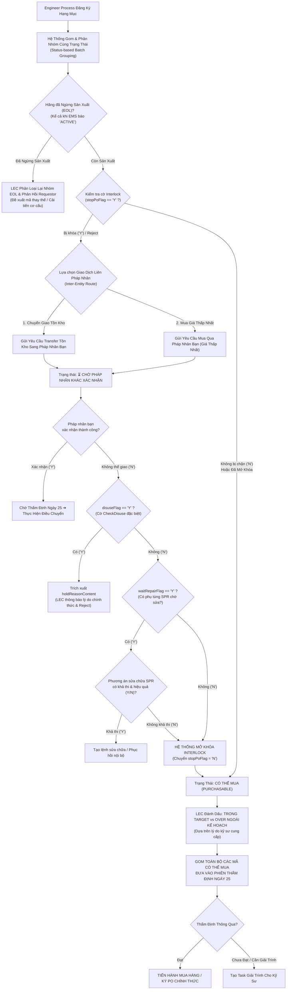

# 01. Quy Trình Xử Lý Interlock Tuần Tự: Cơ Chế Y/N, Giao Dịch Liên Pháp Nhân & Phân Loại Ngừng Sản Xuất (EOL)

## 1. Nguyên Tắc Cốt Lõi Về Đăng Ký Hạng Mục & Đánh Giá Interlock

Quy trình Interlock được chuẩn hóa theo thực tế vận hành nhà xưởng:
1.  **Gom và kiểm tra từ các Kỹ sư Quy trình (Engineer Process)**:
    *   Các Kỹ sư Quy trình trong Team đăng ký các hạng mục yêu cầu mua sắm.
    *   Hệ thống tự động **Gom (Aggregate) và Phân nhóm theo cùng trạng thái** để LEC xử lý đồng loạt (Batch Processing) thay vì duyệt lẻ tẻ từng dòng.
2.  **Hai nhánh Giao dịch Liên Pháp Nhân (Inter-Entity Transactions)**:
    *   Khi kiểm tra thấy pháp nhân khác trong tập đoàn (LGD Korea, Nanjing, Guangzhou...) có thể đáp ứng, có 2 phương án:
        - **Phương án 1: Chuyển giao tồn kho (Inventory Transfer)**: Lấy linh kiện tồn kho nhàn rỗi từ pháp nhân khác chuyển về xưởng.
        - **Phương án 2: Mua với giá thấp nhất từ pháp nhân khác**: Nếu pháp nhân bạn có đơn giá mua theo hợp đồng khung khu vực thấp hơn mua trực tiếp tại Việt Nam $\rightarrow$ phát lệnh mua ủy thác qua pháp nhân đó.
    *   Nếu kênh mua qua pháp nhân khác cũng bị khóa: Cơ chế xử lý **hoàn toàn tương tự như lệnh Transfer** (gửi yêu cầu sang hệ thống đối tác và chuyển trạng thái `Chờ pháp nhân khác xác nhận`).
3.  **Tách nhóm hạng mục "Có Thể Mua" đưa vào Thẩm Định**:
    *   Nếu code sau khi kiểm tra không bị cờ Interlock chặn hoặc đã hoàn tất mở khóa Interlock (`stopPoFlag == 'N'`) $\rightarrow$ Hệ thống gom toàn bộ các mã này vào danh sách **`TRẠNG THÁI CÓ THỂ MUA (PURCHASABLE)`** để đưa vào phiên Thẩm định Offline ngày 25 hàng tháng. Mua bán và chuyển giao chỉ được kích hoạt SAU KHI Thẩm định thông qua.
4.  **Phân loại lại hàng "Ngừng sản xuất" (Discontinued / EOL)**:
    *   Thực tế dữ liệu hệ thống EMS cũ cung cấp thường xuyên không đầy đủ hoặc sai lệch: Nhiều mã phụ tùng hãng đã dừng sản xuất từ lâu nhưng trên EMS vẫn để trạng thái `ACTIVE`.
    *   LEC có thẩm quyền kỹ thuật để **chỉnh sửa, phân loại lại vào nhóm `Ngừng sản xuất (EOL)`**, cập nhật mã phụ tùng thay thế hoặc hướng dẫn kỹ sư cải tiến cơ cấu, đồng thời hệ thống tự động bắn phản hồi cho Requestor.
5.  **Thẩm quyền phân định Trong Target vs Over ngoài kế hoạch**:
    *   Kỹ sư Requestor cung cấp hiện trạng, lý do (Breakdown, sản lượng...).
    *   **LEC là người chính thức thẩm định và bấm cờ đánh dấu `TRONG TARGET` hay `OVER NGOÀI KẾ HOẠCH`** dựa trên đối chiếu với ngân sách thực tế.
6.  **Đánh giá thuần túy theo cờ Y/N**:
    *   Hệ thống chỉ kiểm tra cờ chặn là có hay không (`Y` hoặc `N`). Tuyệt đối **không đánh giá dựa trên số lượng tồn kho ảo** (`transferQty`), vì số lượng tồn kho trên hệ thống chỉ mang tính chất tham khảo, không đảm bảo việc xuất hàng thực tế giữa các pháp nhân.
7.  **Lộ trình kết nối EMS mở rộng dần (Phased Rollout)**:
    *   **Giai đoạn hiện tại (Phase 1)**: Sau khi mở khóa Interlock và chốt duyệt thẩm định, LEC thao tác tạo PRV trên hệ thống EMS, sau đó quay lại hệ thống nhập thông tin đối soát (PRV No / Request ID). Hệ thống tự động gọi API lấy thông tin và cập nhật trạng thái.
    *   **Giai đoạn mở rộng (Phase 2)**: Hệ thống sẽ tự động gọi API `save130PrvData.lgdn` để trực tiếp sinh đơn trên EMS.

---

## 2. Sơ Đồ Khối Chi Tiết Các Bước Xử Lý Tuần Tự

---

## 3. Chi Tiết Hai Nhánh Giao Dịch Liên Pháp Nhân

| Tiêu chí so sánh | Nhánh 1: Chuyển Giao Tồn Kho (Transfer) | Nhánh 2: Mua Với Giá Thấp Nhất (Lowest Cost Buy) |
| :--- | :--- | :--- |
| **Bản chất nghiệp vụ** | Điều chuyển vật tư nhàn rỗi đang nằm trong kho của pháp nhân bạn (HQ Hàn Quốc, LGD Nam Kinh, LGD Quảng Châu...). | Ủy thác cho pháp nhân bạn phát hành đơn mua hộ từ nhà cung cấp ngoại quốc do họ có đơn giá đàm phán rẻ hơn đáng kể. |
| **Điều kiện kích hoạt** | Cờ `transferFlag == 'Y'` và pháp nhân bạn có lượng hàng dư thừa không dùng đến. | Báo giá tại Việt Nam quá cao hoặc nhà cung cấp chỉ bán cho pháp nhân nội địa của họ với mức chiết khấu lớn. |
| **API gọi dữ liệu** | `/retPartsTransferReqList.lgdn` | `/retOtherSitePoRevReqList.lgdn` |
| **Xử lý khi bị khóa** | Nếu kênh bị khóa: chuyển trạng thái `CHỜ PHÁP NHÂN XÁC NHẬN`, SLA 48h. | Cơ chế xử lý hoàn toàn tương tự lệnh Transfer: chuyển trạng thái chờ xác nhận, nếu từ chối sẽ mở khóa mua thường. |
| **Điều kiện thực hiện** | **BẮT BUỘC DIỄN RA SAU KHI THẨM ĐỊNH NGÀY 25 PHÊ DUYỆT**. | **BẮT BUỘC DIỄN RA SAU KHI THẨM ĐỊNH NGÀY 25 PHÊ DUYỆT**. |

---

## 4. Xử Lý Bất Thường: Phân Loại Hàng Ngừng Sản Xuất (EOL) Dù EMS Báo ACTIVE

Một rủi ro nghiêm trọng trong vận hành thực tế là:
- Trên hệ thống EMS, trạng thái của linh kiện vẫn ghi nhận là `ACTIVE`.
- Tuy nhiên, nhà sản xuất (SMC, Keyence, Omron, Trumpf...) đã ra thông báo ngừng sản xuất (End-of-Life - EOL) hoặc thời gian giao hàng (Lead time) kéo dài vô lý (> 6 tháng).
- Nếu cứ để kỹ sư tạo đơn mua thường sẽ dẫn đến việc chậm tiến độ sản xuất và treo đơn hàng.

### Cơ chế xử lý của LEC:
1.  **Gắn nhãn phân loại lại (Reclassification)**: LEC bấm nút `[🏷️ Đổi Trạng Thái ➔ Ngừng Sản Xuất (EOL)]` ngay trên dòng kiểm tra.
2.  **Ghi chú lý do & Tài liệu minh chứng**: LEC đính kèm thông báo EOL của nhà sản xuất hoặc email phản hồi từ Purchase Dept.
3.  **Hệ thống tự động bắn phản hồi cho Requestor**:
    - Gửi thông báo đến Kỹ sư Quy trình: *"Linh kiện [QCode] đã ngừng sản xuất thực tế. Đề nghị chuyển sang mã thay thế hoặc cải tiến đồ gá"*.
    - Đồng thời cập nhật trạng thái linh kiện trên EBOM của toàn phân xưởng thành `DISCONTINUED_BY_MAKER` để các kỹ sư khác không tiếp tục đặt mua nhầm.

---

## 3. Phân Tích Kỹ Thuật Bước 1: Chờ Pháp Nhân Khác Xác Nhận

- **Bản chất giao tiếp**: Gọi API `/emsspareparts/sp40/sp401Nav/retPartsTransferReqList.lgdn` và `/retOtherSitePoRevReqList.lgdn`.
- **Luồng xử lý trên giao diện LEC**:
  - Khi `transferFlag == 'Y'`, hệ thống chuyển trạng thái dòng thành:
    `⏳ PENDING_OTHER_ENTITY_CONFIRMATION`
  - Hệ thống ghi nhận mốc thời gian chờ (SLA quy định: 48 giờ làm việc).
  - Nếu sau 48 giờ pháp nhân bạn chưa xác nhận điều phối hoặc có thông báo vướng mắc thủ tục xuất khẩu liên quốc gia $\rightarrow$ LEC được quyền ghi chú lý do và chuyển tiếp sang Bước 2 mà không bị hệ thống chặn cứng.

---

## 4. Xử Lý Trường Hợp Đặc Biệt: `CheckDisuse` & `holdReasonContent`

- **Tầm quan trọng**: Ngăn ngừa tuyệt đối việc kỹ sư mua nhầm các chi tiết máy đã bị nhà sản xuất thu hồi hoặc bị kỹ thuật cấm sử dụng do lỗi thiết kế.
- **Nguồn dữ liệu trích xuất**:
  - Gọi API `/emsspareparts/sp302/sp330Nav/TargetStockSearchList.lgdn`.
  - Đọc trường **`holdReasonContent`** trong dataset `ds_StockInfomation`.
- **Ví dụ hiển thị trên màn hình**:
  > ⚠️ **CẢNH BÁO DISUSE**: Phụ tùng này bị cấm mua mới trên hệ sinh thái EMS.  
  > **Lý do từ hệ thống**: *"Khai tử theo chỉ thị thay thế cụm đầu gắp Bonding Head V2 model D222 ngày 2026-09-01 (Công văn kỹ thuật HQ-601)"*.  
  > $\rightarrow$ Hệ thống tự động khóa nút Mua Thường, chỉ cho phép LEC bấm `Xác Nhận Hủy (Reject)`.

