# 01. Sequential Interlock Resolution Process: Y/N Mechanisms, Peer Team Stock & End-of-Life (EOL) Classification
> *Operational Standardization: agingInterlockFlag (Consume peer team stock before purchasing, no justification required for other teams' stock), unitPriceFlag (Pricing availability), Inter-Entity Transactions (48h SLA), Beginning-of-Month Cost Audit with Cost Management (1 Single Person) & Official Approvals on EMS*

---

## 1. Core Principles of Item Registration & Interlock Evaluation

The Interlock resolution process is standardized around actual shop-floor operational realities:

1. **Aggregation and Status-Based Batch Grouping from Peer Engineers**:
   - Field engineers across the Team (peer engineers with no hierarchical process-leader boundaries) register procurement requests using friendly machine names.
   - The system automatically **aggregates and groups requests by common status** to enable LEC batch processing.
2. **Nature of `agingInterlockFlag` — Cross-Team Stock (Consume Before Purchasing)**:
   > ⚠️ **GOLDEN RULE ON AGING STOCK**:  
   > When `agingInterlockFlag == 'Y'`, the system warns that stagnant/aged inventory exists within the HW factory, **but this may be idle stock belonging to ANOTHER PEER TEAM**.  
   > $\rightarrow$ **DO NOT DEMAND JUSTIFICATION FROM THE REQUESTING ENGINEER** (Engineers are not responsible for stagnant inventory held by other teams).  
   > $\rightarrow$ **MANDATORY TO BORROW/USE THIS STOCK BEFORE PURCHASING**: The system generates a persistent mandatory task to borrow or transfer idle stock across teams (Intra-Plant Transfer between Cost Centers). This interlock task remains active and only auto-closes when a re-sync with EMS confirms `agingInterlockFlag == 'N'`.
3. **Nature of `unitPriceFlag` — Pricing Availability**:
   - `unitPriceFlag == 'Y'`: A valid contract unit price negotiated by the Purchase Department is already active (`unitPriceStatusCode == 'UP001'`).
   - `unitPriceFlag == 'N'`: No price is available (`UP004: None Price`), pending RFQ negotiations between the Purchase Department and vendors. The LEC tracks quotation progress.
4. **3-Tier Waterfall Interlock Resolution Mechanism**:
   - When interlock checks detect idle stock across other group entities or benchmark price disparities:
     - **Tier 1: Inventory Transfer (`WH-TR-xxxx`)**: Request transfer of idle inventory from peer entities (Korea, Nanjing, Guangzhou, Plant 2) or Central Hub. If approved, order completes at zero procurement cost; if rejected, drops to Tier 2.
     - **Tier 2: Internal Purchase Order (`IPO-xxxx`)**: Purchase through peer entity holding lower contract prices or master framework agreements. If approved, order executes internally; if rejected, drops to Tier 3.
     - **Tier 3: External Procurement (`PO-99xxx`)**: Direct external purchase order issued strictly on Nexacro EMS Core at best negotiated vendor price.
5. **Reclassification of Discontinued / End-of-Life (EOL) Items**:
   - When legacy EMS data still displays `ACTIVE` but the manufacturer has actually discontinued production or the lead time is excessively long (>6 months), the LEC possesses the technical authority to **manually reclassify the item into the `Discontinued (EOL)` category**, assign alternative replacement part codes, or guide the engineer on mechanical structural retrofit, while the system automatically dispatches notifications to the engineer.
6. **Authority to Classify In-Target vs. Unplanned Over-Budget**:
   - The engineer provides machine status and breakdown causes (e.g., breakdown work order, throughput spike).
   - **The LEC serves as the sole official authority to manually tag items as `🟢 IN TARGET` or `🔴 UNPLANNED OVER`** (gated with one of 6 mandatory codes `OVR-01..06` and Work Order binding `WO-xxxx`) + 14-char EM No (`HWBMTL21EC0101`). Strictly NO auto-classification by the system.
7. **Beginning-of-Month Cost Audit (Days 01–05) & 3-Party Clarification Bridge**:
   - Items eligible for procurement (`PURCHASABLE`, strictly requiring an official QCode; temporary `TMP-HW-` codes hard-blocked) are consolidated into the **Beginning-of-Month Audit session** (Days 01–05) with the Reviewer (Cost Management — 1 single person acting as Reviewer & Assistant).
   - If the Reviewer requires further clarification $\rightarrow$ Reviewer notifies LEC $\rightarrow$ **LEC enters inquiry into the system for the Requestor Engineer** $\rightarrow$ **Engineer responds to LEC** $\rightarrow$ **LEC submits consolidated clarification back to Reviewer** (3-party clarification loop).
   - Upon successful review, Reviewer issues Cost Clearance certificate `CC-HW-YYYYMM-PASS`. All approved lines are locked with strict No-Rollover (surplus = $0).
   - **Formal PO approval and issuance take place 100% on Nexacro EMS Core** (the new system contains no approval buttons; it strictly tracks milestones and progress).

---

## 2. Detailed Sequential Process Flowchart

```mermaid
flowchart TD
    Start["Field Engineer Registers Procurement Demand"] --> BatchGroup["System Aggregates & Groups by Status\n(Status-based Batch Grouping)"]
    
    BatchGroup --> CheckEOL{"Discontinued by Manufacturer (EOL)?\n(Even if EMS shows 'ACTIVE')"}
    CheckEOL -->|"Discontinued"| ReclassifyEOL["LEC Reclassifies to EOL & Notifies Engineer\n(Proposes Replacement Code / Structural Retrofit)"]
    
    CheckEOL -->|"Active Production"| CheckAging{"agingInterlockFlag == 'Y' ?\n(Aged/Stagnant Inventory Alert)"}
    
    CheckAging -->|"Yes ('Y')"| TeamStock["POTENTIALLY PEER TEAM STOCK!\n• No justification required from requestor\n• MANDATORY TO BORROW/CONSUME PRIOR TO PURCHASE!"]
    TeamStock --> DoIntraTransfer["Create Intra-Plant Borrow/Transfer Request in HW Factory\n(Persistent task auto-closes only when EMS syncs 'N')"]
    
    CheckAging -->|"No ('N')"| CheckStop{"Check Interlock Flag\n(stopPoFlag == 'Y' ?)"}
    
    CheckStop -->|"Blocked ('Y')"| InterEntity{"Select Inter-Entity Route"}
    
    InterEntity -->|"1. Inventory Transfer"| SendTransfer["Submit Inventory Transfer Request to Peer Entity"]
    InterEntity -->|"2. Lowest-Cost Purchase"| SendBuyCheap["Submit Purchase Request via Peer Entity (Lowest Price)"]
    
    SendTransfer & SendBuyCheap --> StatusWait["Status: ⏳ AWAITING PEER ENTITY CONFIRMATION (SLA: 48h)"]
    
    StatusWait --> WaitConfirm{"Peer Entity Confirmed (Y/N)?"}
    WaitConfirm -->|"Confirmed ('Y')"| DoneTransfer["Pending Beginning-of-Month Audit ➔ Execute Transfer"]
    WaitConfirm -->|"Rejected ('N') / SLA > 48h"| CheckDisuse
    
    CheckStop -->|"Not Blocked ('N')\nOr Interlock Cleared"| ClearStep["Status: PURCHASABLE (Eligible to Buy)"]
    
    CheckDisuse{"disuseFlag == 'Y' ?\n(Disuse Interlock Check)"} -->|"Yes ('Y')"| ExtractReason["Extract holdReasonContent\n(LEC notifies official reason & Rejects)"]
    CheckDisuse -->|"No ('N')"| CheckRepair{"waitRepairFlag == 'Y' ?\n(Repairable SPR spares available?)"}
    
    CheckRepair -->|"Yes ('Y')"| EvalRepair{"Is internal SPR repair\nfeasible & cost-effective (Y/N)?"}
    EvalRepair -->|"Feasible ('Y')"| DoRepair["Issue Internal Repair / Refurbishment Order"]
    EvalRepair -->|"Not Feasible ('N')"| UnlockInterlock["SYSTEM UNLOCKS INTERLOCK\n(Set stopPoFlag = 'N')"]
    CheckRepair -->|"No ('N')"| UnlockInterlock
    UnlockInterlock --> ClearStep
    
    ClearStep --> LEC_TargetEval["LEC Manually Tags: 🟢 IN TARGET vs 🔴 OVER (OVR-01..06 & WO)\n+ Assigns EM No 14 chars (HWBMTL21EC0101)"]
    LEC_TargetEval --> ConsolidateAudit["CONSOLIDATE PURCHASABLE CODES (HARD BLOCK ON TMP-)\nSUBMIT TO BEGINNING-OF-MONTH AUDIT (Days 01-05)"]
    
    ConsolidateAudit --> AuditPass{"Cost Management Reviewer Audit"}
    AuditPass -->|"Clarification Needed"| InquiryLoop["3-Party Loop: Reviewer -> LEC -> Requestor Engineer -> LEC -> Reviewer"]
    InquiryLoop --> AuditPass
    AuditPass -->|"Cost Cleared"| IssueCert["Issue Cost Clearance Certificate CC-HW-YYYYMM-PASS\nLock Final Purchase List (Strict No-Rollover)"]
    
    IssueCert --> Waterfall3{"3-Tier Waterfall Interlock Resolution"}
    Waterfall3 -->|"Tier 1: Approve"| DoneT1["✅ Intra/Inter-Entity WH Transfer Complete (WH-TR-xxxx)"]
    Waterfall3 -->|"Tier 1: Reject"| Tier2{"Tier 2: Internal PO (IPO-xxxx)"}
    Tier2 -->|"Tier 2: Approve"| DoneT2["✅ Internal Entrusted PO Complete"]
    Tier2 -->|"Tier 2: Reject"| Tier3["Tier 3: External Procurement (PO-99xxx)\nSigned 100% on Nexacro EMS Core"]
    Tier3 --> Inbound["Track Inbound / Real ETA & Sync ds_Inv"]
```

---

## 3. In-Depth Operational Rules for the Two Core Flags

### 3.1. `agingInterlockFlag` (Frozen Stock / Cross-Team Inventory)
- **System Display**: `agingInterlockFlag == 'Y'`.
- **Operational Handling**:
  1. When this flag is active, the system queries the HW plant-wide inventory ledger: identifies which warehouse bin stores this spare part and which Cost Center / Team owns it.
  2. **If Stock Belongs to Another Team (Cross-Team Inventory)**:
     - The requesting engineer is **NOT required to submit an aging stock justification task** (they are not responsible for another team's accumulation).
     - The system displays a high-visibility amber banner: `[⚠️ Idle inventory found in peer team (Qty: X) — Mandatory to borrow/consume before purchasing]`.
     - A persistent mandatory task is created for the engineer/LEC to initiate an intra-plant transfer between the two Cost Centers in the HW factory. This task persists and automatically resolves only when an EMS sync cycle confirms `agingInterlockFlag == 'N'`.
  3. **If Stock Belongs to the Requesting Team Itself**:
     - The engineer is required to complete an aging justification task explaining why existing on-hand stock has not been consumed, feeding into the Beginning-of-Month Audit.

### 3.2. `unitPriceFlag` (RFQ Quotation Status)
- **`unitPriceFlag == 'Y'`**:
  - The item possesses an active master purchase contract price (`unitPriceStatusCode == 'UP001'`).
  - The system automatically populates the estimated unit price to calculate the committed spend ceiling (`PO Commit Spend`).
- **`unitPriceFlag == 'N'`**:
  - The item lacks contract pricing (`unitPriceStatusCode == 'UP004: None Price'`).
  - The item is routed to the **Quotation Tracking (RFQ Tracking)** queue for the Purchase Department to negotiate commercial terms with vendors.
  - It can still undergo technical necessity review in the Beginning-of-Month Audit, but formal PO generation on EMS remains blocked until Purchase concludes price registration.

---

## 4. 3-Tier Waterfall Interlock Resolution & Purchase Execution Mechanism

Following Cost Clearance approval (`CC-HW-YYYYMM-PASS`) in Step 8, Step 9 executes a 3-tier waterfall resolution:

| Waterfall Tier | Execution Channel & Mechanism | Approval Action | Next Step / Escalation |
| :--- | :--- | :--- | :--- |
| **Tier 1: Inventory Transfer** | Intra-Plant or Inter-Entity Transfer Slip (`WH-TR-xxxx`) from peer factory/warehouse | **Approve** $\rightarrow$ Dispatch inventory to HW warehouse; Requisition completed at zero purchase cost | **Reject** $\rightarrow$ Automatically escalates to Tier 2 |
| **Tier 2: Internal Purchase Order** | Internal PO (`IPO-xxxx`) placed via sister entity with favorable framework contract prices | **Approve** $\rightarrow$ Execute internal entrusted order; Requisition completed with cost savings | **Reject** $\rightarrow$ Automatically escalates to Tier 3 |
| **Tier 3: External Procurement** | Standard external PO issuance (`PO-99xxx`) via Corporate Procurement | **Executed 100% on Nexacro EMS Core ERP**; System records PO No, monitors Inbound milestones & real ETA | Requisition transitions to `INBOUND_TRACKING` until physical receipt and `ds_Inv` sync |