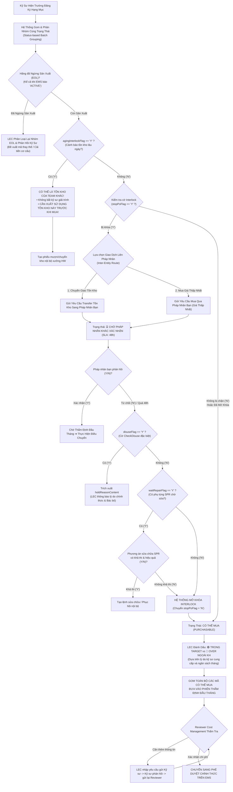

# 01. Quy Trình Xử Lý Interlock Tuần Tự: Cơ Chế Y/N, Tồn Kho Team Khác & Phân Loại Ngừng Sản Xuất (EOL)
> *Chuẩn hóa thực tế: agingInterlockFlag (Xuất dùng tồn kho Team bạn trước khi mua, không bắt giải trình), unitPriceFlag (Đã có giá hay chưa), Xử lý Liên Pháp Nhân (SLA 48h), Thẩm định chi phí ĐẦU THÁNG với Cost Management (1 người) & Phê duyệt trên EMS*

---

## 1. Nguyên Tắc Cốt Lõi Về Đăng Ký Hạng Mục & Đánh Giá Interlock

Quy trình Interlock được chuẩn hóa theo thực tế vận hành nhà xưởng:

1. **Gom và phân nhóm cùng trạng thái từ các Kỹ sư (Ngang hàng nhau)**:
   - Các Kỹ sư trong Team đăng ký nhu cầu mua sắm bằng Tên máy thân thiện.
   - Hệ thống tự động **Gom (Aggregate) và Phân nhóm theo cùng trạng thái** để LEC xử lý đồng loạt (Batch Processing).
2. **Bản chất cờ `agingInterlockFlag` — Tồn kho của Team khác (Xuất dùng trước khi mua)**:
   > ⚠️ **QUY TẮC VÀNG VỀ TỒN KHO AGING**:  
   > Khi cờ `agingInterlockFlag == 'Y'`, hệ thống cảnh báo có tồn kho lâu ngày tại nhà máy HW, **nhưng đây có thể là tồn kho nhàn rỗi của TEAM KHÁC**.  
   > $\rightarrow$ **KHÔNG YÊU CẦU KỸ SƯ GIẢI TRÌNH** (Kỹ sư team này không chịu trách nhiệm cho tồn kho của team khác).  
   > $\rightarrow$ **CẦN XUẤT SỬ DỤNG TỒN KHO NÀY TRƯỚC KHI MUA MỚI**: LEC ưu tiên kích hoạt thủ tục mượn/chuyển giao nội bộ xưởng (Intra-Plant Transfer) để lấy phụ tùng từ kho Team bạn đem ra dùng, tránh lãng phí ngân sách mua mới.
3. **Bản chất cờ `unitPriceFlag` — Đã có giá hay chưa**:
   - `unitPriceFlag == 'Y'`: Đã có đơn giá mua hiệu lực do Purchase đàm phán sẵn.
   - `unitPriceFlag == 'N'`: Chưa có giá (`UP004: None Price`), đang chờ Purchase đàm phán RFQ với nhà cung cấp. LEC theo dõi tiến độ báo giá.
4. **Hai nhánh Giao dịch Liên Pháp Nhân (Inter-Entity Transactions)**:
   - Khi kiểm tra thấy pháp nhân khác trong tập đoàn (LGD Korea, Nanjing, Guangzhou...) có thể đáp ứng:
     - **Nhánh 1: Chuyển giao tồn kho (Inventory Transfer)**: Lấy linh kiện tồn kho nhàn rỗi từ pháp nhân bạn chuyển về xưởng.
     - **Nhánh 2: Mua với giá thấp nhất từ pháp nhân khác**: Nếu pháp nhân bạn có đơn giá mua theo hợp đồng khung rẻ hơn mua tại Việt Nam $\rightarrow$ phát lệnh mua ủy thác qua pháp nhân đó.
   - Nếu kênh mua qua pháp nhân bạn cũng bị khóa: Chuyển trạng thái `Chờ pháp nhân khác xác nhận` (SLA 48h).
5. **Phân loại lại hàng "Ngừng sản xuất" (Discontinued / EOL)**:
   - Khi dữ liệu EMS cũ vẫn báo `ACTIVE` nhưng hãng thực tế đã ngừng sản xuất hoặc lead-time quá dài (>6 tháng), LEC có thẩm quyền kỹ thuật để **chỉnh sửa, phân loại lại vào nhóm `Ngừng sản xuất (EOL)`**, cập nhật mã phụ tùng thay thế hoặc hướng dẫn kỹ sư cải tiến cơ cấu, đồng thời hệ thống tự động bắn phản hồi cho Kỹ sư.
6. **Thẩm quyền phân định Trong Target vs Over ngoài kế hoạch**:
   - Kỹ sư cung cấp hiện trạng, lý do (Breakdown, sản lượng...).
   - **LEC là người chính thức thẩm định và bấm cờ đánh dấu `🟢 TRONG TARGET` hay `🔴 OVER NGOÀI KẾ HOẠCH`** dựa trên đối chiếu với ngân sách thực tế.
7. **Thẩm định chi phí & Kiểm thảo tồn kho vào ĐẦU THÁNG với Cost Management**:
   - Nhóm các mã đủ điều kiện (`PURCHASABLE`) được đưa vào phiên họp **Thẩm định đầu tháng** với Reviewer (Cost Management).
   - Nếu Reviewer cần thêm thông tin giải trình $\rightarrow$ Reviewer báo LEC $\rightarrow$ **LEC nhập yêu cầu trên hệ thống gửi Kỹ sư** $\rightarrow$ **Kỹ sư phản hồi cho LEC** $\rightarrow$ **LEC gửi lại cho Reviewer**.
   - Sau khi Reviewer xác nhận chi phí, việc **Phê duyệt chính thức diễn ra trên EMS** (Hệ thống mới chỉ kiểm soát tiến độ).

---

## 2. Sơ Đồ Khối Chi Tiết Các Bước Xử Lý Tuần Tự

---

## 3. Bản Chất Chi Tiết Hai Cờ Trạng Thái Quan Trọng

### 3.1. Cờ `agingInterlockFlag` (Tồn Kho Đóng Băng / Tồn Kho Team Bạn)
- **Hiển thị trên hệ thống**: `agingInterlockFlag == 'Y'`.
- **Cơ chế xử lý thực tế**:
  1. Khi cờ này bật, hệ thống kiểm tra chi tiết bảng tồn kho toàn nhà máy HW: Phụ tùng này đang nằm ở kho nào và thuộc quyền sở hữu của Team nào.
  2. **Nếu là tồn kho của Team khác**:
     - Kỹ sư của Team hiện tại **không bị yêu cầu làm Task giải trình tồn kho** (vì không phải do Team mình tích trữ).
     - Hệ thống hiện cảnh báo màu vàng: `[⚠️ Có tồn kho nhàn rỗi tại Team bạn (X chiếc) - Ưu tiên xuất sử dụng trước khi mua]`.
     - LEC thực hiện lệnh mượn/chuyển giao giữa 2 Cost Center nội bộ nhà máy HW.
  3. **Nếu là tồn kho của chính Team mình**:
     - Kỹ sư bắt buộc phải làm việc qua Task giải trình lý do chưa xuất dùng phục vụ kiểm thảo đầu tháng.

### 3.2. Cờ `unitPriceFlag` (Tình Trạng Biểu Giá RFQ)
- **`unitPriceFlag == 'Y'`**:
  - Mã hàng đã có đơn giá hợp đồng có hiệu lực (`unitPriceStatusCode == 'UP001'`).
  - Hệ thống tự động điền đơn giá ước tính để tính toán trần chi phí cam kết (`PO Commit Spend`).
- **`unitPriceFlag == 'N'`**:
  - Mã hàng chưa có giá (`unitPriceStatusCode == 'UP004: None Price'`).
  - Hạng mục được đưa vào danh sách **Theo Dõi Báo Giá (RFQ Tracking)** để Purchase Dept đàm phán giá với nhà cung cấp.
  - Vẫn có thể đưa vào thẩm định đầu tháng về mặt nhu cầu kỹ thuật, nhưng lệnh PO chính thức chỉ được tạo sau khi Purchase chốt giá xong trên EMS.
