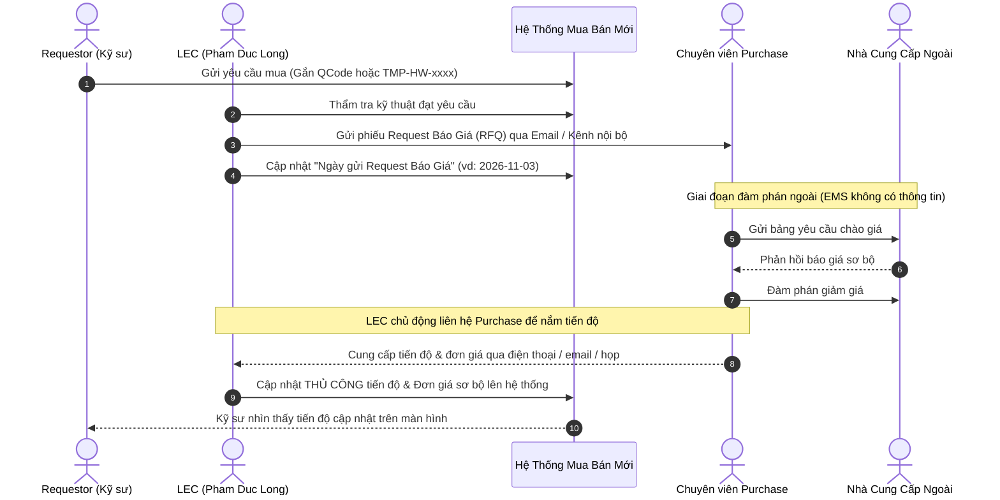

# 02. Phối Hợp Báo Giá Với Bộ Phận Mua Hàng (Purchase Coordination)

## 1. Bản Chất Ranh Giới Nghiệp Vụ Giữa LEC Và Purchase

Trong thực tế sản xuất tại LG Display:
- **LEC trong Team (1 người hoặc 1 nhóm người, đại diện: Pham Duc Long - 658359)**: Chịu trách nhiệm về **Kỹ thuật & Quản lý Spare Parts trong Team** (Đúng quy cách, đúng máy, mở Interlock, quản lý mã tạm `TMP-HW-xxxx`).
- **Purchase Dept (Bộ phận Mua Hàng ngoài)**: Chịu trách nhiệm về **Thương mại & Làm giá với Nhà cung cấp ngoài** (Làm việc với ServeOne, SMC, Keyence, Trumpf, đàm phán hợp đồng, chiết khấu số lượng).
- **Hạn chế của hệ thống EMS cũ**: EMS **hoàn toàn không có dữ liệu** về tiến độ báo giá trung gian của Purchase.

---

## 2. Bảng Theo Dõi Tiến Độ Báo Giá Thủ Công Của LEC

Trên giao diện hệ thống, LEC được cung cấp các trường nhập liệu để cập nhật thông tin từ Purchase:

| Tên trường dữ liệu | Trách nhiệm nhập | Ý nghĩa theo dõi | Ví dụ giá trị |
| :--- | :---: | :--- | :--- |
| `request_rfq_date` | LEC | Ngày LEC chính thức chuyển yêu cầu sang Purchase | `2026-11-03` |
| `purchase_officer_name` | LEC | Chuyên viên Purchase thụ lý hồ sơ | `Nguyễn Văn Nam (Ext: 3421)` |
| `purchase_status` | LEC | Trạng thái hiện tại do Purchase báo | `WAITING_VENDOR_QUOTE` (Đang chờ NCC) |
| `expected_quote_date` | LEC | Hạn cam kết trả giá từ Purchase | `2026-11-08` |
| `preliminary_unit_price`| LEC | Đơn giá sơ bộ đã đàm phán được | `3,150.00 USD` |
| `quotation_file_url` | LEC | Đính kèm file PDF báo giá của NCC | `quote_serveone_cpx_v4.pdf` |
| `lec_purchase_notes` | LEC | Ghi chú cuộc gọi / email trao đổi | *"ServeOne cam kết giao hàng trong 14 ngày nếu chốt PO trước 15/11"* |

Việc chuẩn hóa các trường này giúp toàn bộ Kỹ sư và Leader trong team nhìn thấy tiến độ rõ ràng, triệt tiêu tình trạng hỏi đi hỏi lại gây lãng phí thời gian.

