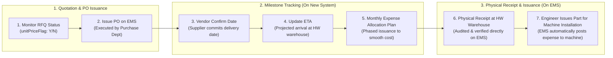

# 02. RFQ Quotation Tracking, Delivery Milestones (Vendor Confirm, ETA) & Expense Allocation Planning
> *Monitoring unitPriceFlag, Tracking Vendor Confirmation Date, Estimated Time of Arrival (ETA), Monthly Expense Allocation Planning & Handling Exceptions from Purchase Department Inquiries*

---

## 1. Business Boundaries & Core Milestones Under Control

Within the procurement operating model at LG Display:
- **External Purchase Department (Purchase Dept)**: Serves as the dedicated commercial unit directly interfacing with vendors (ServeOne, SMC, Keyence, Trumpf, etc.), responsible for contract execution, volume discounts, and unit price negotiations.
- **EMS System**: Serves as the official system of record where physical goods receipts are registered (`notReceivingQty` converts into `receivingQty`). Consequently, **physical goods receipt status is verified directly within the core EMS system**.
- **The New System Tracks and Controls Upstream Milestones Prior to Receipt**:
  1. **Pricing Status (`unitPriceFlag`)**: Identifies whether an item has an active framework contract price (`Y`) or lacks pricing (`N` — awaiting quotation RFQ).
  2. **Vendor Confirmation Date**: The date the vendor officially confirms acceptance of the purchase order and commits to production and delivery timelines.
  3. **ETA (Estimated Time of Arrival)**: The projected date goods arrive at the HW plant warehouse (allowing engineers to proactively schedule machine overhaul windows).
  4. **Monthly Expense Allocation Planning**:
     - For large bulk purchases or framework contract orders, the LEC and engineers formulate a plan detailing **how many units are projected to be issued and consumed in each month**.
     - Objective: **Smooth out actual production expenses (`Issue Expense`) across consecutive months**, preventing single-month expense spikes that could breach the Team's SG budget.



---

## 2. Milestone Tracking & Monthly Expense Allocation Interface

On the LEC Workbench, the **Order Milestones & Expense Allocation** panel provides structured tracking fields:

```
┌──────────────────────────────────────────────────────────────────────────────────────────────────────────────────────────────────┐
│  DELIVERY MILESTONES & MONTHLY EXPENSE ALLOCATION TRACKING CONSOLE                                                 [X Close]     │
├──────────────────────────────────────────────────────────────────────────────────────────────────────────────────────────────────┤
│  Item Code: PR-2611-0082  |  QCode: QCAD38190  |  Part: SMC Dual Rod Cylinder MXQ16-100B  |  Order Qty: 10 EA                    │
├──────────────────────────────────────────────────────────────────────────────────────────────────────────────────────────────────┤
│ 1. DELIVERY MILESTONES TRACKING:                                                                                                 │
│ • Unit Price Status (unitPriceFlag):     🟢 PRICED (UP001 - Contract Price: $220.00 USD)                                         │
│ • Vendor Confirm Date:                   [ 2026-11-08 ] (Vendor SMC confirmed manufacturing & dispatch date)                     │
│ • ETA (Projected HW Warehouse Arrival):  [ 2026-11-15 ] (Projected dock arrival at warehouse H1-2F)                              │
│ • Physical Goods Receipt (Checked on EMS): ⏳ In Transit (PO Remained on EMS: 10 EA)                                             │
├──────────────────────────────────────────────────────────────────────────────────────────────────────────────────────────────────┤
│ 2. MONTHLY EXPENSE ALLOCATION PLAN (FOR PRODUCTION COST RECOGNITION):                                                            │
│ ┌─────────────────────────┬─────────────────────────┬─────────────────────────┬──────────────────────────────────────────────┐ │
│ │ Nov 2026 (Current Month)│ Dec 2026 (Next Month)   │ Jan 2027 (Future Month) │ Total Projected Allocation                   │ │
│ ├─────────────────────────┼─────────────────────────┼─────────────────────────┼──────────────────────────────────────────────┤ │
│ │ Plan: [ 4 ] EA (@$220)  │ Plan: [ 3 ] EA (@$220)  │ Plan: [ 3 ] EA (@$220)  │ 10 EA = $2,200.00 USD                        │ │
│ │ Expense: $880.00 USD    │ Expense: $660.00 USD    │ Expense: $660.00 USD    │ ↳ Phased expense allocation balanced evenly  │ │
│ └─────────────────────────┴─────────────────────────┴─────────────────────────┴──────────────────────────────────────────────┘ │
├──────────────────────────────────────────────────────────────────────────────────────────────────────────────────────────────────┤
│                                        [↩️ CANCEL]   [💾 SAVE MILESTONES & EXPENSE ALLOCATION]                                   │
└──────────────────────────────────────────────────────────────────────────────────────────────────────────────────────────────────┘
```

---

## 3. Handling Anomalies Communicated via Purchase Department Emails

When the Purchase Department notifies the engineering team of commercial or logistics anomalies via email:
- **Discontinued / End-of-Life (EOL)**: The LEC toggles the item status to `EOL` within the system and issues an engineering change notice to the requestor engineer to identify replacement models.
- **Excessive Lead-Time (> 120 Days)**: The LEC updates the ETA, flags production line-stoppage risks, and coordinates with Cost Management and production planners.
- **Unanticipated Price Increase**: The LEC documents the price variance rationale and reclassifies the procurement line as `🔴 UNPLANNED OVER (Reason Code: OVR-05)` for review in the Beginning-of-Month Audit.