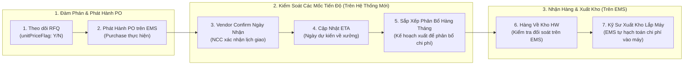

# 02. Theo Dõi Báo Giá RFQ, Các Mốc Tiến Độ (Vendor Confirm, ETA) & Phân Bổ Chi Phí
> *Kiểm Soát unitPriceFlag, Theo Dõi Vendor Confirm Ngày Nhận, Ngày Dự Kiến ETA, Kế Hoạch Sắp Xếp Phân Bổ Chi Phí Sử Dụng Hàng Tháng & Xử Lý Bất Thường Từ Email Purchase*

---

## 1. Ranh Giới Nghiệp Vụ & Các Mốc Tiến Độ Cốt Lõi Cần Kiểm Soát

Trong quy trình mua sắm tại LG Display:
- **Bộ Phận Mua Hàng Ngoài (Purchase Dept)**: Là đơn vị chuyên trách thương mại, trực tiếp làm việc với các nhà cung cấp (ServeOne, SMC, Keyence, Trumpf...), chịu trách nhiệm đàm phán hợp đồng, chiết khấu và đơn giá.
- **Hệ thống EMS**: Là nơi ghi nhận chính thức khi hàng về kho vật lý (`notReceivingQty` chuyển thành `receivingQty`). Do đó **thông tin hàng về chỉ cần kiểm tra trực tiếp trong hệ thống EMS**.
- **Hệ Thống Mới Đóng Vai Trò Kiểm Soát Các Giai Đoạn Trước Khi Hàng Về**:
  1. **Tình trạng giá (`unitPriceFlag`)**: Nhận diện mã hàng đã có biểu giá hợp đồng (`Y`) hay chưa có giá (`N` - cần chờ báo giá RFQ).
  2. **Vendor Confirm Ngày Nhận (Vendor Confirmation Date)**: Ngày nhà cung cấp chính thức xác nhận đơn đặt hàng và cam kết thời gian sản xuất.
  3. **ETA (Estimated Time of Arrival)**: Ngày dự kiến hàng cập bến kho nhà máy HW (phục vụ kỹ sư chủ động lịch sửa máy).
  4. **Sắp xếp phân bổ sử dụng hàng tháng (Monthly Expense Allocation Planning)**:
     - Đối với các lô hàng mua số lượng lớn hoặc theo hợp đồng khung: LEC và Kỹ sư lập kế hoạch **dự kiến tháng nào sẽ xuất kho sử dụng bao nhiêu chiếc**.
     - Mục đích: **Phân bổ chi phí sản xuất thực tế (`Issue Expense`) dàn đều theo từng tháng**, tránh dồn cục chi phí vào một tháng làm vỡ ngân sách SG của Team.



---

## 2. Giao Diện Theo Dõi Mốc Tiến Độ & Phân Bổ Chi Phí Hàng Tháng

Trên Bàn làm việc của LEC, tab **Tiến Độ Đơn Hàng & Phân Bổ Chi Phí** cung cấp các trường theo dõi chi tiết:

```
┌──────────────────────────────────────────────────────────────────────────────────────────────────────────────────────────────────┐
│  BẢNG THEO DÕI CÁC MỐC TIẾN ĐỘ & KẾ HOẠCH PHÂN BỔ CHI PHÍ SỬ DỤNG HÀNG THÁNG                                     [X Đóng]          │
├──────────────────────────────────────────────────────────────────────────────────────────────────────────────────────────────────┤
│  Mã Hạng Mục: PR-2611-0082  |  QCode: QCAD38190  |  Linh kiện: Xylanh trượt kép SMC MXQ16-100B  |  SL Đặt: 10 EA                 │
├──────────────────────────────────────────────────────────────────────────────────────────────────────────────────────────────────┤
│ 1. CÁC MỐC TIẾN ĐỘ GIAO HÀNG (MILESTONES TRACKING):                                                                              │
│ • Tình trạng đơn giá (unitPriceFlag):    🟢 ĐÃ CÓ GIÁ (UP001 - Đơn giá: $220.00 USD)                                             │
│ • Vendor Confirm Ngày Nhận:             [ 2026-11-08 ] (Nhà cung cấp SMC xác nhận ngày giao hàng)                                │
│ • ETA (Dự Kiến Cập Bến Kho HW):         [ 2026-11-15 ] (Thời gian dự kiến về đến kho H1-2F)                                      │
│ • Tình trạng hàng về (Kiểm tra từ EMS): ⏳ Đang vận chuyển (PO Remained trên EMS: 10 EA)                                         │
├──────────────────────────────────────────────────────────────────────────────────────────────────────────────────────────────────┤
│ 2. KẾ HOẠCH PHÂN BỔ SỬ DỤNG HÀNG THÁNG (ĐỂ PHÂN BỔ CHI PHÍ SẢN XUẤT):                                                            │
│ ┌─────────────────────────┬─────────────────────────┬─────────────────────────┬──────────────────────────────────────────────┐ │
│ │ Tháng 11/2026 (Kỳ này)  │ Tháng 12/2026 (Kỳ tới)  │ Tháng 01/2027 (Kỳ sau)  │ Tổng Phân Bổ Dự Kiến                         │ │
│ ├─────────────────────────┼─────────────────────────┼─────────────────────────┼──────────────────────────────────────────────┤ │
│ │ Xuất: [ 4 ] EA (@$220)  │ Xuất: [ 3 ] EA (@$220)  │ Xuất: [ 3 ] EA (@$220)  │ 10 EA = $2,200.00 USD                        │ │
│ │ Chi phí: $880.00 USD    │ Chi phí: $660.00 USD    │ Chi phí: $660.00 USD    │ ↳ Kế hoạch phân bổ chi phí dàn đều hợp lý    │ │
│ └─────────────────────────┴─────────────────────────┴─────────────────────────┴──────────────────────────────────────────────┘ │
├──────────────────────────────────────────────────────────────────────────────────────────────────────────────────────────────────┤
│                                        [↩️ HỦY BỎ]   [💾 LƯU CẬP NHẬT MỐC TIẾN ĐỘ & PHÂN BỔ CHI PHÍ]                              │
└──────────────────────────────────────────────────────────────────────────────────────────────────────────────────────────────────┘
```

---

## 3. Xử Lý Bất Thường Nhận Qua Email Từ Purchase

Khi Purchase Dept gửi email cảnh báo bất thường:
- Hãng báo **Ngừng sản xuất (EOL)** $\rightarrow$ LEC bấm nút chuyển trạng thái sang `EOL` trên hệ thống và gửi thông báo đổi mã cho Kỹ sư.
- Hãng báo **Lead-time quá dài (> 120 ngày)** $\rightarrow$ LEC cập nhật lại ngày ETA và cảnh báo nguy cơ dừng chuyền cho Kỹ sư và Cost Management.
- Hãng báo **Tăng đơn giá đột biến** $\rightarrow$ LEC ghi chú lý do và xếp hạng mục vào danh mục `🔴 OVER NGOÀI KẾ HOẠCH (Mã OVR-05)` để thẩm định đầu tháng.
