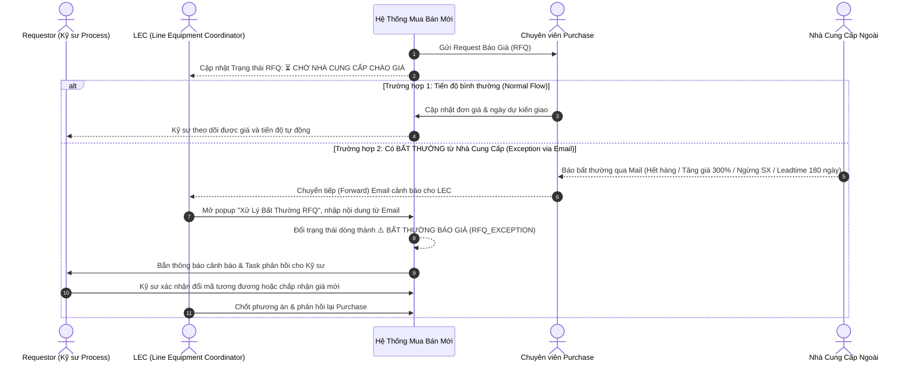

# 02. Theo Dõi Trạng Thái Báo Giá & Xử Lý Bất Thường Từ Email (RFQ Coordination)
> *LEC Theo Dõi Trạng Thái Báo Giá, Xử Lý Bất Thường Nhận Qua Mail, Cập Nhật Hệ Thống Để Phản Hồi Requestor & Đề Xuất Phương Án Kỹ Thuật*

---

## 1. Ranh Giới Nghiệp Vụ: LEC Không Làm Giá, Chỉ Theo Dõi & Xử Lý Bất Thường

Trong thực tế sản xuất tại LG Display:
- **Bộ Phận Mua Hàng Ngoài (Purchase Dept)**: Là đơn vị chuyên trách về thương mại, trực tiếp làm việc với các nhà cung cấp (ServeOne, SMC, Keyence, Trumpf...), chịu trách nhiệm đàm phán hợp đồng, chiết khấu và đơn giá.
- **LEC trong Team (Multi-LEC)**:
  - **CHỈ CẦN THEO DÕI TRẠNG THÁI** (Theo dõi trạng thái RFQ - Request Báo Giá).
  - **XỬ LÝ BẤT THƯỜNG (EXCEPTION HANDLING)**: Khi có thông tin bất thường nhận từ Email của Purchase Dept (ví dụ: nhà cung cấp ngừng sản xuất, lead-time quá dài, giá tăng đột biến, yêu cầu số lượng đặt hàng tối thiểu MOQ quá lớn...), LEC tiếp nhận, nhập thông tin bất thường lên hệ thống để:
    1. **Phản hồi chính thức cho Requestor (Kỹ Sư Quy Trình)**.
    2. **Phát hành cảnh báo thông báo hoặc phối hợp đưa ra phương án kỹ thuật thay thế**.



---

## 2. Giao Diện Theo Dõi Trạng Thái RFQ & Form Tiếp Nhận Bất Thường Từ Email

Trên Bàn làm việc của LEC, tab **Theo Dõi Báo Giá (RFQ Tracking)** được tinh gọn:
- Danh sách hiển thị rõ: Mã phụ tùng, Tên kỹ sư yêu cầu, Tên máy, Trạng thái RFQ, Ngày gửi yêu cầu, Deadline cam kết.
- Khi nhận được email bất thường từ Purchase, LEC chỉ cần click nút **`[⚠️ Nhập Bất Thường Từ Email]`** trên dòng tương ứng:

```
┌──────────────────────────────────────────────────────────────────────────────────────────────────────────────────────────────────┐
│  FORM TIẾP NHẬN BẤT THƯỜNG TỪ EMAIL BÁO GIÁ (RFQ EXCEPTION LOGGING)                                             [X Đóng]          │
├──────────────────────────────────────────────────────────────────────────────────────────────────────────────────────────────────┤
│  Mã Hạng Mục: PR-2611-0089  |  QCode: QDAD12236  |  Linh kiện: Board nguồn CPX V4 Trumpf  |  Requestor: Nguyễn Văn Thắng (DB)    │
├──────────────────────────────────────────────────────────────────────────────────────────────────────────────────────────────────┤
│  Loại Bất Thường Nhận Qua Mail: (*)                                                                                              │
│  (🔘) Hãng đã ngừng sản xuất (Maker EOL / Discontinued)                                                                          │
│  ( ) Lead-time quá dài bất thường (> 120 ngày, nguy cơ dừng chuyền)                                                             │
│  ( ) Đơn giá tăng vọt so với lịch sử (> 150%)                                                                                    │
│  ( ) Yêu cầu MOQ (Số lượng đặt hàng tối thiểu) quá lớn (vd: cần 1 EA nhưng NCC bắt mua 50 EA)                                  │
│  ( ) Nhà cung cấp từ chối bán cho thị trường Việt Nam (Cần chuyển kênh mua liên pháp nhân)                                      │
├──────────────────────────────────────────────────────────────────────────────────────────────────────────────────────────────────┤
│  Nội Dung Trích Dẫn Từ Email Của Purchase: (*)                                                                                   │
│  ┌────────────────────────────────────────────────────────────────────────────────────────────────────────────────────────────┐  │
│  │ "Kính gửi anh Long (LEC), bên đại diện Trumpf thông báo mã board 2912146 đã ngưng sản xuất từ tháng 08/2026. Hãng đề xuất    │  │
│  │  chuyển sang phiên bản nâng cấp CPX V5 (Part No: 3019882) với đơn giá 3,450 USD, thời gian giao hàng 3 tuần..."           │  │
│  └────────────────────────────────────────────────────────────────────────────────────────────────────────────────────────────┘  │
│  Đính kèm Email / Tài liệu báo giá (.eml, .msg, .pdf): [📎 Chon file email đính kèm: FW_Trumpf_EOL_Notice.msg]                   │
├──────────────────────────────────────────────────────────────────────────────────────────────────────────────────────────────────┤
│  Đề Xuất Hướng Xử Lý Của LEC Gửi Cho Requestor: (*)                                                                              │
│  [🔘 Đề nghị Kỹ sư duyệt mã thay thế CPX V5]    [ Đề xuất cải tiến gá lắp khác]    [ Hủy mua & tìm nguồn sửa chữa SPR]         │
├──────────────────────────────────────────────────────────────────────────────────────────────────────────────────────────────────┤
│                                        [↩️ HỦY BỎ]   [📨 PHẢN HỒI CHO REQUESTOR & CẬP NHẬT TIẾN ĐỘ]                               │
└──────────────────────────────────────────────────────────────────────────────────────────────────────────────────────────────────┘
```

---

## 3. Lợi Ích Của Cơ Chế Báo Giá Tinh Gọn

1.  **Giải phóng LEC khỏi gánh nặng kế toán/mua bán**: LEC không cần tốn thời gian gọi điện mặc cả giá hay nhập thủ công từng con số chi tiết nếu không có bất thường.
2.  **Thông tin thông suốt, có bằng chứng minh bạch**: Toàn bộ cảnh báo từ Purchase được lưu vết cùng tệp email gốc, Requestor nhìn thấy ngay lý do chậm trễ hoặc lý do phải đổi mã linh kiện mà không cần gọi điện hỏi LEC.
3.  **Tự động phân luồng xử lý**: Khi LEC chọn loại bất thường là *"Hãng đã ngừng sản xuất"*, hệ thống tự động kích hoạt tính năng **Đổi Trạng Thái EOL** trên Master Data và cảnh báo cho toàn nhà xưởng.


