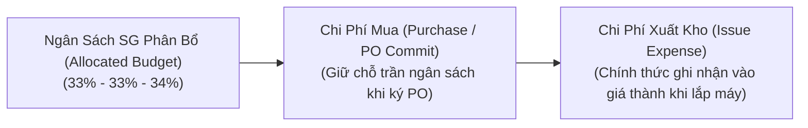

# 01. Quản Lý Ngân Sách SG & Kế Toán Chi Phí Mua vs Xuất

## 1. Bản Chất Hai Dòng Tiền: Mua Hàng vs Xuất Kho

Để kiểm soát chặt chẽ tài chính tại nhà máy HW (Smart Watch), hệ thống tách bạch tuyệt đối giữa hai khái niệm:

### So sánh chi tiết:
*   **Chi Phí Mua (Purchase Spend)**:
    - Phát sinh ngay khi LEC phát hành đơn đặt hàng (PO) cho nhà cung cấp (ServeOne, Trumpf...).
    - Mục đích: **Kiểm soát dòng tiền ra (Cash-out commitment)**, đảm bảo tổng giá trị cam kết mua trong tháng không vượt quá hạn mức phân bổ của tháng đó ($33\% - 33\% - 34\%$).
    - Hàng về nhập kho HW được ghi nhận là: **Tài sản tồn kho (Inventory Asset)**.
*   **Chi Phí Xuất (Issue / Operational Expense)**:
    - **CHỈ PHÁT SINH KHI KỸ SƯ XUẤT KHO LẮP VÀO MÁY TRÊN LINE**.
    - Mục đích: **Tính giá thành sản phẩm Smart Watch và chi phí vận hành thực tế của từng công đoạn (POL, TAB, DIP, LT, DB, BD)**.
    - Được gắn chính xác theo 4 cấp: `Process > Machine > Unit > Line` và mã lệnh sửa chữa `Work Order`.

---

## 2. Mô Hình Phân Bổ Ngân Sách SG 3 Tháng: $33\% - 33\% - 34\%$

Toàn bộ Quỹ ngân sách mua sắm phụ tùng SG (Spare Parts / General Expense - Tài khoản `NY PO M Technology CP/SG Part 1`, Phòng ban `87321`) được chia theo tỷ trọng:

$$\begin{cases} \text{Tháng thứ nhất } (M_1): & 33\% \text{ Tổng hạn mức quý} \\ \text{Tháng thứ hai } (M_2): & 33\% \text{ Tổng hạn mức quý} \\ \text{Tháng thứ ba } (M_3): & 34\% \text{ Tổng hạn mức quý} \end{cases}$$

### Cơ chế dồn số dư (Rollover Policy):
- Số dư Chi phí Mua chưa sử dụng hết của Tháng 1 được tự động cộng dồn sang trần ngân sách mua của Tháng 2:
  $$\text{Hạn mức Mua Tháng 2 Khả Dụng} = 33\% + \text{Số dư chưa dùng Tháng 1}$$
- Tuy nhiên, **Chi phí xuất kho** được khóa sổ theo từng tháng kế toán thực tế, không cộng dồn chi phí xuất sang tháng sau để đảm bảo tính chuẩn xác của báo cáo tài chính hàng tháng.

