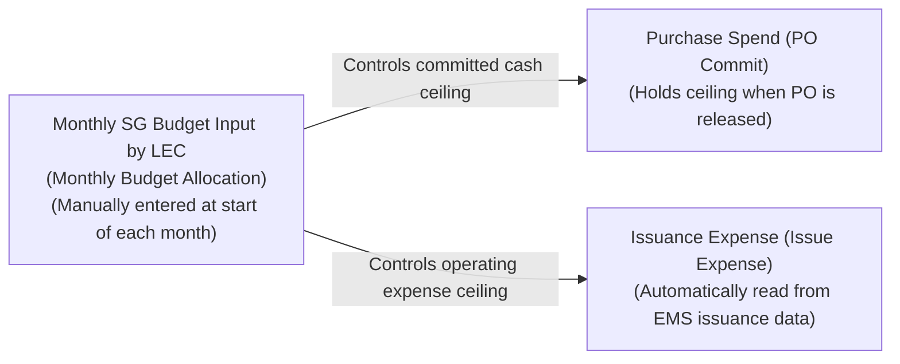

# 01. SG Budget Management & Purchase vs. Issuance Cost Accounting
> *Manual Monthly Budget Input by LEC, Strict No-Rollover Policy, Automated Issuance Ingestion from EMS & Financial Axis Reconciliation*

---

## 1. Nature of the Two Cash Flows: Purchase (PO Commit) vs. Issuance (Issue Expense Read from EMS)

To enforce strict financial governance at Factory HW (Smart Watch) as well as across other plants within the enterprise, the system maintains a clear separation between two distinct accounting concepts:

### Detailed Comparison:
*   **Purchase Spend (Purchase / PO Commit Spend)**:
    - Incurred immediately when a Purchase Order (PO) is officially signed and released to external vendors (ServeOne, SMC, Trumpf, etc.).
    - Purpose: **Controls cash-out commitment**, ensuring the total value of procurement commitments during the month does not breach the authorized monthly budget ceiling.
    - Physical goods receipt at the warehouse is booked as: **Inventory Asset**.
*   **Issuance Expense (Issue / Operational Expense)**:
    - **INCURRED ONLY WHEN AN ENGINEER WITHDRAWS SPARE PARTS FROM THE WAREHOUSE AND INSTALLS THEM ONTO FACTORY EQUIPMENT**.
    - **Data Source**: Bypasses any HW warehouse portal (warehouse keepers do not use this application); the system **automatically ingests issuance transactions directly from core EMS (`ds_Inv`)**.
    - Purpose: **Calculates actual manufacturing unit cost and operational expenses for each Part/Team**, mapped directly to friendly Machine Names and maintenance `Work Order` records.

---

## 2. Monthly Budget Rules: Manual Input & STRICT NO-ROLLOVER POLICY

### 2.1. Manual Monthly Budget Entry
- **Responsible Person**: The **LEC** of each respective Team.
- **Timing**: Prior to the 01st day of each financial month (or immediately following corporate authorization of the monthly quota).
- **Operation**: The LEC accesses the Budget Configuration panel and directly inputs the authorized SG Budget quota for the month (USD / VND).

### 2.2. Core Financial Principle: STRICT NO-ROLLOVER POLICY
Unlike quarterly accrual or rollover mechanisms common in commercial or service enterprises, high-tech manufacturing facility operations adhere to the following:
> ⚠️ **GOLDEN FINANCIAL RULE**:  
> **Each month's budget closes completely within that month. Any uncommitted balance remaining at month-end automatically EXPIRES at 23:59:59 on the final day of the month. STRICTLY NO ROLLOVER of unspent funds into subsequent months.**

$$\text{Available Budget Limit for Month } (M) = \text{Newly Input Budget for Month } (M) \quad (\text{No carryover from Month } M-1)$$

- **Governance Rationale**:
  1. Prevents budget hoarding: Eliminates artificial spending suppression in earlier months intended to stockpile budget for massive procurement spikes later, preventing operational cash-flow volatility.
  2. Enforces demand-driven accuracy: Mandates that engineers and LECs formulate procurement plans strictly aligned with the actual operational maintenance needs of that specific monthly cycle.
  3. Ensures audit integrity: Reconciliation data presented to Cost Management (a single individual serving as Reviewer & Assistant) during the Beginning-of-Month Audit reflects the authentic financial posture of the operating cycle.

---

## 3. Multi-Plant Applicability

The budget allocation schema is built on a configuration-driven architecture leveraging core Master Data attributes:
- Factory Code (`factory_code`: `HW`, `TV`, `AU`, etc.).
- Cost Center Code (`cost_center`: `87321` for SW, `87410` for TV, etc.).
- General Ledger Account (`gl_account`: `NY PO M Technology CP/SG Part 1`, etc.).

When expanding deployment to the TV plant or Auto Display manufacturing facilities, administrators simply configure new budget allocation records linked to the corresponding Cost Centers without modifying the underlying accounting structure of the system.