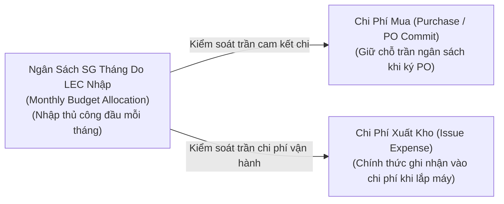

# 01. Quản Lý Ngân Sách SG & Kế Toán Chi Phí Mua vs Xuất
> *Cơ Chế Nhập Ngân Sách Thủ Công Hàng Tháng Của LEC, Tuyệt Đối Không Cộng Dồn Số Dư (No Rollover) & Đối Chiếu 3 Trục Tài Chính*

---

## 1. Bản Chất Hai Dòng Tiền: Mua Hàng (PO Commit) vs Xuất Kho (Issue Expense)

Để kiểm soát chặt chẽ tài chính tại nhà máy HW (Smart Watch) cũng như các nhà máy khác trong tập đoàn, hệ thống tách bạch tuyệt đối giữa hai khái niệm:

### So sánh chi tiết:
*   **Chi Phí Mua (Purchase / PO Commit Spend)**:
    - Phát sinh ngay khi đơn đặt hàng (PO) được ký phát hành cho nhà cung cấp (ServeOne, SMC, Trumpf...).
    - Mục đích: **Kiểm soát dòng tiền ra (Cash-out commitment)**, đảm bảo tổng giá trị cam kết mua hàng trong tháng không vượt trần ngân sách tháng đó.
    - Hàng về nhập kho được ghi nhận là: **Tài sản tồn kho (Inventory Asset)**.
*   **Chi Phí Xuất (Issue / Operational Expense)**:
    - **CHỈ PHÁT SINH KHI KỸ SƯ XUẤT KHO LẮP VÀO MÁY TRÊN DÂY CHUYỀN**.
    - Mục đích: **Tính giá thành sản phẩm và chi phí vận hành thực tế của từng công đoạn (POL, TAB, DIP, LT, DB, BD)**.
    - Được gắn chính xác theo 4 cấp: `Process > Machine > Unit > Line` và mã lệnh sửa chữa `Work Order`.

---

## 2. Quy Tắc Ngân Sách Hàng Tháng: Nhập Thủ Công & TUYỆT ĐỐI KHÔNG CỘNG DỒN SỐ DƯ (No Rollover Policy)

### 2.1. Nhập Ngân Sách Thủ Công Hàng Tháng (Manual Monthly Budget Input)
- **Người chịu trách nhiệm**: **LEC** của từng Team.
- **Thời điểm**: Trước ngày 01 của mỗi tháng tài chính (hoặc ngay sau khi Ban Giám Đốc phê duyệt hạn mức tháng).
- **Thao tác**: LEC truy cập màn hình Cấu Hình Ngân Sách, nhập trực tiếp hạn mức SG Budget cho tháng (USD / VND).

### 2.2. Nguyên Tắc Cốt Lõi: TUYỆT ĐỐI KHÔNG CỘNG DỒN SỐ DƯ (Strict No Rollover)
Trái với cơ chế dồn tích quý trong các doanh nghiệp dịch vụ, tại môi trường sản xuất công nghệ cao của nhà máy:
> ⚠️ **NGUYÊN TẮC VÀNG TÀI CHÍNH**:  
> **Ngân sách tháng nào khóa sổ trọn vẹn tháng đó. Hạn mức chưa dùng hết trong tháng sẽ tự động HỦY BỎ (Expire) vào 23:59:59 của ngày cuối tháng. TUYỆT ĐỐI KHÔNG CỘNG DỒN SỐ DƯ (NO ROLLOVER) sang tháng tiếp theo.**

$$\text{Hạn Mức Khả Dụng Tháng } (M) = \text{Budget Nhập Mới Cho Tháng } (M) \quad (\text{Không cộng thêm số dư Tháng } M-1)$$

- **Lý do quản trị**:
  1. Ngăn chặn hiện tượng "dồn toa" ngân sách: Tránh tình trạng các Team tiết kiệm giả tạo trong tháng 1 và 2 để dồn tiền mua ồ ạt trong tháng 3 gây sốc dòng tiền.
  2. Bắt buộc Kỹ sư và LEC phải lập kế hoạch mua sắm chính xác theo nhu cầu vận hành thực tế của từng tháng.
  3. Đảm bảo số liệu đối soát với Ban Quản Lý (Management) trong phiên Thẩm định Offline ngày 25 phản ánh đúng thực trạng chi tiêu của kỳ đó.

---

## 3. Khả Năng Áp Dụng Dễ Dàng Cho Nhà Máy / Phân Xưởng Khác (Multi-Plant Applicability)

Bảng phân bổ ngân sách được thiết kế cấu hình động (Config-driven) theo các thuộc tính Master Data:
- Mã Nhà máy (`factory_code`: `HW`, `TV`, `AU`...).
- Mã Phòng ban Kế toán (`cost_center`: `87321` cho SW, `87410` cho TV...).
- Mã Tài khoản Tổng hợp (`gl_account`: `NY PO M Technology CP/SG Part 1`...).

Khi triển khai cho Nhà máy TV hoặc Auto Display, chỉ cần khai báo thêm dòng ngân sách mới với mã Cost Center tương ứng mà không làm xáo trộn cấu trúc kế toán của toàn hệ thống.

