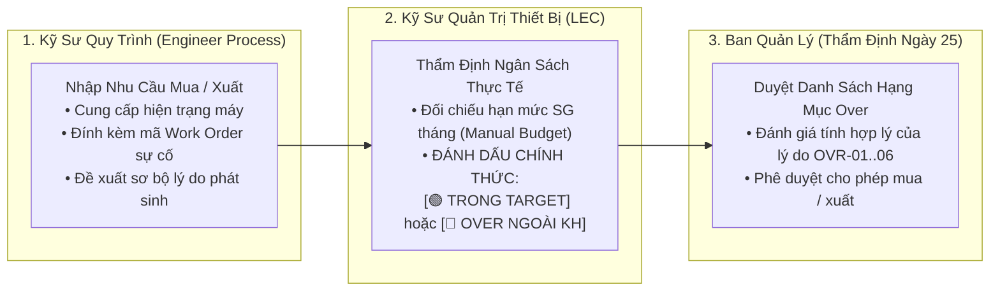
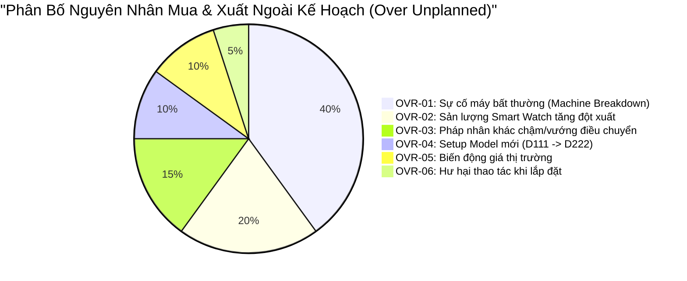

# 02. Quản Lý Danh Sách Mua Ngoài Kế Hoạch (Unplanned Over-Budget Tracking)
> *Phân Tách Rõ Thẩm Quyền Đánh Dấu Của LEC, Đối Chiếu 2 Trục Over (Mua Hàng vs Xuất Kho) & 6 Mã Chuẩn Hóa Giải Trình Lý Do*

---

## 1. Định Nghĩa Chuẩn Xác & Thẩm Quyền Đánh Dấu Của LEC

Theo yêu cầu nghiệp vụ thực tế của nhà máy:
> **"Trong Over hoặc ngoài over, LEC sẽ là người đánh dấu dựa trên lý do kỹ sư cung cấp. Phải thể hiện được list nào over hoặc trong target."**



*   **Hạng Mục Trong Target (In-Target / Planned)**:
    - Là các đơn mua hoặc xuất kho nằm hoàn toàn trong kế hoạch ban đầu: Bù tồn kho an toàn (Target Stock Replenishment), mua theo định mức tiêu hao sản lượng (BOM Norm), hoặc theo lịch bảo dưỡng phòng ngừa định kỳ (PM).
*   **Hạng Mục Over (Out-of-Plan / Unplanned Over)**:
    - Là các phát sinh **hoàn toàn ngoài kế hoạch**: Sự cố máy hỏng bất thường (Breakdown), sản lượng tăng đột biến, hư hại trong thao tác kỹ thuật, hoặc do pháp nhân bạn chậm/không thể chuyển giao buộc phải mua ngoài.
    - **LEC là người duy nhất có thẩm quyền bấm cờ đánh dấu phân loại này** sau khi đối chiếu tổng hạn mức tháng.

---

## 2. Phân Tách Hai Trục Over: Over Mua Hàng (PO Commit) vs Over Xuất Kho (Issue Expense)

Hệ thống bóc tách danh sách gây Over thành 2 trục riêng biệt:

1.  **Over Do Mua Hàng (PO Commit Over)**:
    - Phát sinh khi tổng giá trị các đơn đặt hàng (PO) ký trong tháng vượt quá hạn mức ngân sách mua của tháng đó.
    - Danh sách gây Over mua hàng chỉ ra chính xác: *Nhà cung cấp nào, mã PRV nào, mã PO nào, và lý do tại sao phải mua gấp (OVR-01 đến OVR-06)*.
2.  **Over Do Xuất Kho (Issue Expense Over)**:
    - Phát sinh khi tổng giá trị phụ tùng kỹ sư xuất kho đem ra lắp vào máy thực tế vượt trần định mức chi phí vận hành của công đoạn (POL, TAB, DIP, LT, DB, BD).
    - Danh sách gây Over xuất kho chỉ ra chính xác: *Kỹ sư nào xuất, xuất vào máy nào (EM No / Machine Name), lắp vào cơ cấu nào, gắn với Work Order sự cố nào*.

---

## 3. Danh Mục 6 Mã Chuẩn Hóa Giải Trình Lý Do Over

Mọi dòng mua sắm hoặc xuất kho được LEC đánh dấu `OVER NGOÀI KẾ HOẠCH` bắt buộc phải được gắn 1 trong 6 mã nguyên nhân:



| Mã lý do | Tên nguyên nhân | Bắt buộc đính kèm trên hệ thống | Căn cứ thẩm định offline |
| :---: | :--- | :--- | :--- |
| **OVR-01** | **Sự cố máy bất thường (Breakdown)** | Mã Work Order (`WO-xxxx`), ảnh máy hỏng, báo cáo dừng máy | Biên bản sự cố kỹ thuật của Trưởng ca |
| **OVR-02** | **Tăng sản lượng đột xuất** | Quyết định điều chỉnh sản lượng từ phòng Kế hoạch (PP) | Văn bản tăng công suất chuyền |
| **OVR-03** | **Pháp nhân khác vướng điều chuyển** | Mã yêu cầu Transfer trên API `retPartsTransferReqList` | Thông báo vướng mắc thủ tục xuất khẩu liên quốc gia |
| **OVR-04** | **Setup Model mới (ECO / NPI)** | Mã lệnh thay đổi kỹ thuật (ECO / NPI) | Kế hoạch layout và gá đặt máy mới |
| **OVR-05** | **Biến động giá từ Nhà cung cấp** | Báo giá so sánh giữa kỳ trước và kỳ này từ Purchase | Xác nhận đơn giá tăng từ Purchase Dept |
| **OVR-06** | **Hư hại thao tác lắp máy** | Báo cáo kiểm điểm sự cố và đề xuất đào tạo lại thao tác | Chữ ký xác nhận của Leader công đoạn |

---

## 4. Thể Hiện Danh Sách Trong Target vs Over Trên Giao Diện

Giao diện hệ thống tại tất cả các phân hệ (Requestor, Leader, LEC) đều có thanh bộ lọc và cột trạng thái trực quan:

```
┌────────────────────────────────────────────────────────────────────────────────────────────────────────────────────────────────┐
│  BỘ LỌC KẾ HOẠCH:  [🔘 Tất cả (150)]   [🟢 Trong Target / Trong Kế Hoạch (118)]   [🔴 Over Ngoài Kế Hoạch (32)]                │
├────┬────────────┬─────────────────────────────┬───────────┬─────────────┬─────────────┬──────────────────────────┬─────────────┤
│ STT│ Mã QCode   │ Tên Phụ Tùng                │ Công Đoạn │ Số Lượng Mua│ Đơn Giá Dự  │ Phân Loại Kế Hoạch       │ Mã Lý Do    │
│    │ / Mã Tạm   │                             │ & Máy     │             │ Kiến (USD)  │ (LEC Chính Thức Đánh Dấu)│ Giải Trình  │
├────┼────────────┼─────────────────────────────┼───────────┼─────────────┼─────────────┼──────────────────────────┼─────────────┤
│ 1  │ QDAB03583  │ Cảm biến quang vuông        │ DB / DB-01│ 4 EA        │ 6.39        │ 🟢 TRONG TARGET          │ —           │
│ 2  │ QDAD12236  │ Board nguồn CPX V4 Trumpf   │ DB / DB-01│ 1 EA        │ 3,150.00    │ 🔴 OVER NGOÀI KẾ HOẠCH   │ OVR-01      │
│    │            │ ↳ Ghi chú: Cháy board nguồn do xung sét ca đêm, máy DB-01 dừng (WO-248926091)                               │
│ 3  │ QCAC13053  │ Dây khí nén SMC 6mm         │ POL/POL-02│ 50 M        │ 45.00       │ 🟢 TRONG TARGET          │ —           │
│ 4  │ QCAD38190  │ Xylanh dẫn hướng đôi 16-100B│ TAB/TAB-01│ 2 EA        │ 220.00      │ 🔴 OVER NGOÀI KẾ HOẠCH   │ OVR-03      │
│    │            │ ↳ Ghi chú: LGD Korea chưa xác nhận transfer kịp, cần mua gấp tránh dừng chuyền                               │
└────┴────────────┴─────────────────────────────┴───────────┴─────────────┴─────────────┴──────────────────────────┴─────────────┘
```
