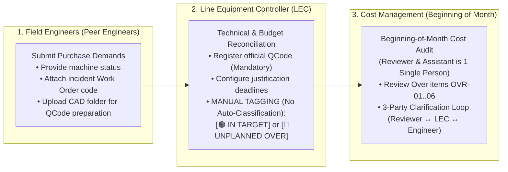
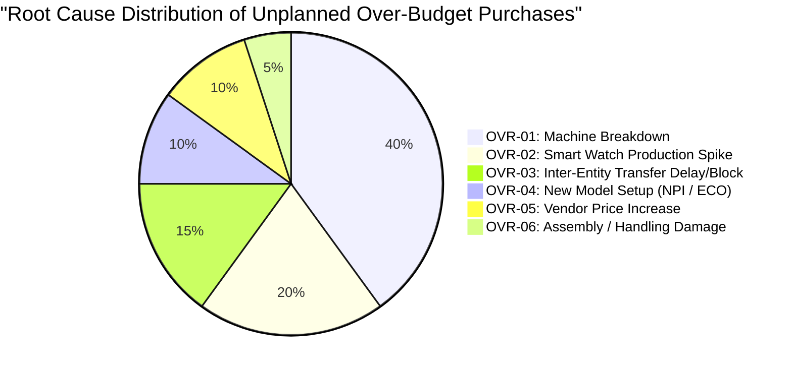

# 02. Unplanned Over-Budget Tracking & Classification
> *Distinguishing LEC Manual Tagging Authority (Strictly NO Auto-Classification), Mandatory Official QCode Prerequisite, Reconciling Two Over Axes (PO Commit vs. EMS Issuance Ingestion), 6 Standardized Justification Codes & 3-Party Clarification Loop*

---

## 1. Operational Definition & LEC Tagging Authority

According to shop-floor operational governance requirements at the Smart Watch production facility (Factory HW):
> **"Items eligible for audit must possess an official QCode; the system does not auto-classify, the LEC classifies manually. The audit and justification deadlines are configured by the LEC. Whether an item is categorized as In-Target or Over, the LEC personally performs manual tagging based on the justification provided by the engineer."**

*   **Mandatory Prerequisite for Audit**: Spare parts **must possess an official registered QCode**. Temporary codes (`TMP-HW-xxxx`) represent engineering technical preparation data only (folder uploads serve as data prep for QCode creation, not audit admission); they are strictly blocked from cost audit submission.
*   **In-Target Items (Planned Allocation)**:
    - Procurement or issuance lines falling within baseline planned quotas: Target Stock Replenishment, bill-of-materials consumption norms (BOM Norm), or scheduled preventive maintenance (PM).
*   **Over Items (Out-of-Plan / Unplanned Over)**:
    - Items arising from **unplanned operational requirements**: Unscheduled machine breakdowns, abrupt production volume surges, assembly handling damage, or unexpected vendor price escalations and transfer delays.
    - **The LEC serves as the sole authority to manually classify these items** following reconciliation against the Team's monthly budget. **The system strictly does NOT auto-classify**.
*   **Deadlines**: Deadlines for submitting aging stock justifications and closing audit dossiers are **configured and controlled by the LEC**.

---

## 2. Reconciling Two Over Axes: PO Commit Over vs. Issuance Expense Over (Read from EMS)

The system segregates over-budget drivers across two independent financial axes:

1.  **Procurement Over (PO Commit Over)**:
    - Incurred when the total committed purchase value (PRV/PO) in a given month exceeds the approved monthly procurement budget ceiling.
    - Line-item tracking details: *Vendor, PRV No, PO No, and root-cause justification code (`OVR-01` through `OVR-06`)*.
2.  **Issuance Over (Issue Expense Over — Ingested from EMS)**:
    - Bypasses any HW warehouse portal (warehouse keepers do not use this application).
    - Actual physical spare part issuance is **automatically ingested from LG Display Nexacro EMS (`ds_Inv`)**.
    - When the total value of parts issued by engineers exceeds the operating expense allocation for the Part/Team, the system automatically detects and flags it within the Issuance Over ledger: *Detailing the requesting engineer, target equipment (Friendly Machine Name / EM No), and specific breakdown Work Order*.

---

## 3. Standard Catalog of 6 Root-Cause Codes for Over Budget

Every procurement line manually tagged by the LEC as `UNPLANNED OVER` must be assigned one of the 6 standardized root-cause codes:

| Reason Code | Root Cause Description | System Supporting Artifacts | Beginning-of-Month Audit Basis |
| :---: | :--- | :--- | :--- |
| **OVR-01** | **Machine Breakdown** | Work Order code (`WO-xxxx`), failure photos, downtime log | Machine breakdown incident report from field engineer |
| **OVR-02** | **Production Throughput Spike** | Production adjustment directive from Production Planning (PP) | Throughput ramp plan for Smart Watch lines |
| **OVR-03** | **Inter-Entity Transfer Blockage** | Transfer request ID via API `retPartsTransferReqList` | Customs or cross-border logistics delay notice |
| **OVR-04** | **New Model Setup (ECO / NPI)** | Engineering Change Order (ECO / NPI) authorization | Tooling and fixture setup schedule for new model |
| **OVR-05** | **Vendor Price Increase** | Quotation comparison between prior and current cycles from Purchase | Formal price increase confirmation from Purchase Dept |
| **OVR-06** | **Assembly / Installation Damage** | Post-incident review report and operator re-training plan | Internal Part corrective action report |

---

## 4. Three-Party Clarification Loop During Beginning-of-Month Audit

Following the offline cost audit session conducted at the beginning of each month between the LEC and the Reviewer (Cost Management — a single individual acting as Reviewer & Assistant):
1. **Reviewer Requests Additional Information**:
   - If specific Over items lack sufficient engineering documentation or urgent necessity justification, the Reviewer logs inquiry items directly within the Audit module.
2. **LEC Coordinates & Delegates to Engineer**:
   - The LEC reviews the Reviewer's inquiry, provides operational guidance, and assigns the clarification task to the responsible equipment engineer.
3. **Engineer Responds to LEC**:
   - The engineer submits technical parameters, shop-floor photos, and maintenance logs back to the LEC prior to the established deadline.
4. **LEC Consolidates & Resubmits to Reviewer**:
   - The LEC validates the engineer's submission, compiles a complete response package, and submits it back to the Cost Management Reviewer to finalize audit clearance prior to formal PRV/PO creation on EMS (formal approvals take place exclusively on EMS; no approval buttons exist on the new system).