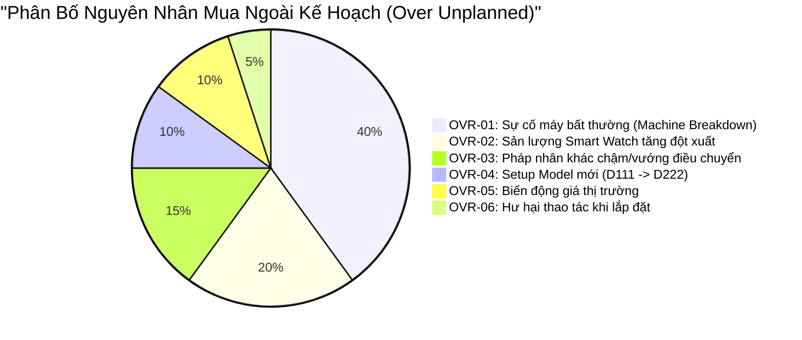

# 02. Quản Lý Danh Sách Mua Ngoài Kế Hoạch (Unplanned Over-Budget Tracking)

## 1. Định Nghĩa Chuẩn Xác Về "Over"

Theo yêu cầu nghiệp vụ cốt lõi:
> **"Over phải là ngoài kế hoạch. Giao diện phải thể hiện được list mua nào over hoặc trong target."**

*   **Hạng Mục Trong Target (In-Target / Planned)**:
    - Là các đơn mua phụ tùng nằm hoàn toàn trong kế hoạch ban đầu: Bù tồn kho an toàn (Target Stock Replenishment), mua theo định mức tiêu hao sản lượng Smart Watch (BOM Norm), hoặc theo lịch bảo dưỡng định kỳ (PM).
    - Được hệ thống cấp phát hạn mức ngân sách tự động.
*   **Hạng Mục Over (Out-of-Plan / Unplanned Over)**:
    - Là các phát sinh **hoàn toàn ngoài kế hoạch**: Sự cố máy hỏng bất thường (Breakdown), sản lượng Smart Watch tăng đột biến, hư hại trong thao tác kỹ thuật, hoặc do pháp nhân bạn chậm/không thể chuyển giao buộc phải mua ngoài khẩn cấp.
    - Làm tổng nhu cầu mua hoặc chi phí vượt trần ngân sách phân bổ của tháng.

---

## 2. Danh Mục 6 Mã Chuẩn Hóa Giải Trình Lý Do Over

Mọi dòng mua sắm được đánh dấu `OVER` bắt buộc phải được gắn 1 trong 6 mã nguyên nhân:



| Mã lý do | Tên nguyên nhân | Bắt buộc đính kèm trên hệ thống | Căn cứ thẩm định offline |
| :---: | :--- | :--- | :--- |
| **OVR-01** | **Sự cố máy bất thường (Breakdown)** | Mã Work Order (`WO-xxxx`), ảnh máy hỏng, báo cáo dừng máy | Biên bản sự cố kỹ thuật của Trưởng ca |
| **OVR-02** | **Tăng sản lượng Smart Watch** | Quyết định điều chỉnh sản lượng từ phòng Kế hoạch (PP) | Văn bản tăng công suất chuyền |
| **OVR-03** | **Pháp nhân khác vướng điều chuyển** | Mã yêu cầu Transfer trên API `retPartsTransferReqList` | Thông báo vướng mắc thủ tục xuất khẩu liên quốc gia |
| **OVR-04** | **Setup Model mới (D111 $\rightarrow$ D222)** | Mã lệnh thay đổi kỹ thuật (ECO / NPI) | Kế hoạch layout và gá đặt máy mới |
| **OVR-05** | **Biến động giá từ Nhà cung cấp** | Báo giá so sánh giữa kỳ trước và kỳ này từ Purchase | Xác nhận đơn giá tăng từ Purchase Dept |
| **OVR-06** | **Hư hại thao tác lắp máy** | Báo cáo kiểm điểm sự cố và đề xuất đào tạo lại thao tác | Chữ ký xác nhận của Leader công đoạn |

---

## 3. Thể Hiện Danh Sách Trong Target vs Over Trên Giao Diện

Giao diện hệ thống tại tất cả các phân hệ (Requestor, Leader, LEC) đều có thanh bộ lọc và cột trạng thái trực quan:

```
┌────────────────────────────────────────────────────────────────────────────────────────────────────────────────────────────────┐
│  BỘ LỌC KẾ HOẠCH:  [🔘 Tất cả (150)]   [🟢 Trong Target / Trong Kế Hoạch (118)]   [🔴 Over Ngoài Kế Hoạch (32)]                │
├────┬────────────┬─────────────────────────────┬───────────┬─────────────┬─────────────┬──────────────────────────┬─────────────┤
│ STT│ Mã QCode   │ Tên Phụ Tùng                │ Công Đoạn │ Số Lượng Mua│ Đơn Giá Dự  │ Phân Loại Kế Hoạch       │ Mã Lý Do    │
│    │ / Mã Tạm   │                             │ & Máy     │             │ Kiến (USD)  │ (Plan Classification)    │ Giải Trình  │
├────┼────────────┼─────────────────────────────┼───────────┼─────────────┼─────────────┼──────────────────────────┼─────────────┤
│ 1  │ QDAB03583  │ Cảm biến quang vuông        │ DB / DB-01│ 4 EA        │ 6.39        │ 🟢 TRONG TARGET          │ —           │
│ 2  │ QDAD12236  │ Board nguồn CPX V4 Trumpf   │ DB / DB-01│ 1 EA        │ 3,150.00    │ 🔴 OVER NGOÀI KẾ HOẠCH   │ OVR-01      │
│    │            │ ↳ Ghi chú: Cháy board nguồn do xung sét ca đêm, máy DB-01 dừng (WO-248926091)                               │
│ 3  │ QCAC13053  │ Dây khí nén SMC 6mm         │ POL/POL-02│ 50 M        │ 45.00       │ 🟢 TRONG TARGET          │ —           │
│ 4  │ QCAD38190  │ Xylanh dẫn hướng đôi 16-100B│ TAB/TAB-01│ 2 EA        │ 220.00      │ 🔴 OVER NGOÀI KẾ HOẠCH   │ OVR-03      │
│    │            │ ↳ Ghi chú: LGD Korea chưa xác nhận transfer kịp, cần mua gấp tránh dừng chuyền                               │
└────┴────────────┴─────────────────────────────┴───────────┴─────────────┴─────────────┴──────────────────────────┴─────────────┘
```
Giúp Leader và LEC ngay lập tức nhìn thấy bức tranh chi tiêu: dòng nào là chi thường xuyên theo định mức, dòng nào là phát sinh bất thường cần giải trình với Ban Quản Lý.

