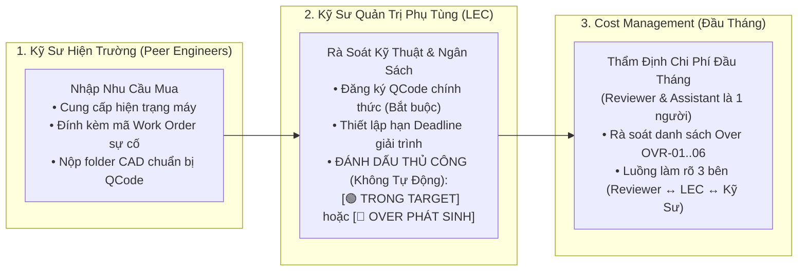

# 02. Quản Lý Danh Sách Mua Ngoài Kế Hoạch (Unplanned Over-Budget Tracking)
> *Phân Tách Rõ Thẩm Quyền Đánh Dấu Thủ Công Của LEC (Không Tự Động), Điều Kiện Bắt Buộc Có QCode, Đối Chiếu 2 Trục Over (Mua Hàng vs Xuất Kho Đọc Từ EMS), 6 Mã Chuẩn Hóa Giải Trình Lý Do & Vòng Phản Hồi 3 Bên Đầu Tháng*

---

## 1. Định Nghĩa Chuẩn Xác & Thẩm Quyền Đánh Dấu Của LEC

Theo yêu cầu nghiệp vụ thực tế của nhà máy Smart Watch (Factory HW):
> **"Trường hợp có thể thẩm định phải có Qcode, không tự động LEC tự phân loại. Thẩm định và giải trình do LEC quy định hạn. Trong Over hoặc ngoài over, LEC sẽ là người trực tiếp đánh dấu thủ công dựa trên lý do kỹ sư cung cấp."**

*   **Điều Kiện Tiên Quyết Để Thẩm Định**: Phụ tùng **bắt buộc phải có Mã QCode chính thức**. Các mã tạm `TMP-HW-xxxx` chỉ là dữ liệu chuẩn bị kỹ thuật, tuyệt đối không được đưa vào danh sách thẩm định chi phí.
*   **Hạng Mục Trong Target (In-Target / Planned)**:
    - Là các đơn mua hoặc xuất kho nằm trong kế hoạch định mức ban đầu: Bù tồn kho an toàn (Target Stock Replenishment), mua theo định mức tiêu hao sản lượng (BOM Norm), hoặc bảo dưỡng định kỳ (PM).
*   **Hạng Mục Over (Out-of-Plan / Unplanned Over)**:
    - Là các phát sinh **ngoài kế hoạch**: Hỏng hóc đột xuất (Breakdown), sản lượng tăng đột biến, hư hại khi thao tác lắp ráp, hoặc biến động giá/vướng mắc điều chuyển.
    - **LEC là người duy nhất trực tiếp đánh dấu phân loại này** sau khi đối chiếu ngân sách tháng của Team. **Hệ thống không tự động phân loại**.
*   **Thời Hạn (Deadline)**: Thời hạn nộp giải trình và thời hạn chốt danh sách thẩm định do **LEC thiết lập và cấu hình**.

---

## 2. Phân Tách Hai Trục Over: Over Mua Hàng (PO Commit) vs Over Xuất Kho (Issue Expense Đọc Từ EMS)

Hệ thống bóc tách danh sách gây Over thành 2 trục độc lập:

1.  **Over Do Mua Hàng (PO Commit Over)**:
    - Phát sinh khi tổng giá trị cam kết mua hàng (PRV/PO) trong tháng vượt quá ngân sách mua của tháng đó.
    - Danh sách chỉ rõ: *Nhà cung cấp nào, số PRV, số PO, và mã lý do tại sao phải mua gấp (`OVR-01` đến `OVR-06`)*.
2.  **Over Do Xuất Kho (Issue Expense Over - Đồng Bộ Từ EMS)**:
    - Bỏ qua Cổng thủ kho nhà máy HW (thủ kho không sử dụng ứng dụng này).
    - Tình trạng xuất kho thực tế được hệ thống **đọc tự động từ dữ liệu xuất kho trên LG Display Nexacro EMS**.
    - Khi tổng giá trị phụ tùng kỹ sư xuất dùng vượt trần định mức chi phí vận hành của Part/Team, hệ thống tự động nhận diện và đưa vào danh mục Over xuất kho: *Chỉ rõ kỹ sư nào xuất, xuất vào máy nào (Machine Name / EM No), phục vụ sự cố nào*.

---

## 3. Danh Mục 6 Mã Chuẩn Hóa Giải Trình Lý Do Over

Mọi dòng mua sắm được LEC đánh dấu `OVER PHÁT SINH` bắt buộc phải được gắn 1 trong 6 mã nguyên nhân:

| Mã lý do | Tên nguyên nhân | Dữ liệu đính kèm trên hệ thống | Căn cứ thẩm định đầu tháng |
| :---: | :--- | :--- | :--- |
| **OVR-01** | **Sự cố máy bất thường (Breakdown)** | Mã Work Order (`WO-xxxx`), hình ảnh hỏng hóc, báo cáo dừng máy | Biên bản sự cố kỹ thuật của kỹ sư máy |
| **OVR-02** | **Tăng sản lượng đột xuất** | Quyết định điều chỉnh sản lượng từ phòng Kế hoạch (PP) | Kế hoạch tăng công suất chuyền Smart Watch |
| **OVR-03** | **Pháp nhân khác vướng điều chuyển** | Mã yêu cầu Transfer trên API `retPartsTransferReqList` | Thông báo vướng mắc thủ tục hải quan / xuất khẩu |
| **OVR-04** | **Setup Model mới (ECO / NPI)** | Mã lệnh thay đổi kỹ thuật (ECO / NPI) | Kế hoạch gá đặt thiết bị model mới |
| **OVR-05** | **Biến động giá từ Nhà cung cấp** | Báo giá so sánh giữa kỳ trước và kỳ này từ Purchase | Xác nhận đơn giá tăng từ Purchase Dept |
| **OVR-06** | **Hư hại thao tác lắp máy** | Báo cáo kiểm điểm sự cố và đề xuất đào tạo lại thao tác | Báo cáo giải trình nội bộ Part |

---

## 4. Quy Trình Phản Hồi 3 Bên Làm Rõ Thông Tin Thẩm Định Đầu Tháng

Sau phiên thẩm định chi phí offline vào đầu tháng giữa LEC và Reviewer (Bộ phận Quản lý chi phí - Cost Management):
1. **Reviewer Yêu Cầu Bổ Sung Thông Tin**:
   - Nếu một số hạng mục Over chưa đủ chứng cứ hoặc cần làm rõ tính cấp thiết, Reviewer nhập yêu cầu cần thêm thông tin trực tiếp trên phân hệ Thẩm Định.
2. **LEC Điều Phối & Gửi Cho Kỹ Sư**:
   - LEC kiểm tra câu hỏi của Reviewer, bổ sung ghi chú nghiệp vụ và chuyển giao nhiệm vụ làm rõ cho đúng Kỹ sư phụ trách máy.
3. **Kỹ Sư Phản Hồi Cho LEC**:
   - Kỹ sư cập nhật thêm thông số kỹ thuật, hình ảnh hiện trường, nhật ký hỏng hóc và gửi lại cho LEC trước thời hạn quy định.
4. **LEC Tổng Hợp & Phản Hồi Lại Reviewer**:
   - LEC rà soát câu trả lời của kỹ sư, tổng hợp thành tài liệu hoàn chỉnh và bấm gửi lại cho Reviewer Cost Management để hoàn tất thẩm định trước khi đưa lên tạo PRV/PO chính thức trên EMS.
