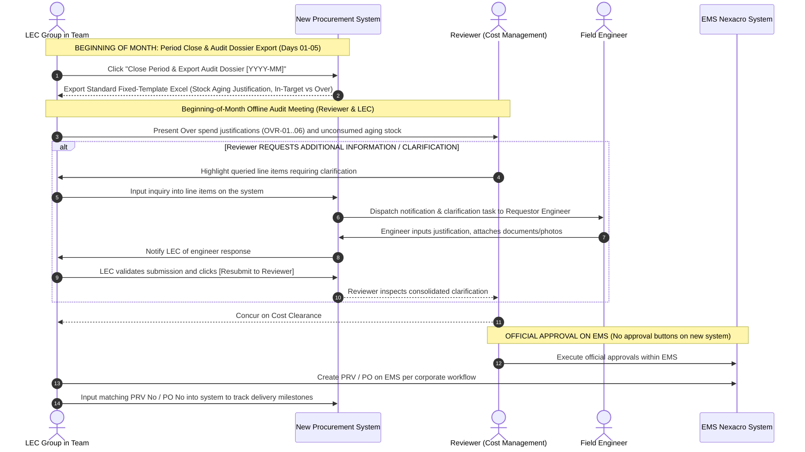

# 03. Beginning-of-Month Cost Audit & Aging Review Process (Cost Management Audit)
> *Beginning-of-Month Cost Governance & Unconsumed Stock Review (Days 01–05), Three-Party Clarification Loop (Reviewer ↔ LEC ↔ Engineer), Strict No-Rollover Budget & Approvals on EMS*

---

## 1. Beginning-of-Month Governance & Review Architecture

The cost audit workflow operates practically and concisely at the **beginning of each month (Days 01–05)** between the **LEC Group in the Team** and the **Reviewer (Cost Management — 1 single person acting as Reviewer & Assistant)**:

---

## 2. Standard Fixed-Template Excel Report Architecture

The audit workbook generated for the Beginning-of-Month Audit comprises 4 standardized sheets:

1. **Sheet 1: Inventory Aging & Variance Justification (Inventory Aging & Variance)**:
   - Beginning inventory, receipts, warehouse issuances to machines during the month (automatically read from EMS), and ending inventory.
   - Reconciliation of Target Stock vs. actual On-hand inventory in the HW warehouse.
   - Detailed ledger of stagnant stock aging >30 days, incorporating justification text submitted by requestor engineers.
2. **Sheet 2: Monthly SG Budget Balance Sheet (STRICT NO-ROLLOVER POLICY)**:
   - Monthly SG budget quota manually input by the LEC (managed independently per Team).
   - **Strictly NO rollover of unspent balances from prior months into the new cycle**.
   - Total procurement commitments In-Target vs. Total Unplanned Over spend.
3. **Sheet 3: Itemized Ledger of Unplanned Over-Budget Purchases**:
   - Comprehensive breakdown of each Over item tagged with its respective root-cause code (**OVR-01 through OVR-06**), equipment maintenance `Work Order` codes, unit prices, and requesting engineers.
4. **Sheet 4: Interlock Efficiency & Cross-Team Stock Utilization Report**:
   - Summary of spare parts borrowed and consumed from idle stock held by peer teams within the HW factory (prompted by `agingInterlockFlag`), demonstrating direct procurement cost avoidance.
   - Ledger of successfully executed inter-entity inventory transfers across corporate subsidiaries.