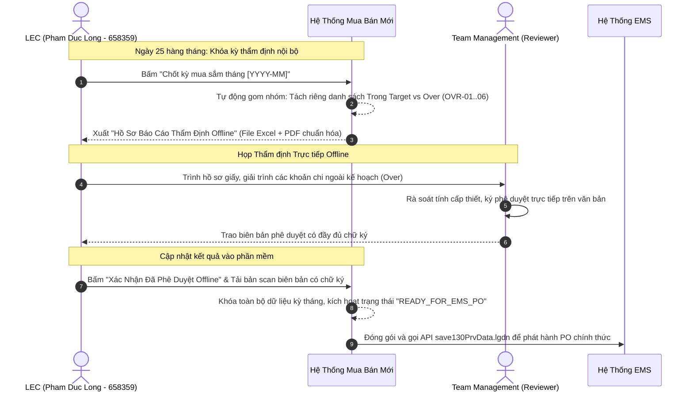

# 03. Quy Trình Chốt Kỳ Tháng & Thẩm Định Offline Với Team Management

## 1. Cơ Chế Thẩm Định Offline (Offline Management Governance)

Do **Team Management tạm thời chưa đưa vào hệ thống**, mọi quyết định phê duyệt cấp cao (đặc biệt là duyệt các khoản Over ngoài kế hoạch và duyệt phát hành PO tháng) được vận hành theo cơ chế hồ sơ giấy kết hợp xác thực số:

---

## 2. Cấu Trúc Hồ Sơ Thẩm Định Offline (Offline Audit Package)

File hồ sơ xuất ra từ hệ thống bao gồm 4 phần tiêu chuẩn:
1.  **Phần 1: Bảng tổng hợp cân đối ngân sách SG tháng ($33\% - 33\% - 34\%$)**:
    *   Hạn mức phân bổ tháng: \$150,000 USD.
    *   Tổng cam kết mua Trong Target: \$125,000 USD.
    *   Tổng phát sinh Mua Ngoài Kế Hoạch (Over): \$28,000 USD.
    *   Tổng đề xuất duyệt: \$153,000 USD (Vượt trần \$3,000 USD).
2.  **Phần 2: Bảng giải trình chi tiết các dòng Over ngoài kế hoạch**:
    *   Bảng kê chi tiết từng phụ tùng Over kèm mã nguyên nhân (**OVR-01 đến OVR-06**), số tiền chênh lệch, mã máy hỏng và số Work Order.
3.  **Phần 3: Báo cáo hiệu quả xử lý Interlock**:
    *   Số tiền đã tiết kiệm được nhờ điều chuyển từ pháp nhân khác hoặc sửa chữa phục hồi linh kiện SPR nội bộ thay vì mua mới 100%.
4.  **Phần 4: Trang ký duyệt pháp lý**:
    *   Khu vực chữ ký của **Đại diện LEC (Pham Duc Long)** và **Đại diện Ban Quản Lý (Team Management Reviewer)**.

