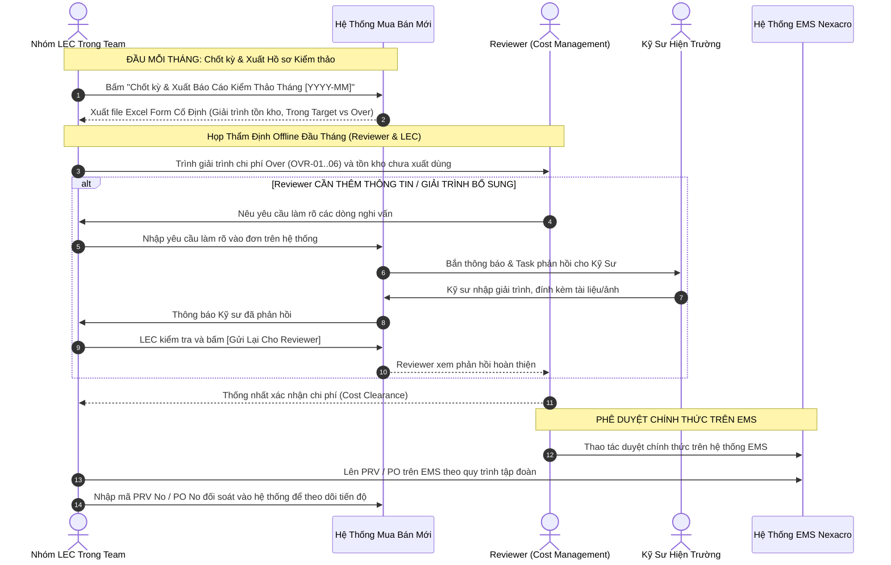

# 03. Quy Trình Thẩm Định Đầu Tháng & Kiểm Thảo Giải Trình Tồn Kho (Cost Management Audit)
> *Thẩm Định Chi Phí & Kiểm Thảo Tồn Kho Chưa Dùng Vào ĐẦU THÁNG, Cơ Chế Làm Rõ Thông Tin 3 Bên (Reviewer <-> LEC <-> Kỹ Sư), Ngân Sách Không Rollover & Phê Duyệt Trên EMS*

---

## 1. Cơ Chế Thẩm Định & Kiểm Thảo Đầu Mỗi Tháng (Beginning-of-Month Cost Governance)

Quy trình thẩm định được vận hành thực tế và tinh gọn vào **đầu mỗi tháng** giữa **Nhóm LEC trong Team** và **Reviewer (Bộ phận Cost Management - Reviewer & Assistant là 1 người)**:

---

## 2. Cấu Trúc Báo Cáo Excel Form Cố Định (Standard Fixed Template)

Báo cáo xuất ra phục vụ phiên thẩm định đầu tháng gồm 4 Sheet tiêu chuẩn:
1. **Sheet 1: Giải Trình Biến Động Tồn Kho & Tuổi Thọ Tồn (Inventory Aging & Variance)**:
   - Tồn kho đầu kỳ, lượng nhập kho, lượng xuất kho lắp máy trong tháng (từ EMS), tồn kho cuối kỳ.
   - Đối soát tồn an toàn (Target Stock) vs Tồn thực tế On-hand tại kho HW.
   - Danh sách tồn kho >30 ngày kèm nội dung Task giải trình của Kỹ sư.
2. **Sheet 2: Bảng Cân Đối Ngân Sách SG Tháng (TUYỆT ĐỐI KHÔNG ROLLOVER)**:
   - Hạn mức ngân sách SG tháng mới do LEC nhập thủ công (độc lập từng Team).
   - **Tuyệt đối KHÔNG cộng dồn số dư từ tháng trước sang tháng sau**.
   - Tổng cam kết mua Trong Target vs Tổng phát sinh Mua Ngoài Kế Hoạch (Over).
3. **Sheet 3: Danh Mục Chi Tiết Các Hạng Mục Over Ngoài Kế Hoạch**:
   - Bảng kê từng chi tiết Over kèm 6 mã nguyên nhân (**OVR-01 đến OVR-06**), mã lệnh máy `Work Order`, đơn giá và kỹ sư yêu cầu.
4. **Sheet 4: Báo Cáo Hiệu Quả Xử Lý Interlock & Tồn Kho Team Bạn**:
   - Tổng hợp các hạng mục đã xuất sử dụng từ tồn kho nhàn rỗi của Team bạn trong nhà máy HW (theo cảnh báo `agingInterlockFlag`), giúp tiết kiệm chi phí mua mới.
   - Danh sách các mã điều chuyển liên pháp nhân thành công.
