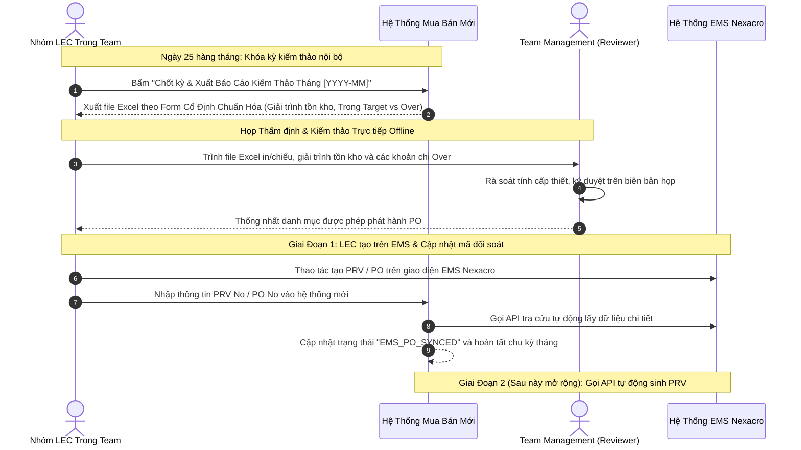

# 03. Quy Trình Chốt Kỳ Tháng, Giải Trình Tồn Kho & Kiểm Thảo Định Kỳ (Xuất Excel Form Cố Định)

## 1. Cơ Chế Thẩm Định & Kiểm Thảo Hàng Tháng (Monthly Inventory Audit & Governance)

Hệ thống phục vụ công tác **Giải trình tồn kho và kiểm thảo định kỳ hàng tháng** với Ban Quản Lý (Team Management). Do Team Management tạm thời chưa đưa vào phần mềm, quy trình được vận hành thực tế và tinh gọn như sau:

---

## 2. Cấu Trúc Báo Cáo Excel Form Cố Định (Fixed Standard Excel Template)

Báo cáo xuất ra từ hệ thống sử dụng duy nhất một **Mẫu Excel Cố Định (Standard Fixed Template)** gồm 4 Sheet tiêu chuẩn:
1.  **Sheet 1: Giải Trình Biến Động Tồn Kho & Chi Phí (Inventory & Cost Variance)**:
    *   Tồn kho đầu kỳ, lượng nhập kho, lượng xuất kho lắp máy trong tháng, tồn kho cuối kỳ.
    *   Đối soát tồn kho an toàn (Target Stock) vs Tồn kho thực tế On-hand tại kho HW.
2.  **Sheet 2: Bảng Cân Đối Ngân Sách SG Tháng ($33\% - 33\% - 34\%$)**:
    *   Hạn mức phân bổ tháng: \$150,000 USD (kèm số dư dồn từ tháng trước nếu có).
    *   Tổng cam kết mua Trong Target: \$125,000 USD.
    *   Tổng phát sinh Mua Ngoài Kế Hoạch (Over): \$28,000 USD.
    *   Tổng đề xuất duyệt: \$153,000 USD.
3.  **Sheet 3: Danh Mục Chi Tiết Các Hạng Mục Over Ngoài Kế Hoạch**:
    *   Bảng kê từng chi tiết Over kèm mã nguyên nhân (**OVR-01 đến OVR-06**), mã lệnh máy `Work Order`, đơn giá và người đề xuất.
4.  **Sheet 4: Báo Cáo Hiệu Quả Xử Lý Interlock (Transfer / Pháp nhân khác)**:
    *   Tổng hợp các hạng mục đã xử lý điều chuyển liên pháp nhân hoặc mua qua pháp nhân khác thành công, giúp tiết kiệm chi phí mua mới.

