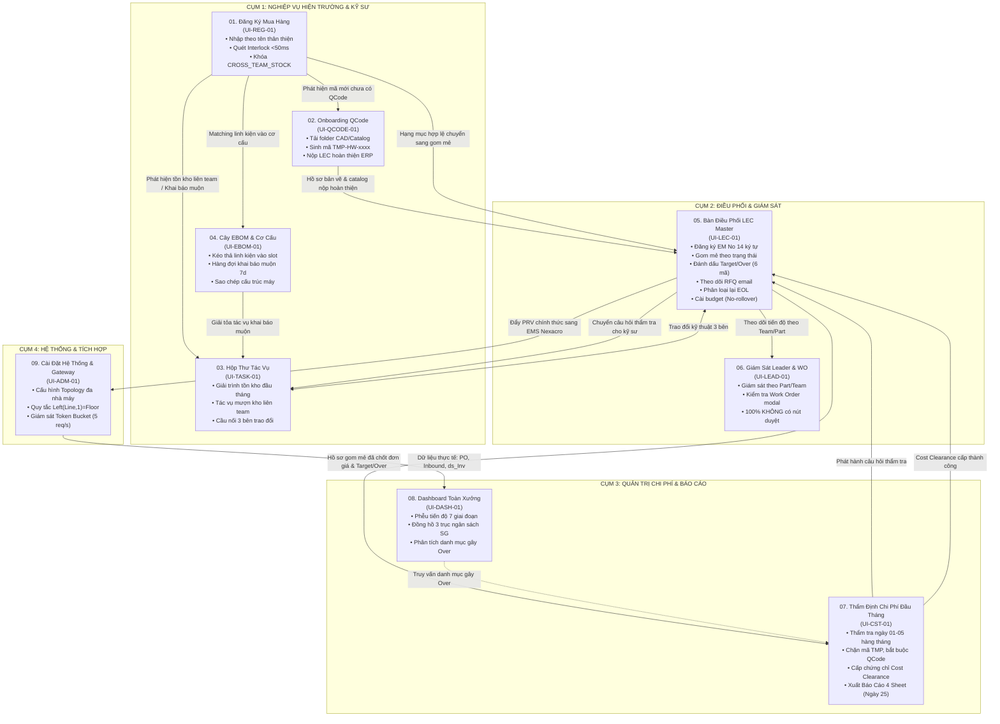

# 00. TỔNG QUAN KIẾN TRÚC HỆ THỐNG MÀN HÌNH (V2 - SCREEN SPECIFICATIONS ARCHITECTURE)

> **Dự án**: Spare Parts Procurement Tracking & Engineering Operations Platform  
> **Phân xưởng áp dụng**: Smart Watch (SW) — Factory HW (Display Module Plant 1 - Org ID: `28753`)  
> **Khả năng mở rộng**: Dễ dàng nhân bản cấu hình cho các Phân xưởng / Nhà máy khác trong tập đoàn.  
> **Phiên bản tài liệu**: 2.0 - Đặc tả Hoàn Chỉnh & Liền Mạch Toàn Bộ Các Màn Hình Nghiệp Vụ  
> **Nguyên tắc bất biến**: KHÔNG chỉnh sửa source code dự án web (`services/procurement-web`); Chuẩn hóa toàn bộ cấu trúc dữ liệu, sơ đồ tương tác, layout wireframe và luồng nghiệp vụ.

---

## 1. BỐI CẢNH NGHIỆP VỤ & TẦM NHÌN THIẾT KẾ V2

Hệ thống điều hành và theo dõi mua sắm phụ tùng phòng sạch (Cleanroom Spare Parts) đòi hỏi tính chính xác, minh bạch ngân sách và phản hồi cực nhanh giữa các bên liên quan:
1. **Giải quyết triệt để sự phân hóa (Anti-Fragmentation)**:
   - Các bên (Kỹ sư, Trưởng nhóm Part, LEC, Quản lý Chi phí) không còn nhìn dữ liệu rời rạc. Toàn bộ thông tin từ Đăng ký $\rightarrow$ Quét Interlock $\rightarrow$ EBOM $\rightarrow$ Gom mẻ LEC $\rightarrow$ Thẩm định Chi phí $\rightarrow$ Đồng bộ EMS $\rightarrow$ Nhập kho đều nằm trong một dòng chảy dữ liệu duy nhất (Single Data Thread).
2. **Quy định vai trò chuẩn xác theo thực tế hiện trường**:
   - **Kỹ sư hiện trường (Field Engineer)**: Là đồng nghiệp ngang hàng (peer engineers), không phân biệt công đoạn POL, TAB hay DIP. Kỹ sư làm việc trực tiếp với **Tên thân thiện** (`Line`, `Machine`, `Assembly`), không phải nhớ chuỗi mã kỹ thuật phức tạp.
   - **Chuyên viên Điều phối Thiết bị (LEC)**: Chịu trách nhiệm đăng ký mã **EM No 14 ký tự**, gom mẻ, mở khóa Interlock, theo dõi trạng thái báo giá RFQ qua email, nhập ngân sách thủ công (không cộng dồn số dư) và phân loại lại mã linh kiện (như EOL).
   - **Quản lý Chi phí (Cost Manager - 1 Người duy nhất)**: Thẩm định hồ sơ đầu tháng (ngày 01–05), bắt buộc phải có mã QCode chính thức (chặn mã tạm `TMP-`), phát hành Cost Clearance và ngày 25 hàng tháng xuất báo cáo chuẩn 4 Sheet Excel.
   - **Loại bỏ hoàn toàn vai trò Thủ kho nội bộ**: Tồn kho xuất dùng lấy tự động từ bảng `ds_Inv` của EMS.
   - **Triệt tiêu nút phê duyệt trên hệ thống nội bộ**: Phê duyệt chính thức tuân thủ 100% trên hệ thống EMS Nexacro theo đúng thẩm quyền.

---

## 2. SƠ ĐỒ DÒNG CHẢY DỮ LIỆU TỔNG THỂ (MASTER END-TO-END FLOWCHART)

Sơ đồ kết nối liền mạch toàn bộ 10 màn hình chức năng từ lúc phát sinh nhu cầu đến khi quyết toán báo cáo:



---

## 3. THIẾT KẾ THANH ĐIỀU HƯỚNG BÊN (SIDEBAR NAVIGATION)

Thanh Sidebar hiển thị cố định bên trái giao diện làm việc, nhóm thành 4 Cụm Chức Năng Hoạt Động (4 Operational Clusters) với chỉ số Badge cảnh báo thời gian thực:

```
┌──────────────────────────────────────────────┐
│ 🏭 SMART WATCH OPS | FACTORY HW (ORG 28753)  │
│ Người dùng: Nguyễn Văn Thắng (Kỹ Sư Line 201)│
├──────────────────────────────────────────────┤
│ 📊 TỔNG QUAN HỆ THỐNG                        │
│   [#] 08. Dashboard Toàn Xưởng    (UI-DASH-01)│
├──────────────────────────────────────────────┤
│ 🛠️ CỤM 1: NGHIỆP VỤ HIỆN TRƯỜNG & KỸ SƯ      │
│   [+] 01. Đăng Ký Mua Hàng        (UI-REG-01)│
│   [📁] 02. Onboarding QCode Mới   (UI-QCODE-01)│
│   [📬] 03. Hộp Thư Tác Vụ         (UI-TASK-01) [🔴 2]
│   [🌿] 04. Cây EBOM & Cơ Cấu      (UI-EBOM-01)│
├──────────────────────────────────────────────┤
│ 🎯 CỤM 2: ĐIỀU PHỐI & GIÁM SÁT               │
│   [⚡] 05. Bàn Điều Phối LEC      (UI-LEC-01)  [🟡 5]
│   [👁️] 06. Giám Sát Leader & WO   (UI-LEAD-01) │
├──────────────────────────────────────────────┤
│ 💰 CỤM 3: QUẢN TRỊ CHI PHÍ & BÁO CÁO         │
│   [⚖️] 07. Thẩm Định Chi Phí       (UI-CST-01) │
├──────────────────────────────────────────────┤
│ ⚙️ CỤM 4: CẤU HÌNH & HỆ THỐNG                │
│   [🔧] 09. Cài Đặt & Cổng EMS     (UI-ADM-01) │
├──────────────────────────────────────────────┤
│ [?] Trợ giúp | Phiên bản V2.0 | Cổng EMS: 🟢 │
└──────────────────────────────────────────────┘
```

### Ý Nghĩa Các Chỉ Số Huy Hiệu (Badges) Trên Sidebar:
* **Hộp Thư Tác Vụ (`[🔴 2]`)**: Cảnh báo số lượng tác vụ khẩn cấp quá hạn hoặc cận hạn (giải trình tồn kho chậm luân chuyển trước ngày 05, mượn kho liên team).
* **Bàn Điều Phối LEC (`[🟡 5]`)**: Số lượng mẻ đăng ký mới từ kỹ sư đang chờ gom mẻ, gắn mã EM No hoặc thẩm định trạng thái Target/Over.

---

## 4. MA TRẬN PHÂN QUYỀN TRUY CẬP 10 MÀN HÌNH

Hệ thống quản lý dữ liệu theo ngữ cảnh phân quyền phân tầng (`Context Auto-Scoping`):

| Mã Màn Hình | Tên Màn Hình Nghiệp Vụ | Kỹ Sư Hiện Trường | Trưởng Nhóm / Part | Điều Phối LEC | Quản Lý Chi Phí (1 Người) | Quản Trị Hệ Thống |
| :--- | :--- | :---: | :---: | :---: | :---: | :---: |
| **`UI-REG-01`** | **01. Đăng Ký Hạng Mục Mua Hàng** | 🟢 Toàn quyền | 👁️ Theo dõi | 🟢 Mở khóa & EM No | 🚫 Không | 🟢 Toàn quyền |
| **`UI-QCODE-01`**| **02. Onboarding QCode & Tải Folder** | 🟢 Tải folder | 👁️ Theo dõi | 🟢 Hoàn thiện ERP | 👁️ Tra cứu | 🟢 Toàn quyền |
| **`UI-TASK-01`** | **03. Hộp Thư Tác Vụ & Giải Trình** | 🟢 Trả lời task | 👁️ Giám sát | 🟢 Phê duyệt task | 🟢 Gửi chất vấn | 🟢 Toàn quyền |
| **`UI-EBOM-01`** | **04. Cây EBOM Kéo Thả & Cơ Cấu** | 🟢 Kéo thả/Gán | 👁️ Tra cứu | 🟢 Quản trị cây | 👁️ Tra cứu | 🟢 Toàn quyền |
| **`UI-LEC-01`**  | **05. Bàn Điều Phối LEC Master** | 🚫 Không | 👁️ Theo dõi | 🟢 Toàn quyền | 👁️ Tra cứu | 🟢 Toàn quyền |
| **`UI-LEAD-01`** | **06. Giám Sát Leader & Work Order** | 🚫 Không | 🟢 Toàn quyền | 👁️ Đối soát | 👁️ Tra cứu | 🟢 Toàn quyền |
| **`UI-CST-01`**  | **07. Thẩm Định Chi Phí Đầu Tháng** | 🚫 Không | 🚫 Không | 👁️ Phản hồi hỏi | 🟢 Toàn quyền | 🟢 Toàn quyền |
| **`UI-DASH-01`** | **08. Dashboard Vận Hành Toàn Xưởng** | 👁️ Theo Line | 👁️ Theo Part | 👁️ Toàn Team | 👁️ Toàn Nhà Máy | 🟢 Toàn quyền |
| **`UI-ADM-01`**  | **09. Cài Đặt Hệ Thống & Cổng EMS** | 🚫 Không | 🚫 Không | ⚙️ Nhập Budget | 🚫 Không | 🟢 Toàn quyền |

*(Ký hiệu: 🟢 Thao tác toàn quyền; 👁️ Xem giới hạn theo phân vùng phụ trách; ⚙️ Cài đặt trường dữ liệu chuyên trách; 🚫 Không có quyền truy cập).*

---

## 5. BỘ QUY CHUẨN THIẾT KẾ GIAO DIỆN & MÃ MÀU TOÀN HỆ THỐNG

### 5.1. Bảng Mã Màu Trạng Thái Nghiệp Vụ (Semantic Color Tokens):
* 🟢 **Xanh Ngọc / Emerald (`#10B981` / `#059669`)**:
  - Hạng mục Trong Kế Hoạch (`TARGET`).
  - Mã QCode chính thức đã được cấp (`OFFICIAL_QCODE`).
  - Tác vụ đã giải trình thành công (`RESOLVED`).
  - Cổng kết nối EMS Gateway sẵn sàng (`ONLINE`).
* 🟡 **Màu Hổ Phách / Amber (`#F59E0B` / `#D97706`)**:
  - Cảnh báo tồn kho liên team (`CROSS_TEAM_STOCK`, `agingInterlock = 'Y'`).
  - Trạng thái chờ báo giá mua hàng RFQ (`unitPriceFlag = 'N'`).
  - Tác vụ tồn kho chậm luân chuyển cần giải trình trước ngày 05 hàng tháng.
* 🔴 **Màu Đỏ Hồng / Rose (`#EF4444` / `#DC2626`)**:
  - Hạng mục Ngoài Kế Hoạch (`OVER`) thuộc 6 mã sự cố (`OVR-01` đến `OVR-06`).
  - Phụ tùng ngừng sản xuất (`EOL`).
  - Tác vụ quá hạn giải trình.
  - Cảnh báo sự cố dừng máy khẩn cấp (`Line Stop - OVR-01`).
* 🔵 **Màu Xanh Lam / Cyan (`#06B6D4` / `#0284C7`)**:
  - Mã yêu cầu PRV, mã Work Order.
  - Quy tắc phân tầng sản xuất (`2F`, `3F`).
  - Tên máy và cụm cơ cấu thân thiện.
* 🟣 **Màu Tím Chàm / Indigo (`#6366F1` / `#4F46E5`)**:
  - Chuỗi định danh thiết bị EM No 14 ký tự (`HWBMTL21EC0101`).
  - Câu hỏi chất vấn từ Quản lý Chi phí (`AUDIT_INQUIRY`).
  - Chứng chỉ Cost Clearance được phê chuẩn.

### 5.2. Tiêu Chuẩn Hiển Thị Số Liệu Tài Chính & Ngày Tháng:
* **Tiền tệ chuẩn**: Đô la Mỹ (`USD`), ký hiệu `$`. Ví dụ: `$12,450 USD`.
* **Quy tắc làm tròn**: Đơn giá và thành tiền hiển thị số nguyên hoặc tối đa 2 chữ số thập phân; Tỷ lệ phần trăm hoàn thành làm tròn 1 chữ số thập phân (`94.5%`).
* **Định dạng thời gian**: `YYYY-MM-DD` (e.g. `2026-11-05`), thời gian chi tiết `YYYY-MM-DD HH:mm`.

---

## 6. DANH MỤC CHI TIẾT 10 TÀI LIỆU ĐẶC TẢ MÀN HÌNH V2

| STT | Tên Tài Liệu Đặc Tả | Mã Màn Hình | Vai Trò Chính | Mục Tiêu Nghiệp Vụ Cốt Lõi |
| :---: | :--- | :---: | :---: | :--- |
| **00** | [**`00-tong-quan-kien-truc-he-thong-man-hinh.md`**](file:///home/longp/projects/company/ops-workflow/procurement-system/05-ui-ux-screen-specifications-v2/00-tong-quan-kien-truc-he-thong-man-hinh.md) | `SYS-ARCH` | Toàn bộ | Kiến trúc tổng thể, Sidebar 4 cụm, ma trận phân quyền và luồng dữ liệu Master. |
| **01** | [**`01-man-hinh-dang-ky-hang-muc-mua-hang.md`**](file:///home/longp/projects/company/ops-workflow/procurement-system/05-ui-ux-screen-specifications-v2/01-man-hinh-dang-ky-hang-muc-mua-hang.md) | `UI-REG-01` | Kỹ sư / LEC | Đăng ký mua đơn lẻ & Excel, tên thân thiện, quét Interlock, 2 nhánh sau mở khóa. |
| **02** | [**`02-man-hinh-onboarding-qcode-va-tai-folder.md`**](file:///home/longp/projects/company/ops-workflow/procurement-system/05-ui-ux-screen-specifications-v2/02-man-hinh-onboarding-qcode-va-tai-folder.md) | `UI-QCODE-01` | Kỹ sư / LEC | Tải trọn vẹn folder CAD/Catalog, trích xuất bảng thông số, nộp LEC cấp QCode ERP. |
| **03** | [**`03-man-hinh-hop-thu-tac-vu-va-giai-trinh-ton-kho.md`**](file:///home/longp/projects/company/ops-workflow/procurement-system/05-ui-ux-screen-specifications-v2/03-man-hinh-hop-thu-tac-vu-va-giai-trinh-ton-kho.md) | `UI-TASK-01` | Kỹ sư / LEC / Chi phí | Hộp thư tác vụ bắt buộc, giải trình tồn kho chậm luân chuyển, trao đổi 3 bên. |
| **04** | [**`04-man-hinh-ebom-keo-tha-co-cau.md`**](file:///home/longp/projects/company/ops-workflow/procurement-system/05-ui-ux-screen-specifications-v2/04-man-hinh-ebom-keo-tha-co-cau.md) | `UI-EBOM-01` | Kỹ sư / LEC | Cây phân cấp thiết bị trực quan, kéo thả matching slot cơ cấu, giải tỏa khai báo muộn. |
| **05** | [**`05-man-hinh-dieu-phoi-lec-master-workbench.md`**](file:///home/longp/projects/company/ops-workflow/procurement-system/05-ui-ux-screen-specifications-v2/05-man-hinh-dieu-phoi-lec-master-workbench.md) | `UI-LEC-01` | Chuyên viên LEC | Bàn điều phối gom mẻ, cấp EM No 14 ký tự, đánh dấu Target/Over, theo dõi RFQ email. |
| **06** | [**`06-man-hinh-giam-sat-leader-va-work-order.md`**](file:///home/longp/projects/company/ops-workflow/procurement-system/05-ui-ux-screen-specifications-v2/06-man-hinh-giam-sat-leader-va-work-order.md) | `UI-LEAD-01` | Trưởng nhóm Part | Giám sát tiến độ mua sắm theo Part, đối soát Work Order, tuân thủ 100% không nút duyệt. |
| **07** | [**`07-man-hinh-tham-dinh-chi-phi-dau-thang.md`**](file:///home/longp/projects/company/ops-workflow/procurement-system/05-ui-ux-screen-specifications-v2/07-man-hinh-tham-dinh-chi-phi-dau-thang.md) | `UI-CST-01` | Quản lý Chi phí | Thẩm định chi phí ngày 01-05, chặn mã TMP, cấp Cost Clearance, xuất Báo Cáo 4 Sheet. |
| **08** | [**`08-man-hinh-dashboard-tong-quan-toan-xuan.md`**](file:///home/longp/projects/company/ops-workflow/procurement-system/05-ui-ux-screen-specifications-v2/08-man-hinh-dashboard-tong-quan-toan-xuan.md) | `UI-DASH-01` | Ban Giám Đốc / Toàn bộ | Phễu 7 giai đoạn, 3 trục ngân sách SG (mua sắm & xuất kho ds_Inv), truy vấn mã gây Over. |
| **09** | [**`09-man-hinh-cai-dat-he-thong-va-gateway-ems.md`**](file:///home/longp/projects/company/ops-workflow/procurement-system/05-ui-ux-screen-specifications-v2/09-man-hinh-cai-dat-he-thong-va-gateway-ems.md) | `UI-ADM-01` | Quản trị Hệ thống | Cấu hình Topology đa nhà máy, quy tắc tầng Left(Line,1)=Floor, giám sát Token Bucket. |
