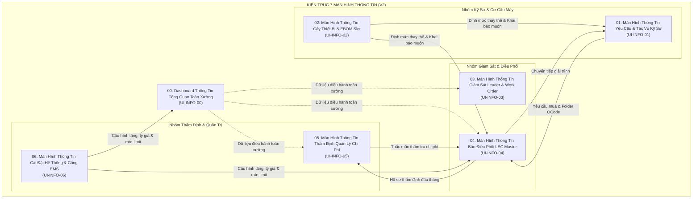

# 00. TỔNG QUAN KIẾN TRÚC MÀN HÌNH THÔNG TIN (V2 - INFORMATION SCREENS SPECIFICATION)

> **Dự án**: Spare Parts Procurement Tracking & Engineering Operations Platform  
> **Phân xưởng**: Smart Watch (SW) — Factory HW (Display Module Plant 1 - Org ID: `28753`)  
> **Phiên bản tài liệu**: 2.0 - Đặc tả Chuyên sâu Toàn bộ Các Màn hình Thông tin  
> **Nguyên tắc cốt lõi**: Không chỉnh sửa dự án web; Chuẩn hóa cấu trúc thông tin, bảng biểu, trường dữ liệu, wireframe chi tiết và luồng tương tác thông tin.

---

## 1. BỐI CẢNH & ĐỊNH HƯỚNG THIẾT KẾ MÀN HÌNH THÔNG TIN

Trong môi trường nhà máy công nghệ cao (Display Module Plant), giao diện phần mềm nghiệp vụ thường gặp phải hai vấn đề lớn:
1. **Quá tải thông tin (Information Overload)**: Trình bày hàng loạt bảng dữ liệu thô thiếu phân cấp, khiến kỹ sư và quản lý mất nhiều thời gian tìm kiếm.
2. **Phân hóa dữ liệu (Data Fragmentation)**: Các phòng ban xem các tập dữ liệu rời rạc, không đối soát được giữa tiến độ mua sắm (Purchase), ngân sách SG (Cost Mgmt), tồn kho xuất dùng (`ds_Inv` EMS) và tình trạng máy hiện trường.

Phiên bản **V2 - Màn hình Thông tin** được tái thiết kế toàn diện nhằm giải quyết triệt để sự phân hóa bằng cách:
* **Tổ chức thông tin theo ngữ cảnh (Context Auto-Scoping)**: Dữ liệu tự động thu hẹp theo vị trí đăng nhập (Kỹ sư theo cụm máy $\rightarrow$ Leader theo Team/Part $\rightarrow$ LEC theo toàn Team $\rightarrow$ Quản lý Chi phí theo toàn nhà máy).
* **Chuẩn hóa thông tin 3 tầng (3-Tier Information Hierarchy)**:
  * **Tầng 1 - Thẻ chỉ số tổng hợp (Executive Metrics & KPIs)**: Trạng thái tức thời, tỷ lệ %, số tiền tổng quan.
  * **Tầng 2 - Trực quan hóa tiến độ & phân bổ (Pipelines & Visual Breakdowns)**: Phễu 7 giai đoạn, biểu đồ ngân sách 3 trục, phân tích 6 mã Over.
  * **Tầng 3 - Bảng dữ liệu chi tiết đa chiều (Multi-dimensional Data Grids)**: Bộ lọc đa năng (Omni-filter), phân trang, sắp xếp, badge trạng thái có mã màu, và drawer mở rộng chi tiết.
* **Loại bỏ hoàn toàn các màn hình thừa**: Triệt tiêu vai trò Kho vận (thông tin xuất kho lấy tự động từ EMS); triệt tiêu các nút phê duyệt nội bộ (phê duyệt chính thức 100% trên EMS Nexacro).

---

## 2. MA TRẬN 7 MÀN HÌNH THÔNG TIN CHUẨN HÓA

### Bảng Phân Quyền Truy Cập Màn Hình Thông Tin:

| Mã Màn Hình | Tên Màn Hình Thông Tin | Kỹ Sư Hiện Trường | Trưởng Nhóm / Part | Điều Phối LEC | Quản Lý Chi Phí (1 Người) | Quản Trị Hệ Thống |
| :--- | :--- | :---: | :---: | :---: | :---: | :---: |
| **`UI-INFO-00`** | **Tổng Quan Vận Hành & Tiến Độ Toàn Xưởng** | 👁️ Theo Line | 👁️ Theo Part/Team | 👁️ Toàn Team | 👁️ Toàn Nhà Máy | **Toàn quyền** |
| **`UI-INFO-01`** | **Yêu Cầu Mua Sắm & Tác Vụ Kỹ Sư** | 🟢 Toàn quyền | 👁️ Tra cứu | 👁️ Tra cứu & Hỗ trợ | 🚫 Không | **Toàn quyền** |
| **`UI-INFO-02`** | **Cây Thiết Bị, EBOM & Tra Cứu Linh Kiện** | 👁️ Tra cứu & Gán | 👁️ Tra cứu | 🟢 Toàn quyền | 👁️ Tra cứu | **Toàn quyền** |
| **`UI-INFO-03`** | **Giám Sát Leader & Đối Soát Work Order** | 🚫 Không | 🟢 Toàn quyền | 👁️ Đối soát | 👁️ Xem hồ sơ | **Toàn quyền** |
| **`UI-INFO-04`** | **Bàn Điều Phối LEC Master & Gom Mẻ** | 🚫 Không | 👁️ Theo dõi | 🟢 Toàn quyền | 👁️ Tra cứu | **Toàn quyền** |
| **`UI-INFO-05`** | **Thẩm Định Đầu Tháng & Báo Cáo 4 Sheet** | 🚫 Không | 🚫 Không | 👁️ Xem câu hỏi | 🟢 Toàn quyền | **Toàn quyền** |
| **`UI-INFO-06`** | **Tham Số Hệ Thống & Giám Sát Cổng EMS** | 🚫 Không | 🚫 Không | ⚙️ Cài đặt ngân sách | 🚫 Không | 🟢 Toàn quyền |

*(Ghi chú: 🟢 Toàn quyền thao tác; 👁️ Xem dữ liệu theo phân vùng; ⚙️ Cài đặt hạn chế; 🚫 Bị khóa).*

---

## 3. NGUYÊN TẮC THIẾT KẾ THÔNG TIN & HỆ THỐNG MÀU SẮC CHUẨN

### 3.1. Phân Loại Trạng Thái Bằng Mã Màu Đồng Nhất (Universal Color Tokens):
* 🟢 **Xanh Lá Cây (Emerald / Success)**: Hạng mục Trong Kế Hoạch (`TARGET`), Mã QCode đã cấp chính thức, Tác vụ đã giải quyết (`RESOLVED`), Kết nối EMS Gateway sẵn sàng (`READY`).
* 🟡 **Màu Hổ Phách (Amber / Warning)**: Cảnh báo tồn kho liên team (`agingInterlockFlag = 'Y'`), Chờ báo giá RFQ (`unitPriceFlag = 'N'`), Tác vụ tồn kho chậm luân chuyển cần giải trình trước ngày 05.
* 🔴 **Màu Đỏ Hồng (Rose / Danger)**: Hạng mục Ngoài Kế Hoạch (`OVER`), Linh kiện ngừng sản xuất (`EOL`), Quá hạn deadline giải trình, Cảnh báo dừng máy khẩn cấp (`Line Stop - OVR-01`).
* 🔵 **Màu Xanh Biển (Cyan / Info)**: Mã số yêu cầu PRV, Quy tắc số chuyền và tầng (`2F`, `3F`), Dây chuyền sản xuất, Tên thân thiện thiết bị.
* 🟣 **Màu Tím / Chàm (Purple / Indigo / Governance)**: Mã định danh EM No 14 ký tự (`HWBMTL21EC0101`), Câu hỏi thẩm tra từ Quản lý Chi phí, Chứng chỉ Cost Clearance.

### 3.2. Tiêu Chuẩn Hiển Thị Số Liệu Tài Chính:
* **Tiền tệ chuẩn**: Đô la Mỹ (`USD`), ký hiệu `$`. Ví dụ: `$150,000 USD`.
* **Quy tắc làm tròn**: Đơn giá linh kiện lấy số nguyên hoặc tối đa 2 chữ số thập phân; Tỷ lệ phần trăm hoàn thành lấy 1 chữ số thập phân (e.g. `92.8%`).
* **Quy chuẩn hiển thị ngày tháng**: Chuẩn quốc tế `YYYY-MM-DD` (e.g. `2026-11-05`). Thời gian chi tiết: `YYYY-MM-DD HH:mm`.

---

## 4. DANH MỤC TÀI LIỆU CHI TIẾT TRONG BỘ V2

Các tài liệu đặc tả chi tiết cho từng màn hình thông tin được lưu trữ trong thư mục này gồm:
1. [**`01-man-hinh-thong-tin-tong-quan-toan-xuan-dashboard.md`**](file:///home/longp/projects/company/ops-workflow/procurement-system/05-ui-ux-screen-specifications-v2/01-man-hinh-thong-tin-tong-quan-toan-xuan-dashboard.md): Đặc tả Màn hình Thông tin Tổng quan Vận hành & Chỉ số Toàn xưởng (`UI-INFO-00`).
2. [**`02-man-hinh-thong-tin-ky-su-va-tien-do-mua-sam.md`**](file:///home/longp/projects/company/ops-workflow/procurement-system/05-ui-ux-screen-specifications-v2/02-man-hinh-thong-tin-ky-su-va-tien-do-mua-sam.md): Đặc tả Màn hình Thông tin Yêu cầu Mua sắm & Tác vụ Kỹ sư Hiện trường (`UI-INFO-01`).
3. [**`03-man-hinh-thong-tin-cay-thiet-bi-ebom-va-co-cau.md`**](file:///home/longp/projects/company/ops-workflow/procurement-system/05-ui-ux-screen-specifications-v2/03-man-hinh-thong-tin-cay-thiet-bi-ebom-va-co-cau.md): Đặc tả Màn hình Thông tin Cây Thiết bị, EBOM & Tra cứu Thay thế (`UI-INFO-02`).
4. [**`04-man-hinh-thong-tin-giam-sat-leader-va-work-order.md`**](file:///home/longp/projects/company/ops-workflow/procurement-system/05-ui-ux-screen-specifications-v2/04-man-hinh-thong-tin-giam-sat-leader-va-work-order.md): Đặc tả Màn hình Thông tin Giám sát Trưởng Nhóm / Part & Đối soát Work Order (`UI-INFO-03`).
5. [**`05-man-hinh-thong-tin-dieu-phoi-lec-master-workbench.md`**](file:///home/longp/projects/company/ops-workflow/procurement-system/05-ui-ux-screen-specifications-v2/05-man-hinh-thong-tin-dieu-phoi-lec-master-workbench.md): Đặc tả Màn hình Thông tin Điều phối Bàn làm việc LEC Master Workbench (`UI-INFO-04`).
6. [**`06-man-hinh-thong-tin-tham-dinh-chi-phi-dau-thang.md`**](file:///home/longp/projects/company/ops-workflow/procurement-system/05-ui-ux-screen-specifications-v2/06-man-hinh-thong-tin-tham-dinh-chi-phi-dau-thang.md): Đặc tả Màn hình Thông tin Thẩm định Đầu Tháng & Xuất Báo Cáo 4 Sheet (`UI-INFO-05`).
7. [**`07-man-hinh-thong-tin-cau-hinh-he-thong-va-gateway-ems.md`**](file:///home/longp/projects/company/ops-workflow/procurement-system/05-ui-ux-screen-specifications-v2/07-man-hinh-thong-tin-cau-hinh-he-thong-va-gateway-ems.md): Đặc tả Màn hình Thông tin Cấu hình Hệ thống, Topology & Giám sát Cổng EMS (`UI-INFO-06`).
