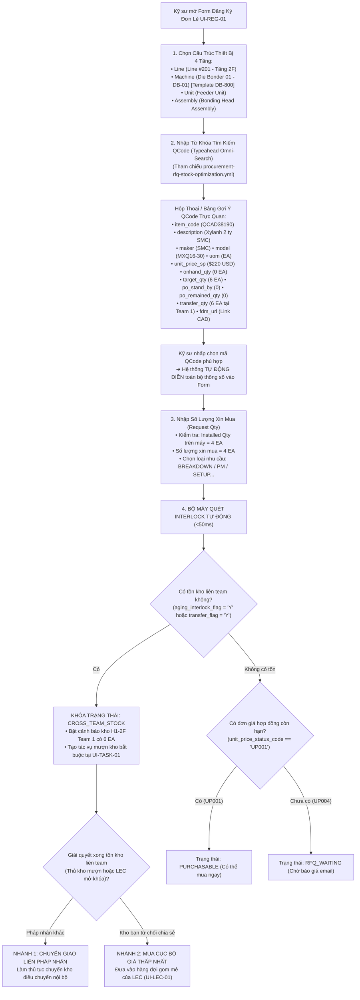

# 01. MÀN HÌNH ĐĂNG KÝ HẠNG MỤC MUA HÀNG (PROCUREMENT ITEM REGISTRATION)

> **Mã màn hình**: `UI-REG-01`  
> **Tên màn hình**: Procurement Item Registration & Requisition Workbench  
> **Vai trò người dùng chính**: Kỹ sư hiện trường (Field Engineer / Requestor) — **Đồng nghiệp ngang hàng (Không phân cấp công đoạn POL, TAB, DIP)**.  
> **Vai trò phối hợp**: Chuyên viên Điều phối Thiết bị (LEC) — Đăng ký mã EM 14 ký tự, gom mẻ, mở khóa Interlock và phân loại lại.  
> **Mục tiêu cốt lõi**: Nơi kỹ sư hiện trường đăng ký toàn bộ các hạng mục mua sắm phụ tùng; **tìm kiếm QCode thông minh đa tiêu chí (Omni-Search Typeahead / Modal tra cứu thay vì dropdown đơn giản)** tham chiếu từ quy trình `procurement-rfq-stock-optimization.yml`; làm việc với cấu trúc 4 tầng chuẩn xưởng: `Line` $\rightarrow$ `Machine` $\rightarrow$ `Unit` $\rightarrow$ `Assembly`; hỗ trợ các máy giống nhau giữa các line; kiểm tra tức thời cờ tồn kho/đơn giá; theo dõi tiến trình xử lý khi bị khóa Interlock và kích hoạt 2 bước mua tiếp theo (chuyển giao liên pháp nhân hoặc mua thường với giá thấp nhất).

---

## 1. NGUYÊN TẮC NGHIỆP VỤ & BỐI CẢNH VẬN HÀNH

Theo phản biện từ thực tế xưởng sản xuất Smart Watch (Factory HW):
1. **Tìm kiếm QCode đa năng thay vì Dropdown đơn giản (Omni-Search Engine)**:
   - Với hơn 20,000 mã linh kiện phụ tùng phòng sạch trong kho nhà máy, việc dùng dropdown menu `<select>` truyền thống là hoàn toàn bất khả thi và gây treo trình duyệt.
   - Hệ thống trang bị **Thanh tìm kiếm thông minh (Typeahead Omni-Search & Tra cứu Modal)**, tích hợp bộ dữ liệu chuẩn hóa từ quy trình `procurement-rfq-stock-optimization.yml`:
     * Cho phép gõ tìm kiếm tức thời theo: Mã QCode (`item_code`), Tên phụ tùng (`description`), Hãng sản xuất (`maker`), Mã Model (`model`), hoặc thông số kỹ thuật.
     * Hiển thị bảng kết quả giàu thông tin thời gian thực: Đơn giá hợp đồng (`unit_price_sp`), Trạng thái giá (`UP001` vs `UP004`), Tồn kho hiện có (`onhand_qty`), Định mức tồn tối ưu (`target_qty`), Số lượng đặt hàng tối thiểu (`min_order_qty`), Số lượng PO đang chờ (`po_stand_by`), Số lượng PO đang trên đường về cảng (`po_remained_qty`), Tồn chuyển giao (`transfer_qty`), và liên kết xem bản vẽ CAD (`fdm_url`).
2. **Cấu trúc phân cấp thiết bị 4 tầng chuẩn hóa & Máy giống nhau giữa các Line**:
   - Kỹ sư không phải nhớ chuỗi mã kỹ thuật phức tạp, mà chọn trực quan theo 4 tầng:
     $$\text{Line (Chuyền)} \longrightarrow \text{Machine (Tên máy)} \longrightarrow \text{Unit (Khối chức năng)} \longrightarrow \text{Assembly (Cơ cấu chi tiết)}$$
   - **Máy giống nhau giữa các line (Identical Machine Models)**: Các dòng máy cùng chủng loại (ví dụ: Die Bonder model `DB-800` có mặt ở cả Line 201, Line 202, Line 301) được liên kết với một **Master Machine Template**, cho phép tự động kế thừa cấu trúc Unit/Assembly và số lượng định mức mà không cần nhập lại từ đầu.
3. **EBOM Matching cơ cấu thay thế & Quản lý số lượng (Quantity Bounds)**:
   - Mọi hạng mục mua sắm bắt buộc phải khớp nối (matching) với chi tiết cơ cấu máy để biết linh kiện mua về thay thế cho bộ phận nào khi hỏng hóc.
   - Quản lý rõ ràng 4 chỉ số số lượng:
     * **Số lượng lắp trên máy (Installed Quantity / Std Qty)**: Số lượng thực tế đang gắn trên cụm cơ cấu (lấy từ EBOM).
     * **Định mức dự phòng tối ưu (Target Stock Qty)**: Mức tồn an toàn cần duy trì trong kho (`target_qty`).
     * **Tồn kho thực tế (Onhand Qty)**: Số lượng sẵn có tại xưởng (`onhand_qty`).
     * **Số lượng xin mua (Request Qty)**: Số lượng kỹ sư đề xuất mua kỳ này (`request_qty`).
   - Nếu linh kiện mới phát sinh chưa có trong cây EBOM, kỹ sư được phép chọn cờ **Khai báo muộn (Late Declaration)** để đăng ký mua trước và bổ sung vị trí cơ cấu trong vòng 7 ngày.
4. **Cơ chế xử lý khi bị khóa Interlock & Các bước tiếp theo**:
   - Nếu hệ thống phát hiện tồn kho tại Team khác trong Factory HW hoặc pháp nhân khác $\rightarrow$ Đơn đăng ký bị khóa trạng thái `CROSS_TEAM_STOCK`.
   - Khi Kỹ sư/LEC giải quyết xong điều kiện tồn kho (hoặc xác minh kho bạn không thể chia sẻ và hệ thống/LEC mở khóa Interlock), hệ thống cho phép xử lý bước tiếp theo:
     * **Nhánh 1: Chuyển giao Liên pháp nhân (Inter-Entity Transfer)** nếu tồn kho nằm ở pháp nhân khác (làm thủ tục transfer).
     * **Nhánh 2: Mua thường cục bộ (Local Purchase)** với đơn giá thấp nhất thông qua đàm phán của bộ phận Mua hàng.
5. **Cơ chế phản hồi & Phân loại lại của LEC (Reclassification & Feedback)**:
   - Một số linh kiện trên hệ thống EMS vẫn hiển thị trạng thái `Active` nhưng thực tế nhà sản xuất đã ngừng sản xuất (`EOL`).
   - LEC sẽ trực tiếp phân loại lại sang nhóm `EOL` hoặc yêu cầu bổ sung thông tin, gửi phản hồi trực tiếp trên màn hình đăng ký này để Kỹ sư nắm bắt và tìm mã thay thế.

---

## 2. BỐ CỤC BÀN LÀM VIỆC ĐĂNG KÝ HẠNG MỤC (LAYOUT ANATOMY)

```
┌──────────────────────────────────────────────────────────────────────────────────────────────────────────────────┐
│ HEADER: ĐĂNG KÝ HẠNG MỤC MUA SẮM SPARE PARTS | Kỹ sư: Nguyễn Văn Thắng | Chuyền: Line #201 (CP/SG Part 1 - 2F)  │
│ Bộ Lọc & Tìm Kiếm: [🔎 Nhập QCode, Tên Phụ Tùng, Tên Máy...] | Phân Ban: [CP/SG Part 1 ▼] | Trạng Thái: [Tất Cả ▼]│
├──────────────────────────────────────────────────────────────────────────────────────────────────────────────────┤
│ PHÂN KHU 1: CÔNG CỤ ĐĂNG KÝ HẠNG MỤC MỚI (REGISTRATION TOOLBAR & ACTIONS)                                        │
│ [ ➕ Đăng Ký Đơn Lẻ (Single Item Form) ]   [ 📄 Đăng Ký Hàng Loạt (Excel/CSV Batch Import) ]                     │
│ [ 🔍 Tra Cứu Kho & QCode Nâng Cao ]       [ 📁 Tải Folder Bản Vẽ Cho Mã Mới ]   [ 🔄 Đồng Bộ Trạng Thái EMS ]    │
├──────────────────────────────────────────────────────────────────────────────────────────────────────────────────┤
│ PHÂN KHU 2: BẢNG THEO DÕI VÒNG ĐỜI CÁC HẠNG MỤC ĐÃ ĐĂNG KÝ (REQUISITION STATUS MONITOR)                         │
│ Bộ lọc phễu cá nhân:                                                                                             │
│ [Tất Cả (18)] [Chờ Quét Interlock (2)] [Bị Khóa Tồn Kho (1)] [Đã Mở Khóa Chờ Mua (6)] [Chờ Báo Giá RFQ (3)]    │
│ [LEC Yêu Cầu Sửa/EOL (2)] [Đã Ký PRV Trên EMS (4)]                                                               │
│ ┌───┬─────────────┬─────────────┬──────────────────────────┬──────────┬──────────┬──────────────┬──────────────┐ │
│ │STT│Mã PR / QCode│Tên Phụ Tùng │Cấu Trúc Thiết Bị 4 Tầng  │Loại Nhu  │Thành Tiền│Trạng Thái    │Hành Động     │ │
│ │   │             │& Maker/Model│(Line > Mach > Unit > Asm)│Cầu & WO  │(USD)     │Xử Lý Hiện Tại│Tiếp Theo     │ │
│ ├───┼─────────────┼─────────────┼──────────────────────────┼──────────┼──────────┼──────────────┼──────────────┤ │
│ │ 1 │PR-2611-0083 │Xylanh 2 ty  │Line 202 > Tape Bonder 02 │IMPROVE   │$880 USD  │🔴 BỊ KHÓA    │[Xem Kho Mượn]│ │
│ │   │QCAD38190    │SMC MXQ16-30 │Cutter Unit > Blade Asm   │WO-248926 │(4 EA)    │TỒN KHO TEAM 1│[Nhờ LEC Mở]  │ │
│ ├───┼─────────────┼─────────────┼──────────────────────────┼──────────┼──────────┼──────────────┼──────────────┤ │
│ │ 2 │PR-2611-0081 │Cảm biến CN73│Line 201 > Die Bonder 01  │PM        │$450 USD  │🟢 ĐÃ MỞ KHÓA │[Đã Chuyển LEC│ │
│ │   │QDAB03583    │Panasonic    │Feeder Unit > Gripper Asm │-         │(10 EA)   │CHỜ DUYỆT EMS │ Gom Mẻ Mua]  │ │
│ ├───┼─────────────┼─────────────┼──────────────────────────┼──────────┼──────────┼──────────────┼──────────────┤ │
│ │ 3 │PR-2611-0084 │Driver Servo │Line 203 > Polarizer 01   │PM        │$1,780 USD│⚠️ LEC BÁO EOL│[Xem Phản Hồi]│ │
│ │   │QCAB99120    │Omron R88D   │Conveyor Unit > Belt Asm  │-         │(2 EA)    │NGỪNG SẢN XUẤT│[Đổi Mã Khác] │ │
│ ├───┼─────────────┼─────────────┼──────────────────────────┼──────────┼──────────┼──────────────┼──────────────┤ │
│ │ 4 │PR-2611-0087 │Đầu gia nhiệtLine 201 > Tape Bonder 01  │BREAKDOWN │$1,260 USD│🟡 CHỜ BÁO GIÁ│[Theo Dõi RFQ]│ │
│ │   │QCAD55421    │Kyocera 400W │Stage Unit > Heat Asm     │WO-2489115│(3 EA)    │UP004 (EMAIL) │              │ │
│ └───┴─────────────┴─────────────┴──────────────────────────┴──────────┴──────────┴──────────────┴──────────────┘ │
├──────────────────────────────────────────────────────────────────────────────────────────────────────────────────┤
│ PHÂN KHU 3: NGĂN KÉO CHI TIẾT HẠNG MỤC (DRAWER THÔNG TIN & XỬ LÝ NGOẠI LỆ)                                      │
│ Hiển thị chi tiết khi bấm vào một dòng:                                                                          │
│ • Chi tiết mã EM 14 ký tự do LEC gán • Bản vẽ FDM CAD Drawing • Bằng chứng Work Order sự cố                      │
│ • Bước tiếp theo khi mở khóa: Lựa chọn [Chuyển giao liên pháp nhân] HOẶC [Mua thường với giá thấp nhất]          │
└──────────────────────────────────────────────────────────────────────────────────────────────────────────────────┘
```

---

## 3. QUY TRÌNH TÌM KIẾM QCODE & TƯƠNG TÁC ĐĂNG KÝ (WORKFLOW)



---

## 4. ĐẶC TẢ CHI TIẾT TỪNG THÀNH PHẦN GIAO DIỆN

### 4.1. Hộp Thoại Đăng Ký Đơn Lẻ (Single Item Registration Modal với QCode Omni-Search)

Khi kỹ sư nhấn **[➕ Đăng Ký Đơn Lẻ]**, cửa sổ nhập liệu xuất hiện:

```
┌──────────────────────────────────────────────────────────────────────────────────────────────────────────────────┐
│ ➕ ĐĂNG KÝ HẠNG MỤC PHỤ TÙNG MỚI (PROCUREMENT REQUISITION MODAL)                                    [Đóng (X)]   │
├──────────────────────────────────────────────────────────────────────────────────────────────────────────────────┤
│ 1. CẤU TRÚC THIẾT BỊ 4 TẦNG & TÊN THÂN THIỆN:                                                                    │
│ • Dây chuyền (Line):              • Tên máy thân thiện (Machine):                                                │
│   [ Line #201 (Tầng 2F)       ▼ ]   [ Die Bonder 01 (DB-01) - Model Template DB-800                          ▼ ] │
│   ↳ Quy tắc: Left(Line,1)=Floor     ↳ Kế thừa cấu trúc máy dùng chung giữa Line 201, 202, 301                    │
│ • Cụm chức năng máy (Unit):       • Cơ cấu chi tiết lắp đặt (Assembly / Mechanism):                              │
│   [ Feeder Unit (Cấp phôi)    ▼ ]   [ Bonding Head Assembly (Cụm gắp chip SubUnit 01)                        ▼ ] │
│ ──────────────────────────────────────────────────────────────────────────────────────────────────────────────── │
│ Mã định danh EM No: [ HWBMTL21EC0101 ] (Hệ thống tự động liên kết cấu trúc • LEC ký duyệt chính thức)            │
├──────────────────────────────────────────────────────────────────────────────────────────────────────────────────┤
│ 2. TÌM KIẾM QCODE THÔNG MINH (OMNI-SEARCH ENGINE - THAM CHIẾU procurement-rfq-stock-optimization.yml):           │
│ 🔎 Nhập từ khóa: [ MXQ16-30                                                           ] [ 🔍 Tìm Kiếm Nâng Cao ] │
│ ┌──────────────────────────────────────────────────────────────────────────────────────────────────────────────┐ │
│ │ KẾT QUẢ GỢI Ý TỨC THỜI (DEBOUNCE 300MS):                                                                     │ │
│ │ ┌──────────┬────────────────────────────┬──────┬─────────┬─────────┬────────┬────────┬────────┬──────────────┐ │ │
│ │ │Mã QCode  │Tên Phụ Tùng & Maker / Model│ĐVT   │Đơn Giá  │Tồn Hiện │Định Mức│Đang Về │Transfer│Cờ Cảnh Báo   │ │ │
│ │ │          │                            │(UOM) │(SP Cost)│(Onhand) │(Target)│(PO Rem)│(Liên ĐV│Interlocks    │ │ │
│ │ ├──────────┼────────────────────────────┼──────┼─────────┼─────────┼────────┼────────┼────────┼──────────────┤ │ │
│ │ │QCAD38190 │Xylanh 2 ty dẫn hướng SMC   │EA    │$220 USD │0 EA     │6 EA    │0 EA    │6 EA    │⚠️ Có Tồn Kho │ │ │
│ │ │(Đang chọn│SMC - Model: MXQ16-30       │      │(UP001)  │         │        │        │(Team 1)│   Liên Team  │ │ │
│ │ ├──────────┼────────────────────────────┼──────┼─────────┼─────────┼────────┼────────┼────────┼──────────────┤ │ │
│ │ │QCAD38195 │Xylanh 2 ty dẫn hướng SMC   │EA    │$245 USD │2 EA     │4 EA    │2 EA    │0 EA    │🟢 Sẵn Sàng   │ │ │
│ │ │          │SMC - Model: MXQ16-50       │      │(UP001)  │         │        │        │        │   Mua Ngay   │ │ │
│ │ └──────────┴────────────────────────────┴──────┴─────────┴─────────┴────────┴────────┴────────┴──────────────┘ │ │
│ └──────────────────────────────────────────────────────────────────────────────────────────────────────────────┘ │
│ THÔNG TIN CHI TIẾT MÃ ĐÃ CHỌN:                                                                                   │
│ • Mã QCode: QCAD38190 | Hãng SX: SMC Japan | Model: MXQ16-30 | Bản vẽ CAD: [ 📐 Xem Bản Vẽ Kỹ Thuật FDM ]      │
│ • Đơn giá hợp đồng: $220.00 USD (UP001 - Hợp lệ) | MOQ: 1 EA | Người mua phụ trách: Vũ Thị Mai (Buyer 03)      │
├──────────────────────────────────────────────────────────────────────────────────────────────────────────────────┤
│ 3. SỐ LƯỢNG & PHÂN LOẠI NHU CẦU:                                                                                 │
│ • Số lượng lắp trên máy (Installed Qty): 4 EA  (Lấy từ EBOM của Cụm Bonding Head Assembly)                       │
│ • Số lượng xin mua (Request Qty): [ 4 ] EA ➔ Thành tiền dự kiến: $880.00 USD                                     │
│ • Phân loại nhu cầu: [ BREAKDOWN (Sự Cố Dừng Chuyền) ▼ ]                                                         │
│ • Mã Work Order sự cố: [ WO-248926095                 ] (Bắt buộc nhập mã WO đối với sự cố Breakdown)            │
│ • Lý do chi tiết: [ Xylanh cụm gắp bị rơ bạc trượt dẫn hướng sau 15,000h chạy, kẹt phôi ca đêm ]                 │
│ • [ ] Tích chọn: KHAI BÁO MUỘN EBOM (Nếu linh kiện mới chưa có slot trên cây máy, bổ sung trong 7 ngày)          │
│ ┌──────────────────────────────────────────────────────────────────────────────────────────────────────────────┐ │
│ │ ⚠️ CẢNH BÁO INTERLOCK TỒN KHO LIÊN TEAM: Kho H1-2F của PO Module Team 1 đang CÓ SẴN 6 EA!                    │ │
│ │ Đơn mua này sẽ bị KHÓA TRẠNG THÁI CROSS_TEAM_STOCK. Hệ thống tự động tạo Tác vụ Mượn Kho tại UI-TASK-01.      │ │
│ └──────────────────────────────────────────────────────────────────────────────────────────────────────────────┘ │
├──────────────────────────────────────────────────────────────────────────────────────────────────────────────────┤
│ NÚT HÀNH ĐỘNG: [ Hủy Bỏ ]                                                [ 💾 Xác Nhận Đăng Ký Yêu Cầu Mua ]     │
└──────────────────────────────────────────────────────────────────────────────────────────────────────────────────┘
```

---

## 5. ĐẶC TẢ BẢNG DỮ LIỆU TÌM KIẾM QCODE TỪ `procurement-rfq-stock-optimization.yml`

Khi bộ máy tìm kiếm thực thi (hoặc khi mở Modal Tra cứu Nâng cao), các trường dữ liệu được ánh xạ trực tiếp từ các dataset của EMS Nexacro như định nghĩa trong workflow:

| Tên Trường Hiển Thị | Mã Trường YML | Nguồn Service EMS | Mô Tả & Ý Nghĩa Nghiệp Vụ |
| :--- | :--- | :--- | :--- |
| **Mã Linh Kiện** | `item_code` | `/retrieveItem.lgdn` (`ds_Search`) | Mã QCode 9 ký tự chuẩn (e.g. `QDAB03583`, `QCAD38190`). |
| **Tên Phụ Tùng** | `description` | `TargetStockSearchList.lgdn` (`ds_StockInfomation`) | Tên mô tả kỹ thuật (e.g. *Xylanh 2 ty dẫn hướng SMC*). |
| **Model Nhà SX** | `model` | `TargetStockSearchList.lgdn` | Model chính xác từ Catalog hãng (e.g. `MXQ16-30`). |
| **Hãng Sản Xuất** | `maker` / `vendor_name` | `TargetStockSearchList.lgdn` | Tên nhà chế tạo (SMC, Omron, Panasonic, Keyence, THK). |
| **Đơn Vị Tính** | `uom` | `TargetStockSearchList.lgdn` | `EA` (Cái), `SET` (Bộ), `METER` (Mét), `ROLL` (Cuộn). |
| **Đơn Giá SP** | `unit_price_sp` | `TargetStockSearchList.lgdn` (`itemCost`) | Đơn giá hợp đồng hiện hành bằng USD (e.g. `$220.00`). |
| **Trạng Thái Đơn Giá** | `unit_price_status_code` | `retrieveItemPoStatusList.lgdn` | `UP001`: Có giá hợp đồng $\rightarrow$ Mua ngay; `UP004`: Chưa có giá $\rightarrow$ Chờ RFQ. |
| **Số Lượng Tối Thiểu**| `min_order_qty` | `TargetStockSearchList.lgdn` (`minOrderQty`) | MOQ đặt hàng của nhà cung cấp. |
| **Định Mức Tồn Kho** | `target_qty` | `TargetStockSearchList.lgdn` (`targetQty`) | Mức tồn kho an toàn tối ưu cần duy trì. |
| **Tồn Kho Thực Tế** | `onhand_qty` | `retrieveItemInfoDetail.lgdn` (`ds_Inv`) | Số lượng phụ tùng đang có sẵn trong kho phân xưởng. |
| **PO Đang Chờ Duyệt** | `po_stand_by` | `retrieveItemInfoDetail.lgdn` (`poWaitingQty`)| Số lượng trong đơn PRV/PO đang chờ duyệt ký trên EMS. |
| **PO Đang Về Cảng** | `po_remained_qty`| `retrieveItemInfoDetail.lgdn` (`notReceivingQty`)| Hàng đã đặt nhà cung cấp nhưng chưa giao đến nhà máy. |
| **Tồn Chuyển Giao** | `transfer_qty` | `retrieveItemPoStatusList.lgdn` (`transferQty`)| Hàng dư thừa tại Team/Nhà máy khác có thể mượn (`transferFlag`). |
| **Bản Vẽ CAD FDM** | `fdm_url` | `retrieveItemInfoDetail.lgdn` (`ds_Item.fdmUrl`)| Đường dẫn mở trực tiếp bản vẽ 2D/3D trên hệ thống FDM. |
| **Cảnh Báo Chặn Mua**| `stop_po_flag` | `retrieveItemPoStatusList.lgdn` | Cờ khóa chặn đặt mua từ hệ thống tập đoàn. |
| **Cảnh Báo Chậm Tồn**| `aging_interlock_flag` | `retrieveItemPoStatusList.lgdn` | Cờ cảnh báo phụ tùng tồn kho quá 30 ngày chưa lắp. |

---

## 6. XỬ LÝ MÁY GIỐNG NHAU GIỮA CÁC LINE (MASTER MACHINE TEMPLATES)

Nhà máy Smart Watch có nhiều dây chuyền (Line 201, 202, 301, 302...) sử dụng các dòng máy đồng nhất về cấu trúc và phụ tùng:
1. **Khái niệm Master Machine Template**:
   - Máy `Die Bonder 01 (Line 201)`, `Die Bonder 02 (Line 202)`, `Die Bonder 03 (Line 301)` đều thuộc chung dòng máy mẫu: `TEMPLATE-DB-800`.
2. **Cơ chế Kế thừa Tự động khi Đăng ký Mua**:
   - Khi kỹ sư chọn máy `Die Bonder 01`, hệ thống tự động tải cây cấu trúc chuẩn:
     * Unit: `Feeder Unit` $\rightarrow$ Assembly: `Bonding Head Assembly` $\rightarrow$ Linh kiện: `QCAD38190` (Installed Qty = 4 EA).
   - Kỹ sư không phải nhập lại từ đầu cấu trúc cơ cấu hay số lượng lắp trên máy.
3. **Đồng bộ hóa & Khớp nối**:
   - Việc mua phụ tùng cho máy này có thể dễ dàng tham chiếu sang các máy cùng model trên line khác để kiểm tra xem line bạn có linh kiện dự phòng tương đương hay không.


---

## 7. THEO DÕI TIẾN ĐỘ TỪNG HẠNG MỤC & LIÊN KẾT TÁC VỤ (ITEM PROGRESS & TASK BINDING)

Khi kỹ sư nhấp vào bất kỳ một dòng hạng mục nào trên Bảng Requisition Status Monitor, Ngăn kéo Drawer mở ra hiển thị **Tiến độ Milestone thời gian thực** và **Tác vụ liên quan**:

```
┌──────────────────────────────────────────────────────────────────────────────────────────────────────┐
│ 📑 TIẾN ĐỘ CHI TIẾT HẠNG MỤC: PR-2611-0083 | Xylanh 2 ty SMC MXQ16-30 | $880 USD                     │
├──────────────────────────────────────────────────────────────────────────────────────────────────────┤
│ 1. THANH TIẾN ĐỘ VÒNG ĐỜI 7 MỐC (ITEM MILESTONE TIMELINE):                                           │
│  [🟢 1.Đăng Ký] ── [🔴 2.Quét Interlock] ── [⏳ 3.Báo Giá] ── [⏳ 4.Thẩm Định] ── [⏳ 5.Ký Duyệt EMS]│
│      2026-11-04        BỊ KHÓA TỒN KHO         UP001 ($220)       Chờ 01-05         Chưa ký PO       │
│  ── [⏳ 6.Inbound Vận Chuyển] ── [⏳ 7.Xuất Lắp Máy (ds_Inv)]                                       │
│          Chưa giao hàng                  Chưa xuất                                                   │
├──────────────────────────────────────────────────────────────────────────────────────────────────────┤
│ 2. TÁC VỤ BẮT BUỘC LIÊN KẾT (ASSOCIATED PERSISTENT TASK):                                            │
│ • Mã Tác Vụ: [ 📬 TASK-LCK-0018: Mượn Kho Liên Team ] ➔ Trạng thái: 🟡 Đang Mở                       │
│ • Vị trí tồn kho: Kho H1-2F (PO Module Team 1) đang có sẵn 6 EA dư thừa.                             │
│ • Thao tác nhanh: [ 🔗 Mở Tác Vụ Tại UI-TASK-01 ]   [ 💬 Nhắn Tin Nhờ LEC Mở Khóa ]                 │
├──────────────────────────────────────────────────────────────────────────────────────────────────────┤
│ 3. TRA CỨU LỊCH SỬ MUA HÀNG TRONG QUÁ KHỨ (HISTORICAL PROCUREMENT LOOKUP):                           │
│ • Lịch sử mua gần nhất của mã QCAD38190:                                                             │
│   - Đợt 1: 2026-10-12 (PO-99120) - Mua 4 EA x $220 USD cho Line #201 (Nhà cung cấp: SMC Vietnam)     │
│   - Đợt 2: 2026-08-05 (PO-97541) - Mua 2 EA x $225 USD cho Line #202 (Nhà cung cấp: SMC Vietnam)     │
│ • Đơn giá biến động: Giảm $5 USD (-2.2%) so với quý trước.                                           │
│ [ 📊 Mở Phân Tích Lịch Sử Mua & Xu Hướng Over Đa Tháng Tại UI-DASH-01 ]                              │
└──────────────────────────────────────────────────────────────────────────────────────────────────────┘
```
