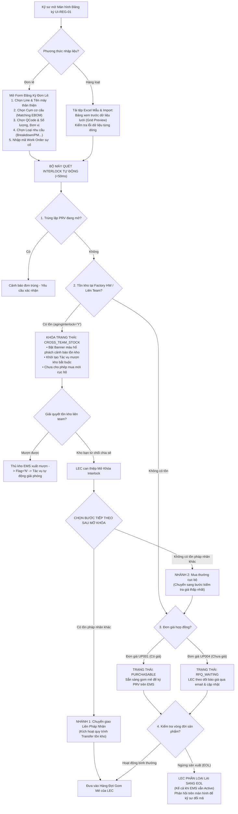

# 01. MÀN HÌNH ĐĂNG KÝ HẠNG MỤC MUA HÀNG (PROCUREMENT ITEM REGISTRATION)

> **Mã màn hình**: `UI-REG-01`  
> **Tên màn hình**: Procurement Item Registration & Requisition Workbench  
> **Vai trò người dùng chính**: Kỹ sư hiện trường (Field Engineer / Requestor) — **Đồng nghiệp ngang hàng (Không phân cấp công đoạn POL, TAB, DIP)**.  
> **Vai trò phối hợp**: Chuyên viên Điều phối Thiết bị (LEC) — Đăng ký mã EM 14 ký tự, gom mẻ, mở khóa Interlock và phân loại lại.  
> **Mục tiêu cốt lõi**: Nơi kỹ sư hiện trường đăng ký toàn bộ các hạng mục mua sắm phụ tùng; làm việc trực tiếp với tên Machine, Line, Assembly thân thiện; kiểm tra tức thời cờ tồn kho/đơn giá; theo dõi tiến trình xử lý khi bị khóa Interlock và kích hoạt các bước mua tiếp theo (chuyển giao liên pháp nhân hoặc mua thường với giá thấp nhất).

---

## 1. NGUYÊN TẮC NGHIỆP VỤ & BỐI CẢNH VẬN HÀNH

Theo phản biện từ thực tế xưởng sản xuất Smart Watch (Factory HW):
1. **Không có hạng mục nào cần mua gấp phi quy trình**:
   - Dù là sự cố dừng máy hay bảo dưỡng, kỹ sư chỉ cần **đăng ký hạng mục lên hệ thống** kèm đầy đủ thông tin máy, cụm cơ cấu và mã Work Order.
   - Hệ thống tự động kiểm tra xem hạng mục có bị trùng lặp hoặc bị khóa Interlock hay không.
2. **Kỹ sư làm việc với Tên Thân Thiện — LEC đăng ký Mã EM 14 ký tự**:
   - Kỹ sư chọn trực quan: `Machine` (e.g. Die Bonder 01 - DB-01), `Line` (e.g. Line #201), `Assembly` (Cụm cơ cấu e.g. Bonding Head).
   - LEC là người phê duyệt/đăng ký chuỗi định danh mã EM No chuẩn 14 ký tự (`HWBMTL21EC0101`) lên hệ thống để đồng bộ sang EMS Core.
3. **EBOM Matching cơ cấu thay thế**:
   - Mọi hạng mục mua sắm bắt buộc phải khớp nối (matching) với chi tiết cơ cấu máy để biết linh kiện mua về thay thế cho cụm nào khi hỏng hóc.
   - Nếu linh kiện mới phát sinh chưa có trong cây EBOM, kỹ sư được phép chọn cờ **Khai báo muộn (Late Declaration)** để đăng ký mua trước và bổ sung vị trí cơ cấu trong vòng 7 ngày.
4. **Cơ chế xử lý khi bị khóa Interlock & Các bước tiếp theo**:
   - Nếu hệ thống phát hiện tồn kho tại Team khác trong Factory HW hoặc pháp nhân khác $\rightarrow$ Đơn đăng ký bị khóa trạng thái `CROSS_TEAM_STOCK`.
   - Khi Kỹ sư/LEC giải quyết xong điều kiện tồn kho (hoặc xác minh kho bạn không thể chia sẻ và hệ thống/LEC mở khóa Interlock), hệ thống cho phép xử lý bước tiếp theo:
     * **Nhánh 1: Chuyển giao Liên pháp nhân (Inter-Entity Transfer)** nếu tồn kho nằm ở pháp nhân khác (làm thủ tục transfer).
     * **Nhánh 2: Mua thường cục bộ (Local Purchase)** với đơn giá thấp nhất thông qua đàm phán của bộ phận Mua hàng.
5. **Cơ chế phản hồi & Phân loại lại của LEC (Reclassification & Feedback)**:
   - Một số linh kiện trên hệ thống EMS vẫn hiển thị trạng thái `Active` nhưng thực tế nhà sản xuất đã ngừng sản xuất (`EOL`).
   - Hoặc thông tin kỹ thuật do kỹ sư nhập chưa đầy đủ: LEC sẽ trực tiếp phân loại lại sang nhóm `EOL` hoặc yêu cầu bổ sung thông tin, gửi phản hồi trực tiếp trên màn hình đăng ký này để Kỹ sư nắm bắt và tìm mã thay thế.

---

## 2. CẤU TRÚC BỐ CỤC MÀN HÌNH (LAYOUT ANATOMY)

Màn hình được chia làm 3 phân khu chức năng đồng bộ:

```
┌──────────────────────────────────────────────────────────────────────────────────────────────────────────────────┐
│ HEADER: ĐĂNG KÝ HẠNG MỤC MUA SẮM SPARE PARTS | Kỹ sư: Nguyễn Văn Thắng | Chuyền: Line #201 (CP/SG Part 1 - 2F)  │
│ Bộ Lọc & Tìm Kiếm: [🔎 Nhập QCode, Tên Phụ Tùng, Tên Máy...] | Phân Ban: [CP/SG Part 1 ▼] | Trạng Thái: [Tất Cả ▼]│
├──────────────────────────────────────────────────────────────────────────────────────────────────────────────────┤
│ PHÂN KHU 1: CÔNG CỤ ĐĂNG KÝ HẠNG MỤC MỚI (REGISTRATION TOOLBAR & ACTIONS)                                        │
│ [ ➕ Đăng Ký Đơn Lẻ (Single Item Form) ]   [ 📄 Đăng Ký Hàng Loạt (Excel/CSV Batch Import) ]                     │
│ [ 📁 Tải Folder Bản Vẽ Cho Mã Mới ]       [ 🔄 Đồng Bộ Trạng Thái EMS ]                                          │
├──────────────────────────────────────────────────────────────────────────────────────────────────────────────────┤
│ PHÂN KHU 2: BẢNG THEO DÕI VÒNG ĐỜI CÁC HẠNG MỤC ĐÃ ĐĂNG KÝ (REQUISITION STATUS MONITOR)                         │
│ Bộ lọc phễu cá nhân:                                                                                             │
│ [Tất Cả (18)] [Chờ Quét Interlock (2)] [Bị Khóa Tồn Kho (1)] [Đã Mở Khóa Chờ Mua (6)] [Chờ Báo Giá RFQ (3)]    │
│ [LEC Yêu Cầu Sửa/EOL (2)] [Đã Ký PRV Trên EMS (4)]                                                               │
│ ┌───┬─────────────┬─────────────┬──────────────────────────┬──────────┬──────────┬──────────────┬──────────────┐ │
│ │STT│Mã PR / QCode│Tên Phụ Tùng │Thiết Bị / Chuyền / Cơ Cấu│Loại Nhu  │Thành Tiền│Trạng Thái    │Hành Động     │ │
│ │   │             │             │(Machine - Line - Mech)   │Cầu & WO  │(USD)     │Xử Lý Hiện Tại│Tiếp Theo     │ │
│ ├───┼─────────────┼─────────────┼──────────────────────────┼──────────┼──────────┼──────────────┼──────────────┤ │
│ │ 1 │PR-2611-0083 │Xylanh 2 ty  │Tape Bonder 02 - Line 202 │IMPROVE   │$880 USD  │🔴 BỊ KHÓA    │[Xem Kho Mượn]│ │
│ │   │QCAD38190    │SMC MXQ16    │Cơ cấu cắt băng (Mech 01) │WO-248926 │(4 EA)    │TỒN KHO TEAM 1│[Nhờ LEC Mở]  │ │
│ ├───┼─────────────┼─────────────┼──────────────────────────┼──────────┼──────────┼──────────────┼──────────────┤ │
│ │ 2 │PR-2611-0081 │Cảm biến quangDie Bonder 01 - Line 201  │PM        │$450 USD  │🟢 ĐÃ MỞ KHÓA │[Đã Chuyển LEC│ │
│ │   │QDAB03583    │Panasonic    │Cụm cấp phôi (Feeder 01)  │-         │(10 EA)   │CHỜ DUYỆT EMS │ Gom Mẻ Mua]  │ │
│ ├───┼─────────────┼─────────────┼──────────────────────────┼──────────┼──────────┼──────────────┼──────────────┤ │
│ │ 3 │PR-2611-0084 │Driver Servo │Polarizer 01 - Line 203   │PM        │$1,780 USD│⚠️ LEC BÁO EOL│[Xem Phản Hồi]│ │
│ │   │QCAB99120    │Omron R88D   │Băng tải cấp (Conveyor 02)│-         │(2 EA)    │NGỪNG SẢN XUẤT│[Đổi Mã Khác] │ │
│ ├───┼─────────────┼─────────────┼──────────────────────────┼──────────┼──────────┼──────────────┼──────────────┤ │
│ │ 4 │PR-2611-0087 │Đầu gia nhiệtTape Bonder 01 - Line 201  │BREAKDOWN │$1,260 USD│🟡 CHỜ BÁO GIÁ│[Theo Dõi RFQ]│ │
│ │   │QCAD55421    │Kyocera 400W │Bàn nhiệt ép (Heat Stage) │WO-2489115│(3 EA)    │UP004 (EMAIL) │              │ │
│ └───┴─────────────┴─────────────┴──────────────────────────┴──────────┴──────────┴──────────────┴──────────────┘ │
├──────────────────────────────────────────────────────────────────────────────────────────────────────────────────┤
│ PHÂN KHU 3: NGĂN KÉO CHI TIẾT HẠNG MỤC (DRAWER THÔNG TIN & XỬ LÝ NGOẠI LỆ)                                      │
│ Hiển thị chi tiết khi bấm vào một dòng:                                                                          │
│ • Chi tiết mã EM 14 ký tự do LEC gán • Bằng chứng Work Order sự cố • Trạng thái đàm phán giá Purchase            │
│ • Bước tiếp theo khi mở khóa: Lựa chọn [Chuyển giao liên pháp nhân] HOẶC [Mua thường với giá thấp nhất]          │
└──────────────────────────────────────────────────────────────────────────────────────────────────────────────────┘
```

---

## 3. QUY TRÌNH NGHIỆP VỤ ĐĂNG KÝ HẠNG MỤC (STEP-BY-STEP WORKFLOW)



---

## 4. ĐẶC TẢ CHI TIẾT TỪNG THÀNH PHẦN GIAO DIỆN

### 4.1. Hộp Thoại Đăng Ký Đơn Lẻ (Single Item Registration Modal)
Khi kỹ sư nhấn **[➕ Đăng Ký Đơn Lẻ]**, cửa sổ nhập liệu xuất hiện với các trường thông tin chuẩn hóa:

```
┌─────────────────────────────────────────────────────────────────────────────────────────────────┐
│ ĐĂNG KÝ HẠNG MỤC PHỤ TÙNG MỚI                                                      [Đóng (X)]   │
├─────────────────────────────────────────────────────────────────────────────────────────────────┤
│ 1. THÔNG TIN VỊ TRÍ THIẾT BỊ (EQUIPMENT LOCATION - TÊN THÂN THIỆN):                             │
│ • Dây chuyền (Line):                                                                            │
│   [ Line #201 (Tầng 2F) ▼ ]  (Quy tắc: Left(Line,1)=Tầng ➔ Tầng 2F)                             │
│ • Tên máy thân thiện (Machine Friendly Name):                                                   │
│   [ Die Bonder 01 (DB-01) ▼ ]  (Mã chủng loại: EC • Thứ tự: 01)                                 │
│ • Cụm cơ cấu lắp đặt (Assembly / Mechanism):                                                    │
│   [ Cụm Đầu Gắp Chip (Bonding Head - SubUnit 01) ▼ ]                                            │
│ • Khung giải mã mã EM No hiển thị tức thời:                                                     │
│   ┌───────────────────────────────────────────────────────────────────────────────────────────┐ │
│   │ Mã EM 14 ký tự: HWBMTL21EC0101 (Do LEC duyệt & đăng ký chính thức lên hệ thống)           │ │
│   └───────────────────────────────────────────────────────────────────────────────────────────┘ │
├─────────────────────────────────────────────────────────────────────────────────────────────────┤
│ 2. THÔNG TIN PHỤ TÙNG & TRUY VẤN TỒN KHO / ĐƠN GIÁ (REAL-TIME LOOKUP):                          │
│ • Mã linh kiện (QCode): [ 🔎 Nhập mã QCode e.g. QCAD38190...                             ]      │
│ • Tên phụ tùng: Xylanh dẫn hướng đôi khí nén SMC MXQ16-100B                                     │
│ • Nhà sản xuất (Maker): SMC Japan        • Model/Part No: MXQ16-100B                            │
│ • Số lượng đăng ký: [ 4 ] EA             • Đơn vị tính: EA (Cái)                                │
│ • Đơn giá tham chiếu: $220 USD           • Thành tiền ước tính: $880 USD                        │
│ • Trạng thái giá: 🟢 UP001 (Có đơn giá hợp đồng còn hiệu lực)                                   │
│ ┌─────────────────────────────────────────────────────────────────────────────────────────────┐ │
│ │ ⚠️ CẢNH BÁO INTERLOCK TỒN KHO: Phát hiện 6 EA tại Kho H1-2F thuộc PO Module Tech Team 1!   │ │
│ │ Hạng mục sẽ ở trạng thái BỊ KHÓA TỒN KHO sau khi đăng ký để bạn làm thủ tục mượn trước.     │ │
│ └─────────────────────────────────────────────────────────────────────────────────────────────┘ │
├─────────────────────────────────────────────────────────────────────────────────────────────────┤
│ 3. PHÂN LOẠI NHU CẦU & THÔNG TIN BẢO TRÌ:                                                       │
│ • Loại nhu cầu (Demand Type): [ BREAKDOWN (Sự Cố Dừng Máy) ▼ ]                                  │
│ • Mã Work Order sự cố: [ WO-248926095                 ] (Bắt buộc đối với Breakdown/Over)       │
│ • Lý do xin mua chi tiết:                                                                       │
│   [ Xylanh cụm gắp bị rơ lắc bạc trượt sau 15,000h vận hành, gây lệch tâm dán chip ca đêm...   ]│
│ • [ ] Tích chọn: KHAI BÁO MUỘN EBOM (Nếu linh kiện mới chưa kịp gán slot trên cây máy)          │
├─────────────────────────────────────────────────────────────────────────────────────────────────┤
│ Nút hành động: [ Hủy Bỏ ]                                  [ 💾 Xác Nhận Đăng Ký Hạng Mục ]     │
└─────────────────────────────────────────────────────────────────────────────────────────────────┘
```

### 4.2. Chế Độ Đăng Ký Hàng Loạt (Excel/CSV Batch Import Grid)
* **Mục tiêu**: Cho phép kỹ sư chuẩn bị sẵn danh sách phụ tùng bảo dưỡng PM của cả dây chuyền (10-30 mã) trên Excel và nạp vào hệ thống chỉ với 1 thao tác.
* **Quy chuẩn tệp Excel mẫu**:
  * Cột A: `LineCode` (e.g. `201`)
  * Cột B: `MachineName` (e.g. `DB-01`)
  * Cột C: `MechanismName` (e.g. `Bonding Head`)
  * Cột D: `QCode` (e.g. `QDAB03583`)
  * Cột E: `Quantity` (e.g. `10`)
  * Cột F: `DemandType` (e.g. `PM`)
  * Cột G: `WorkOrderNo` (e.g. `WO-PM-202611`)
* **Lưới xem trước & Xác thực dữ liệu (Validation Grid)**:
  * Khi nạp tệp lên, hệ thống hiển thị bảng kiểm tra trước:
    * Ô màu xanh: Dữ liệu hợp lệ.
    * Ô màu đỏ: Sai định dạng hoặc QCode không tồn tại $\rightarrow$ Rà lỗi trực tiếp trên ô lưới.
    * Ô màu vàng: Cảnh báo mã có tồn kho liên team.
  * Nhấn **[Xác Nhận Import Hàng Loạt]** $\rightarrow$ Hệ thống tự động đẩy toàn bộ danh sách vào cơ sở dữ liệu.

---

### 4.3. Cơ Chế Xử Lý Khi Hạng Mục Bị Khóa Interlock & Các Bước Tiếp Theo

Đây là nội dung giải quyết trực tiếp **phản biện của Request 5 & Request 7**:

#### A. Khi Hạng Mục Bị Khóa (`CROSS_TEAM_STOCK`):
1. Hệ thống gắn nhãn đỏ `BỊ KHÓA INTERLOCK` trên bảng danh mục của kỹ sư.
2. Nút thao tác trên dòng chuyển thành:
   * **[Xem Kho Mượn]**: Mở popup hiển thị vị trí chính xác (Nhà kho H1, Tầng 2, Giá kệ B-04), số lượng đang tồn (6 EA), người quản lý kho bên Team 1 (Kỹ sư Lê Hoàng Quân - SĐT: 0912.xxx.xxx).
   * **[Nhờ LEC Mở Khóa]**: Gửi yêu cầu can thiệp cho LEC trong trường hợp Team 1 từ chối cho mượn (ví dụ Team 1 cần dự phòng chạy đơn hàng đặc biệt).

#### B. Các Bước Xử Lý Tiếp Theo Khi Interlock Được Mở Khóa:
Sau khi LEC kiểm tra và kích hoạt mở khóa Interlock trên hệ thống, đơn đăng ký chuyển sang bước xử lý tiếp theo với **2 Nhánh Lựa Chọn**:

```
[ INTERLOCK ĐƯỢC MỞ KHÓA BỞI LEC ]
                 │
                 ├── NHÁNH 1: MUA CHUYỂN GIAO LIÊN PHÁP NHÂN (INTER-ENTITY TRANSFER)
                 │   • Áp dụng khi: Tồn kho nằm ở pháp nhân khác (Factory TV hoặc LGD Hàn Quốc/Trung Quốc).
                 │   • Thao tác: Hệ thống kích hoạt quy trình Transfer liên pháp nhân.
                 │   • Ưu điểm: Tận dụng tối đa tồn kho nhàn rỗi trong toàn tập đoàn.
                 │
                 └── NHÁNH 2: MUA THƯỜNG CỤC BỘ (LOCAL PURCHASE)
                     • Áp dụng khi: Không có tồn kho ở bất kỳ pháp nhân nào, hoặc chi phí logistics transfer cao hơn mua mới.
                     • Thao tác: Chuyển sang bộ phận Mua hàng để đàm phán mua thường với GIÁ THẤP NHẤT.
                     • Đơn giá: 
                       - Nếu có giá hợp đồng UP001 ➔ Mua ngay.
                       - Nếu chưa có giá UP004 ➔ Kích hoạt yêu cầu RFQ qua Email.
```

---

### 4.4. Cơ Chế LEC Phân Loại Lại & Phản Hồi Cho Requestor (Reclassification & Feedback)

Trong thực tế hiện trường có nhiều tình huống phức tạp:
1. **Linh kiện hiển thị `Active` trên EMS nhưng thực tế đã ngừng sản xuất (`EOL`)**:
   * Nhà sản xuất (ví dụ Omron, Panasonic) đã thông báo ngừng cung cấp mẫu mã cũ nhưng hệ thống EMS tập đoàn chưa kịp cập nhật trạng thái `Discontinue`.
   * LEC phát hiện thông tin này qua kênh trao đổi với Nhà cung cấp $\rightarrow$ LEC chuyển trạng thái trên hệ thống từ `Active` sang `EOL`.
   * **Phản hồi tức thì trên màn hình Kỹ sư**:
     * Hạng mục của kỹ sư hiển thị nhãn đỏ: `⚠️ LEC PHÂN LOẠI LẠI: NGỪNG SẢN XUẤT (EOL)`.
     * Kèm lời nhắn của LEC: *"Mã Omron R88D-KT02H hãng đã dừng sản xuất từ tháng 8. Thắng chuyển sang đăng ký mã tương đương R88D-1SN02H nhé"*.
     * Cung cấp nút **[Đổi Mã Linh Kiện Khác]** để kỹ sư sửa đổi trực tiếp mà không cần hủy đơn làm lại từ đầu.
2. **Thông tin kỹ thuật không đầy đủ**:
   * Kỹ sư nhập quy cách mơ hồ: *"Xylanh dẫn hướng"*.
   * LEC đánh dấu cờ `INCOMPLETE_INFO` kèm yêu cầu: *"Bổ sung đường kính piston và hành trình hành trình stroke (e.g. MXQ16-100B)"*.
   * Đơn đăng ký chuyển sang màu cam, mở khóa cho kỹ sư bổ sung thông số.

---

## 5. TỪ ĐIỂN TRƯỜNG DỮ LIỆU ĐĂNG KÝ HẠNG MỤC (DATA FIELD DICTIONARY)

| Tên Trường Hiển Thị | Mã Trường | Kiểu Dữ Liệu | Nguồn / Người Cung Cấp | Ràng Buộc & Quy Tắc Vận Hành |
| :--- | :--- | :---: | :---: | :--- |
| **Mã Đơn Yêu Cầu** | `id` | String | Hệ thống tự sinh | Tiền tố chuẩn: `PR-YYMM-xxxx` (e.g. `PR-2611-0081`) |
| **Mã QCode** | `qCode` | String | ERP / Tải folder | Font Mono. Chấp nhận mã chính thức hoặc mã tạm `TMP-HW-` |
| **Cờ Mã Tạm** | `isTempCode` | Boolean | Hệ thống xác định | `true` nếu mang tiền tố `TMP-HW-` (Bị chặn thẩm định) |
| **Tên Linh Kiện** | `partName` | String | Kỹ sư nhập / Danh mục | Tên tiếng Việt kèm tên tiếng Anh quy cách kỹ thuật |
| **Nhà Sản Xuất (Maker)**| `maker` | String | Kỹ sư chọn / Danh mục | e.g. SMC, Panasonic, Trumpf, DISCO, Kyocera |
| **Model / Part Number** | `model` | String | Kỹ sư chọn / Danh mục | Ký hiệu mã hiệu kỹ thuật chính xác từ nhà sản xuất |
| **Dây Chuyền** | `lineName` | Select | Kỹ sư chọn | `Line #201`, `#202`, `#301`. Tự động suy ra tầng lầu |
| **Tên Máy Thân Thiện** | `machineFriendlyName`| Select | Kỹ sư chọn | Tên thường gọi trong xưởng: e.g. `Die Bonder 01 (DB-01)` |
| **Cụm Cơ Cấu Lắp Đặt** | `mechanismFriendlyName`| Select | Kỹ sư chọn | Cơ cấu matching EBOM: e.g. `Cụm Đầu Gắp (Bonding Head)` |
| **Mã EM Thiết Bị (14 Ký Tự)**| `emNo` | String (14) | LEC duyệt / Hệ thống tính | Mã chuẩn ERP: `[Plant][Prod][Proc][Line][Cat][Seq][Sub]` |
| **Số Lượng Đăng Ký** | `quantity` | Number | Kỹ sư nhập | Số nguyên dương $\ge 1$ |
| **Đơn Vị Tính** | `unit` | String | Danh mục chuẩn | `EA` (Cái), `SET` (Bộ), `M` (Mét), `ROLL` (Cuộn) |
| **Đơn Giá Ước Tính** | `estimatedUnitPrice` | Currency | Hợp đồng / Báo giá | Đô la Mỹ (`USD`). e.g. `$220 USD` |
| **Cờ Đơn Giá Hợp Đồng** | `unitPriceFlag` | Enum ('Y'/'N')| EMS đồng bộ | `Y` = Hợp đồng UP001 (Có giá); `N` = UP004 (Cần RFQ) |
| **Loại Nhu Cầu** | `demandType` | Enum | Kỹ sư chọn | `BREAKDOWN`, `PM`, `IMPROVE`, `SETUP`, `SAFETY_STOCK` |
| **Mã Work Order** | `workOrderNo` | String | Kỹ sư nhập | Bắt buộc khi `demandType = 'BREAKDOWN'` hoặc có Over |
| **Cờ Tồn Kho Liên Team**| `agingInterlockFlag`| Enum ('Y'/'N')| Quét tự động | `Y` = Có tồn tại Factory HW $\rightarrow$ Khóa Interlock |
| **Số Lượng Tồn Liên Team**| `crossTeamStockQty` | Number | Quét tự động | Số lượng tồn sẵn có tại team bạn (e.g. 6 EA) |
| **Team Đang Giữ Tồn** | `peerTeamOwner` | String | Quét tự động | Tên team sở hữu hàng tồn: `PO Module Tech Team 1` |
| **Cờ Khai Báo Muộn EBOM**| `ebomPendingMapping`| Boolean | Kỹ sư tích chọn | `true` nếu mua gấp sự cố chưa có slot trên cây máy |
| **Trạng Thái Xử Lý** | `status` | Enum | Máy trạng thái | `DRAFT`, `INTERLOCK_CHECK`, `CROSS_TEAM_STOCK`, `PURCHASABLE`, `RFQ_WAITING`, `EOL`, `EMS_APPROVED` |
| **Phản Hồi Từ LEC** | `lecFeedbackNote` | Textarea | LEC nhập | Chỉ dẫn kỹ thuật hoặc thông báo EOL của LEC |
