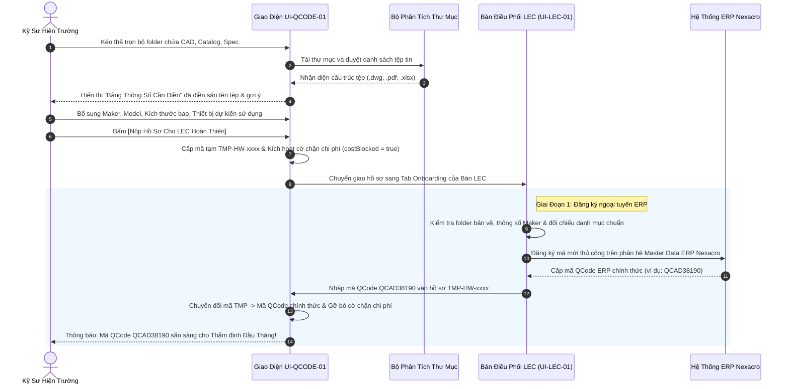

# 02. MÀN HÌNH ONBOARDING QCODE & TẢI FOLDER TÀI LIỆU (QCODE ONBOARDING & DRAWING FOLDER INGESTION)

> **Mã màn hình**: `UI-QCODE-01`  
> **Tên màn hình**: QCode Onboarding, Drawing Folder Upload & ERP Master Data Preparation Portal  
> **Vai trò người dùng chính**: Kỹ sư hiện trường (Field Engineer) — Tải folder tài liệu, điền bảng thông số kỹ thuật sơ bộ.  
> **Vai trò phối hợp**: Chuyên viên Điều phối Thiết bị (LEC) — Tiếp nhận hồ sơ, hoàn thiện thông tin và đăng ký cấp mã QCode ERP chính thức.  
> **Mục tiêu cốt lõi**: Đơn giản hóa việc xin cấp mã linh kiện mới bằng cách cho phép kéo thả trọn vẹn thư mục (folder) bản vẽ CAD, tài liệu Catalog, tự động trích xuất bảng thông tin cần điền; hỗ trợ lộ trình 2 giai đoạn (đăng ký ngoại tuyến ERP sau đó cập nhật lên hệ thống, tiến tới đăng ký tự động ERP trong tương lai); cảnh báo mã tạm `TMP-` bị chặn thẩm định đầu tháng.

---

## 1. NGUYÊN TẮC NGHIỆP VỤ & LỘ TRÌNH 2 GIAI ĐOẠN

1. **Tải trọn gói thư mục kỹ thuật (Folder Upload & Ingestion)**:
   - Kỹ sư không phải tải từng file đơn lẻ mà kéo thả toàn bộ thư mục chứa: Bản vẽ chế tạo (`.dwg`, `.dxf`), Tài liệu kỹ thuật nhà sản xuất Catalog (`.pdf`), Bảng thông số kích thước (`.xlsx`), Hình ảnh chụp linh kiện thực tế (`.png`, `.jpg`).
   - Hệ thống tự động phân tích cấu trúc folder và tạo ra **Bảng thông tin cần điền (Draft Parameter Grid)**.
2. **Cơ chế Mã Tạm thời (`TMP-HW-xxxx`) & Cảnh báo Chặn Thẩm Định**:
   - Khi kỹ sư gửi bảng thông tin sơ bộ kèm folder, hệ thống cấp phát mã số nhận diện tạm thời có định dạng `TMP-HW-[NămTháng]-[SốThứTự]` (e.g. `TMP-HW-2611-0042`).
   - **Quy tắc vàng chặn chi phí (Golden Rule #5)**: Mã tạm `TMP-` cho phép kỹ sư tạo yêu cầu và gán tạm vào EBOM, nhưng **tuyệt đối bị khóa không cho Quản lý Chi phí thẩm định (Cost Clearance) vào ngày 01–05 đầu tháng**. Hồ sơ chỉ được giải phóng khi LEC cập nhật mã QCode ERP chính thức.
3. **Lộ trình 2 Giai đoạn Đăng ký QCode**:
   - **Giai đoạn 1 (Hiện tại - Đăng ký ngoại tuyến)**: Kỹ sư nộp folder $\rightarrow$ Bảng thông số được chuyển đến LEC $\rightarrow$ LEC lấy file kiểm tra, đăng ký thủ công bên ngoài hệ thống ERP Nexacro $\rightarrow$ Khi ERP sinh mã QCode chính thức (e.g. `QCAD38190`), LEC nhập mã này lên hệ thống để chuyển đổi trạng thái hồ sơ.
   - **Giai đoạn 2 (Tương lai - Tự động hóa API ERP)**: Bổ sung các trường dữ liệu bắt buộc (HS Code, Thuế suất, Đơn vị tính hải quan, Chuẩn RoHS) $\rightarrow$ Hệ thống tự động gửi API đẩy dữ liệu trực tiếp lên ERP để đăng ký tự động không cần thao tác thủ công.

---

## 2. BỐ CỤC KHÔNG GIAN GIAO DIỆN (LAYOUT ANATOMY)

```
┌──────────────────────────────────────────────────────────────────────────────────────────────────────────────────┐
│ HEADER: ONBOARDING QCODE MỚI | Kỹ sư: Nguyễn Văn Thắng | Phân Xưởng: Factory HW (Smart Watch)                   │
│ Lối tắt: [ 🔙 Quay lại Đăng Ký Mua Hàng UI-REG-01 ] [ 🌿 Xem Cây EBOM UI-EBOM-01 ] [ 📬 Hộp Thư Tác Vụ UI-TASK-01 ]│
├──────────────────────────────────────────────────────────────────────────────────────────────────────────────────┤
│ PHÂN VÙNG 1: KHUNG KÉO THẢ THƯ MỤC TÀI LIỆU KỸ THUẬT (FOLDER DRAG-AND-DROP ZONE)                                 │
│ ┌──────────────────────────────────────────────────────────────────────────────────────────────────────────────┐ │
│ │  📁 KÉO THẢ TRỌN BỘ FOLDER BẢN VẼ & CATALOG VÀO ĐÂY (HOẶC NHẤN ĐỂ CHỌN THƯ MỤC TỪ MÁY TÍNH)                  │ │
│ │  Hỗ trợ tự động nhận diện: .dwg, .dxf (CAD) | .pdf (Catalog/Spec) | .xlsx (Bảng kích thước) | .png, .jpg     │ │
│ │  [ 📂 Chọn Thư Mục Bản Vẽ: /D:/Drawings/DieBonder_CustomCylinder_202611/ ]  -> 5 tệp tin được nhận diện      │ │
│ └──────────────────────────────────────────────────────────────────────────────────────────────────────────────┘ │
├──────────────────────────────────────────────────────────────────────────────────────────────────────────────────┤
│ PHÂN VÙNG 2: BẢNG TRÍCH XUẤT THÔNG TIN CẦN ĐIỀN ĐĂNG KÝ (DRAFT PARAMETER SPECIFICATION GRID)                    │
│ Mã tạm dự kiến: [ TMP-HW-2611-0042 ]  | Trạng thái: 🟡 Chờ Kỹ Sư Hoàn Tất Bảng Thông Số                         │
│ ┌───────────────────────────┬───────────────────────────────────┬────────────────────────────────────────────┐ │
│ │ TRƯỜNG DỮ LIỆU BẮT BUỘC   │ GIÁ TRỊ NHẬP TỪ KỸ SƯ             │ GỢI Ý TỰ ĐỘNG & TỆP ĐÍNH KÈM LIÊN KẾT      │ │
│ ├───────────────────────────┼───────────────────────────────────┼────────────────────────────────────────────┤ │
│ │ 1. Tên Linh Kiện Tiếng Anh│ [ Pneumatic Gripper 2-Finger    ] │ Trích xuất từ tên tệp: Gripper_Spec.pdf    │ │
│ │ 2. Tên Tiếng Việt         │ [ Cụm kẹp khí nén 2 chấu song song] │ Mô tả chức năng cơ cấu                     │ │
│ │ 3. Hãng Sản Xuất (Maker)  │ [ SMC                           ] │ Phát hiện logo SMC trong tài liệu catalog  │ │
│ │ 4. Mã Model Nhà Sản Xuất  │ [ MHZ2-16D                      ] │ Khớp với bản vẽ CAD: MHZ2-16D_RevB.dwg     │ │
│ │ 5. Thông Số Kỹ Thuật Chính│ [ Hành trình 16mm, Áp suất 0.7MPa]│ Thông số lực kẹp và hành trình xylanh      │ │
│ │ 6. Kích Thước Bao (WxLxH) │ [ 30 x 65 x 45 mm               ] │ Lấy từ Sheet "Dimensions" trong Excel      │ │
│ │ 7. Thiết Bị & Cụm Cơ Cấu  │ [ Die Bonder 01 -> Head Gripper ] │ Máy dự kiến sử dụng (Dropdown thân thiện)  │ │
│ │ 8. Dự Kiến Đơn Giá ($ USD)│ [ $185 USD                      ] │ Giá chào sơ bộ từ Catalog/Báo giá tham khảo│ │
│ └───────────────────────────┴───────────────────────────────────┴────────────────────────────────────────────┘ │
│ [ 🚀 NỘP HỒ SƠ CHO LEC HOÀN THIỆN ĐĂNG KÝ QCODE ]    [ 💾 Lưu Bản Nháp ]                                         │
├──────────────────────────────────────────────────────────────────────────────────────────────────────────────────┤
│ PHÂN VÙNG 3: BẢNG THEO DÕI TIẾN TRÌNH CẤP MÃ QCODE (QCODE ONBOARDING LIFECYCLE MONITOR)                         │
│ ┌───────────────┬────────────────────────────┬─────────────┬───────────┬──────────────────────┬──────────────┐ │
│ │Mã Tạm TMP     │Tên Phụ Tùng / Maker / Model│Ngày Tải Lên │Chuyên Viên│Trạng Thái Tiến Trình │Mã QCode ERP  │ │
│ │               │                            │             │LEC Xử Lý  │                      │Chính Thức    │ │
│ ├───────────────┼────────────────────────────┼─────────────┼───────────┼──────────────────────┼──────────────┤ │
│ │TMP-HW-2611-0042│Cụm kẹp khí nén SMC MHZ2-16D│2026-11-04   │Phạm Đ.Long│🟡 Chờ LEC Kiểm Tra   │⏳ Chưa Cấp   │ │
│ │               │                            │14:20        │(LEC 01)   │(Chặn Thẩm Định Chi)  │              │ │
│ ├───────────────┼────────────────────────────┼─────────────┼───────────┼──────────────────────┼──────────────┤ │
│ │TMP-HW-2610-0019│Cảm biến sợi quang Omron E3X│2026-10-28   │Phạm Đ.Long│🟢 ĐÃ CẤP MÃ CHÍNH    │QCAD38190     │ │
│ │               │E3X-HD11 2M                 │09:15        │(LEC 01)   │THỨC TRÊN ERP NEXACRO │(Đã Mở Khóa)  │ │
│ └───────────────┴────────────────────────────┴─────────────┴───────────┴──────────────────────┴──────────────┘ │
└──────────────────────────────────────────────────────────────────────────────────────────────────────────────────┘
```

---

## 3. QUY TRÌNH NGHIỆP VỤ ONBOARDING & TƯƠNG TÁC (DETAILED WORKFLOW)



---

## 4. CHI TIẾT CÁC TRƯỜNG DỮ LIỆU & QUY CHUẨN XỬ LÝ (FIELD SPECIFICATIONS)

### 4.1. Bảng Trích Xuất & Điền Thông Số (Draft Parameter Specification Grid):

| Tên Trường | Kiểu Dữ Liệu | Bắt Buộc | Nguồn Dữ Liệu | Quy Chuẩn Kiểm Tra (Validation) |
| :--- | :---: | :---: | :--- | :--- |
| `tmpItemCode` | String | Có | Hệ thống tự sinh | Định dạng `TMP-HW-YYMM-NNNN` (e.g. `TMP-HW-2611-0042`). |
| `partNameEn` | String | Có | Kỹ sư nhập / Gợi ý | Tiếng Anh không dấu, tối đa 80 ký tự. |
| `partNameVi` | String | Có | Kỹ sư nhập | Tiếng Việt rõ nghĩa công năng phụ tùng. |
| `maker` | String | Có | Kỹ sư nhập / Gợi ý | Tên hãng sản xuất chuẩn (SMC, Omron, Keyence, Panasonic, THK...). |
| `modelNumber` | String | Có | Kỹ sư nhập / CAD | Chuỗi ký hiệu model chính xác của hãng để phục vụ báo giá RFQ. |
| `specification` | String | Có | Kỹ sư nhập | Thông số làm việc cốt lõi (điện áp, hành trình, áp suất, độ phân giải). |
| `dimensions` | String | Không | Kỹ sư nhập | Dài x Rộng x Cao (mm). |
| `targetMachine` | String | Có | Dropdown chọn | Chọn Line và Máy dự kiến sử dụng (e.g. `Line 201 - Die Bonder 01`). |
| `estUnitPrice` | Decimal | Có | Kỹ sư nhập | Giá tham khảo ban đầu bằng USD (phục vụ ước tính ngân sách SG). |
| `attachedFiles` | Array | Có | Trích xuất folder | Danh sách tệp đính kèm với MIME-Type và dung lượng tệp. |

### 4.2. Cấu Trúc Trạng Thái Hồ Sơ (Lifecycle Statuses):

```typescript
export type QCodeOnboardingStatus =
  | 'DRAFT_FOLDER_UPLOADED'      // Kỹ sư mới kéo folder, chưa nộp
  | 'SUBMITTED_TO_LEC'           // Đã nộp LEC, mang mã tạm TMP-HW-xxxx (BỊ CHẶN CHI PHÍ)
  | 'LEC_IN_REVIEW'              // LEC đang kiểm tra thông số kỹ thuật và bản vẽ
  | 'LEC_REJECTED_REVISION'      // LEC yêu cầu kỹ sư bổ sung thêm bản vẽ hoặc catalog rõ hơn
  | 'OFFICIAL_QCODE_REGISTERED'; // LEC đã nhập mã QCode ERP chính thức (ĐƯỢC PHÉP THẨM ĐỊNH)
```

---

## 5. CƠ CHẾ GIAI ĐOẠN 2: CHUẨN BỊ CHO TỰ ĐỘNG HÓA ERP TRONG TƯƠNG LAI

Để sẵn sàng kết nối API tự động sang hệ thống ERP phân xưởng mà không cần kỹ sư phải học lại giao diện:
1. **Khung mở rộng thuộc tính Master Data (Extended ERP Schema)**:
   - Hệ thống chuẩn bị sẵn các trường ẩn: `HS_Code` (Mã biểu thuế hải quan), `Standard_UOM` (Đơn vị tính chuẩn: EA, SET, METER, ROLL), `RoHS_Compliance` (Chứng nhận tiêu chuẩn môi trường xanh: Y/N), `Inspection_Required` (Yêu cầu kiểm tra đo lường khi hàng về: Y/N).
2. **Nút kích hoạt tự động (Future Auto-Registration Toggle)**:
   - Trên giao diện của LEC, khi hệ thống kích hoạt Module tích hợp ERP API trong cài đặt hệ thống (`UI-ADM-01`), nút `[Nhập QCode Thủ Công]` sẽ được thay thế bằng nút `[⚡ Đăng Ký Tự Động Lên ERP]`.
   - Hệ thống tự động đóng gói folder thành tệp ZIP nén và đẩy payload JSON sang endpoint của ERP Master Data.
