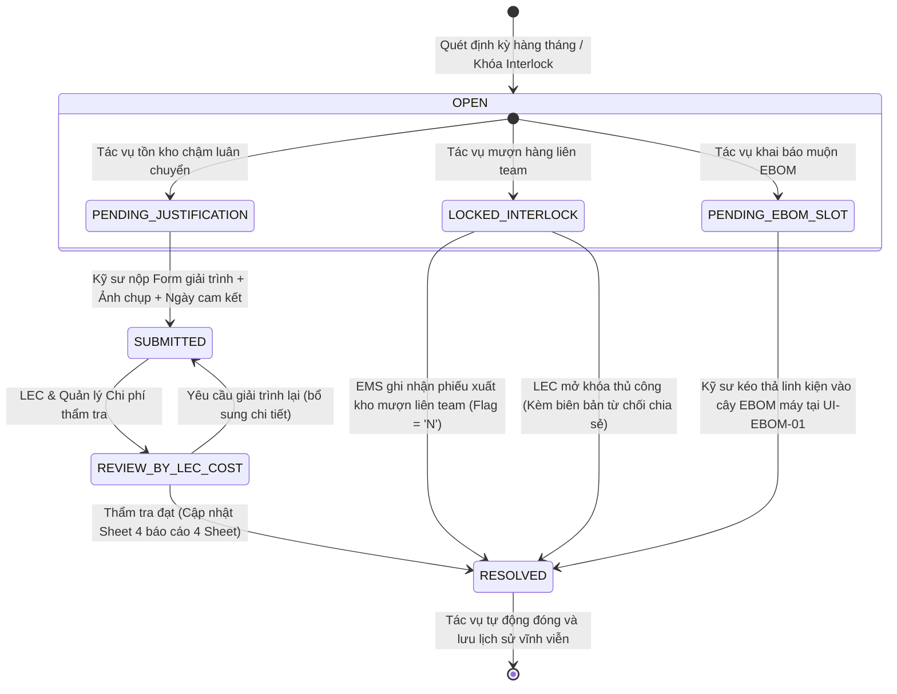

# 03. MÀN HÌNH HỘP THƯ TÁC VỤ & GIẢI TRÌNH TỒN KHO (MANDATORY TASKS & AGING INVENTORY JUSTIFICATION)

> **Mã màn hình**: `UI-TASK-01`  
> **Tên màn hình**: Mandatory Operational Tasks, Aging Stock Justification & 3-Party Clarification Hub  
> **Vai trò người dùng chính**: Kỹ sư hiện trường (Field Engineer / Requestor) — Bắt buộc giải trình tại sao tồn kho không sử dụng, thực hiện mượn hàng liên team, hoàn thiện EBOM muộn.  
> **Vai trò phối hợp**: Chuyên viên Điều phối Thiết bị (LEC) & Quản lý Chi phí (Cost Manager) — Xem xét giải trình, thẩm tra chi phí và giải phóng cờ phong tỏa.  
> **Mục tiêu cốt lõi**: Khắc phục tình trạng "nhắc việc qua miệng hoặc tin nhắn trôi"; thiết lập hệ thống tác vụ tương tác bắt buộc (Persistent Tasks), buộc kỹ sư phải giải trình nguyên nhân vật tư tồn kho chậm luân chuyển trước ngày 05 đầu tháng; xử lý mượn kho liên team khi bị Interlock; tạo cầu nối trao đổi 3 bên trực tiếp trên từng mã phụ tùng.

---

## 1. NGUYÊN TẮC NGHIỆP VỤ & QUY TẮC BẮT BUỘC

1. **Giải trình Tồn kho Chậm Luân Chuyển Hàng Tháng (Golden Rule #4 & Phản hồi Người dùng)**:
   - Trước ngày **05 hàng tháng**, hệ thống quét toàn bộ danh mục linh kiện mà Kỹ sư/Line đã xuất kho hoặc tồn kho quá 30, 60, 90 ngày chưa lắp lên máy.
   - Hệ thống tự động tạo **Tác vụ giải trình bắt buộc (Mandatory Justification Task)** gửi trực tiếp vào Hộp thư của kỹ sư phụ trách.
   - Kỹ sư bắt buộc phải trả lời: *Tại sao chưa sử dụng? Hiện vật tư đang nằm ở đâu? Kế hoạch đưa vào máy ngày nào?* Kèm ảnh chụp thực tế tại tủ phụ tùng hiện trường.
   - Giải trình này được tổng hợp tự động vào **Sheet 4 của Báo cáo Excel 4 Sheet chuẩn hóa** xuất ngày 25 hàng tháng cho Quản lý Chi phí và Ban Giám Đốc.
2. **Tác vụ Mượn Hàng Liên Team (`CROSS_TEAM_STOCK`)**:
   - Khi kỹ sư đăng ký mua linh kiện mà hệ thống phát hiện Team khác (hoặc pháp nhân khác) trong Factory HW đang có sẵn hàng dư thừa $\rightarrow$ Sinh tác vụ mượn hàng bắt buộc.
   - Tác vụ **KHÔNG THỂ tự ý nhấn Hoàn thành bằng tay**. Tác vụ chỉ tự động biến mất khi cổng EMS Gateway ghi nhận giao dịch xuất mượn thành công (`agingInterlockFlag = 'N'`), hoặc khi LEC can thiệp mở khóa thủ công kèm lý do kho bạn từ chối chia sẻ.
3. **Cầu nối Trao đổi 3 Bên (3-Party Clarification Bridge)**:
   - Khi Quản lý Chi phí thẩm tra hồ sơ đầu tháng và phát hiện hạng mục bất thường hoặc vượt ngân sách $\rightarrow$ Gửi câu hỏi chất vấn.
   - LEC nhận câu hỏi và chuyển tiếp/hướng dẫn kỹ sư giải trình kỹ thuật. Toàn bộ trao đổi được lưu vết theo từng dòng phụ tùng (Audit Trail), không dùng email ngoài gây thất lạc thông tin.

---

## 2. BỐ CỤC KHÔNG GIAN GIAO DIỆN (LAYOUT ANATOMY)

```
┌──────────────────────────────────────────────────────────────────────────────────────────────────────────────────┐
│ HEADER: HỘP THƯ TÁC VỤ & GIẢI TRÌNH NGHIỆP VỤ | Kỹ sư: Nguyễn Văn Thắng (CP/SG Part 1 - Line 201)                │
│ Huy hiệu cảnh báo đỏ: 🔴 2 Tác Vụ Cần Giải Trình Trước Ngày 05 | 🟡 1 Yêu Cầu Mượn Kho Liên Team                  │
├──────────────────────────────────────────────────────────────────────────────────────────────────────────────────┤
│ PHÂN VÙNG 1: BỘ LỌC PHÂN LOẠI TÁC VỤ (TASK CATEGORY TABS & COUNTERS)                                             │
│ [ Tất Cả Tác Vụ (4) ]  [ ⚠️ Giải Trình Tồn Kho Đầu Tháng (2) ]  [ 📦 Mượn Kho Liên Team (1) ]                    │
│ [ 🌿 Khai Báo Muộn EBOM (1) ]  [ 💬 Chất Vấn Quản Lý Chi Phí (0) ]                                               │
├──────────────────────────────────────────────────────────────────────────────────────────────────────────────────┤
│ PHÂN VÙNG 2: DANH SÁCH TÁC VỤ CẦN XỬ LÝ (PERSISTENT TASK LIST GRID)                                              │
│ ┌───┬──────────────┬─────────────┬───────────┬──────────────┬──────────────────┬─────────────┬─────────────────┐ │
│ │STT│Mã Tác Vụ     │Phân Loại    │Mã QCode / │Tên Phụ Tùng &│Thông Tin Tồn Kho/│Hạn Chót     │Hành Động        │ │
│ │   │              │Tác Vụ       │Mã Yêu Cầu │Cơ Cấu Máy    │Giá Trị Tồn ($)   │Xử Lý        │Xử Lý            │ │
│ ├───┼──────────────┼─────────────┼───────────┼──────────────┼──────────────────┼─────────────┼─────────────────┤ │
│ │ 1 │TASK-AGE-0042 │🔴 GIẢI TRÌNH│QDAB03583  │Cảm biến quang│Tồn kho: 48 ngày  │2026-11-05   │[ ✍️ Nhập        │ │
│ │   │              │TỒN KHO >30D │Line 201   │Panasonic     │Số lượng: 6 EA    │(Còn 1 ngày) │    Giải Trình ] │ │
│ │   │              │             │DB-01      │Cụm Feeder    │Giá trị: $270 USD │             │                 │ │
│ ├───┼──────────────┼─────────────┼───────────┼──────────────┼──────────────────┼─────────────┼─────────────────┤ │
│ │ 2 │TASK-AGE-0043 │🔴 GIẢI TRÌNH│QCAD55421  │Bàn nhiệt ép  │Tồn kho: 72 ngày  │2026-11-05   │[ ✍️ Nhập        │ │
│ │   │              │TỒN KHO >60D │Line 201   │Kyocera 400W  │Số lượng: 2 EA    │(Còn 1 ngày) │    Giải Trình ] │ │
│ │   │              │             │TAB-01     │Heat Stage    │Giá trị: $840 USD │             │                 │ │
│ ├───┼──────────────┼─────────────┼───────────┼──────────────┼──────────────────┼─────────────┼─────────────────┤ │
│ │ 3 │TASK-LCK-0018 │🟡 MƯỢN KHO  │QCAD38190  │Xylanh 2 ty   │Kho H1-2F (Team 1)│Không thời   │[ 👁️ Xem Vị Trí │ │
│ │   │              │LIÊN TEAM    │PR-2611-083│SMC MXQ16     │Có sẵn: 6 EA      │hạn (Khóa PR)│   & Nhờ LEC ]   │ │
│ ├───┼──────────────┼─────────────┼───────────┼──────────────┼──────────────────┼─────────────┼─────────────────┤ │
│ │ 4 │TASK-EBM-0007 │🌿 KHAI BÁO  │TMP-HW-0105│Tấm Chuck gá  │Đã mua theo sự cố │2026-11-09   │[ 🌿 Mở Màn Hình │ │
│ │   │              │MUỘN EBOM    │PR-2611-085│Kẹp phôi máy 1│Die Bonder 01     │(Còn 5 ngày) │   Gán Cụm Máy ] │ │
│ └───┴──────────────┴─────────────┴───────────┴──────────────┴──────────────────┴─────────────┴─────────────────┘ │
├──────────────────────────────────────────────────────────────────────────────────────────────────────────────────┤
│ PHÂN VÙNG 3: KHUNG SOẠN THẢO GIẢI TRÌNH & TRAO ĐỔI 3 BÊN (INTERACTIVE JUSTIFICATION & CLARIFICATION PANEL)       │
│ Đang mở: Tác vụ TASK-AGE-0042 (Cảm biến quang Panasonic - Tồn kho 48 ngày tại Line 201)                         │
│ ┌──────────────────────────────────────────────────────────────────────────────────────────────────────────────┐ │
│ │ 1. Lý Do Tại Sao Chưa Sử Dụng (Root Cause):                                                                  │ │
│ │ [ Máy Die Bonder 01 dự kiến bảo dưỡng lớn định kỳ (Overhaul) vào tuần 3 tháng 11 theo kế hoạch PM; cảm biến   │ │
│ │   mua dự phòng để thay thế đồng loạt 6 vị trí mắt đọc phôi nhằm tránh dừng chuyền đột ngột.                ] │ │
│ │ 2. Kế Hoạch Đưa Vào Máy Sử Dụng (Action Plan):                                                               │ │
│ │ [ Tiến hành thay thế trong ca bảo dưỡng ngày 2026-11-18. Nếu sau ngày này không dùng hết sẽ hoàn trả kho EMS.]│ │
│ │ 3. Ngày Cam Kết Sử Dụng Hoặc Hoàn Trả Kho: [ 2026-11-20 📅 ]                                                 │ │
│ │ 4. Đính Kèm Ảnh Chụp Hiện Trường & Tình Trạng Vật Tư: [ 📷 Tai_Lieu_Hien_Truong_DB01.jpg (2.4 MB) ]        │ │
│ │ ──────────────────────────────────────────────────────────────────────────────────────────────────────────── │ │
│ │ LỊCH SỬ TRAO ĐỔI 3 BÊN (AUDIT TRAIL):                                                                        │ │
│ │ • [2026-11-03 16:30] Quản Lý Chi Phí: "Đề nghị kỹ sư xác nhận mã này đã tồn kho 48 ngày, có nguy cơ hỏng mốc"│ │
│ │ • [2026-11-04 08:15] LEC Phạm Đức Long: "Kỹ sư Thắng đã bổ sung gói chống ẩm tủ linh kiện và cam kết thay tuần 3"│ │
│ └──────────────────────────────────────────────────────────────────────────────────────────────────────────────┘ │
│ [ 🚀 NỘP GIẢI TRÌNH CHO LEC & QUẢN LÝ CHI PHÍ ]    [ 💾 Lưu Nháp ]                                               │
└──────────────────────────────────────────────────────────────────────────────────────────────────────────────────┘
```

---

## 3. CƠ CHẾ HOẠT ĐỘNG & ĐIỀU KIỆN ĐÓNG TÁC VỤ (TASK RESOLUTION RULES)

Hệ thống tuân thủ nguyên tắc nghiêm ngặt: **Không bao giờ cho phép người dùng bấm một checkbox đơn giản để đóng tác vụ**. Mỗi loại tác vụ gắn liền với một điều kiện vật lý:



---

## 4. CHI TIẾT CÁC TRƯỜNG DỮ LIỆU FORM GIẢI TRÌNH (DATA SCHEMA)

| Mã Trường | Tên Trường | Kiểu | Mô Tả & Điều Kiện Bắt Buộc |
| :--- | :--- | :---: | :--- |
| `taskId` | Mã tác vụ | String | Định dạng `TASK-[AGE/LCK/EBM]-[NNNN]` duy nhất toàn xưởng. |
| `taskType` | Phân loại | Enum | `'AGING_STOCK_30D'` \| `'AGING_STOCK_60D'` \| `'AGING_STOCK_90D'` \| `'INTERLOCK_BORROW'` \| `'LATE_EBOM'`. |
| `qcode` | Mã linh kiện | String | Mã QCode ERP chính thức hoặc mã tạm TMP. |
| `agingDays` | Số ngày tồn kho | Number | Lấy từ bảng `ds_Inv` của EMS tính từ ngày nhập kho gần nhất. |
| `stockQty` | Số lượng tồn | Number | Số lượng thực tế tại kho vật tư hoặc tủ dự phòng chuyền. |
| `totalValueUsd` | Tổng giá trị tồn | Decimal | Đơn giá hợp đồng x Số lượng tồn ($ USD). |
| `rootCauseReason` | Lý do chưa dùng | Text | Bắt buộc, tối thiểu 30 ký tự (Máy chờ đại tu, Thay đổi thiết kế, Đổi model chạy...). |
| `actionPlan` | Kế hoạch sử dụng | Text | Bắt buộc, giải thích rõ cách đưa vào máy hoặc kế hoạch thanh lý. |
| `commitmentDate` | Ngày cam kết sử dụng| Date | Bắt buộc, định dạng `YYYY-MM-DD`. Hệ thống tự động kiểm tra lại vào ngày này. |
| `photoEvidenceUrl` | Ảnh hiện trường | URL/File| Tải ảnh chụp thực tế tình trạng bao bì, tủ bảo quản linh kiện. |
| `resolutionStatus`| Trạng thái giải quyết| Enum | `'OPEN'` \| `'SUBMITTED'` \| `'RESOLVED'` \| `'REJECTED'`. |
| `resolutionNote` | Ghi chú thẩm định | Text | Đánh giá của Chuyên viên LEC và Quản lý Chi phí. |

---

## 5. TÍCH HỢP TỰ ĐỘNG VỚI BÁO CÁO 4 SHEET (EXCEL SHEET 4 INTEGRATION)

Toàn bộ các tác vụ giải trình tồn kho chậm luân chuyển (`TASK-AGE-xxxx`) đã được giải quyết hoặc chưa giải quyết trước ngày 25 hàng tháng sẽ được hệ thống trích xuất tự động vào **Sheet 4 (Aging Stock & Engineer Justifications)** của file Excel báo cáo:
- Hiển thị danh sách từng kỹ sư phụ trách, từng mã QCode tồn đọng.
- Xuất nguyên văn lý do chưa sử dụng, ngày cam kết và đánh giá của LEC.
- Báo cáo này là cơ sở duy nhất để Quản lý Chi phí và Giám Đốc Phân Xưởng phê chuẩn kế hoạch ngân sách phụ tùng tháng tiếp theo.
