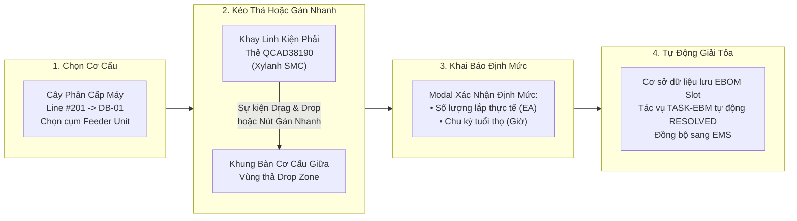

# 04. MÀN HÌNH EBOM KÉO THẢ & MATCHING CƠ CẤU (VISUAL DRAG-AND-DROP EBOM SLOT MAPPER)

> **Mã màn hình**: `UI-EBOM-01`  
> **Tên màn hình**: Visual Drag-and-Drop Machine Hierarchy, Mechanism Structure & Replacement Mapping  
> **Vai trò người dùng chính**: Kỹ sư hiện trường (Field Engineer) — Matching linh kiện vào cơ cấu máy, giải tỏa hàng đợi khai báo muộn.  
> **Vai trò phối hợp**: Chuyên viên Điều phối Thiết bị (LEC) — Quản trị cây thiết bị phân xưởng, sao chép cấu trúc cụm máy giữa các chuyền.  
> **Mục tiêu cốt lõi**: Giải quyết triệt để sự phức tạp của hệ thống EBOM truyền thống bằng giao diện trực quan hóa 3 khung kéo - thả (Drag-and-Drop); bắt buộc khớp nối (matching) linh kiện mua với cơ cấu lắp đặt thực tế; quản lý định mức thay thế và tự động giải tỏa tác vụ khai báo muộn 7 ngày.

---

## 1. NGUYÊN TẮC THIẾT KẾ GIẢM ĐỘ PHỨC TẠP CHO EBOM

Theo phản biện từ thực tế xưởng sản xuất:
1. **EBOM Matching bắt buộc (Mechanical Structure Matching)**:
   - Mọi hạng mục mua sắm phụ tùng phải gắn liền với một cụm cơ cấu máy (`Machine` $\rightarrow$ `Sub-assembly` $\rightarrow$ `Part Slot`).
   - Việc này giúp nhà máy biết chính xác phụ tùng mua về để thay thế cho bộ phận nào khi máy hỏng, đồng thời thu thập dữ liệu về tần suất hư hỏng và tuổi thọ linh kiện.
2. **Cơ chế Khai báo muộn (Late Declaration) giải cứu sự cố khẩn**:
   - Khi máy dừng chuyền đột ngột cần mua linh kiện thay thế chưa từng có trong danh mục EBOM, kỹ sư được phép chọn cờ **Khai báo muộn (Late Declaration)** để tiến hành mua trước.
   - Hệ thống đưa hạng mục vào **Hàng đợi Khai báo muộn** với thời hạn 7 ngày để kỹ sư bổ sung vị trí cơ cấu sau khi khắc phục xong sự cố.
3. **Giảm thiểu thao tác nhờ cơ chế Kéo - Thả & Sao chép nhanh (Cloning)**:
   - Thay vì mở hàng chục form khai báo bảng biểu cồng kềnh, kỹ sư chỉ cần **kéo linh kiện từ khay phụ tùng thả thẳng vào cơ cấu máy**.
   - Hỗ trợ tính năng **Sao Chép Cấu Trúc Máy (Machine Template Clone)**: Cụm cơ cấu chuẩn của máy `DB-01` có thể nhân bản sang `DB-02`, `DB-03` chỉ bằng 1 cú nhấp chuột.

---

## 2. BỐ CỤC KHÔNG GIAN GIAO DIỆN KÉO THẢ (LAYOUT ANATOMY)

Giao diện được tổ chức thành 3 khung làm việc song song (3-Pane Visual Workspace) và phân vùng hàng đợi phía dưới:

```
┌──────────────────────────────────────────────────────────────────────────────────────────────────────────────────┐
│ HEADER: CÂY EBOM THIẾT BỊ & CƠ CẤU | Nhà Máy: Factory HW (Smart Watch) | Dây Chuyền: Line #201, #202, #301        │
│ Trạng Thái: 🟢 54 Cụm Cơ Cấu Đã Khai Báo | ⚠️ 1 Hạng Mục Khai Báo Muộn Cần Khớp Nối | [ 📋 Sao Chép Cấu Trúc Máy ]│
├──────────────────────────────────────────────────────────────────────────────────────────────────────────────────┤
│ BỐ CỤC 3 KHUNG KÉO THẢ TRỰC QUAN (3-PANE VISUAL DRAG-AND-DROP WORKSPACE):                                        │
│ ┌──────────────────────────┬──────────────────────────────────────────┬────────────────────────────────────────┐ │
│ │ KHUNG 1: CÂY MÁY PHÂN CẤP│ KHUNG 2: BÀN CƠ CẤU & CÁC SLOT ĐÃ MATCH  │ KHUNG 3: KHAY LINH KIỆN DỰ PHÒNG       │ │
│ │ (HIERARCHY TREE - 3 CỘT) │ (MECHANISM SLOTS & DROP ZONE - 5 CỘT)    │ (SPARE PARTS TRAY - 4 CỘT)             │ │
│ ├──────────────────────────┼──────────────────────────────────────────┼────────────────────────────────────────┤ │
│ │ 🏭 Factory HW (Org 28753) │ Cụm Đang Mở: Feeder Unit (Cấp Phôi)      │ 🔎 [ Nhập QCode, Maker, Model... ]     │ │
│ │  ├── 🌐 Line #201 (2F)   │ Mã EM: HWBMTL21EC0101                    │ Bộ lọc: [ Khí nén ▼ ] [ Điện tử ▼ ]    │ │
│ │  │    ├── ⚙️ DB-01 (Đang) │ Vị trí: Đầu dây chuyền Line 201          │ ┌────────────────────────────────────┐ │ │
│ │  │    │   ├── 🔩 Feeder  │ ──────────────────────────────────────── │ │ [::] QCAD38190                     │ │ │
│ │  │    │   ├── 🔩 Head 01 │ CÁC VỊ TRÍ ĐÃ KHỚP NỐI (2 SLOTS):        │ │ Xylanh 2 ty SMC MXQ16-30           │ │ │
│ │  │    │   └── 🔩 HeatStg │ 1. QDAB03583 - Cảm biến quang Panasonic  │ │ 🏷️ Khí nén | SMC | $220 USD        │ │ │
│ │  │    ├── ⚙️ DB-02        │    • SL định mức: 2 EA • Tuổi thọ: 20,000h│ │ [🖐️ Kéo thả]   [⚡ Gán nhanh]      │ │ │
│ │  │    └── ⚙️ TAB-01       │ 2. QCAD12044 - Giác hút chân không Pisco │ ├────────────────────────────────────┤ │ │
│ │  ├── 🌐 Line #202 (2F)   │    • SL định mức: 4 EA • Tuổi thọ: 8,000h │ │ [::] QDAB03583                     │ │ │
│ │  │    └── ⚙️ TAB-02       │ ┌──────────────────────────────────────┐ │ │ Cảm biến quang vuông Panasonic   │ │ │
│ │  └── 🌐 Line #301 (3F)   │ │ 🎯 VÙNG THẢ LINH KIỆN MỚI VÀO CƠ CẤU │ │ │ 🏷️ Quang học | Panasonic | $45 USD│ │ │
│ │       └── ⚙️ POL-01       │ │   (Kéo thẻ từ Khay phải thả vào đây   │ │ │ [🖐️ Kéo thả]   [⚡ Gán nhanh]      │ │ │
│ │                          │ │    hoặc bấm nút "Gán nhanh" bên phải)  │ │ └────────────────────────────────────┘ │ │
│ │ [ ➕ Thêm Cơ Cấu Mới ]   │ └──────────────────────────────────────┘ │ [ 📁 Onboarding Mã Mới UI-QCODE-01 ]   │ │
│ └──────────────────────────┴──────────────────────────────────────────┴────────────────────────────────────────┘ │
├──────────────────────────────────────────────────────────────────────────────────────────────────────────────────┤
│ PHÂN VÙNG 4: HÀNG ĐỢI KHAI BÁO MUỘN (LATE DECLARATION QUEUE - TỰ ĐỘNG ĐÓNG TÁC VỤ KỸ SƯ):                        │
│ Các phụ tùng đã xin mua xử lý sự cố gấp nhưng chưa gán vị trí lắp đặt cụm cơ cấu (Thời hạn tối đa: 7 ngày):     │
│ ┌─────────────┬─────────────┬────────────────────────────────────┬─────────────────┬───────────┬─────────────┐ │
│ │Mã Đơn Mua   │Mã Linh Kiện │Tên Phụ Tùng Phát Sinh Sự Cố        │Thiết Bị Phát Sinh│Thời Hạn   │Hành Động    │ │
│ ├─────────────┼─────────────┼────────────────────────────────────┼─────────────────┼───────────┼─────────────┤ │
│ │PR-2611-0085 │TMP-HW-0105  │Tấm Chuck gá kẹp phôi Die Bonder    │Die Bonder 01    │Còn 5 ngày │[ 🎯 Gán Vào │ │
│ │             │             │Vật liệu hợp kim nhôm Anodized      │Line #201        │2026-11-09 │  Cụm Này ]  │ │
│ └─────────────┴─────────────┴────────────────────────────────────┴─────────────────┴───────────┴─────────────┘ │
└──────────────────────────────────────────────────────────────────────────────────────────────────────────────────┘
```

---

## 3. QUY TRÌNH THAO TÁC KÉO THẢ & SAO CHÉP CẤU TRÚC (INTERACTION WORKFLOW)



---

## 4. CHI TIẾT TÍNH NĂNG ĐẶC BIỆT CỦA MÀN HÌNH EBOM

### 4.1. Công Cụ Sao Chép Cấu Trúc Máy (Rapid Machine Structure Cloning Tool):
- **Bối cảnh**: Phân xưởng Smart Watch có nhiều dây chuyền sản xuất tương tự nhau (ví dụ: Chuyền 201 và Chuyền 202 cùng sử dụng dòng máy `Die Bonder DB-01`, `DB-02`).
- **Thao tác 1-Click**:
  1. Kỹ sư/LEC chọn máy nguồn đã khai báo đầy đủ cơ cấu: `Die Bonder 01 (Line 201)`.
  2. Bấm nút `[ 📋 Sao Chép Cấu Trúc Máy ]`.
  3. Chọn máy đích cần nhân bản: `Die Bonder 02 (Line 201)` và `Die Bonder 03 (Line 202)`.
  4. Hệ thống tự động sao chép toàn bộ danh sách cụm cơ cấu (`Feeder`, `Head`, `Heat Stage`) và các Slot định mức sang máy đích, tự động gán mã EM No tương ứng với chuyền đích.

### 4.2. Khớp Nối Hàng Đợi Khai Báo Muộn (Late Declaration Queue Resolution):
- Khi kỹ sư nhấn nút `[ 🎯 Gán Vào Cụm Này ]` trên hàng đợi khai báo muộn:
  1. Linh kiện mua khẩn cấp sẽ ngay lập tức được chuyển thành 1 Slot cơ cấu chính thức của Cụm đang hiển thị ở Khung giữa.
  2. Hệ thống kiểm tra xem có tác vụ `TASK-EBM-xxxx` tương ứng trong Hộp Thư Tác Vụ (`UI-TASK-01`) hay không $\rightarrow$ Tự động chuyển trạng thái tác vụ thành `RESOLVED`.
  3. Xóa dòng tương ứng khỏi Hàng đợi khai báo muộn.

---

## 5. CẤU TRÚC DỮ LIỆU ĐỊNH MỨC THAY THẾ (SLOT METRICS SCHEMA)

| Thuộc Tính Slot | Kiểu Dữ Liệu | Ví Dụ | Ý Nghĩa Kiểm Soát Chi Phí |
| :--- | :---: | :--- | :--- |
| `slotId` | String | `SLOT-DB01-FEED-01` | Mã định danh duy nhất của khe lắp đặt phụ tùng. |
| `machineCode` | String | `DB-01` | Tên máy thân thiện sở hữu slot. |
| `mechanismName` | String | `Feeder Unit` | Tên cụm cơ cấu phụ trách. |
| `qcode` | String | `QDAB03583` | Mã QCode ERP chính thức của linh kiện lắp vào. |
| `stdQuantity` | Number | `2` | Số lượng lắp thực tế trên máy (Standard Operating Quantity). |
| `ratedLifespanHours`| Number | `20000` | Tuổi thọ thiết kế của hãng (giờ vận hành). |
| `warningThresholdHours`| Number | `18000` | Mốc cảnh báo chuẩn bị mua thay thế trước khi hư hỏng. |
| `lastReplacedDate` | Date | `2026-05-10` | Ngày lắp đặt thay thế gần nhất (ghi nhận từ Work Order). |
| `isLateDeclared` | Boolean | `false` | Đánh dấu phụ tùng phát sinh từ luồng mua khẩn cấp. |
