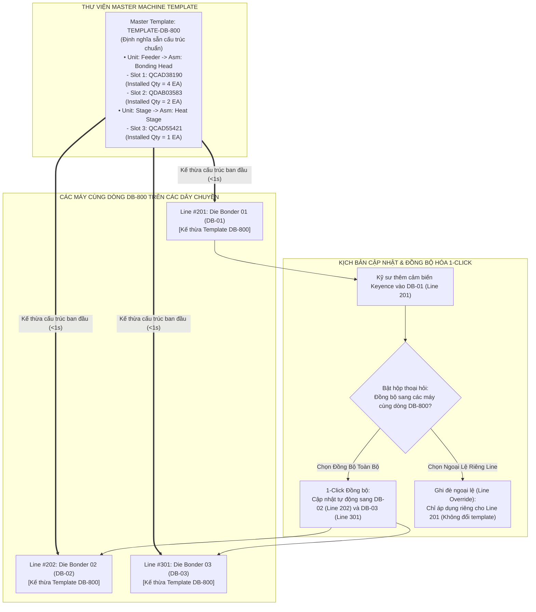

# 04. MÀN HÌNH EBOM KÉO THẢ & MATCHING CƠ CẤU (VISUAL DRAG-AND-DROP EBOM SLOT MAPPER)

> **Mã màn hình**: `UI-EBOM-01`  
> **Tên màn hình**: Visual Drag-and-Drop EBOM Workbench, 4-Tier Machine Hierarchy, Quantity Matrix & Multi-Line Template Sync  
> **Vai trò người dùng chính**: Kỹ sư hiện trường (Field Engineer) — Matching linh kiện vào cơ cấu máy, quản lý số lượng định mức, giải tỏa hàng đợi khai báo muộn.  
> **Vai trò phối hợp**: Chuyên viên Điều phối Thiết bị (LEC) — Quản trị Master Machine Template phân xưởng, đồng bộ cấu trúc máy giữa các chuyền.  
> **Mục tiêu cốt lõi**: Giải quyết triệt để sự phức tạp của hệ thống EBOM truyền thống bằng giao diện trực quan hóa 3 khung kéo - thả (Drag-and-Drop); **chuẩn hóa phân cấp 4 tầng: `Line` $\rightarrow$ `Machine` $\rightarrow$ `Unit` $\rightarrow$ `Assembly`**; **quản lý tường minh các loại số lượng (Số lượng lắp thực tế, Số lượng dự phòng tối ưu, Tồn kho thực tế)**; **tối ưu cho các máy giống nhau giữa các line (Master Machine Templates & 1-Click Multi-Line Sync)**; tích hợp bộ tìm kiếm QCode thông minh tham chiếu từ `procurement-rfq-stock-optimization.yml`.

---

## 1. NGUYÊN TẮC THIẾT KẾ & GIẢI PHÁP TỐI ƯU HÓA EBOM

Theo phản biện từ thực tế xưởng sản xuất Smart Watch (Factory HW):
1. **Phân Cấp Thiết Bị 4 Tầng Rõ Ràng (Strict 4-Tier Hierarchy)**:
   - Thay vì các khái niệm phân cấp mơ hồ, hệ thống cố định 4 cấp độ kỹ thuật:
     * **Tầng 1 - Dây chuyền (`Line`)**: Vị trí vật lý trong phân xưởng (`Line #201`, `Line #202`, `Line #301`), áp dụng quy tắc tự động `Left(Line, 1) = Floor`.
     * **Tầng 2 - Tên máy (`Machine`)**: Máy cụ thể trên chuyền (`Die Bonder 01 - DB-01`, `Tape Bonder 01 - TAB-01`).
     * **Tầng 3 - Khối chức năng (`Unit`)**: Các module chức năng lớn của máy (`Feeder Unit`, `Bonding Unit`, `Stage Unit`, `Vision Unit`, `Conveyor Unit`).
     * **Tầng 4 - Cơ cấu chi tiết (`Assembly / Mechanism`)**: Cụm cơ khí lắp ráp cụ thể (`Bonding Head Assembly`, `Vacuum Gripper Assembly`, `Heating Stage Assembly`, `Cutter Blade Assembly`).
     * $\rightarrow$ **Vị trí phụ tùng (`Spare Part Slot`)**: Khe cắm linh kiện trực tiếp thuộc Assembly.
2. **Quản Lý Đầy Đủ Các Chỉ Số Số Lượng (Comprehensive Quantity Matrix)**:
   - Mỗi Slot linh kiện trong EBOM bắt buộc quản lý 4 chỉ số lượng rõ ràng:
     * **Số lượng lắp trên máy (`Installed Qty / Machine Std Qty`)**: Số lượng linh kiện thực tế đang gắn trên cụm cơ cấu (ví dụ: 1 cụm Head Assembly có 4 xylanh kẹp phôi).
     * **Định mức dự phòng tối ưu (`Target Stock Qty`)**: Mức tồn kho an toàn cần duy trì trong kho xưởng (`target_qty`), tính theo lead time, daily usage và MOQ từ `procurement-rfq-stock-optimization.yml`.
     * **Tồn kho thực tế (`Onhand Qty`)**: Số lượng sẵn có trong kho hiện tại (`onhand_qty` lấy từ EMS `ds_Inv`).
     * **Giới hạn số lượng mua bảo dưỡng (`Max PM Purchase Qty`)**:
       $$\text{Max PM Qty} = \text{Installed Qty} \times \text{Số máy đến hạn bảo dưỡng kỳ này}$$
       Nếu kỹ sư xin mua vượt quá số lượng này, hệ thống tự động cảnh báo và yêu cầu giải trình chuyển thành loại `OVER`.
3. **Tối Ưu Cho Các Máy Giống Nhau Giữa Các Line (Master Machine Template & Multi-Line Sync)**:
   - **Vấn đề thực tế**: Xưởng Smart Watch có nhiều dây chuyền (Line 201, Line 202, Line 301) cùng sử dụng các dòng máy giống hệt nhau (ví dụ: Máy Die Bonder model `DB-800` có ở cả 3 chuyền; Tape Bonder model `TAB-200` có ở 2 chuyền). Nếu kỹ sư phải khai báo EBOM từng máy từ đầu sẽ cực kỳ tốn công và dễ sai lệch.
   - **Giải pháp Template dùng chung (Master Machine Template)**:
     * Kỹ sư/LEC chỉ cần khai báo Cấu trúc chuẩn 1 lần trên Master Template `TEMPLATE-DB-800`.
     * Khi tạo máy `DB-01 (Line 201)`, `DB-02 (Line 202)`, `DB-03 (Line 301)`, các máy này chỉ cần chọn liên kết với Template `DB-800` $\rightarrow$ **Kế thừa 100% toàn bộ cây Unit, Assembly, Slot linh kiện và Số lượng định mức**.
   - **Đồng bộ hóa 1-Click Đa Chuyền (1-Click Multi-Line Sync)**:
     * Khi kỹ sư cập nhật một linh kiện mới (hoặc thay đổi hãng sản xuất phụ tùng) trên máy `DB-01`, hệ thống hiển thị tùy chọn:
       `[X] Đồng bộ thay đổi này sang tất cả các máy cùng dòng DB-800 trên Line 202 và Line 301`.
   - **Ghi đè Biến thể Chuyền Cụ Thể (Line-Specific Variant Overrides)**:
     * Nếu Line 301 chạy model sản phẩm đặc thù cần dùng bộ kẹp 20mm thay vì 16mm, hệ thống cho phép "Ghi đè ngoại lệ" cho riêng máy đó mà không làm ảnh hưởng đến Master Template chung.
4. **Tìm Kiếm QCode Thông Minh Trong Khay Phụ Tùng**:
   - Khay phụ tùng tích hợp bộ máy tìm kiếm đa tiêu chí tham chiếu từ `procurement-rfq-stock-optimization.yml`.
   - Hiển thị đầy đủ thông số: QCode, Tên phụ tùng, Maker, Model, Đơn giá hợp đồng, ĐVT, Tồn kho, Định mức tồn, Cảnh báo Interlock và liên kết xem trực tiếp bản vẽ CAD FDM (`fdm_url`).
5. **Hàng Đợi Khai Báo Muộn (Late Declaration Queue - 7 Ngày)**:
   - Các linh kiện mua gấp khi dừng máy sự cố chưa có trong EBOM được đưa vào hàng đợi với hạn chót 7 ngày.
   - Kỹ sư chỉ cần chọn cơ cấu và bấm `[Gán Vào Cụm Này]` $\rightarrow$ Hệ thống tự động tạo slot và đóng tác vụ `TASK-EBM-xxxx` tại Hộp Thư Tác Vụ (`UI-TASK-01`).

---

## 2. BỐ CỤC KHÔNG GIAN GIAO DIỆN EBOM KÉO THẢ (LAYOUT ANATOMY)

```
┌──────────────────────────────────────────────────────────────────────────────────────────────────────────────────┐
│ HEADER: CÂY EBOM THIẾT BỊ & CƠ CẤU | Nhà Máy: Factory HW (Smart Watch) | Dây Chuyền: Line #201, #202, #301        │
│ Trạng Thái: 🟢 54 Cụm Cơ Cấu Đã Khai Báo | ⚠️ 1 Hạng Mục Khai Báo Muộn Cần Khớp Nối | [ 📋 Quản Lý Master Template]│
├──────────────────────────────────────────────────────────────────────────────────────────────────────────────────┤
│ BỐ CỤC 3 KHUNG KÉO THẢ TRỰC QUAN (3-PANE VISUAL DRAG-AND-DROP WORKSPACE):                                        │
│ ┌──────────────────────────┬──────────────────────────────────────────┬────────────────────────────────────────┐ │
│ │ KHUNG 1: CÂY CẤU TRÚC    │ KHUNG 2: BÀN CƠ CẤU & BẢNG SỐ LƯỢNG SLOT │ KHUNG 3: KHAY PHỤ TÙNG & TÌM KIẾM QCODE│ │
│ │ (4 TẦNG: LINE>MACH>UNIT) │ (ASSEMBLY SLOTS & DROP TARGET - 5 CỘT)   │ (SPARE PARTS TRAY - 4 CỘT)             │ │
│ ├──────────────────────────┼──────────────────────────────────────────┼────────────────────────────────────────┤ │
│ │ 🏭 Factory HW (Org 28753) │ Cụm Đang Chọn: Bonding Head Assembly     │ 🔎 Tìm QCode: [ SMC MXQ16            ] │ │
│ │  ├── 🌐 Line #201 (2F)   │ Thuộc Khối: Feeder Unit | Máy: DB-01     │ (Tham chiếu: TargetStockSearchList)    │ │
│ │  │    ├── ⚙️ DB-01 (Đang) │ Master Template: [ TEMPLATE-DB-800    ▼ ]│ ┌────────────────────────────────────┐ │ │
│ │  │    │   ├── 📦 Feeder  │ Mã EM No: HWBMTL21EC0101                 │ │ [::] QCAD38190 - SMC MXQ16-30      │ │ │
│ │  │    │   │   ├── 🔩 Head│ ──────────────────────────────────────── │ │ Tên: Xylanh 2 ty dẫn hướng SMC     │ │ │
│ │  │    │   │   └── 🔩 Grip│ BẢNG QUẢN LÝ SỐ LƯỢNG & ĐỊNH MỨC (SLOTS):│ │ Maker: SMC Japan | ĐVT: EA         │ │ │
│ │  │    │   ├── 📦 Stage   │ 1. QCAD38190 - Xylanh 2 ty dẫn hướng SMC │ │ Giá: $220 USD | Tồn kho: 0 EA      │ │ │
│ │  │    │   └── 📦 Vision  │    • SL Lắp Máy (Installed Qty): 4 EA    │ │ Định mức (Target Qty): 6 EA        │ │ │
│ │  │    ├── ⚙️ DB-02        │    • Tồn Kho Hiện Tại (Onhand): 0 EA     │ │ [ 📐 Xem CAD FDM ]                 │ │ │
│ │  │    └── ⚙️ TAB-01       │    • Định Mức Dự Phòng (Target): 6 EA    │ │ [ 🖐️ Kéo Thả ]  [ ⚡ Gán Nhanh ]   │ │ │
│ │  ├── 🌐 Line #202 (2F)   │    • Chu Kỳ Tuổi Thọ: 15,000 Giờ         │ ├────────────────────────────────────┤ │ │
│ │  │    ├── ⚙️ DB-02 (DB800)│ 2. QDAB03583 - Cảm biến quang Panasonic  │ │ [::] QDAB03583 - Panasonic CN73    │ │ │
│ │  │    └── ⚙️ TAB-02       │    • SL Lắp Máy (Installed Qty): 2 EA    │ │ Tên: Cảm biến quang vuông          │ │ │
│ │  └── 🌐 Line #301 (3F)   │    • Tồn Kho Hiện Tại (Onhand): 4 EA     │ │ Maker: Panasonic | ĐVT: EA         │ │ │
│ │       └── ⚙️ DB-03 (DB800)│    • Định Mức Dự Phòng (Target): 6 EA    │ │ Giá: $45 USD | Tồn kho: 4 EA       │ │ │
│ │                          │    • Chu Kỳ Tuổi Thọ: 20,000 Giờ         │ │ [ 🖐️ Kéo Thả ]  [ ⚡ Gán Nhanh ]   │ │ │
│ │ ──────────────────────── │ ┌──────────────────────────────────────┐ │ └────────────────────────────────────┘ │ │
│ │ [ ➕ Thêm Khối Unit Mới ]│ │ 🎯 VÙNG THẢ LINH KIỆN MỚI VÀO CƠ CẤU │ │ [ 📁 Onboarding Mã Mới UI-QCODE-01 ]   │ │
│ │ [ ➕ Thêm Cơ Cấu Mới ]   │ │   (Kéo thẻ từ Khay phải thả vào đây) │ │                                        │ │
│ │ [ 📋 Đồng Bộ Sang Line Khác]└──────────────────────────────────────┘ │                                        │ │
│ └──────────────────────────┴──────────────────────────────────────────┴────────────────────────────────────────┘ │
├──────────────────────────────────────────────────────────────────────────────────────────────────────────────────┤
│ PHÂN VÙNG 4: HÀNG ĐỢI KHAI BÁO MUỘN (LATE DECLARATION QUEUE - TỰ ĐỘNG GIẢI TỎA TÁC VỤ KỸ SƯ):                    │
│ Các phụ tùng đã xin mua xử lý sự cố gấp nhưng chưa gán vị trí lắp đặt cụm cơ cấu (Thời hạn tối đa: 7 ngày):     │
│ ┌─────────────┬─────────────┬────────────────────────────────────┬─────────────────┬───────────┬─────────────┐ │
│ │Mã Đơn Mua   │Mã Linh Kiện │Tên Phụ Tùng Phát Sinh Sự Cố        │Thiết Bị Phát Sinh│Thời Hạn   │Hành Động    │ │
│ ├─────────────┼─────────────┼────────────────────────────────────┼─────────────────┼───────────┼─────────────┤ │
│ │PR-2611-0085 │TMP-HW-0105  │Tấm Chuck gá kẹp phôi Die Bonder    │Die Bonder 01    │Còn 5 ngày │[ 🎯 Gán Vào │ │
│ │             │             │Vật liệu hợp kim nhôm Anodized      │Line #201        │2026-11-09 │  Cơ Cấu Này]│ │
│ └─────────────┴─────────────┴────────────────────────────────────┴─────────────────┴───────────┴─────────────┘ │
└──────────────────────────────────────────────────────────────────────────────────────────────────────────────────┘
```

---

## 3. CƠ CHẾ MASTER MACHINE TEMPLATES & ĐỒNG BỘ ĐA CHUYỀN (CROSS-LINE REPLICATION)



---

## 4. CHI TIẾT CÁC CHỈ SỐ SỐ LƯỢNG TRONG MODAL ĐĂNG KÝ SLOT EBOM

Khi kỹ sư kéo thả một linh kiện từ Khay phải vào Khung giữa, một Hộp thoại Khai Báo Số Lượng & Định Mức xuất hiện:

```
┌────────────────────────────────────────────────────────────────────────────────────────────────────────┐
│ ⚙️ KHAI BÁO THÔNG SỐ SLOT EBOM CƠ CẤU MÁY                                                  [Đóng (X)]  │
├────────────────────────────────────────────────────────────────────────────────────────────────────────┤
│ 1. ĐỊNH VỊ CƠ CẤU:                                                                                     │
│ • Thiết Bị: Line #201 > Die Bonder 01 (DB-01) | Master Template: TEMPLATE-DB-800                       │
│ • Khối Chức Năng (Unit): Feeder Unit (Khối Cấp Phôi)                                                   │
│ • Cơ Cấu Lắp Đặt (Assembly): Bonding Head Assembly (Cụm Đầu Gắp Chip)                                  │
├────────────────────────────────────────────────────────────────────────────────────────────────────────┤
│ 2. THÔNG TIN PHỤ TÙNG KHỚP NỐI:                                                                        │
│ • Mã QCode: QCAD38190 | Tên: Xylanh 2 ty dẫn hướng SMC MXQ16-30 | Hãng SX: SMC Japan                   │
│ • Đơn vị tính (UOM): EA | Đơn giá hợp đồng: $220.00 USD | Link CAD: [ 📐 Xem Bản Vẽ FDM Drawing ]     │
├────────────────────────────────────────────────────────────────────────────────────────────────────────┤
│ 3. MA TRẬN SỐ LƯỢNG & ĐỊNH MỨC THAY THẾ (QUANTITY MATRIX):                                             │
│ • Số lượng lắp thực tế trên cụm cơ cấu (Installed Quantity): [ 4 ] EA                                  │
│   ↳ Ý nghĩa: Trên 1 cụm Bonding Head thực tế có đúng 4 chiếc xylanh SMC này hoạt động song song.       │
│ • Định mức tồn kho dự phòng an toàn (Target Stock Qty): [ 6 ] EA                                       │
│   ↳ Tính toán từ formula: Safety = Max(DailyUsage x LeadTime x 1.25, MOQ)                             │
│ • Tồn kho thực tế hiện tại (Onhand Stock): 0 EA  (Đồng bộ từ bảng ds_Inv của EMS)                      │
│ • Số lượng PO đang chờ nhận (PO Remained Qty): 0 EA                                                    │
│ • Chu kỳ tuổi thọ vận hành khuyến cáo (Lifespan Hours): [ 15,000 ] Giờ                                  │
│ • Ngưỡng cảnh báo bảo dưỡng phòng ngừa (Warning Threshold): [ 13,500 ] Giờ (90% tuổi thọ)               │
├────────────────────────────────────────────────────────────────────────────────────────────────────────┤
│ 4. TÙY CHỌN ĐỒNG BỘ MASTER TEMPLATE DÙNG CHUNG:                                                        │
│ [X] Tự động cập nhật Slot này vào Master Template: TEMPLATE-DB-800                                     │
│ [X] Đồng bộ cấu trúc này sang tất cả các máy cùng dòng trên các chuyền khác:                           │
│     • Line #202: Die Bonder 02 (DB-02)                                                                 │
│     • Line #301: Die Bonder 03 (DB-03)                                                                 │
├────────────────────────────────────────────────────────────────────────────────────────────────────────┤
│ Nút hành động: [ Hủy Bỏ ]                                                [ 💾 Lưu Cấu Trúc Slot EBOM ] │
└────────────────────────────────────────────────────────────────────────────────────────────────────────┘
```

---

## 5. TỪ ĐIỂN DỮ LIỆU ĐẶC THÙ MÀN HÌNH EBOM

| Mã Dữ Liệu | Tên Trường | Kiểu Dữ Liệu | Nguồn / Quy Tắc Nghiệp Vụ |
| :--- | :--- | :---: | :--- |
| `lineId` | Mã Dây Chuyền | String | Định dạng `Line #201`, `Line #202` (Suy ra tầng theo `Left(Line, 1)`). |
| `machineCode` | Tên Máy Thân Thiện | String | `DB-01`, `DB-02`, `TAB-01`, `POL-01`. |
| `masterTemplateId`| Mã Master Template | String | `TEMPLATE-DB-800`, `TEMPLATE-TAB-200` dùng chung cho các máy cùng dòng. |
| `unitName` | Tên Khối Chức Năng | String | Cụm chức năng lớn: `Feeder Unit`, `Bonding Unit`, `Stage Unit`. |
| `assemblyName` | Tên Cơ Cấu Chi Tiết | String | Cụm chi tiết: `Bonding Head Assembly`, `Vacuum Gripper Assembly`. |
| `slotId` | Mã Định Danh Slot | String | `SLOT-DB01-FEED-HEAD-01` duy nhất trên toàn hệ thống. |
| `installedQty` | Số Lượng Lắp Thực Tế | Number | Số lượng linh kiện lắp thực tế trên cụm cơ cấu (e.g. `4 EA`). |
| `targetStockQty` | Định Mức Tồn Dự Phòng | Number | Mức tồn tối ưu an toàn (`target_qty`) lấy từ `procurement-rfq-stock-optimization.yml`. |
| `onhandQty` | Tồn Kho Thực Tế | Number | Tồn kho thực tế tại kho nhà máy lấy từ bảng `ds_Inv` EMS. |
| `lifespanHours` | Chu Kỳ Tuổi Thọ | Number | Số giờ hoạt động tối đa khuyến cáo của nhà sản xuất. |
| `isSyncedAcrossLines`| Cờ Đồng Bộ Đa Chuyền | Boolean | `true` khi cấu hình được kế thừa từ Master Template sang các chuyền khác. |
| `isLineOverride` | Cờ Ghi Đè Chuyền Riêng| Boolean | `true` nếu máy trên chuyền này có tùy biến slot khác biệt so với template chung. |
