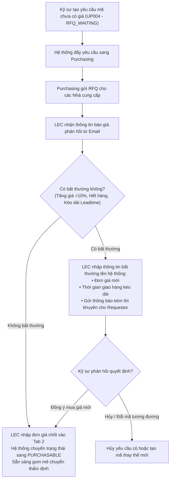

# 05. MÀN HÌNH ĐIỀU PHỐI LEC MASTER WORKBENCH (LEC COORDINATION & BATCH OPERATIONS)

> **Mã màn hình**: `UI-LEC-01`  
> **Tên màn hình**: LEC Master Workbench, Batch Grouping, RFQ Tracking, EM No Registration & Multi-Plant Control  
> **Vai trò người dùng chính**: Chuyên viên Điều phối Thiết bị (LEC - Spare Part Coordinator) — **Phạm Đức Long (MSNV: 658359) và các đồng nghiệp LEC (Hỗ trợ Đa Phân xưởng / Đa Team)**.  
> **Vai trò phối hợp**: Kỹ sư hiện trường (nhận phản hồi, báo giá, thông báo EOL) & Quản lý Chi phí (nhận hồ sơ thẩm định).  
> **Mục tiêu cốt lõi**: Trung tâm tác nghiệp toàn diện của LEC: Gom các hạng mục cùng trạng thái để xử lý đồng loạt; đăng ký mã EM No 14 ký tự chuẩn hóa từ tên thân thiện; theo dõi trạng thái báo giá RFQ qua email và xử lý bất thường; đánh dấu thủ công Target/Over với 6 mã sự cố; phân loại lại linh kiện ngừng sản xuất (EOL) ngay cả khi EMS vẫn hiển thị Active; cấu hình ngân sách SG thủ công (không cộng dồn số dư) và quản lý mốc giao hàng Inbound rải chi phí 3 tháng.

---

## 1. NGUYÊN TẮC NGHIỆP VỤ & QUYỀN HẠN ĐIỀU PHỐI

Theo phản biện từ thực tế xưởng sản xuất Smart Watch:
1. **Gom mẻ theo trạng thái (Batch Grouping & Bulk Processing)**:
   - Các kỹ sư hiện trường đăng ký hàng chục mã linh kiện mỗi ngày. Nếu LEC duyệt từng mã đơn lẻ sẽ gây quá tải và chậm trễ.
   - LEC sử dụng bộ lọc trạng thái để gom các mã: *Có thể mua*, *Chờ báo giá RFQ*, *Bị khóa Interlock*, *Chờ cấp QCode*, để xử lý hàng loạt chỉ với 1 cú nhấp chuột.
2. **Theo dõi trạng thái báo giá RFQ qua Email & Xử lý bất thường**:
   - LEC theo dõi các yêu cầu đang chờ báo giá từ bộ phận Mua hàng (`Purchasing`).
   - Khi nhận email phản hồi báo giá (hoặc thông báo nhà cung cấp tăng giá đột biến, hết hàng, kéo dài lead time) $\rightarrow$ LEC nhập trực tiếp đơn giá/thông tin ngoại lệ lên hệ thống, phản hồi tức thời cho Kỹ sư yêu cầu (Requestor) để kỹ sư quyết định tiếp tục mua hay đổi mã khác.
3. **Đăng ký mã EM No 14 ký tự chuẩn hóa**:
   - Kỹ sư chỉ làm việc với tên thân thiện: Dây chuyền (`Line #201`), Tên máy (`Die Bonder 01`), Cụm cơ cấu (`Feeder Unit`).
   - LEC là người chịu trách nhiệm xác thực và gán chuỗi mã thiết bị EM No 14 ký tự chuẩn hóa (`HWBMTL21EC0101`) lên hệ thống để đồng bộ sang EMS Core.
4. **Phân loại lại linh kiện ngừng sản xuất (EOL Reclassification)**:
   - Rất nhiều linh kiện trên hệ thống EMS vẫn hiển thị trạng thái `Active`, nhưng nhà sản xuất thực tế đã ngừng sản xuất (Discontinued / EOL).
   - LEC có thẩm quyền phân loại lại các mã này vào nhóm `EOL`, ghi nhận lý do và gửi phản hồi thông báo cho Kỹ sư để tiến hành tìm mã thay thế tương đương.
5. **Đánh dấu thủ công Target/Over (Strict Non-Automated Marking)**:
   - Tuyệt đối không dùng thuật toán tự động gắn nhãn. LEC căn cứ vào lý do kỹ sư giải trình và mã Work Order để đánh dấu `TARGET` hoặc `OVER` (gán 1 trong 6 mã `OVR-01` đến `OVR-06`).
6. **Nhập ngân sách thủ công & Nguyên tắc không cộng dồn (Strict No-Rollover)**:
   - LEC nhập thủ công hạn mức ngân sách SG tháng cho Team (e.g. `$150,000 USD`). Số dư cuối tháng không cộng dồn sang tháng sau (`Carryover Surplus = $0`).
7. **Hỗ trợ Đa Phân Xưởng / Đa Team (Multi-Plant / Team Topology)**:
   - Cho phép LEC chuyển đổi nhanh giữa các Team (`PO Module 1`, `PO Module 2`, `Assembly Team`) hoặc giữa các Nhà máy khác nhau trong cùng giao diện.

---

## 2. BỐ CỤC KHÔNG GIAN GIAO DIỆN LEC MASTER (LAYOUT ANATOMY)

```
┌──────────────────────────────────────────────────────────────────────────────────────────────────────────────────┐
│ HEADER: BÀN ĐIỀU PHỐI LEC MASTER | Trực Ban: Phạm Đức Long (658359) | Phân Ban: [ PO Module 2 (Factory HW) ▼ ]   │
│ Thanh Chỉ Số Trực Quan: ⚡ 3 Mã Có Thể Mua | 📧 4 Mã Chờ RFQ Email | 📁 2 Folder QCode | ⚠️ 1 Mã Cần Báo EOL   │
├──────────────────────────────────────────────────────────────────────────────────────────────────────────────────┤
│ ĐIỀU HƯỚNG 6 PHÂN HỆ TÁC NGHIỆP LEC WORKBENCH:                                                                   │
│ [ 1. Gom Mẻ & Xử Lý Đồng Loạt ] [ 2. Theo Dõi Báo Giá RFQ & Email ] [ 3. Đánh Dấu Target/Over & EM No ]        │
│ [ 4. Tiếp Nhận QCode & EOL ]    [ 5. Mốc Inbound & Rải Chi Phí 3 Tháng ] [ 6. Cấu Hình Budget & Deadline ]      │
├──────────────────────────────────────────────────────────────────────────────────────────────────────────────────┤
│ [NỘI DUNG TAB 1: GOM MẺ THEO TRẠNG THÁI & THAO TÁC ĐỒNG LOẠT (BATCH GROUPING)]                                   │
│ Bộ Lọc Gom Mẻ: [🔘 Tất Cả (12)] [🟢 Có Thể Mua (5)] [🟡 Chờ RFQ (4)] [🔴 Bị Khóa Interlock (2)] [⚠️ Báo EOL (1)] │
│ Thanh Thao Tác Hàng Loạt (Đã tích chọn 3 dòng):                                                                  │
│ [ 🚀 Gom Mẻ Chuyển Thẩm Định Chi Phí ]  [ 🔓 Mở Khóa Interlock Đồng Loạt ]  [ 🚫 Đánh Dấu EOL Hàng Loạt ]        │
│ ┌───┬───┬─────────────┬─────────────┬──────────────────────────┬──────────┬──────────┬──────────────┬────────────┐ │
│ │[X]│STT│Mã Đơn Mua   │Mã QCode     │Tên Phụ Tùng & Maker      │Máy/Chuyền│Kỹ Sư     │Thành Tiền    │Trạng Thái  │ │
│ ├───┼───┼─────────────┼─────────────┼──────────────────────────┼──────────┼──────────┼──────────────┼────────────┤ │
│ │[X]│ 1 │PR-2611-0081 │QDAB03583    │Cảm biến quang Panasonic  │DB-01/201 │Thắng     │$450 USD      │PURCHASABLE │ │
│ │[X]│ 2 │PR-2611-0082 │QCAD12044    │Giác hút chân không Pisco │DB-01/201 │Thắng     │$120 USD      │PURCHASABLE │ │
│ │[ ]│ 3 │PR-2611-0087 │QCAD55421    │Đầu gia nhiệt Kyocera 400WTAB-01/201 │Quân      │$1,260 USD    │RFQ_WAITING │ │
│ │[ ]│ 4 │PR-2611-0083 │QCAD38190    │Xylanh 2 ty SMC MXQ16-30  │TAB-02/202│Quân      │$880 USD      │LOCKED_STK  │ │
│ └───┴───┴─────────────┴─────────────┴──────────────────────────┴──────────┴──────────┴──────────────┴────────────┘ │
├──────────────────────────────────────────────────────────────────────────────────────────────────────────────────┤
│ [NỘI DUNG TAB 2: THEO DÕI TRẠNG THÁI BÁO GIÁ RFQ & XỬ LÝ BẤT THƯỜNG TỪ EMAIL]                                     │
│ Khung nhập báo giá nhận từ bộ phận Mua Hàng qua email:                                                           │
│ • Chọn đơn mua: [ PR-2611-0087 - Đầu gia nhiệt Kyocera 400W ▼ ]                                                  │
│ • Tình trạng phản hồi từ Purchasing: [🟡 Nhà cung cấp báo tăng giá + Kéo dài Lead time ▼]                         │
│ • Đơn giá mới nhận từ email: [ $460.00 ] USD (Tăng $40/EA so với giá cũ $420)                                    │
│ • Lead time mới: [ 45 ] Ngày (Cũ: 21 ngày)   • Nhà cung cấp báo giá: [ Kyocera Vietnam ]                        │
│ • Phản hồi gửi Kỹ sư: [ "NCC báo model này tồn kho ít, giá tăng lên $460. Kỹ sư có đồng ý mua mức giá này?" ]   │
│ [ ✉️ CẬP NHẬT ĐƠN GIÁ & GỬI THÔNG BÁO CHO KỸ SƯ ]   [ 🔄 Chuyển Trạng Thái Thành CÓ THỂ MUA ]                    │
├──────────────────────────────────────────────────────────────────────────────────────────────────────────────────┤
│ [NỘI DUNG TAB 3: ĐĂNG KÝ EM NO 14 KÝ TỰ & ĐÁNH DẤU TARGET / OVER (6 MÃ SỰ CỐ)]                                   │
│ ┌────────────────────────────────────────────────────────┬─────────────────────────────────────────────────────┐ │
│ │ 1. ĐĂNG KÝ MÃ EM NO 14 KÝ TỰ CHUẨN HÓA:                │ 2. ĐÁNH DẤU THỦ CÔNG TARGET / OVER:                 │ │
│ │ • Tên thân thiện kỹ sư chọn:                           │ • Phân loại kế hoạch:                              │ │
│ │   Line #201 (2F) -> Die Bonder 01 -> Feeder Unit       │   ( ) TRONG KẾ HOẠCH (TARGET)                       │ │
│ │ • Chuỗi mã EM No 14 ký tự do LEC gán:                  │   (X) NGOÀI KẾ HOẠCH (OVER)                         │ │
│ │   [ HWBMTL21EC0101               ] [ 🔄 Đồng Bộ EMS ]  │ • Mã nguyên nhân Over (Bắt buộc chọn 1 trong 6 mã): │ │
│ │ • Giải mã chuỗi: HW (Nhà máy HW) - BM (Smart Watch) -  │   [ OVR-01: Line Stop (Đột xuất dừng chuyền)     ▼]│ │
│ │   TL (Total Line) - 21 (Line 201) - EC01 (Bonder 01) - │ • Bằng chứng Work Order: [ WO-248926095           ]│ │
│ │   01 (Cụm Feeder Unit)                                 │ • Ghi chú thẩm tra LEC: [ Hỏng cảm biến mắt đọc ]   │ │
│ └────────────────────────────────────────────────────────┴─────────────────────────────────────────────────────┘ │
├──────────────────────────────────────────────────────────────────────────────────────────────────────────────────┤
│ [NỘI DUNG TAB 4: TIẾP NHẬN FOLDER QCODE MỚI & PHÂN LOẠI LẠI MÃ NGỪNG SẢN XUẤT (EOL)]                             │
│ • Xử lý mã EOL: Tìm mã [ QCAB99120 ] (Driver Servo Omron)                                                        │
│   Trạng thái EMS: 🟢 Active -> LEC phân loại lại: 🔴 EOL (Nhà sản xuất ngừng sản xuất từ Q3/2026)                │
│   Ghi chú phản hồi Kỹ sư: [ "Mã này Omron đã ngừng sản xuất, đề nghị kỹ sư Thắng đổi sang dòng R88D-1SN thay thế" ]│
│   [ 🚫 Ghi Nhận EOL & Bắn Cảnh Báo Cho Requestor ]                                                               │
├──────────────────────────────────────────────────────────────────────────────────────────────────────────────────┤
│ [NỘI DUNG TAB 5: MỐC INBOUND GIAO HÀNG & MA TRẬN RẢI GHI NHẬN CHI PHÍ 3 THÁNG]                                   │
│ Quản trị dòng tiền không dồn cục bộ:                                                                             │
│ • Đơn hàng: PR-2611-0075 (Board Trumpf - $30,000 USD - 6 EA)                                                     │
│ • Vendor Confirm Date: [ 2026-11-10 📅 ] | ETA Cảng/Kho HW: [ 2026-11-25 📅 ]                                    │
│ • Phân bổ chi phí 3 tháng: Tháng 11/2026: 50% ($15,000) | Tháng 12/2026: 25% ($7,500) | Tháng 01/2027: 25%($7,500)│
├──────────────────────────────────────────────────────────────────────────────────────────────────────────────────┤
│ [NỘI DUNG TAB 6: THIẾT LẬP DEADLINE KIỂM THẢO & NGÂN SÁCH SG (STRICT NO-ROLLOVER)]                               │
│ • Phân xưởng: Factory HW | Team: PO Module 2                                                                     │
│ • Hạn Mức Ngân Sách SG Tháng 11/2026: [ $150,000 ] USD (Nhập thủ công - Không cộng dồn số dư tháng trước)       │
│ • Số dư tháng 10 chuyển sang: $0 USD (Khóa cứng quy tắc No-Rollover)                                             │
│ • Hạn chót kỹ sư nộp giải trình tồn kho: Ngày 05 hàng tháng | Hạn chốt thẩm định chi phí: Ngày 07 hàng tháng    │
└──────────────────────────────────────────────────────────────────────────────────────────────────────────────────┘
```

---

## 3. QUY TRÌNH NGHIỆP VỤ XỬ LÝ RFQ QUA EMAIL & NGOẠI LỆ



---

## 4. CHI TIẾT TỪ ĐIỂN DỮ LIỆU & BỘ CHỈ SỐ LEC

| Tên Thuộc Tính | Mã Dữ Liệu | Kiểu Dữ Liệu | Mô Tả Nghiệp Vụ & Giới Hạn |
| :--- | :--- | :---: | :--- |
| `activePlantTeam` | Phân xưởng / Team | Object | Ví dụ: `{ plant: 'HW', team: 'PO Module 2', orgId: 28753 }`. Hỗ trợ đổi Team linh hoạt. |
| `batchSelectionIds`| Danh sách gom mẻ | Array[String]| Mảng các mã yêu cầu được LEC tích chọn xử lý hàng loạt. |
| `rfqEmailNote` | Ghi chú từ email RFQ | Text | Chi tiết nội dung phản hồi từ bộ phận Mua hàng hoặc Nhà cung cấp. |
| `unitPriceConfirmed`| Đơn giá chốt từ RFQ | Decimal | Đơn giá USD chính thức sau khi đàm phán thành công. |
| `isEolOverridden` | Cờ phân loại lại EOL | Boolean | `true` khi LEC can thiệp chuyển mã từ Active sang EOL. |
| `eolNoticeToEng` | Thông báo EOL gửi KS | Text | Lời nhắn hướng dẫn kỹ sư tìm mã thay thế tương đương. |
| `emNo14Chars` | Mã EM No 14 ký tự | String | Mã thiết bị 14 ký tự chuẩn hóa (e.g. `HWBMTL21EC0101`). |
| `planType` | Phân loại kế hoạch | Enum | `TARGET` (Trong kế hoạch) hoặc `OVER` (Ngoài kế hoạch). |
| `overReasonCode` | Mã lý do Over | Enum | Bắt buộc 1 trong 6 mã: `OVR-01` đến `OVR-06`. |
| `sgMonthlyCapUsd` | Trần ngân sách SG tháng | Decimal | Ngân sách tháng do LEC nhập tay (Số dư chuyển sang = 0). |
| `inboundMilestones`| Mốc giao hàng Inbound | Object | Gồm `vendorConfirmDate`, `etaPortDate`, `actualReceiveDate`. |
| `amortizationRatio`| Tỷ lệ rải chi phí 3 tháng| Array[Number]| Tỷ lệ phần trăm phân bổ (e.g. `[0.50, 0.25, 0.25]`). |
