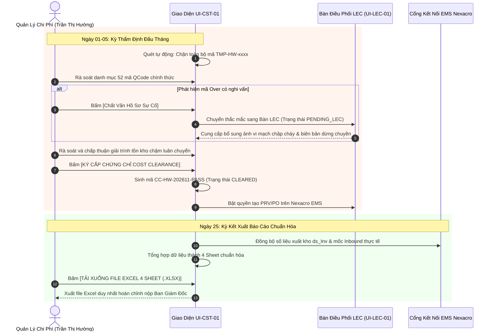

# 07. MÀN HÌNH THẨM ĐỊNH CHI PHÍ ĐẦU THÁNG & BÁO CÁO 4 SHEET (COST MANAGEMENT AUDIT & 4-SHEET EXCEL REPORT)

> **Mã màn hình**: `UI-CST-01`  
> **Tên màn hình**: Cost Management Monthly Audit, Official QCode Enforcement, Cost Clearance & Fixed 4-Sheet Report Portal  
> **Vai trò người dùng chính**: Chuyên viên Quản lý Chi phí Phân Xưởng (Cost Management Department) — **Reviewer & Assistant hợp nhất thành 1 cá nhân duy nhất (Trần Thị Hường)** phụ trách toàn bộ nhà máy Factory HW.  
> **Thời điểm thẩm định (Golden Rule #4)**: Định kỳ diễn ra vào **ĐẦU MỖI THÁNG (TỪ NGÀY 01 ĐẾN 05)**.  
> **Thời điểm xuất báo cáo chuẩn hóa (Golden Rule #9)**: **NGÀY 25 HÀNG THÁNG**, xuất duy nhất một file Excel theo Form cố định chuẩn hóa gồm 4 Sheet tiêu chuẩn.  
> **Điều kiện tiên quyết (Golden Rule #5)**: **BẮT BUỘC PHẢI CÓ MÃ QCODE CHÍNH THỨC**. Toàn bộ mã tạm mang tiền tố `TMP-HW-` bị chặn cứng khỏi danh mục thẩm định.

---

## 1. NGUYÊN TẮC NGHIỆP VỤ & QUYỀN HẠN QUẢN LÝ CHI PHÍ

1. **Thẩm định Chi phí Kỳ Đầu Tháng (Days 01–05 Audit Window)**:
   - Trong 5 ngày đầu tháng, Quản lý Chi phí tiến hành rà soát toàn bộ các gói mua sắm phụ tùng do LEC đã gom mẻ.
   - Thẩm tra tính hợp lý của các hạng mục `TARGET` (đối chiếu định mức bảo dưỡng) và các hạng mục `OVER` (đối chiếu mã sự cố `OVR-01` đến `OVR-06` kèm bằng chứng Work Order dừng chuyền).
2. **Cơ chế Chặn Cứng Mã Tạm (Strict Official QCode Gatekeeper)**:
   - Hệ thống áp dụng bộ lọc bảo vệ: Hạng mục nào còn mang mã tạm `TMP-HW-xxxx` sẽ bị hệ thống tự động khóa lại ở khay cảnh báo, không cho phép đưa vào phiên thẩm định.
   - Quản lý Chi phí không duyệt bất kỳ hồ sơ nào chưa được cấp mã QCode ERP chính thức.
3. **Công cụ Phát Hành Thắc Mắc & Thẩm Tra Trực Tiếp (Inquiry Dispatch Tool)**:
   - Khi phát hiện một dòng chi phí bất thường, Quản lý Chi phí bấm nút phát hành câu hỏi thẩm tra gửi thẳng về bàn làm việc của LEC.
   - Sau khi kỹ sư và LEC bổ sung ảnh chụp, biên bản hiện trường và giải trình thỏa đáng, Quản lý Chi phí mới mở khóa dòng đó.
4. **Phát Hành Chứng Chỉ Thẩm Duyệt Chi Phí (Cost Clearance Issuance)**:
   - Sau khi hoàn tất kiểm tra, Quản lý Chi phí bấm ký cấp **Cost Clearance** cho toàn Team.
   - Đây là điều kiện kỹ thuật để hệ thống mở khóa tính năng tạo đơn PRV/PO trên Nexacro EMS và kích hoạt thủ tục xuất kho/chuyển giao liên pháp nhân.
5. **Kỳ Xuất Báo Cáo Chuẩn Hóa Ngày 25 (Standard Fixed 4-Sheet Excel Export)**:
   - Vào ngày 25 hàng tháng, hệ thống tự động tổng hợp toàn bộ số liệu chi phí, tình trạng mua sắm, xuất kho và giải trình để xuất ra **duy nhất 1 file Excel gồm đúng 4 Sheet tiêu chuẩn** trình Ban Giám Đốc.

---

## 2. BỐ CỤC KHÔNG GIAN GIAO DIỆN THẨM ĐỊNH (LAYOUT ANATOMY)

```
┌──────────────────────────────────────────────────────────────────────────────────────────────────────────────────┐
│ HEADER: CỔNG THẨM ĐỊNH BAN QUẢN LÝ CHI PHÍ | Phụ Trách: Trần Thị Hường | Phân Xưởng: Factory HW (Smart Watch)   │
│ 📅 LỊCH THẨM ĐỊNH: Ngày 01-05 Hàng Tháng | 📊 LỊCH XUẤT BÁO CÁO: Ngày 25 Hàng Tháng (Xuất 1 File Excel 4 Sheet) │
├──────────────────────────────────────────────────────────────────────────────────────────────────────────────────┤
│ PHÂN VÙNG 1: BANNER BẢO VỆ CHUẨN MÃ & TRẠNG THÁI KIỂM SOÁT                                                       │
│ ┌──────────────────────────────────────────────────────────────────────────────────────────────────────────────┐ │
│ │ 🛡️ CỔNG BẢO VỆ THẨM ĐỊNH CHI PHÍ:                                                                            │ │
│ │ • Hạng mục đủ điều kiện thẩm định (Đã có QCode chính thức): 52 mã ($148,200 USD)                             │ │
│ │ • Hạng mục BỊ CHẶN do mang mã tạm TMP (TMP-HW-0105): 1 mã ($185 USD) ➔ Chờ LEC cấp QCode trên ERP           │ │
│ └──────────────────────────────────────────────────────────────────────────────────────────────────────────────┘ │
├──────────────────────────────────────────────────────────────────────────────────────────────────────────────────┤
│ PHÂN VÙNG 2: ĐIỀU HƯỚNG 3 PHÂN HỆ THẨM TRA (3 AUDIT TABS)                                                        │
│ [ TAB 1: Danh Mục Thẩm Định Gói Mua Đầu Tháng ]  [ TAB 2: Thẩm Tra Giải Trình Tồn Kho ]  [ TAB 3: Báo Cáo 4 Sheet ]│
├──────────────────────────────────────────────────────────────────────────────────────────────────────────────────┤
│ [NỘI DUNG TAB 1: HỒ SƠ THẨM ĐỊNH GÓI MUA SẮM (AUDIT WORKBENCH)]                                                  │
│ Bộ Lọc: [🔘 Tất Cả Hợp Lệ (52)] [🟢 Target Định Mức (41)] [🔴 Over Đột Xuất (11)] [💬 Đang Chất Vấn (2)]         │
│ ┌───┬─────────────┬─────────────┬─────────────┬──────────┬───────────┬──────────┬──────────────┬─────────────────┐ │
│ │STT│Mã Đơn Mua   │Mã QCode ERP │Tên Phụ Tùng │Thiết Bị  │Phân Loại  │Mã WO     │Thành Tiền    │Hành Động Thẩm Tra│
│ ├───┼─────────────┼─────────────┼─────────────┼──────────┼───────────┼──────────┼──────────────┼─────────────────┤ │
│ │ 1 │PR-2611-0081 │QDAB03583    │Cảm biến quangDie Bonder │TARGET     │-         │$450 USD      │🟢 Đạt định mức  │ │
│ │ 2 │PR-2611-0082 │QCAD55421    │Board Trumpf │TAB-01    │🔴 OVER    │WO-248926 │$3,150 USD    │[💬 Chất Vấn     │ │
│ │   │             │             │400W         │          │(OVR-01)   │          │              │    Hồ Sơ Sự Cố ]│ │
│ │ 3 │PR-2611-0086 │QDAD12236    │Xylanh kẹp   │POL-01    │🔴 OVER    │WO-248999 │$1,820 USD    │[💬 Chất Vấn     │ │
│ │   │             │             │SMC MHZ2     │          │(OVR-04)   │          │              │    Lý Do Setup ]│ │
│ └───┴─────────────┴─────────────┴─────────────┴──────────┴───────────┴──────────┴──────────────┴─────────────────┘ │
│ [ ✍️ KÝ CẤP CHỨNG CHỈ COST CLEARANCE ] -> Mã chứng thực dự kiến: CC-HW-202611-PASS                                │
├──────────────────────────────────────────────────────────────────────────────────────────────────────────────────┤
│ [NỘI DUNG TAB 2: THẨM TRA GIẢI TRÌNH TỒN KHO CHẬM LUÂN CHUYỂN (>30/60/90 NGÀY)]                                  │
│ Rà soát 2 văn bản giải trình của kỹ sư Thắng và Quân:                                                            │
│ • QDAB03583 (Tồn 48 ngày - $270 USD): Kỹ sư cam kết thay thế trong ca bảo dưỡng 18/11 ➔ [🟢 Chấp Thuận]         │
│ • QCAD55421 (Tồn 72 ngày - $840 USD): Kỹ sư cam kết lắp vào TAB-01 tuần 3 tháng 11 ➔ [🟢 Chấp Thuận]             │
├──────────────────────────────────────────────────────────────────────────────────────────────────────────────────┤
│ [NỘI DUNG TAB 3: TRUNG TÂM KẾT XUẤT BÁO CÁO EXCEL 4 SHEET TIÊU CHUẨN (NGÀY 25 HÀNG THÁNG)]                      │
│ Cấu trúc tệp tin báo cáo duy nhất cho Ban Giám Đốc: [ Báo_Cáo_Tong_Hop_Chi_Phi_SW_FactoryHW_202611.xlsx ]        │
│ ┌─────────────────────────┬─────────────────────────┬─────────────────────────┬──────────────────────────────┐ │
│ │ SHEET 1: TỔNG HỢP NGÂN  │ SHEET 2: DANH MỤC GÂY   │ SHEET 3: TIẾN ĐỘ INBOUND│ SHEET 4: TỒN KHO CHẬM LUÂN   │ │
│ │ SÁCH SG & KHO (ds_Inv)  │ OVER (MUA & XUẤT KHO)   │ & RẢI CHI PHÍ 3 THÁNG   │ CHUYỂN & GIẢI TRÌNH KỸ SƯ    │ │
│ │ • Trần SG: $150,000 USD │ • Mua gây Over: $26.2k  │ • Mốc Vendor Confirm    │ • Chi tiết mã tồn >30/60/90d │ │
│ │ • Thực cam kết: $148.2k │ • Xuất kho Over: $14.8k │ • Mốc ETA Cảng / Kho HW │ • Toàn văn lý do chưa dùng   │ │
│ │ • Xuất kho EMS: $118.4k │ • Chi tiết 6 mã OVR     │ • Phân bổ T, T+1, T+2   │ • Ngày cam kết & ảnh hiện trg│ │
│ │ • Thặng dư (Hủy): $0 USD│ • Bằng chứng Work Order │ • Tiến độ thực tế EMS   │ • Ý kiến thẩm định chi phí   │ │
│ └─────────────────────────┴─────────────────────────┴─────────────────────────┴──────────────────────────────┘ │
│ [ 📥 TẢI XUỐNG FILE EXCEL 4 SHEET CHUẨN HÓA (.XLSX) ]    [ 🖨️ Xuất Báo Cáo Tóm Tắt Gửi Ban Giám Đốc (.PDF) ]     │
└──────────────────────────────────────────────────────────────────────────────────────────────────────────────────┘
```

---

## 3. ĐẶC TẢ CHI TIẾT 4 SHEET EXCEL TIÊU CHUẨN XUẤT NGÀY 25 HÀNG THÁNG

Hệ thống kết xuất ra **duy nhất 1 file Excel định dạng `.xlsx`** với cấu trúc 4 Sheet không thể thay đổi:

### 3.1. Sheet 1: `TONG_HOP_NGAN_SACH_SG` (SG Budget vs PO vs Inventory Issuance)
* Cung cấp bức tranh toàn cảnh tài chính phân xưởng Smart Watch (Factory HW):
  * **Trần ngân sách SG tháng được duyệt (Budget Cap)**: Nhập từ cấu hình của LEC (e.g. `$150,000 USD`).
  * **Tổng giá trị đơn mua đã cam kết (Committed PO Total)**: Lấy từ các đơn PRV đã cấp Cost Clearance và ký PO trên EMS (`$148,200 USD`).
  * **Tổng giá trị vật tư xuất kho thực tế (Actual Warehouse Issuance)**: Đồng bộ tự động từ bảng `ds_Inv` của EMS (`$118,450 USD`).
  * **Số dư chuyển sang tháng sau (Carryover Surplus)**: Hiển thị cố định `$0 USD` (Tuân thủ nguyên tắc No-Rollover).

### 3.2. Sheet 2: `DANH_MUC_GAY_OVER` (Purchase & Warehouse Over-Budget Deep Dive)
* Bóc tách toàn bộ nguyên nhân gây vượt ngân sách:
  * **Cột phân loại nguồn gốc**: Phân biệt rõ Over do `PURCHASE` (Đơn mua mới phát sinh ngoài kế hoạch) hay Over do `WAREHOUSE_ISSUE` (Xuất phụ tùng dự phòng từ kho vượt định mức tháng).
  * **Bóc tách theo 6 mã sự cố chuẩn**: `OVR-01` (Line Stop), `OVR-02` (Production Surge), `OVR-03` (Transfer Delay), `OVR-04` (Model Setup), `OVR-05` (Price Surge), `OVR-06` (Human Error/Alignment).
  * **Chi tiết từng dòng**: Mã QCode, Tên phụ tùng, Số lượng, Đơn giá, Thành tiền, Tên máy, Dây chuyền, Mã Work Order sự cố và Kỹ sư đề xuất.

### 3.3. Sheet 3: `TIEN_DO_INBOUND_MOC_NHAP` (Inbound Logistics & 3-Month Expense Allocation)
* Quản trị rủi ro dòng tiền và tiến độ giao hàng:
  * **Các mốc logistics**: Mã đơn hàng, Tên nhà cung cấp, Ngày NCC xác nhận (`Vendor Confirm Date`), Ngày dự kiến về cảng/kho HW (`ETA Date`), Ngày thực tế nhập kho EMS.
  * **Ma trận phân bổ ghi nhận chi phí 3 tháng**:
    * Số tiền hạch toán Tháng $T$ (Tháng hiện tại).
    * Số tiền hạch toán Tháng $T+1$ (Tháng kế tiếp).
    * Số tiền hạch toán Tháng $T+2$ (Hai tháng sau).

### 3.4. Sheet 4: `TON_KHO_CHAM_LUAN_CHUYEN` (Aging Inventory & Engineer Justifications)
* Kiểm thảo tài sản ứ đọng:
  * Danh mục các mã phụ tùng có tuổi tồn kho `> 30 ngày`, `> 60 ngày`, `> 90 ngày` lấy từ `ds_Inv`.
  * Tên kỹ sư và Part phụ trách.
  * Toàn văn nội dung kỹ sư giải trình trên màn hình `UI-TASK-01`: Lý do chưa sử dụng, Kế hoạch đưa vào máy, Ngày cam kết sử dụng hoặc hoàn trả kho.
  * Đánh giá và ghi chú phê duyệt của Quản lý Chi phí (Trần Thị Hường).

---

## 4. QUY TRÌNH THẨM ĐỊNH & CẤP COST CLEARANCE



