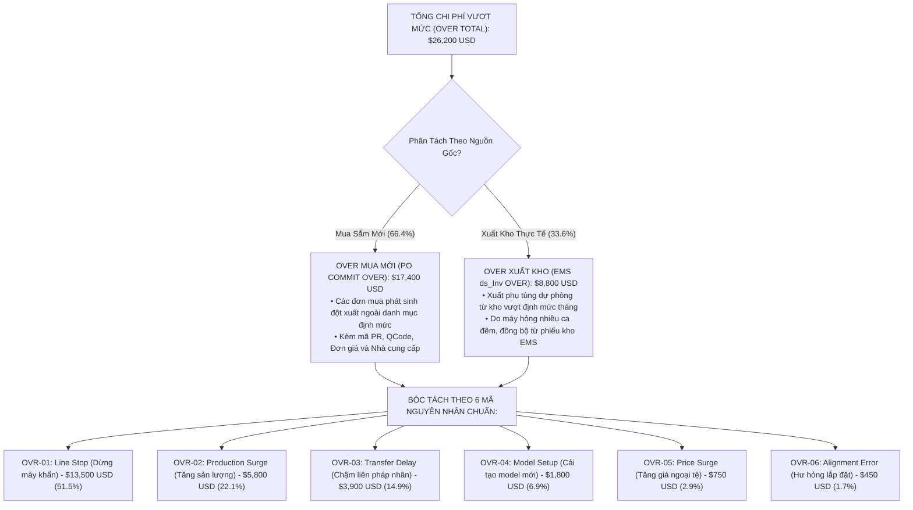

# 08. MÀN HÌNH DASHBOARD TỔNG QUAN VẬN HÀNH & PHÂN TÍCH TOÀN XƯỞNG (UNIVERSAL OPERATIONS & ANALYTICS DASHBOARD)

> **Mã màn hình**: `UI-DASH-01`  
> **Tên màn hình**: Universal Operations, Procurement Funnel, SG Budget Dials & Over-Budget Deep Dive Dashboard  
> **Phạm vi hiển thị (Visibility Scope)**: Toàn bộ phân xưởng Smart Watch (Factory HW - Org ID: 28753), tự động phân quyền dữ liệu theo vai trò đăng nhập.  
> **Mục tiêu cốt lõi**: Trung tâm thông tin điều hành toàn diện: Phễu tiến độ 7 giai đoạn thời gian thực; kiểm soát 3 trục ngân sách SG (không lũy kế); **công cụ chuyên sâu truy vấn danh mục gây Over (trả về danh sách chi tiết các hạng mục gây Over của cả xuất kho EMS và mua sắm mới)**; kết xuất báo cáo Excel 4 Sheet phục vụ họp Ban Giám Đốc.

---

## 1. NGUYÊN TẮC THIẾT KẾ & ĐỐI SOÁT NGÂN SÁCH

1. **Đối soát 3 Trục Ngân Sách SG (Strict No-Rollover Policy)**:
   - **Trục 1: Trần Ngân sách SG ($B_{\text{alloc}}$)**: Nhập thủ công từ LEC, số dư cuối tháng bị hủy về 0 (`Carryover Surplus = $0`).
   - **Trục 2: Thực chi PO Cam kết ($S_{\text{PO}}$)**: Tổng giá trị các đơn mua đã ký PO trên EMS.
   - **Trục 3: Chi phí Xuất kho Thực tế ($E_{\text{EMS}}$)**: Đồng bộ tự động từ bảng kê `ds_Inv` của EMS khi thủ kho phát phụ tùng lên chuyền.
2. **Phễu Tiến Độ Mua Sắm 7 Giai Đoạn (7-Stage Clickable Pipeline)**:
   - Nhấp vào bất kỳ giai đoạn nào trên phễu sẽ tự động lọc danh sách bảng dữ liệu bên dưới:
     * *Giai đoạn 1: Chuẩn bị QCode & Folder CAD (`TMP-`)*.
     * *Giai đoạn 2: Quét & Phân tích Interlock*.
     * *Giai đoạn 3: Chờ Báo Giá RFQ (Email Purchasing)*.
     * *Giai đoạn 4: Thẩm Định Chi Phí & Ký Duyệt EMS*.
     * *Giai đoạn 5: NCC Xác Nhận Đơn Hàng (Vendor Confirm)*.
     * *Giai đoạn 6: Hàng Về Cảng / Kho Nhà Máy (ETA Date)*.
     * *Giai đoạn 7: Xuất Lắp Đặt Vào Máy (Ghi nhận `ds_Inv`)*.
3. **Phân Tích Chuyên Sâu Danh Mục Gây Over (Over-Budget Deep Dive Analyzer)**:
   - Hệ thống giải quyết trọn vẹn yêu cầu phản biện: *Vượt do lý do gì? Trả về danh sách những hạng mục nào gây vượt ngân sách của cả mua sắm và xuất kho?*
   - Cung cấp bảng bóc tách theo **6 mã sự cố chuẩn (`OVR-01` đến `OVR-06`)** và phân loại tách bạch giữa Over Mua Sắm Mới vs. Over Xuất Kho Dây Chuyền.

---

## 2. BỐ CỤC KHÔNG GIAN GIAO DIỆN DASHBOARD (LAYOUT ANATOMY)

```
┌──────────────────────────────────────────────────────────────────────────────────────────────────────────────────┐
│ HEADER: DASHBOARD ĐIỀU HÀNH TOÀN XƯỞNG | Phân Xưởng: Factory HW (Smart Watch) | Kỳ: 2026-11 | Cổng EMS: 🟢 Online│
│ Omni-Filter: [Kỳ: Tháng 11/2026 ▼] [Team: Tất Cả (PO 1, PO 2) ▼] [Chuyền: Line #201..#301 ▼] [Target/Over: Tất Cả]│
├──────────────────────────────────────────────────────────────────────────────────────────────────────────────────┤
│ PHÂN VÙNG 1: ĐỐI SOÁT NGÂN SÁCH SG 3 TRỤC (THREE-AXIS SG BUDGET DIALS)                                           │
│ ┌──────────────────────┬──────────────────────┬──────────────────────┬─────────────────────────────────────────┐ │
│ │ 1. Trần Ngân Sách SG │ 2. Thực Chi Cam Kết  │ 3. Chi Phí Xuất Kho  │ 4. Tổng Chi Phí Vượt Mức (Over Total)   │ │
│ │    $150,000 USD      │    $148,200 USD      │    $118,450 USD      │    $26,200 USD (Chiếm 17.7% tổng ngân)  │ │
│ │ • Hạn mức LEC nhập   │ • Đã ký PO trên EMS  │ • Đồng bộ từ ds_Inv  │ • Over Mua Mới: $17,400 USD (66.4%)     │ │
│ │ • Carryover = $0     │ • Đạt 98.8% trần     │ • Vật tư đã lên máy  │ • Over Xuất Kho: $8,800 USD (33.6%)     │ │
│ └──────────────────────┴──────────────────────┴──────────────────────┴─────────────────────────────────────────┘ │
├──────────────────────────────────────────────────────────────────────────────────────────────────────────────────┤
│ PHÂN VÙNG 2: PHỄU TIẾN ĐỘ MUA SẮM 7 GIAI ĐOẠN TƯƠNG TÁC (7-STAGE CLICKABLE PIPELINE FUNNEL)                      │
│ ┌──────────────────────────────────────────────────────────────────────────────────────────────────────────────┐ │
│ │ [1.Chuẩn Bị QCode] ➔ [2.Quét Interlock] ➔ [3.Chờ Báo Giá RFQ] ➔ [4.Thẩm Định & Duyệt EMS]                    │ │
│ │   (2 Hồ sơ - $370)     (3 Đơn - $1,760)     (4 Đơn - $3,450)        (52 Đơn - $148,200)                      │ │
│ │ ➔ [5.NCC Xác Nhận] ➔ [6.Hàng Về Kho HW] ➔ [7.Xuất Lắp Máy (ds_Inv)]                                         │ │
│ │   (18 Đơn - $42,500)   (12 Đơn - $31,000)   (45 Đơn - $118,450)                                              │ │
│ │ • Chu kỳ bình quân (Lead Time): 9.4 Ngày | Tỷ lệ giao đúng hạn (OTD): 92.8% | Nhấn giai đoạn để lọc bảng dưới │ │
│ └──────────────────────────────────────────────────────────────────────────────────────────────────────────────┘ │
├──────────────────────────────────────────────────────────────────────────────────────────────────────────────────┤
│ PHÂN VÙNG 3: TRUY VẤN CHUYÊN SÂU DANH MỤC GÂY OVER (OVER-BUDGET DEEP DIVE ANALYZER)                              │
│ Nhấp chọn nguyên nhân để hiển thị danh sách các hạng mục chi tiết gây Over:                                     │
│ [🔘 Tất Cả Over ($26.2k)] [🔴 OVR-01: Line Stop ($13.5k)] [🔴 OVR-02: Sản Lượng ($5.8k)] [🔴 OVR-03: Trễ TF ($3.9k)]│
│ [🔴 OVR-04: Model Mới ($1.8k)] [🔴 OVR-05: Biến Động Giá ($750)] [🔴 OVR-06: Lắp Đặt ($450)]                   │
│ ┌───┬─────────────┬─────────────┬──────────────────────────┬──────────┬──────────┬──────────┬────────────────────┐ │
│ │STT│Mã PR / QCode│Tên Phụ Tùng │Thiết Bị / Chuyền         │Nguồn Gốc │Mã Sự Cố  │Thành Tiền│Lý Do Chi Tiết &    │ │
│ │   │             │             │                          │Over      │& WorkOrder(USD)     │Kế Hoạch Khắc Phục  │ │
│ ├───┼─────────────┼─────────────┼──────────────────────────┼──────────┼──────────┼──────────┼────────────────────┤ │
│ │ 1 │PR-2611-0082 │Board Trumpf │Tape Bonder 01 - Line 201 │MUA MỚI   │OVR-01    │$3,150 USD│Chập tụ nguồn do biến│ │
│ │   │QCAD55421    │400W         │Cụm Heat Stage            │(PO Commit│WO-2489260│(1 EA)    │áp chập chờn ca đêm │ │
│ ├───┼─────────────┼─────────────┼──────────────────────────┼──────────┼──────────┼──────────┼────────────────────┤ │
│ │ 2 │INV-2611-041 │Driver Servo │Die Bonder 02 - Line 201  │XUẤT KHO  │OVR-01    │$2,400 USD│Hỏng encoder do kẹt │ │
│ │   │QCAB99120    │Omron R88D   │Cụm Băng tải cấp phôi     │(ds_Inv)  │WO-2489115│(2 EA)    │băng tải chuyền     │ │
│ ├───┼─────────────┼─────────────┼──────────────────────────┼──────────┼──────────┼──────────┼────────────────────┤ │
│ │ 3 │PR-2611-0086 │Xylanh kẹp   │Polarizer 01 - Line 301   │MUA MỚI   │OVR-04    │$1,820 USD│Thay đồ gá chạy sản │ │
│ │   │QDAD12236    │SMC MHZ2-16D │Cụm Kẹp kính LCD          │(PO Commit│WO-2489991│(4 EA)    │phẩm Smart Watch D2 │ │
│ └───┴─────────────┴─────────────┴──────────────────────────┴──────────┴──────────┴──────────┴────────────────────┘ │
├──────────────────────────────────────────────────────────────────────────────────────────────────────────────────┤
│ PHÂN VÙNG 4: XUẤT BÁO CÁO TỔNG HỢP EXCEL 4 SHEET TIÊU CHUẨN (NGÀY 25 HÀNG THÁNG)                                │
│ Báo cáo Form cố định 4 Sheet chuẩn hóa phục vụ họp Ban Giám Đốc và Kiểm Thảo:                                   │
│ [Sheet 1: Ngân Sách SG & Kho] [Sheet 2: Danh Mục Gây Over] [Sheet 3: Mốc Inbound] [Sheet 4: Tồn Kho & Giải Trình]│
│ [ 📥 Tải File Excel 4 Sheet (.xlsx) ]   [ 🖨️ In Báo Cáo Phân Tích ]                                             │
└──────────────────────────────────────────────────────────────────────────────────────────────────────────────────┘
```

---

## 3. ĐẶC TẢ TÍNH NĂNG TRUY VẤN DANH MỤC GÂY OVER (OVER DRILLDOWN)

Khi Quản lý Chi phí, Leader hoặc Giám Đốc bấm vào bất kỳ chỉ số Over nào (hoặc nhấn nút bóc tách trên Khối 3), hệ thống kích hoạt bộ lọc trả về dữ liệu đa chiều:



---

## 4. MA TRẬN TRƯỜNG DỮ LIỆU HIỂN THỊ DASHBOARD

| Thuộc Tính Hiển Thị | Tên Trường Dữ Liệu | Kiểu Dữ Liệu | Ý Nghĩa Điều Hành |
| :--- | :--- | :---: | :--- |
| **Trần Ngân Sách SG Tháng** | `sgMonthlyCapUsd` | Currency | Ngân sách được duyệt của Team do LEC cấu hình (Không cộng dồn số dư). |
| **Thực Chi PO Cam Kết** | `committedPoTotalUsd`| Currency | Tổng giá trị đơn mua đã phát hành PO chính thức. |
| **Chi Phí Xuất Kho EMS** | `actualIssuedEmsUsd` | Currency | Chi phí vật tư đã phát lên chuyền từ bảng kê `ds_Inv`. |
| **Tổng Chi Phí Over** | `overTotalUsd` | Currency | Tổng số tiền phát sinh ngoài kế hoạch (`$26,200 USD`). |
| **Over Mua Mới** | `overPurchaseUsd` | Currency | Tiền mua phụ tùng mới gây Over (`$17,400 USD`). |
| **Over Xuất Kho** | `overWarehouseIssueUsd`| Currency | Tiền linh kiện xuất kho vượt định mức (`$8,800 USD`). |
| **Mã Sự Cố Over** | `overReasonCode` | Enum | 1 trong 6 mã chuẩn `OVR-01` đến `OVR-06`. |
| **Mã Work Order** | `workOrderNo` | String | Phiếu bảo trì sự cố liên kết để đối soát hiện trường. |
| **Phễu 7 Giai Đoạn** | `stageCounts` | Array[Object]| Số lượng và số tiền ở từng giai đoạn trong 7 bước. |
